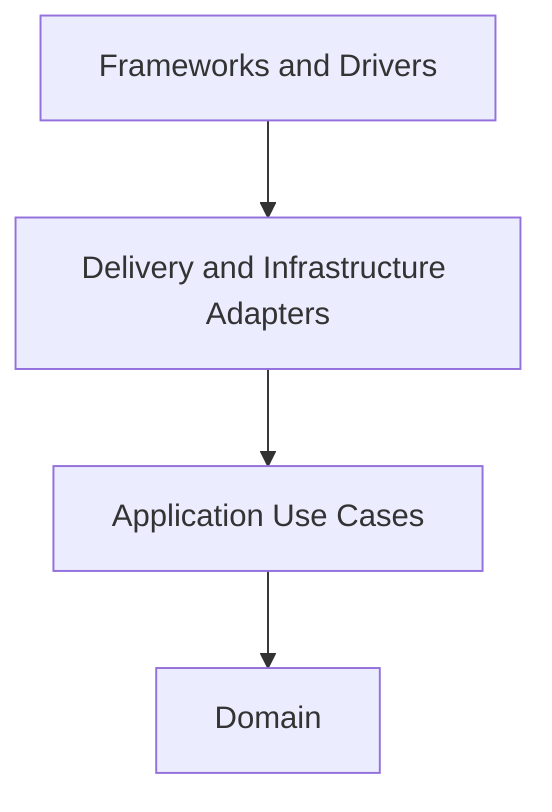

# API Server Architecture Spec

本文件是 `api-server` component 的 Clean Architecture constitution。Root
architecture spec、shared glossary 與 provider-owned API contracts 同時適用；
本文件不得覆蓋它們。

## Component Boundary

`api-server` 是 swallow 唯一 API provider，負責：

- HTTP REST API、authentication 與 authorization。
- Swallow-owned desired state、policy、stable identity mapping 與 observed-state projections。
- Provisioner／Platform／monitoring reconciliation 與 query adapters。
- Durable Workflow orchestration（Workflow executor port；目前的 adapter 是 Temporal）。
- Versioned host automation content（目前是 Ansible）與 execution attempts。

上位模型與結構以 root 的 [`desired-state-model.md`](../../../docs/development/desired-state-model.md)
與 [`core-and-extensions.md`](../../../docs/development/core-and-extensions.md) 為準；本文件描述它們在
`api-server` 內的分層與實作限制。

`dashboard` 與 `cli` 是 conformist HTTP consumers，只能透過 published
contract 整合。`api-server` 不發布 HTTP 以外的 public protocol。

## Runtime Topology

同一個 `swallow-api` binary 提供四個 process role：

- `api` — HTTP delivery、queries、reconciliation loops 與 Workflow start/control。
- `worker` — Temporal Workflow definition 與 activities。
- `ansible-executor` — 執行 idempotent Ansible attempt、保存 artifacts、發布 events。
- `migrate` — service startup 前的 explicit migration。

Workflow executor port 目前唯一的 adapter 是 Temporal。API process 不執行 in-process
fallback。完整 execution topology 還需要 Temporal Server/PostgreSQL、MongoDB、
worker 與 ansible-executor。

desired state 的 controller（desired-state-model.md §7）在 worker process 執行，不在 API process。

部署假設（2026-10-31 決定）：

- swallow 是 standalone 安裝，不支援多節點；但設計不得堵死多節點：正確性不依賴 process 內的記憶體狀態，
  背景工作以 store 中的 lease 保證同時只有一個 active instance，store 不存主機上的絕對路徑，對外部系統的呼叫是
  idempotent。
- 遇到取捨時以 standalone 的簡單為優先。
- 整機遷移（主機故障後，以備份在另一台主機還原）是一級情境，優先於多節點：所有狀態都要在備份範圍內。

## Dependency Rule

Source dependencies 只能向內：



- `internal/core/<context>/domain` 定義 entity、value、invariant、domain error 與
  inner-owned port。不得 import Fiber、MongoDB、Temporal、Ansible、provider SDK
  或 config，也不得含有廠商或產品專屬的詞彙、型別與常數（例如 MAAS 的 port、狀態碼或
  chain URL）；這些屬於 provider adapter。
- `internal/core/<context>/application` 實作 use case，協調 domain 與 port。不得
  import delivery 或 adapter。
- `internal/core/<context>/delivery` 將 HTTP transport 映射到 use-case input/output。
- `internal/adapters/<port>/<adapter>` 實作 core 的 port：MongoDB store、MAAS、Temporal、Ansible、
  Prometheus/Alertmanager、Redfish、libvirt 等。
- `modules/` 放擴充模組的 Go 程式碼與 host automation 內容（目前的 Go 程式碼是 Kubernetes／Slurm API client
  與 Docker Engine client）。
- `internal/app` 是 composition root，可組合 core、adapter、模組、loops 與 runtime
  process。
- `cmd/swallow-api` 只負責 Cobra command、signal/context、config load 與啟動。

內層不能接受 `*fiber.Ctx`、`bson.M`、Mongo cursor、Temporal activity context、
Ansible event、provider SDK response 或 YAML node。

## Layout

依 root 的 [`core-and-extensions.md`](../../../docs/development/core-and-extensions.md)，`api-server` 的程式碼分成
core、provider adapter 與擴充模組三部分：

```text
api-server/
├── cmd/swallow-api/  config/
├── internal/
│   ├── core/                        # 不含廠商、產品、平台或 GPU 廠商的知識
│   │   ├── store/                   # store port：Transactor、AfterCommit
│   │   └── <context>/domain|application|delivery
│   ├── adapters/                    # 依 provider interface 分組
│   │   ├── store/mongodb/           # client、topology 檢查、Transactor；<context>/ 各 context 的 repository；migration/
│   │   ├── osprovisioning/maas/
│   │   ├── executor/temporalworkflow/
│   │   ├── hostautomation/ansible/
│   │   ├── metrics/promstack/
│   │   ├── bmc/redfish/
│   │   ├── hypervisor/libvirt/
│   │   ├── hostaccess/sshaccess/    # Ansible 之外直接 SSH 到 host（Server Default User、Hypervisor）
│   │   ├── bootiso/genfsimg/
│   │   ├── keys/openssh/
│   │   └── events/memory/           # process 內的 Server 事件
│   ├── shared/                      # 無業務規則的共用 helper
│   └── app/                         # composition root
└── modules/                         # host automation 的內容根目錄（ansible-runner project dir）
    ├── manifest.json                # release 的 playbook allowlist，路徑相對於 modules/
    ├── platform/kubernetes/  platform/slurm/
    ├── platform/platformapi/        # Kubernetes 與 Slurm 模組暫時共用的 API client
    ├── accelerator/amd/
    ├── software/<kind>/
    └── shared/                      # 跨模組共用的 playbook 與 role
```

- **core**：`<context>` 是現在的 feature slice（site、server、provisioning、workflow、platform、software、sshkey、
  auth、apikey、infrastructure、monitoring、overview、discovery），各自保留 domain、application、delivery 三層。
  Delivery（HTTP）屬於 core，因為它是 swallow 自己發佈的契約。core 不得 import `internal/adapters` 或
  `modules`。
- **adapters**：依它實作的 provider interface 分組；只依賴 core 的 port 與外部 SDK，不得 import 其他 adapter
  或模組。Mongo repository 依 context 放在 `store/mongodb/<context>`，schema migration 放在
  `store/mongodb/migration`。
- **modules**：一個模組一個目錄，Go hook 與 manifest、host automation 內容放在一起；只經由模組契約依賴 core，
  不得 import adapter 或其他模組的內部程式碼。playbook 放在模組的 `playbooks/`、role 放在模組的 `roles/`；
  `modules/` 本身就是執行時的內容根目錄（安裝在 `/opt/swallow/automation/modules`），每次執行只看得到 playbook
  所屬模組與 `shared/` 的 role（`ANSIBLE_ROLES_PATH`）。
- **`internal/app`**：唯一可以同時看到 core、adapter 與模組的地方。

依賴方向由 `tests/layout_test.go` 的 import 檢查守住，隨 `go test ./...` 執行，只檢查非測試檔：

- `internal/` 底下只有 `core`、`adapters`、`shared`、`app`。
- core 不得 import `internal/adapters`、`internal/app`、`modules`、`config`、`bootstrap`，也不得 import MongoDB、
  Temporal 或 `golang.org/x/crypto/ssh`；Fiber 只出現在 delivery。domain 不得 import application 或 delivery，
  application 不得 import delivery。
- adapter 不得 import 其他 adapter、`internal/app` 或 `modules`；同一個 adapter 根目錄
  （`internal/adapters/<port>/<adapter>`）底下的 package 可以互相 import。
- 模組只依賴 core、`internal/shared` 與自己的 package，不得 import adapter、`internal/app` 或其他模組。
- `internal/shared` 不得 import core、adapter、`internal/app` 或 `modules`。

新增的 import 違反上述規則時應修正依賴方向（例如把 port 或常數移到 core），不得放寬檢查。

## Feature Slices

`internal/core/<context>` 的主要 vertical slices 包含：

- `auth` — Session（password login、refresh token 換發與重用偵測、logout）與 current identity；
  只存 refresh token 的 SHA-256 hash（decision 042）。
- `apikey` — User 的 API Key（只存 SHA-256 hash 與顯示前綴）及每個請求的 key 驗證；owner 經
  `OwnerDirectory` port 由 `internal/app` adapter 對接 auth 的 user store（decision 042）。
- `site`／`infrastructure` — Sites、Integrations、Zones、Pools。
- `server` — stable Server projection 與 event stream。
- `provisioning` — OS provisioning port、images、templates、tags、network、deploy/release/recovery（MAAS adapter 在
  `internal/adapters/osprovisioning/maas`）。
- `platform` — Kubernetes／Slurm deployment policy、credentials、membership、live APIs。
- `software` — Managed Software catalog、Assignments 與 lifecycle intent。
- `sshkey` — SSH Keys（Deployment Key 與 Access Keys）、provisioner 同步；Deployment Key 由安裝步驟
  `swallow-api deployment-key ensure` 建立（API 啟動不建立也不檢查），workflow 經 `DeploymentKeySource`
  port 取得、OS／Platform 佈署受理前檢查其存在（decision 039）。
- `workflow` — Workflow/Job/Task domain、execution records 與 artifacts（型別與 collection 沿用先前的 Operation
  名稱；runner 在 `internal/adapters/hostautomation/ansible`）。
- `monitoring`／`overview`／`discovery` — read models 與 external live queries。

Schema／data evolution 在 store adapter 的 `migration`。Context 之間不得 import 對方的 adapter；cross-context
coordination 透過 application port 或 `internal/app` adapter 組合。

認證由 `internal/shared/middleware` 的 `Authenticator` 統一處理：access JWT 與 API Key 都轉成
framework-free 的 `internal/shared/identity.Principal`，handler 只透過 `GetPrincipal` 讀取呼叫者，
不分辨 credential 類型（`SessionOnly` 是唯一例外，用於禁止以 API Key 建立 API Key）。

## Data Crossing Boundaries

- Delivery 先 parse／validate HTTP request，再轉成 application input。
- Application/domain 回傳 stable inner type，由 delivery shape response 與 status。
- Adapter 將 Mongo document、provider response、Temporal payload、Ansible event
  映射成 inner type。
- Persistence document 與 API DTO 不得直接成為 domain entity。
- Shared wire helpers（timestamp、pagination、API error）只承載 cross-feature
  transport concern，不承載 feature business rule。

## Ports and Dependency Inversion

Port 由內層需要的能力驅動，應小而精確。例如 repository、clock、ID generator、
provider capability、Workflow starter 或 metrics query。外層實作 port，再由
composition root 注入。

Interface 不用來包裝每個 concrete type；只有需要保護 boundary、替換 driver
或隔離測試時才建立。

## Provider Ownership

所有權以 root 的 [`desired-state-model.md`](../../../docs/development/desired-state-model.md) 為準：

- Swallow 擁有受管資源的 desired state（spec），store 是唯一真相來源；provider adapter 只寫入 observed
  state（status），帶來源 Integration 與觀察時間，永遠不寫 desired state。
- 每個欄位只有一個寫入者：spec 由 API 或擁有它的上層資源寫入，observed 由 adapter 的觀察路徑寫入，
  conditions 由該資源的 controller 寫入。
- provider 沒有能力實現某個欄位時回報 `realized=false`（reason `capability_missing`），不再建立同形狀的
  swallow-owned fallback（decision 069 取代 decision 031）。
- metrics、alert 評估、workload 排程與 Platform 內部的資源仍由各自的系統擁有，只即時讀取。

尚未遷移的功能維持現行行為（包括 capability-first fallback 與 Provider Data Overlay），以各功能規格為準；
修改它們的所有權或收斂行為時，依上述規則重做該部分。

## Provider Adapter Boundary

依 root 的 [`core-and-extensions.md`](../../../docs/development/core-and-extensions.md)：

- Provider interface（port）由 domain 或 application 層以 core 的詞彙定義；adapter 位於
  `internal/adapters/<port>/<adapter>`，負責把廠商的狀態碼、ID、預設值與錯誤翻譯成 inner type。
- Adapter 的識別碼（provider kind、`RunnerKind` 的值）在 domain 與 use case 中只是不透明的資料；
  已持久化或已在 API 上的值維持不變。行為依 adapter 宣告的 capability 決定，不依識別碼分支。
- 平台專屬（Kubernetes、Slurm）與 GPU 廠商專屬（AMD）的邏輯屬於擴充模組，不得新增到 core 的 feature
  slice 或 `internal/app`；現有的越界列在 core-and-extensions.md §3.6，修改時不得擴大。

## Durable Workflow Boundary

- Workflow 的語意與狀態由 swallow 擁有、存在 store；Temporal 只是 Workflow executor adapter，它的型別與
  概念不得越過 `internal/adapters/executor/temporalworkflow`（見 desired-state-model.md §9）。
- Application 建立 intent 與 durable Workflow record，不直接長時間 block HTTP request。
- Temporal Workflow code 必須 deterministic；I/O、clock、randomness、provider call
  與 Mongo write 留在 activity。
- Activity 使用 idempotency key，並安全處理 replay/retry。
- Site/resource lease 保護 conflicting work；lock gate 在 application boundary 執行。
- Ansible executor 只接受 manifest allowlist 內的 playbook，credential 經 write-only
  secret boundary 傳遞，event/artifact 不得洩漏 secret。
- 無法證明 external side effect 的 expired run 變成 `indeterminate`，不得自動 retry。

## Store and Transaction Boundary

依 root 的 [`desired-state-model.md`](../../../docs/development/desired-state-model.md) §10：

- MongoDB 必須以 single-node replica set 執行；每個 process role 啟動時檢查 store 支援 transaction 與
  change stream，不支援時拒絕啟動。
- 跨文件的不變式（例如 Platform 與其 Server 上的 Platform Claim）必須在同一個 transaction 內完成。
  Application 透過 transaction port 表達交易範圍，不 import driver 的 session 型別。
- Transaction callback 不得有外部 I/O（provider、HTTP、Temporal、檔案），而且必須可以重跑。需要 provider 資料的
  use case 先在 transaction 外 prepare（例如 `DeploymentLauncher.PrepareDeployment`），再在 transaction 內 persist。
- Repository 方法在 transaction 內不得於寫入被拒後繼續操作（例如「insert，duplicate key 時再 find」）：MongoDB 會中止
  transaction，之後的操作以 transient 錯誤失敗，driver 重試整個 unit 直到逾時。冪等寫入改用 `$setOnInsert` upsert 之類
  的單一條件式寫入。
- 事件（包括 SSE 的 Server 事件）在 commit 之後才發布；跨 process 的變化以 change feed port 取得。
- `bson`、Mongo update operator、change stream resume token 只出現在 store adapter。
- Application tests 使用 `internal/core/store/storetest` 的 fake Transactor，驗證 use case 在 transaction 內寫入，
  以及事件只在成功後發布；記憶體 fake 無法 rollback，所以「失敗時沒有任何寫入」由 replica set 上的 store adapter 整合測試
  驗證。

Platform deploy 受理、Platform Delete、CompleteUninstall、Workflow 建立與 rerun、GPU Operator 變更與 Software
install／uninstall 已是 transaction。其餘仍以補償或修復 sweep 維持一致的流程（Temporal activity 的投影寫入、和
provider 交錯的流程）是待遷移的現況，不得當成新功能的範例。

## Configuration Boundary

`config` package 是唯一 file/env/flag/default merge owner。Priority 為 environment、
flag、file、default。Validation 在 merge 後執行。

下層 package 不得讀 `os.Getenv` 或 Cobra flag。Composition root 只將最小所需
configuration 傳入 adapter/use case。Credential key、JWT、machine token、
Temporal、artifact path、retention、parallelism 等 security/lifecycle semantics
必須有維護性註解。

## Error Boundary

- Domain/application 回傳具有業務語意的 error，不暴露 driver error。
- Adapter 將 Mongo/provider/Temporal/Ansible error 翻譯為 inner error。
- Delivery 透過 shared API error mapping 產生 contract-defined status、code、
  message 與 request ID。
- Error message 給人閱讀；consumer 只能對 code 分支。

## Testing

- Domain unit tests 不需要 MongoDB、HTTP、Temporal 或 provider。
- Application tests 使用 fake ports，涵蓋 invariant、conflict、rollback/recovery。
- Delivery tests驗證 request/response mapping、auth、status 與 error envelope。
- Adapter tests 驗證 mapping、Mongo uniqueness、provider capability 與 runner behavior。
- Temporal tests需涵蓋 deterministic replay、worker restart、activity retry/cancel。
- Cross-layer tests 放在 `tests/`；unit tests 與 source 同 package。

若核心規則只能靠 live external system 驗證，代表 boundary 需要重構。

## Prohibited Designs

- Domain/application import outer framework 或 concrete adapter。
- Handler、repository、Temporal Workflow definition 或 playbook catalog 內散落 business rule。
- API behavior 沒有 Active contract。
- Consumer 依賴 private struct、Mongo document 或 implementation enum。
- 在 API process 建立第二套 in-process Workflow execution engine。
- 直接執行未在 release manifest 登錄的 playbook。
- 將 credential、token、private key 或 become password 寫入 log/event/artifact。
- 以 hostname／IP 取代 opaque Server identity。
- 以 provider 為 desired state 的真相來源，或讓 provider adapter 寫入 desired state。
- 以補償（先寫再刪）或修復 sweep 取代 transaction。
- 在 core 的 feature slice 或 `internal/app` 新增平台（Kubernetes、Slurm）或 GPU 廠商（AMD、NVIDIA）專屬的邏輯。
- 在 domain 或 application 使用廠商或產品專屬的詞彙、型別、常數，或依 adapter 識別碼分支。

## Completion Gate

任何 code change 必須：

1. 先確認 glossary 與 Active API contract。
2. 保持 dependency direction、provider ownership 與 provider adapter boundary。
3. 執行 `gofmt -l .`、`go vet ./...`、`go test ./...`、`go build ./...`。
4. 依 coding style 手動檢查 changed Go files 的 comments、security、concurrency、
   cleanup 與 compatibility。
5. 同步更新 contract、glossary、architecture、tests 與 public docs（若 user-visible）。
