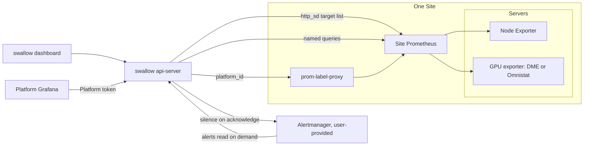

# 003 — Monitoring Topology and the Metrics Label Contract

- Status: Accepted
- Date: unrecorded (predates the ADR template)
- 現行規格：`docs/development/monitoring.md`

> **Terminology note:** swallow's managed runtime aggregate is a Platform
> ([decision 015](015-platform-term-disambiguation.md) (platform term disambiguation)); no metric carries a
> `cluster` label, and the `clusterId` alias of `platformId` was removed
> ([decision 074](074-retire-schema-v2-and-deprecated-aliases.md) (retire schema v2 and deprecated aliases)).

## Decision

**Infrastructure metrics are collected once, by one swallow-managed Prometheus per Site, and read by
everything that displays them; each Platform reads only its own members' series.**

- **One Prometheus per Site.** swallow installs and manages a Prometheus for each Site and registers
  it as the Site's metrics Integration (at most one per Site). It scrapes every exporter of its Site
  and nothing else. How a second Site's Prometheus is deployed is not decided; swallow resolves a
  Server's metrics through the Site it belongs to and never assumes one global store.
- **swallow serves the target list.** One Prometheus `http_sd` endpoint returns the exporters swallow
  knows are installed — a Software Assignment or a Platform setting says so — each target already
  labelled with the contract below. The modules that provide an exporter declare its name and port,
  so a new exporter needs no scrape-configuration change and the core names no product.
- **Three tiers.** Basic monitoring is the Node Exporter, installed by OS provisioning on every
  Server swallow deploys and kept through a Platform uninstall. GPU monitoring is installed only where
  there are GPUs and depends on the context: a standalone Device Metrics Exporter (DME) as Managed
  Software, the DME an AMD GPU Operator manages on a Kubernetes Platform, or Omnistat (the default)
  or the DME on a Slurm Platform. AI NIC monitoring will take the same shape as GPU monitoring. A
  CPU-only Server or Platform is fully supported: nothing in the basic tier depends on a GPU.
- **Display many, read one.** swallow's dashboard reads the Site Prometheus for every Server's basic
  metrics and health. Each Platform may have its own Grafana showing its complete monitoring; it
  reads the same Prometheus through swallow's gateway and
  [prom-label-proxy](https://github.com/prometheus-community/prom-label-proxy), which force every
  query to the Platform's `platform_id`.
- **No exporter ownership policy.** With the Node Exporter always installed by OS provisioning, a host
  never has a second node exporter, and the GPU exporter follows the context above; the per-Platform
  exporter owner and the Kubernetes exporter DaemonSets are retired.

## Context

Three problems, all caused by more than one thing wanting to monitor a host.

**Who collects.** If the exporters are scraped only by each Platform's own Prometheus, swallow sees no
monitoring data; if swallow's Prometheus and a Platform's both scrape them, the datacenter stores
everything twice, with two exporters contending for a port when each side installs its own.

**How exporters get installed.** Exporters arrived through every path: Platform features (the GPU
Operator, Omnistat, a Kubernetes DaemonSet), Ansible, and Managed Software, each scraped by a
different Prometheus or by none.

**The join.** swallow's value is correlation, and correlation needs a key. A metric that says
`instance="10.0.1.10:9100"` cannot be attached to a server whose IP is an observed, mutable,
non-unique attribute ([002](002-server-identity.md)). Without a stable label carrying swallow's
`serverId`, every screen that wants "this server's temperature" has to guess.

## Topology

The basic tier exists independently of any Platform, because burn-in and acceptance testing happen
before a Platform does. A freshly provisioned server has to be observable while it is still a spare,
and it stays observable after its Platform is uninstalled.

### Alerts are read, not received

swallow **reads** alerts from a user-provided Alertmanager's API on demand and stores none; a webhook
receiver would have to keep a copy of state Alertmanager owns
([069](069-swallow-owns-desired-state.md)). Correlation to a server happens at query time from the
label set. Acknowledging an alert creates an Alertmanager silence, so the acknowledgement is visible
to the alerting pipeline itself. The cost is no alert history; swallow ships no Alertmanager and no
alert rules.

## The Label Contract

### Labels on every target

| Label | Value | Why |
|-------|-------|-----|
| `server_id` | swallow `serverId` | The join key; never a hostname or address |
| `site` | swallow `siteId` | Which Site's Prometheus collected it |
| `platform_id` | The Platform of the Server's Platform Claim; absent when there is none | Tenancy: prom-label-proxy filters on it |
| `exporter` | The declared exporter name, for example `node-exporter` | Several exporters on one Server |

swallow attaches all four because it serves the target list; the identity mapping and the scrape
configuration come from the same place, so the join key cannot be wrong.

`platform_id` comes from the **Platform Claim**, the record swallow writes with the Platform, not
from the membership observed in the cluster: tenancy must not change when a cluster is briefly
unreachable. The label is taken at scrape time, so a Server's series from while it belonged to a
Platform stay that Platform's after it leaves.

### Cardinality rules

- Do not add labels beyond this contract to identify a server. Rack, owner, GPU model, Pool, and
  Zone are swallow attributes, joined at query time, not metric labels. They change for reasons
  unrelated to the metric and would fragment series history on every change. `platform_id` is the
  one exception, because tenancy has to be enforced on the series themselves.
- `instance` stays whatever the scrape produces. It is a scrape detail, not an identity.
- A label added to metrics is effectively permanent. Adding one to this contract is a decision
  document, not a config change.

### How swallow queries

swallow's own API exposes **named, parameterised queries** — current values and bounded ranges for a
fixed set of metrics — not an arbitrary PromQL passthrough. A passthrough would make swallow
responsible for query cost it cannot predict and let a client trigger a fleet-wide high-cardinality
scan through an authenticated API.

The Platform gateway is a passthrough, deliberately: it serves a Platform's Grafana, the exploration
tool, and prom-label-proxy confines every query to that Platform's own series, so its cost is bounded
by the Platform's size. It accepts only read paths (the query APIs and `/federate`) and a token that
belongs to that one Platform.

Product-specific metric names stay out of the core: the named queries live with the metrics adapter,
and GPU metrics return to swallow's own screens only as a few common metrics (utilisation,
temperature, busy) mapped from each GPU exporter's declaration.

## Built-in usage charts

A user who deploys a Server through swallow can see how much of it is used **without leaving
swallow**. swallow exposes a bounded, named range query beside the instant one (contract
`server-metrics.md`): the window is at most 7 days, swallow chooses the step (about 180 points), and a
scope resolves to at most 1000 Servers. Each named query declares how Servers combine — utilisation
and fill levels average, throughput and power sum, temperature takes the maximum — so a client cannot
choose a misleading aggregate.

A chart's scope is explicit Servers, or a Pool, Zone, or Platform, resolved to its **current**
members' `server_id`s when the request is served; history follows current membership, the same trade
the label rules make for rack and tenant.

## The `gpuStackOwner` Policy

Both OS provisioning and a GPU Operator can own a Server's GPU driver, and they cannot coexist on one
host, so each Platform declares which one wins (`provisioning` or `gpu-operator`). With
`gpu-operator`, the operator also runs the GPU exporter (the DME) inside the cluster; swallow
configures it to use the host network on the DME's port so the Site Prometheus scrapes it like any
other exporter. `gpuStackOwner` follows the GPU Operator feature
([062](062-swallow-managed-gpu-operator.md)).

## Consequences

- swallow implements one Prometheus `http_sd` endpoint for the exporters it knows are installed, with
  the four labels attached; a Server without a Node Exporter target is never `down`: its health is
  `unknown` when swallow's Node Exporter policy covers it and `not_applicable` otherwise.
- Each Site's Prometheus is part of what swallow installs and upgrades, alongside prom-label-proxy.
- swallow stores no metrics. GPU inventory comes from the provisioner and telemetry from the Site
  Prometheus.
- A Platform's own Prometheus, if one is offered later, scrapes only workload metrics; infrastructure
  series reach it through the gateway's `/federate` or a second Grafana datasource, never by scraping
  the exporters again.
- A central store across Sites (Thanos, Mimir, VictoriaMetrics) is left to the multi-site design;
  nothing here depends on it.

## Rejected Alternatives

**Each Platform scrapes its own members' exporters.** Self-contained Platforms, nothing for swallow to
run. Rejected because swallow then sees nothing for Servers in a Platform and nothing for spares, and
a fleet question fans out to every Platform's Prometheus, inheriting the slowest.

**Both swallow and each Platform scrape the exporters.** Everyone has their own data. Rejected because
every series is stored twice and two parties install exporters on the same ports.

**One Prometheus scraping every Site.** One place to query. Rejected because it assumes flat network
reachability from one scraper to every host across Sites, and makes that scraper a single point of
failure for all monitoring.

**prom-label-proxy without swallow in front.** Simpler wiring. Rejected because the proxy
authenticates nobody: whoever reaches it chooses the label value and reads any Platform.

**`platform_id` from the observed membership.** It is what the cluster reports. Rejected because
tenancy would follow a reading that is stale or missing whenever the cluster is unreachable.

**Store a `server_id` label by writing it from provisioning into the Node Exporter textfile
collector.** Puts the identity on the host. Rejected because every metric's identity would depend on a
file written once, with no correction path, while `http_sd` keeps the mapping live.

**Arbitrary PromQL passthrough in swallow's own API.** Maximum frontend flexibility. Rejected:
unbounded query cost through an API swallow is responsible for.

**Grafana embedded panels as the primary chart UI.** It would make Grafana mandatory for basic
visibility and couple the dashboard to Grafana's authentication and version.

## Related

- [002 — Server Identity](002-server-identity.md)
- [062 — swallow-managed GPU Operator](062-swallow-managed-gpu-operator.md)
- [063 — Omnistat Slurm observability](063-omnistat-slurm-observability.md)
- [068 — Device Metrics Exporter as Managed Software](068-device-metrics-exporter-managed-software.md)
- [069 — swallow owns desired state](069-swallow-owns-desired-state.md)
- Glossary: Monitoring Link, Platform Claim, Site

## Revision history

- unrecorded: decided the monitoring topology, the metrics label contract, and that alerts are read from Alertmanager rather than received.
- 2026-08-27: added switchable exporter ownership and the AMD RDC exporter.
- 2026-10-12: added built-in usage charts, Monitoring Links, and runtimes that bring their own monitoring.
- 2026-11-02: referred to the people who use swallow as users instead of operators; the decision is unchanged.
- 2026-11-03: the `ansible` owner's host exporter became the Node Exporter package installed as Managed Software, changing the owner policy installs or removes nothing, and swallow stopped installing the RDC exporter on hosts.
- 2026-11-03: monitoring v2: one swallow-managed Prometheus per Site collects every exporter swallow knows is installed, `platform_id` from the Platform Claim with prom-label-proxy tenancy for Platform Grafanas, three monitoring tiers with GPU monitoring per context, and exporter ownership retired; the central store is left to the multi-site design.
- 2026-11-04: a Server without a Node Exporter target reads health `unknown` when the Node Exporter policy covers it and `not_applicable` otherwise; the label contract and topology are unchanged.
