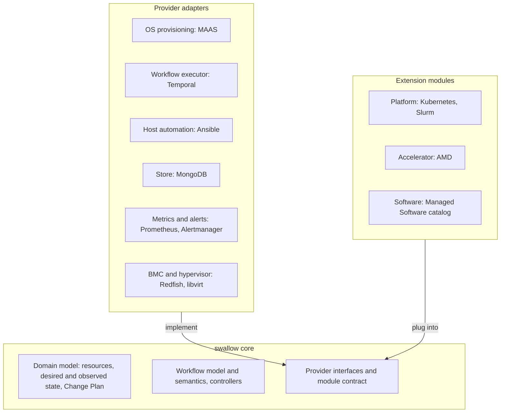

# Core、Provider Adapter 與擴充模組設計與規範

本文件定義 swallow 的**大尺度結構**：哪些東西是 core、外部系統如何以 provider adapter 接入、swallow 能管理的
東西如何以擴充模組加入，以及這三者之間的契約。所有新的外部系統、新平台、新 GPU 廠商與新軟體都必須遵守。

> **本文件不重述決策**：為什麼採 ports and adapters、為什麼把 Accelerator 獨立成一個維度、為什麼模組分三階段，
> 見 [decision 070](../decisions/070-core-providers-and-extensions.md)。資源的所有權與收斂規則見
> [desired-state-model.md](desired-state-model.md)（[decision 069](../decisions/069-swallow-owns-desired-state.md)）。

> **目標結構與現況**：本文件描述目標結構。現有程式碼仍有越過邊界的地方（§3.6），遷移在各自的計畫中進行；
> 新的程式碼必須依本文件放置，修改既有程式碼時不得讓越界的情況擴大。

---

## 1. 目的與適用範圍

- **讀者**：新增外部系統整合、Platform、GPU 廠商支援或 Managed Software，或判斷一段程式碼該放在哪裡的
  開發者與 AI agent，包括從團隊外部加入、在本 repository 共同開發模組的貢獻者。
- **判斷新程式碼的位置**：
  1. 它在說「swallow 能管理什麼」（某個平台、某個 GPU 廠商、某個軟體）→ 擴充模組（§4）。
  2. 它在說「怎麼和某個外部系統溝通」（某個產品的 API、狀態碼、ID 格式、錯誤）→ provider adapter（§3）。
  3. 兩者都不是 → core（§2）。
- 一段程式碼同時屬於兩類時，先拆開；例如「Slurm 需要 AMD GPU 的 GRES 設定」是 Platform 模組向 Accelerator
  模組要資料（§5.4），不是 core 的分支。

## 2. Core 的內容

core 只包含：

- 資源模型、desired 與 observed state、controller 框架、Change Plan（見 [desired-state-model.md](desired-state-model.md)）。
- Workflow 的模型與語意：Workflow／Job／Task、attempt、重試、取消、fencing、等待 operator（目前的行為見
  [workflow-execution.md](workflow-execution.md)）。
- **開發原則：deployment 以宣告式定義開發，Workflow 是實際的執行者。** 一個 Workflow 是一份完整的執行計畫——
  Job、Task、依賴、重試粒度、完成行為、取消補償、目標與資源——engine 只依宣告執行，不認得任何 Workflow kind 或
  Task kind（[workflow-execution.md](workflow-execution.md) §12）。新增一種 deployment 只需要產生這份計畫與它需要
  的 handler，不修改 engine。
- 各類 provider interface 與模組契約。
- 身分與認證、Site 與 Integration 的登錄、監控關聯（把 metrics 接回 Server 的身分對應）。

core **不得**含有任何廠商、產品、平台或 GPU 廠商的名稱、型別、常數或知識，也不得依它們分支。

## 3. Provider interface 與 adapter

### 3.1 類別與目前的 adapter

| provider interface | 目前的 adapter | adapter 位置（api-server） | 註冊方式 |
| --- | --- | --- | --- |
| OS provisioning | MAAS | `internal/adapters/osprovisioning/maas` | Site 的 `provisioner` Integration |
| Workflow executor | Temporal | `internal/adapters/executor/temporalworkflow` | 安裝層級，由 composition root 選擇 |
| Host automation | Ansible（`ansible-runner`） | ansible executor process 與其 Workflow 端 | 安裝層級；內容來自 release 的 manifest |
| Store | MongoDB | 各 feature 的 `infra` repository | 安裝層級，由 composition root 選擇 |
| Metrics 與 alerts | Prometheus、Alertmanager | `internal/adapters/metrics/promstack` | Site 的 `metrics` Integration |
| BMC 與 hypervisor | Redfish、libvirt | `internal/adapters/bmc/redfish`、`internal/adapters/hypervisor/libvirt` | 依 Server（連線資料由 provisioner 提供，或以 Deployment Key 經 SSH 連到 Hypervisor） |

Platform 執行環境的即時讀取（Kubernetes API、slurmrestd）與 Docker Engine 的即時管理不是 core 的 provider
interface，而是 Platform 模組與 Software 模組提供的能力（§4）。

### 3.2 port 由 core 定義

- port 以 core 的詞彙表達：OS Provisioning State、Deploy Target、Machine、Node Role 等，不用任何產品的名稱或值。
- port 的方法與資料型別放在 core 的 domain 或 application 層；adapter 依賴 port，port 不依賴 adapter。
- 一個 port 可以由一個必要介面加上數個選用的 capability 介面組成（現有的 `OSProvisioningProvider` 與
  `ProviderCapabilities` 就是這種形狀）。

### 3.3 adapter 負責翻譯

- adapter 是 anti-corruption layer：廠商的狀態碼、ID 格式、錯誤、預設值與生命週期語意，在 adapter 內翻譯成
  core 的詞彙，不得越過 adapter。例如 MAAS 的 `Commissioning` 在 adapter 內對應為 `inspecting`；MAAS rack 的
  開機 port 與 chain URL 只存在 MAAS adapter。
- adapter 的錯誤分成暫時性、永久性與缺少能力三類回報，不把原始錯誤字串當成對外的訊息。
- adapter 只回報 observed state，永遠不寫 desired state（見 [desired-state-model.md](desired-state-model.md) §8）。

### 3.4 識別碼與 capability

- adapter 的識別碼（例如 provider kind `maas`）在 core 中只是不透明的資料，用來選擇 adapter。core 不得以
  `if kind == "maas"` 這類方式分支。
- 已持久化或已在 API 上的識別碼值維持不變，例如 `RunnerKind` 的 `maas` 與 provider kind 字串；遷移只改變 core
  對它的解讀方式，不需要資料遷移或契約變更。
- 每個 adapter 宣告自己的 capability；core 依 capability 決定行為，從不依 adapter 名稱決定。

### 3.5 註冊

- 需要連線設定的 adapter 以 [Integration](glossaries/terms/integration.md) 註冊到某個 Site；Integration 就是
  「某個 adapter 在某個 Site 的一筆註冊」。哪些 provider kind 可以扮演哪一種 Integration，由 adapter 的註冊
  提供，而不是寫死在 core 的對照表。
- store 與 Workflow executor 是安裝層級的 adapter，整個安裝只有一個，由 composition root 選擇。

### 3.6 現有的越界（遷移時處理）

- Boot ISO 的 domain 程式包含 MAAS rack 的預設 port、chain URL 與 iPXE／GRUB 範本。
- Workflow 的 domain 有 Ansible 專屬的執行模型，`RunnerKind` 以產品命名（`ansible`、`maas`）。
- Site 的 domain 定義 provider kind 常數與 Integration 種類的對照。
- 平台與 AMD 專屬的模型與流程位於 `internal/core/platform` 與 `internal/app`（§4）。

Temporal 已經只出現在 adapter 與 composition root，是邊界的參考範例。

### 3.7 一致性測試

每個 port 都有一組 adapter 一致性測試，描述 core 對該 port 的期待（例如不支援的 capability 要怎麼回報、
暫時性錯誤要怎麼分類）。新的 adapter 必須通過同一組測試。

## 4. 三種模組

### 4.1 Platform 模組

一種受管 runtime（目前是 Kubernetes 與 Slurm）。提供：

- Platform spec 的 schema、拓樸與 Node Role。
- 部署、uninstall 與 day-2 作業的 Job／Task 組合。
- 狀態讀回：membership、連線狀態、功能狀態（例如 GPU Operator State），以及執行環境的即時讀取。
- 需要向 Accelerator 模組取得的資料，以及要組入的 Software 模組。

### 4.2 Accelerator 模組

一個 GPU 廠商（目前是 AMD，之後是 NVIDIA），是與 Platform 分開的第二個維度。提供：

- GPU 分類（compute 或 display）與 Server Type 的判斷依據。
- driver 的處理與可用性驗收。
- 監控 exporter。
- 給 Platform 模組的 hook，例如 Slurm 的 GRES 設定、Kubernetes 的 GPU Operator。

### 4.3 Software 模組

單一軟體及其 variant 的安裝與卸載，也就是 [Managed Software](glossaries/terms/managed-software.md)。可以單獨
安裝在 Server 上，也可以由 Platform 模組以 Job 組入（見 [software-deployment.md](software-deployment.md)）。

## 5. 模組契約

### 5.1 manifest

每個模組以一份 manifest 宣告自己，內容包含：

- 種類（Platform、Accelerator、Software）、id、版本，以及**契約版本**。
- spec schema 與功能開關。
- Job／Task 範本。
- 狀態規則：如何從 observed 推導 conditions 與功能狀態。
- 需要的 provider capability。
- Platform 模組：相容的 Accelerator 模組；Software 模組：互斥或相依的其他軟體。

manifest 是資料；core 以讀取 manifest 的方式載入模組，契約版本不相容時拒絕載入。

### 5.2 host automation 內容

host automation 內容（目前是 playbook）以「內容類型＋參照」宣告，由對應的 host automation adapter 執行。
manifest 本身不假設內容一定是 Ansible。內容仍受 release 的 allowlist 管控（目前是
`api-server/modules/manifest.json`），不得來自可變的資料庫內容。

**改套件的內容必須暫緩 OS 的自動套件維護**（[decision 073](../decisions/073-hold-os-package-maintenance-during-automation.md)）：

- 任何會安裝、移除或更新套件、或刷新套件索引的 playbook，第一個 play 以共用 role
  `package_maintenance_hold` 在所有目標上取得 hold（`hosts: all`、`gather_facts: false`），最後一個 play
  以 `tasks_from: release` 釋放。hold 只在執行期間停止 apt-daily／unattended-upgrades 與
  dnf-makecache／dnf-automatic 的 timer，不停用也不 mask，也不中斷已在執行的升級，而是等它完成（逾時則
  `[package_maintenance_busy]`）。
- hold 是有期限的租約：預設 TTL 3 小時，release 之後再保留 10 分鐘，讓同一個 Workflow 接續的 Task 仍在
  hold 之內。期限到了，由 transient systemd timer 啟動 hold 停掉的 timer，所以失敗、被取消或遺失的執行最晚
  在 TTL 後歸還主機；同一台主機上並行的 Task 各自持有租約。
- hold 同時寫入 swallow 擁有的 `/etc/apt/apt.conf.d/50swallow-lock-timeout`（`DPkg::Lock::Timeout`），讓
  `apt-get` 遇到 swallow 以外的人持有 lock 時等待而不是立即失敗。Ansible apt module 的 `lock_timeout` 只涵蓋
  python-apt 自己的 lock，不涵蓋它接著執行的 `apt-get` 與 `dpkg`。
- 每個套件 task（`apt`、`dnf`、`yum`、`package`、會刷新索引的 `apt_repository`、執行 `apt-get`／`dpkg` 的
  command）仍要 `register` + `until: ... is succeeded` + `retries`，以涵蓋 mirror 的暫時性錯誤。
- `internal/adapters/hostautomation/ansible/package_hold_playbook_test.go` 依 manifest 與 role 閉包強制以上規則。

### 5.3 Go hook

- 只用於資料表達不了的邏輯，例如需要計算的 trusted variables 或 Platform 專屬的狀態解讀。
- 每個 hook 都要在模組中列出存在的理由；hook 清單是一致性測試的一部分（§9）。
- Go hook 編譯在 swallow 之內：第二階段的模組更新不能改變 Go hook，第三階段的外部套件不得附帶 Go hook（§10.2）。

### 5.4 模組之間的依賴

- Platform 模組透過 Accelerator 模組的 hook 取得 GPU 相關設定，不自己判斷 GPU 廠商。
- Platform 模組以 Job 組入 Software 模組，不巢狀啟動另一個 Workflow（與
  [software-deployment.md](software-deployment.md) 的規則相同）。
- 模組之間只經由契約互動，不 import 彼此的內部程式碼。

## 6. 與 desired-state 模型的關係

- Platform 是通用資源，它的 spec 由 Platform 模組的 schema 定義。
- controller 由 core 提供，在需要的地方呼叫模組的 hook，並只經由 provider interface 改變外部世界。
- 破壞性與非破壞性的分類（[desired-state-model.md](desired-state-model.md) §5）由模組在 manifest 中為自己的
  spec 欄位宣告，core 以此決定要直接收斂還是產生 Change Plan。

## 7. API 與 dashboard

- Platform API 是通用的，spec 由模組的 schema 定義。
- 第一方模組可以提供專屬的 dashboard 畫面；沒有專屬畫面的模組，由 dashboard 依 schema 產生通用的表單與詳情。
- API 與 UI 以 port 的概念呈現，不以 adapter 名稱作為使用者概念，例如呈現「provisioner」而不是「MAAS」。
  adapter 專屬的設定畫面（例如 MAAS Integration 的連線設定）是例外。

## 8. 支援矩陣與發行版

- 交付給客戶的是 core 加上一組驗證過的 adapter 與模組。
- **發行版組裝**：release 建置時依一份設定選擇要包含的模組，只複製被選入的模組目錄（加上 `shared/`），不改變
  目錄結構；執行時直接以這個模組根目錄作為 host automation 的內容根目錄，manifest 只登錄被選入模組的 playbook。
  每次執行只看得到該 playbook 所屬模組與 `shared/` 的 role。
- 每個 release 記錄一份支援矩陣：包含哪些 adapter 與模組、各自的版本，以及驗證過的組合（例如
  「Slurm 模組 × AMD 模組 × MAAS adapter」）。支援矩陣由發行版組裝的同一份設定產生，不另外手寫。
- 沒有列在支援矩陣中的組合不得對客戶宣稱支援。

## 9. 一致性測試

第一階段不偏離「可抽換、可外掛」形狀的守門機制：

- 每個 port 一組 adapter 一致性測試（§3.7）。
- 每個 repository 內的模組必須能只靠 manifest 與 host automation 內容載入；Go hook 以清單管理，清單之外的
  模組專屬 Go 程式碼視為違規。
- core 的套件不得 import adapter、模組或廠商 SDK，adapter 與模組也不得互相 import；由 `api-server` 的 import
  檢查守住（規則見 `api-server/docs/development/architecture-spec.md` 的 Layout，與 component 的 Clean
  Architecture 分層檢查是同一個測試）。

## 10. 演進階段與共同開發

### 10.1 第一階段：在本 repository 共同開發

團隊外部的開發者會加入本 repository，與團隊一起開發模組；他們不是依契約在 repository 之外獨立開發、獨立擁有模組。
第一階段因此要讓貢獻者不必先理解整個 core，就能安全地新增或修改一個模組：

- **一個模組一個目錄**：manifest、host automation 內容與 Go hook 放在同一個目錄
  `api-server/modules/<種類>/<id>/`，跨模組共用的內容放在 `api-server/modules/shared/`（登錄於
  [codebase-structure.md](codebase-structure.md)）。這個目錄本身就是模組的套件格式，第一階段不另外定義套件。
- **負責人**：每個模組目錄在 `.github/CODEOWNERS` 登錄負責人，review 依此分派；core、adapter 與共用的 role
  也各有負責人。
- **模組撰寫指南**：說明一個模組可以做什麼、不可以做什麼、如何測試與提交，放在 `docs/development/`（第一階段
  實作時建立）；公開的 `CONTRIBUTING.md` 可以連到它。
- **守門機制**：§9 的一致性測試與 import 檢查，讓越界在 CI 中失敗，而不是靠 review 才發現。
- **契約版本**：manifest 從第一天就帶契約版本，core 拒絕載入不支援的版本；相容性檢查等其他機制留給第二階段。
- **發行版組裝**：release 建置時依一份設定選擇模組，支援矩陣由同一份設定產生（§8）。

加入第三種 Platform 不是進入下一階段的條件，而是重新檢視模組契約是否夠通用的時機。

### 10.2 之後的階段（只記錄設計）

| 階段 | 內容 | 啟動條件 |
| --- | --- | --- |
| 第二階段 | 在一個安裝上管理模組生命週期：單獨啟用、停用或更新某個模組（不必升級 swallow）、core 與模組版本的相容檢查、模組的離線更新包。更新只涵蓋資料與 host automation 內容，Go hook 的變更仍需要升級 swallow | 客戶需要的模組組合或更新節奏和 swallow 的 release 不同 |
| 第三階段 | 模組由本專案以外的人獨立擁有：簽章與信任、套件不得附帶 Go hook、獨立 process 的 hook（webhook 或 gRPC） | 有本專案以外的人需要獨立於 swallow 的 release，自行開發並發佈模組 |

進入下一階段前，要先依本文件更新設計，並視需要寫新的 ADR。

## 11. 檢查清單

### 11.1 新增一個 adapter

- [ ] 它實作的 port 已存在；需要新的 port 時，先以 core 的詞彙定義 port。
- [ ] 廠商的詞彙、狀態碼、ID 格式與錯誤都在 adapter 內翻譯（§3.3）。
- [ ] capability 已宣告，core 不依 adapter 名稱分支（§3.4）。
- [ ] 註冊方式已決定：Site 的 Integration，或安裝層級（§3.5）。
- [ ] 通過該 port 的一致性測試（§3.7）。
- [ ] 支援矩陣已更新（§8）。

### 11.2 新增一個模組

- [ ] 種類已決定：Platform、Accelerator 或 Software（§4）。
- [ ] manifest 已撰寫，包含契約版本（§5.1）。
- [ ] host automation 內容以內容類型與參照宣告，並列在 release 的 allowlist（§5.2）。
- [ ] 每個 Go hook 都寫出理由（§5.3）。
- [ ] 對其他模組的依賴只經由契約（§5.4）。
- [ ] spec 欄位的所有權與破壞性分類已依 [desired-state-model.md](desired-state-model.md) 宣告（§6）。
- [ ] dashboard 的呈現已決定：專屬畫面或依 schema 產生（§7）。
- [ ] 模組目錄已在 `.github/CODEOWNERS` 登錄負責人，並依模組撰寫指南提交（§10.1）。
- [ ] 支援矩陣已更新（§8）。

## 12. 設計理由與相關文件

- 為什麼採 ports and adapters、三種模組與三個階段：[decision 070](../decisions/070-core-providers-and-extensions.md)。
- 模組放在 `api-server/modules/<種類>/<id>/` 的理由：Go hook 必須編進 `swallow-api`，放在 `api-server` 的 Go
  module 內，一個模組才能是一個目錄，CODEOWNERS 一行就能指定負責人。考慮過的替代方案：
  - repository 頂層的 `modules/`：看起來最獨立，但 Go hook 不在 `api-server` 的 Go module 內，只能把 hook 拆到
    `api-server/internal/modules`（一個模組分在兩處），或另開 Go module 並以 `go.work` 連接；模組也只服務
    api-server，放在頂層會讓人誤以為跨 component 共用。
  - 保留 `api-server/automation/` 並依模組分子目錄：改動最小，但一個模組永遠分在兩處，而且把「模組」和
    「host automation 的內容」混在一起。
  - Go hook 不在 `internal/` 之下，Go 不會阻止外部 import；由 §9 的 import 檢查守住。
- 資源的所有權與收斂：[desired-state-model.md](desired-state-model.md)、[decision 069](../decisions/069-swallow-owns-desired-state.md)。
- 現行的 Platform 與 Managed Software 設計：[platform-deployment.md](platform-deployment.md)、
  [software-deployment.md](software-deployment.md)。
- glossary：[Provider Interface](glossaries/terms/provider-interface.md)、
  [Provider Adapter](glossaries/terms/provider-adapter.md)、[Extension Module](glossaries/terms/extension-module.md)、
  [Platform Module](glossaries/terms/platform-module.md)、[Accelerator Module](glossaries/terms/accelerator-module.md)、
  [Software Module](glossaries/terms/software-module.md)、
  [Module Manifest](glossaries/terms/module-manifest.md)、[Module Package](glossaries/terms/module-package.md)、
  [Support Matrix](glossaries/terms/support-matrix.md)。
