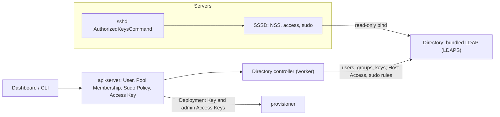

# Identity and Access 設計與規範

本文件是 swallow **帳號與存取（identity and access）** 的權威現行規格：User 與 User Role、Pool Membership 與 Pool Role、
API 的授權規則、Platform 屬於哪個 Pool、Directory（swallow 寫入、受管 Server 讀取的帳號目錄）、Host Access 與 Sudo
Policy、主機端的 directory client，以及安裝時需要的設定。決策見
[decision 082](../decisions/082-accounts-pool-access-and-directory.md)（accounts, pool access, and directory）。

> **本文件的定位**：ADR 只記錄「為什麼」；本檔記錄目前有效的行為與規則。路由、欄位、狀態碼與錯誤格式以 `api-server`
> 擁有的 API 契約為準，本檔只連結、不複製欄位表；術語以 glossary 為準。SSH Key 的保存與 provisioner 同步、Session 與
> API Key 寫在 [access-and-credentials.md](access-and-credentials.md)。

---

## 1. 目的與範圍

- **讀者**：修改帳號、角色、Pool Membership、API 授權、Directory、Host Access、Sudo Policy 或主機登入行為的開發者與 AI
  agent。只是在新路由上套用既有的授權規則時，讀 §4。
- **範圍內**：User 的生命週期與 POSIX identity；User Role 與 Pool Role 的權限；Pool Membership、Pool 的 Sudo Policy、
  access settings 與稽核；API 授權與列表過濾；Platform 的 Pool；Directory provider 與它的 controller；Host Access 與
  sudo 規則；directory client（Managed Software kind `sssd`）；Platform Module 的 Host Access 限制；安裝設定。
- **範圍外（只連結）**：Session、API Key 與 Access Key 的保存（[access-and-credentials.md](access-and-credentials.md)）；
  Pool 目錄與 Server placement 的規則（[os-provisioning.md](os-provisioning.md) §8）；Slurm 的家目錄與共享儲存（尚未決定）；
  外部目錄（組織既有的 LDAP、Active Directory）與 Kubernetes 的帳號整合（後續）。

---

## 2. 心智模型

| 事實 | 類別 | 寫入者 | 存放 |
| --- | --- | --- | --- |
| User（username、User Role、password hash） | desired | API（admin）；bootstrap admin 由安裝建立 | `users` |
| User 的 `uidNumber` | derived（分配一次、永不重用） | 建立 User 的 use case；啟動時補齊缺少者 | `users`、`posix_ids` |
| Pool Membership（Pool Role、sudo 覆寫） | desired | API（admin 或該 Pool 的 owner） | `pool_memberships` |
| Pool 的 Sudo Policy 預設值 | desired | API（admin 或該 Pool 的 owner） | `pool_access_policies` |
| access settings（`adminSudoPasswordless`） | desired | API（admin） | `access_settings` |
| 群組的 `gidNumber` | derived（分配一次、永不重用） | Directory controller | `posix_ids` |
| Host Access、有效的 sudo | derived | 每次計算 | 不保存 |
| Directory 的內容 | Directory 的實現（可由 store 重建） | Directory controller | LDAP |
| Directory 的狀態（conditions、counts） | observed／derived | Directory controller | `directory_status` |
| 稽核紀錄 | 動作的紀錄 | 寫入以上 desired 的 use case | `access_audit` |

兩條貫穿全文的原則：

1. **swallow 擁有身分與政策，Directory 只是實現的目標**：Directory 裡的東西都能由 swallow 的 store 重建；swallow 是它
   唯一的寫入者，所以 controller 每一輪都把不同之處改回來。
2. **登入 swallow 從不依賴 Directory**：API 的密碼登入以 store 中的 hash 驗證；Directory 故障只影響主機上的新登入與
   `sudo`，已快取的登入照常（SSSD 的離線快取）。

---

## 3. User、User Role 與 POSIX identity

### 3.1 建立、修改與刪除

- 只有 admin 管理 User（[users](../../api-server/docs/development/api-contracts/api-server/users.md) 契約）；bootstrap
  admin 由安裝在 API 啟動時建立（`bootstrapAdminUsername`，預設 `admin`）。
- **username** 也是 Linux login name：`^[a-z_][a-z0-9_-]{0,31}$`。保留名稱拒絕：
  - OS 的系統帳號與 cloud image 的預設帳號（`root`、`daemon`、`bin`、`sys`、`nobody`、`sshd`、`ubuntu`、`cloud-user`、
    `centos`、`rocky`、`almalinux`、`ec2-user`、`chrony` 等），`systemd-` 開頭的名稱，以及 `swallow-` 開頭的名稱
    （swallow 的群組名稱）。清單在 `internal/core/auth/domain/user.go`。
  - swallow 的模組與安裝在 Server 上建立的服務帳號（`slurm`、`munge`、`prometheus`、`grafana`、`omnistat`、
    `victoriametrics`、`docker`、`libvirt-qemu`、`libvirt-dnsmasq`、`maas`、`postgres`、`sssd`、`nslcd`、`openldap`）。
    清單是 composition root 的 `moduleServiceAccounts`（`internal/app/access.go`），因為 core 不得出現產品名稱；新增服務
    帳號的模組要一併補上。
- **密碼**至少 8 個字元、至多 72 bytes（bcrypt 的上限），以 bcrypt 保存；admin 可以重設別人的密碼，User 可以以目前的
  密碼改自己的密碼（[auth-me](../../api-server/docs/development/api-contracts/api-server/auth-me.md) 契約）。改密碼與重設
  密碼不撤銷既有的 Session（Session 由 refresh token 的輪替控制，decision 042）；刪除 User 才撤銷。
- **User Role** `admin | user`；不能把最後一位 admin 降級或刪除（`409 conflict`），admin 也不能刪除自己。
- **刪除** User 時在同一個 transaction 內刪除它的 Pool Membership、API Key、Access Key 與 Session；它的 `uidNumber`
  保留在已分配的範圍內，不會被之後的 User 使用。之後的 Directory pass 移除它的帳號，provisioner 同步移除它登錄過的
  Access Key。
- Session 與 API Key 每個請求都以擁有者**目前**的 User Role 與 Pool Membership 判斷權限：降級或移出 Pool 立即生效。

### 3.2 POSIX identity

- 每個 User 有一個 `uidNumber`，在建立 User 的 transaction 內分配；分配不到時 User 不會建立。安裝前就存在的 User（例如
  升級前的 bootstrap admin）在 API 啟動時補齊。
- 號碼來自 installation 的 POSIX ID 範圍：起點是設定 `posixIdStart`（預設 10000），**第一次分配時記錄在 store**，之後
  改設定不會改變它（API 啟動時記一則警告）。User 與群組各自計數，都從起點開始；號碼只增加、不重用。
- 所有 User 的主要群組是 `swallow-users`；另有 `swallow-admins`（所有 admin），每個 Pool 有 `pool-<名稱>`（owner 與
  member）與 `pool-<名稱>-owners`（owner）。Pool 群組的名稱在第一次分配時由 Pool 的名稱推導（小寫，非 `[a-z0-9-]`
  的字元換成 `-`，名稱部分最長 20 個字元，讓 `pool-<名稱>-owners` 不超過 32 個字元；重複時加上 `-2`、`-3`），之後 Pool
  改名也不變。
- home 目錄是 `/home/<username>`，login shell 是 `/bin/bash`；home 目錄在第一次登入時於本機建立（`pam_mkhomedir`）。

---

## 4. 授權

### 4.1 規則

- **admin** 可以做所有事。**user** 的權限只來自 Pool Membership；沒有 membership 的 user 只能使用自己的帳號功能。
- User 與 Pool 都屬於整個 installation：Pool 不屬於任何 Site，一個 Pool 可以有不同 Site 的 Server，Pool 的 owner 與
  member 在每個 Site 都是同一套權限。Pool 只存在於 swallow，不是 provisioner 的 resource pool。
- Server 屬於它的 placement（`spec.poolId`）指向的 Pool；placement 寫入即生效。沒有 Pool 的 Server（新 Server 一律
  如此，直到 admin 把它放進 Pool）只有 admin 能讀取與操作。
- Platform 屬於「它的每個節點都在」的那個 Pool（§5）；沒有這樣的 Pool 時只有 admin 能讀取與管理。
- Workflow 屬於它的目標：每個目標 Server（與目標 Platform）都能讀取時才能讀取；每個目標都能操作時才能取消、rerun 或
  重試。沒有任何目標的 Workflow 只有 admin。
- **列表一律過濾**到呼叫者能讀取的項目，不回傳不能讀取的項目，也不以數量洩漏它們（`total` 是過濾後的數量）。直接讀取
  一個不能讀取的資源回 `404 not_found`，讓 user 無法探測其他 Pool 的資源；能讀取但不能操作時回 `403 forbidden`。
  契約另有規定的路由以契約為準。
- **新路由**必須在契約的 Authorization 一節寫明它屬於下表哪一類，並在 `internal/app/api.go` 套用同一類的 middleware
  或在 use case 檢查。

### 4.2 路由分類

| 類別 | 誰可以 | 路由（摘要；完整以各契約為準） |
| --- | --- | --- |
| 自己的帳號 | 任何已登入的 User | `GET /auth/me`、`PUT /auth/me/password`（只限 Session）、`/api-keys`、自己的 Access Key（`GET /ssh-keys`、`POST /ssh-keys`、`POST /ssh-keys/generate`、`GET`／`DELETE /ssh-keys/{keyId}`） |
| 共用的參考資料 | 任何已登入的 User | `GET /modules`、`GET /sites`、`GET /sites/{id}`、Zone 與 Pool 目錄的讀取、`GET /software/catalog`、`GET /provisioning/images`、`GET /provisioning/templates(/{id})`、`GET /provisioning/tags`、`GET /platforms/deployment-requirements/slurm`、`GET /platforms/gpu-operator/releases`、`GET /validation/suites(/{suiteId})`、`GET /monitoring/metrics/names` |
| Pool 範圍的讀取 | 能讀取資源的 User（Pool 的 owner 或 member） | `GET /servers`（過濾）、`GET /servers/stream`（過濾）、`GET /servers/{id}` 與其讀取子路由（`events`、`network`、`provisioning-tasks`、`power-state`）、`GET /platforms`（過濾）、`GET /platforms/{id}`、`GET /platforms/{id}/slurm`、`GET /software/assignments`（過濾）、`GET /workflows`（過濾）與 Workflow 的讀取子路由、`GET /change-plans`（過濾）、`GET /validation/runs`（過濾）、`GET /monitoring/metrics(/range)`（該 Server）、Pool 的 members 與 access policy 的讀取 |
| Pool 範圍的操作 | 資源所在 Pool 的 owner | Server 的動作（`refresh`、`power-on`、`power-off`、`inspect`、`test`、`abort`、`override-failed-testing`、`lock`、`unlock`、`mark-broken`、`mark-fixed`、`rescue-mode`、`exit-rescue-mode`、`default-user`、網路 link、`provisioner-detail`、Docker Host Explorer）、`POST /provisioning/deployment-operations`、`release-operations`、`recover-operations`、`deployments/preflight`、`POST /provisioning/tags`（每個目標 Server）、`POST /software/assignments`、`POST /software/uninstall`、`POST /platforms`（每個節點都在呼叫者是 owner 的同一個 Pool）、Platform 的 `PATCH`、`PUT /spec`、`DELETE`、`sync` 與 Kubernetes explorer、Change Plan 的核准與拒絕（Platform 的 plan）、Workflow 的 `cancel`、`rerun`、Task 重試、`POST /validation/runs`、`POST /validation/runs/{runId}/cancel`、Pool 的 members 與 access policy 的寫入 |
| admin | User Role `admin` | 其他所有路由：`/overview`、Site 與 Integration 的寫入與 automation、`/users`、`/access/*`、Zone 與 Pool 目錄的寫入、`PUT /servers/{id}/placement`、`DELETE /servers/{id}`、Boot Media、Redfish probe、Power Configuration、virtual machines、`/provisioning` 的其餘路由（OS Image、template 的寫入、image verification、Provisioning Task、reconcile、HTTP Proxy、Subnet DNS、Boot ISO、VM enrollment、tag 的刪除與改名）、Deployment Key 與 `POST /ssh-keys/sync`、registry credentials、`POST /platforms/sync`、`PUT /platforms/deployment-requirements/slurm`、Change Plan 政策、`POST /workflows`、Validation Suite 的寫入與 Validation Schedule、alerts |

### 4.3 實作位置

- `internal/core/access/application` 的 `Authorizer` 以呼叫者（`identity.Principal`）算出 `Scope`：是否 admin，以及每個
  Pool 的 Pool Role；它每個請求都從 store 讀取目前的 User Role 與 membership，不信任 token 裡的 role。use case 以它判斷
  「能不能讀取／操作這些 Server、這個 Platform」，列表以它的 Pool 清單過濾。
- `internal/core/access/delivery` 的 `Guard` 提供 Fiber middleware：`Scope()` 為每個已驗證的請求算一次 `Scope` 並放進
  context（handler 以 `VisibilityFrom` 讀取，用於列表過濾）；`Admin()`；依路徑參數判斷的 `Server`、`Platform`、
  `Workflow`、`Pool`（讀取類用 `Read`、其餘用 `Operate`）；依 request body 的 `ServersInBody`、`PlatformMembersInBody`；
  其他判斷用 `Custom`。`internal/app/api.go` 的每個路由都經 `route(...)` 或 `adminRoute(...)` 套用其中之一。
- SSE（`GET /servers/stream`）在連線時取得可見範圍的快照；之後成員資格的變化要重新連線才生效。

---

## 5. Platform 與 Pool

- Platform 的 Pool 由它的節點推導：spec 指派的每台 Server（以及仍被它 claim 的每台 Server）的 `spec.poolId` 都相同且
  不是空的時候，那就是它的 Pool；否則它沒有 Pool。API 在 Platform 的 `status.poolId` 回報（
  [platforms](../../api-server/docs/development/api-contracts/api-server/platforms.md) 契約）。
- **建立與加入成員**：非 admin 建立 Platform 或在 spec 加入節點時，每個節點都必須在同一個 Pool，而且呼叫者是那個 Pool
  的 owner；否則 `403 forbidden`（不是那個 Pool 的 owner）或 `400 validation_error`（節點分屬不同 Pool 或沒有 Pool）。
  admin 不受限制，但它建立的跨 Pool Platform 只有 admin 能管理。
- **placement**：被 Platform claim 的 Server 只能移到該 Platform 的 Pool，或移出所有 Pool（其他 Pool 是 `409 conflict`），
  所以 Platform 不會因為 placement 而分屬兩個 Pool。移出 Pool 讓 Platform 沒有 Pool（只有 admin 能管理）；沒有 Pool 的
  Platform 的 Server 可以放進任何 Pool，admin 以此把整個 Platform 搬到另一個 Pool：先全部移出，再全部放進新的 Pool。

---

## 6. Pool Membership、Sudo Policy 與稽核

- Pool Membership 以 `(poolId, userId)` 唯一。owner 與 admin 可以新增（以 username 指定既有的 User）、修改 Pool Role
  與 sudo 覆寫、移除；owner 可以把別人設為 owner，也可以移除自己。Pool 刪除時刪除它的 membership 與 access policy
  （[pool-access](../../api-server/docs/development/api-contracts/api-server/pool-access.md) 契約）。
- **Sudo Policy** 依序解析（glossary [Sudo Policy](glossaries/terms/sudo-policy.md)）：
  - admin：一律有 `sudo`，`adminSudoPasswordless` 決定是否免密碼（來源 `settings`）。
  - owner：一律有 `sudo`（來源 `role`）；是否免密碼取 membership 的 `sudoPasswordless` 覆寫，`inherit` 時取 Pool 的
    `sudoPasswordless`（來源 `member` 或 `pool`）。
  - member：有沒有 `sudo` 取 membership 的 `sudo` 覆寫，`inherit` 時取 Pool 的 `memberSudo`；是否免密碼同 owner。
  - Platform 的 Host Access 限制（§8.2）再把 member 的 `sudo` 關掉；API 回報 membership 層級的有效值，限制在 Directory
    的規則中套用。
- **access settings**（admin）：`adminSudoPasswordless`（預設 `false`）。POSIX ID 起點唯讀回報。
- **稽核**：User 的建立、修改、刪除，membership 的新增、修改、移除，Pool access policy 與 access settings 的修改，各寫一筆
  `access_audit`（時間、執行者、動作、對象、摘要，不含密碼），與寫入在同一個 transaction 內。admin 可以讀取最近的紀錄
  （[access](../../api-server/docs/development/api-contracts/api-server/access.md) 契約）。

---

## 7. Directory

### 7.1 Provider interface 與 adapter

- Directory 是 core 的 provider interface（`internal/core/access/domain` 的 `Directory`），以 core 的詞彙表達：帳號
  （username、`uidNumber`、`gidNumber`、home、shell、password hash、SSH 公鑰、允許登入的主機名稱）、群組（名稱、
  `gidNumber`、成員）、sudo 規則（名稱、User、主機、是否免密碼）。`Apply` 收到完整的期望內容，adapter 讓 Directory
  恰好成為那樣，並回報新增、修改、刪除的數量。
- 目前的 adapter 是 LDAP（`internal/adapters/directory/ldap`），接上安裝內建的 OpenLDAP（§10）。它是 installation
  層級的 provider，由 composition root 依設定選擇；沒有設定時沒有 Directory，controller 不啟動，directory client 的政策
  不涵蓋任何 Server，`GET /access/directory` 回報 `configured: false`。

### 7.2 內容（LDAP adapter）

base DN 預設 `dc=swallow,dc=internal`。swallow 只管理 `ou=people`、`ou=groups`、`ou=sudoers` 底下的 entry，三個 OU 裡
不在期望內容中的 entry 一律刪除。

- `uid=<username>,ou=people`：`account`、`posixAccount`（有 Access Key 時加上 `ldapPublicKey`）；`uidNumber`、
  `gidNumber`（`swallow-users`）、`homeDirectory`、`loginShell`、`userPassword: {CRYPT}<bcrypt>`、`sshPublicKey`（每把
  Access Key 一個值）、`host`（Host Access 允許的主機名稱；admin 是 `*`）。
- `cn=<group>,ou=groups`：`posixGroup`，`memberUid` 列出成員。
- `cn=<rule>,ou=sudoers`：`sudoRole`，`sudoUser`、`sudoHost`（主機名稱、FQDN 與位址；admin 規則是 `ALL`）、
  `sudoCommand: ALL`、`sudoRunAsUser: ALL`、`sudoRunAsGroup: ALL`，免密碼的規則加上 `sudoOption: !authenticate`。
- adapter 每一輪連線、以 `cn=admin` bind、逐一 OU 讀出現有的 entry 與期望內容比較，先新增與修改、最後刪除，所以 User 不會
  在帳號消失之前先失去群組或 sudo 規則。只接受 `ldaps://`，以 installation CA 驗證伺服器憑證。
- `cn=reader,ou=services`：主機端 directory client 綁定的唯讀帳號，由安裝建立，不在 swallow 管理的範圍內。存取控制：
  `userPassword` 只能用於認證，reader 可以讀其餘內容、不能寫，匿名 bind 被拒絕。

### 7.3 Controller

- worker 的 Directory controller（key 只有一個：`directory`）每一輪依 store 算出完整的期望內容並 `Apply`。觸發：`users`、
  `pool_memberships`、`pool_access_policies`、`access_settings`、`ssh_keys`、`servers`、`platforms`、`pools` 的變化，
  `POST /access/directory/sync`，以及定期 resync（預設 10 分鐘）。
- 變化觸發時，期望內容的 hash 與上一次成功套用的相同就略過（`servers` 每 30 秒的 reconcile 不會一直寫 LDAP）；resync 一律
  完整比對並修正 Directory 中被改動的內容。
- 群組的 `gidNumber` 在第一次需要時由 controller 分配並記在 `posix_ids`。
- **狀態**（`directory_status`，`GET /access/directory`）：`realized` 與 `requires_attention` conditions、最後一次成功套用的
  時間、帳號、群組、sudo 規則與主機的數量。LDAP 連不上是 `realized=false`、reason `provider_unreachable`，由 runtime
  退避重試；LDAP 拒絕某個寫入是 `provider_rejected`、`requires_attention=true`，訊息只含可給 user 看的原因，期望內容改變
  或 resync 時再試。

---

## 8. Host Access 與 sudo 規則

### 8.1 計算

- 每台 Server 的主機名稱取 observed 的 hostname 與 FQDN；`sudoHost` 另加上它的位址。沒有主機名稱的 Server 不出現在
  `host` 中（沒有人能以 Directory 帳號登入），只有 admin 的 `*` 規則涵蓋它。
- admin：`host: *`、`swallow-admins` 的 sudo 規則（`sudoHost: ALL`）。
- Pool 的 owner：該 Pool 每台 Server 的名稱；sudo 規則 `pool-<group>-owner-passwd` 或 `-owner-nopasswd`。
- Pool 的 member：該 Pool 中 Platform 限制允許 member 登入的 Server；有 `sudo` 的 member 落在 `pool-<group>-member-passwd`
  或 `-member-nopasswd`，`sudoHost` 只含限制允許 member `sudo` 的 Server。
- 每條規則都列出完整的 User 與主機；每個 User 在同一台主機只落在一條規則（admin 的規則優先於 Pool 的規則，所以 admin 不再
  列入 Pool 的規則）。

### 8.2 Platform Module 的限制

- Platform Module 在 `module.json` 以資料宣告 `hostAccess`（不是 Go hook，因為資料表達得了）：`default` 與依 Node Role 的
  `roles`，每條規則是 `memberLogin`、`memberSudo`（`memberSudo` 必須同時 `memberLogin`）。Platform 的 spec 指派的每個節點
  取它的 Node Role 的規則；一個節點有多個角色時取最寬的（login node 同時是 compute node 時仍可登入），沒有列出的角色取
  `default`。沒有宣告的模組不限制：member 依 Pool 的規則登入與 `sudo`。owner 與 admin 不受限制。只有 Platform 模組可以
  宣告（`internal/core/module/domain` 的 `HostAccessDeclaration`）。
- Slurm：`login` 的 member 可以登入、沒有 `sudo`；其餘角色（`controller`、`compute`）member 不能登入。在任何 Slurm 節點上
  member 都沒有 `sudo`（有 root 的人能讀 MUNGE key，冒用任何 User）。member 經 Slurm 在 compute node 上執行 job，
  Directory 讓每個節點都認得同一組 uid。
- Kubernetes：`default` 不允許 member 登入節點，也沒有 `sudo`（節點的 root 等於叢集的管理權）。

---

## 9. Directory client（Managed Software kind `sssd`）

- 模組 `api-server/modules/software/sssd/`，catalog entry 標記 `DirectoryClient`：core 的 `SoftwareService` 以
  `DirectoryClientSettings` port 取得 Directory 的設定，加入 trusted vars（`swallow_directory_uri`、
  `swallow_directory_base_dn`、`swallow_directory_ca_pem`、`swallow_directory_id_start`、`swallow_directory_usernames`）與
  secret vars（`swallow_directory_bind_dn`、`swallow_directory_bind_password`，以 Task 的 sealed secret 傳入，不出現在
  Workflow 紀錄與 artifact）。沒有 Directory 時拒絕安裝（`409 conflict`）。
- desired 由政策推導：設定了 Directory 且 `directoryClientEnsure`（預設開）時，Node Exporter 的同一套 coverage（存在、
  `deployed`、沒有 lock、Site 啟用 automation）涵蓋的每台 Server 都應該有它，由 worker 的 ensure controller（名稱
  `sssd`）安裝（[software-deployment.md](software-deployment.md)）；也可以由 owner 單獨安裝。只有 admin 能 uninstall，
  而且 uninstall 之後 controller 會再安裝（要讓某台 Server 不裝，lock 它或關閉 Site 的 automation）。目前只支援 Ubuntu。
- 安裝內容（idempotent），在 SSSD 讀得到 Directory、本地帳號檢查通過之前不改任何登入路徑：
  - OS 不是 Ubuntu 時 `[sssd_unsupported_os]`；沒有收到 Directory 的設定時 `[sssd_settings_missing]`。
  - 套件 `sssd-ldap`、`libnss-sss`、`libpam-sss`、`libsss-sudo`；installation CA；`/etc/sssd/sssd.conf`（0600；
    `id_provider`、`auth_provider`、`access_provider`、`sudo_provider` 都是 `ldap`，`ldap_access_order = host`，`min_id` 為
    POSIX ID 起點，`ldap_schema = rfc2307`，`cache_credentials = false`，`ldap_tls_reqcert = demand`，reader 帳號）。
  - 啟動 SSSD，以 `getent -s sss` 讀第一個 User；讀不到時 `[sssd_directory_unreachable]`。
  - 只比較本地檔案（`/etc/passwd`、`/etc/group`）：與 User 或 swallow 群組同名時 `[sssd_name_conflict]`，佔用 Directory
    給 User 或群組的 id 時 `[sssd_id_conflict]`。
  - `/etc/nsswitch.conf` 的 `passwd`、`group` 加上 `sss`（本地檔案優先），`sudoers: files sss`；`pam_mkhomedir`；sshd
    drop-in `/etc/ssh/sshd_config.d/50-swallow-directory.conf`（`AuthorizedKeysCommand /usr/bin/sss_ssh_authorizedkeys %u`，
    `AuthorizedKeysCommandUser nobody`），`sshd -t` 拒絕時移除 drop-in 並 `[sssd_sshd_config_invalid]`。
- 卸載先移除 sshd drop-in 與 nsswitch 的 `sss`，再停止 SSSD、移除 swallow 的設定與 CA、purge 套件；本地帳號、已建立的
  home 目錄與 PAM 的 mkhomedir 保留。
- 主機端的快取：帳號 entry 的有效期 60 秒、sudo 規則的 smart refresh 60 秒、full refresh 10 分鐘；撤銷 key、移除
  membership 或 sudo 的變更約一分鐘內生效。

---

## 10. 安裝與設定

- Compose installation 新增 service `ldap`（image `SWALLOW_LDAP_IMAGE`，由 `deploy/production/ldap.Dockerfile` 建置，
  Ubuntu 24.04 的 OpenLDAP 2.6，只開 LDAPS；每次啟動依環境變數與掛入的 secret 重建 `cn=config`）。
  `prepare-secrets.sh` 產生 LDAP 的 admin 與 reader 密碼，並以 `deploy/production/ldap/tls.sh` 產生 installation CA 與
  LDAP 的伺服器憑證（SAN 含 `ldap`、`localhost` 與 `SWALLOW_ADDRESS`；位址改變時以同一個 CA 重簽，CA 的私鑰不掛進任何
  container）。`SWALLOW_LDAP_PORT`（預設 636）發佈在主機上給 Server 使用。`swallowctl backup` 包含 installation CA、憑證與
  兩個密碼（`directory-secrets.tar.gz`），`restore` 還原它們；LDAP 的資料不備份，由 Directory controller 重建。`doctor` 與
  `ensure` 檢查 LDAP 是否回應。
- api-server 與 worker 的設定（`config/`）：

| 設定 | 環境變數 | 說明 |
| --- | --- | --- |
| `directory.url` | `SWALLOW_API_DIRECTORY_URL` | controller 連線的 URL（`ldaps://ldap:636`）；空的時候沒有 Directory |
| `directory.baseDN` | `SWALLOW_API_DIRECTORY_BASE_DN` | 預設 `dc=swallow,dc=internal` |
| `directory.bindPasswordFile` | `SWALLOW_API_DIRECTORY_BIND_PASSWORD_FILE` | `cn=admin` 的密碼 |
| `directory.caFile` | `SWALLOW_API_DIRECTORY_CA_FILE` | installation CA；controller 驗證 LDAP 憑證，也交給 directory client |
| `directory.hostURL` | `SWALLOW_API_DIRECTORY_HOST_URL` | Server 連線的 URL（`ldaps://<SWALLOW_ADDRESS>:636`） |
| `directory.readerPasswordFile` | `SWALLOW_API_DIRECTORY_READER_PASSWORD_FILE` | reader 的密碼，交給 directory client |
| `posixIdStart` | `SWALLOW_API_POSIX_ID_START` | POSIX ID 起點，預設 10000；第一次分配後不再生效 |
| `directoryClientEnsure` | `SWALLOW_WORKER_DIRECTORY_CLIENT_ENSURE` | 有 Directory 時是否執行 directory client 的 ensure controller，預設 `true`（開發環境 `false`） |

- 開發環境的 `deploy/dev/compose.yaml` 有同一個 `ldap` service（compose profile `directory`），憑證與密碼由
  `deploy/dev/ldap-secrets.sh` 產生在 `deploy/dev/ldap/`（git 忽略）；`.env` 設定 `SWALLOW_API_DIRECTORY_URL` 與
  `SWALLOW_API_DIRECTORY_HOST_URL` 才啟用。native installation 尚未支援 Directory。

---

## 11. 限制與尚未實作

- 外部目錄（組織既有的 LDAP、Active Directory）的唯讀 adapter：後續。
- Kubernetes 的帳號（OIDC、RBAC 對應 Pool Role）：後續。
- Slurm 的家目錄與共享儲存、`pam_slurm_adopt`（member 有 job 時 ssh 到 compute node）：後續，見 §8.2。
- directory client 只支援 Ubuntu；RHEL 系列隨已驗證平台集合決定。
- directory client 不檢查主機自己的 hostname 是否等於 swallow 觀察到的名稱；不同時 Host Access 不會讓 Pool 的 User 登入
  （admin 的 `*` 不受影響）。
- swallow 登入不了或 OS 不支援的 Server，ensure controller 依退避每天最多重試一次，不會停止重試。
- Validation Schedule 的建立與修改只開放給 admin。

---

## 12. 設計理由

- Pool 已經是 swallow 擁有的 Server 分組，以它作為存取的單位，不需要另一個要保持一致的分組。它和 User 一樣屬於整個
  installation，同一個團隊在不同 Site 的 Server 才能由一個 Pool 管理；它不在 provisioner 實現，存取不取決於
  provisioner 能不能搬動 machine。
- 主機讀 Directory 而不是由 Ansible 推送檔案：membership、key、placement 的每個變更都不必在每台主機跑 Workflow，離線的
  主機也不會漏掉變更；主機的設定是靜態的，只在安裝 directory client 時寫一次。
- swallow 是 Directory 唯一的寫入者，Directory 可以完整重建：備份只需要 swallow 的 store，controller 能修正任何偏差。
- 共用主要群組：同名的個人群組會讓名為 `admin` 的 User 得到 Ubuntu sudoers 的 `%admin`。
- 完整的脈絡與否決方案見 decision 082。

---

## 13. 程式位置對照（導航用）

`api-server` 內路徑相對於 `api-server/`：

| 職責 | 路徑 |
| --- | --- |
| User、User Role、username 規則、保留名稱 | `internal/core/auth/domain/user.go` |
| User 管理 use case、改密碼 | `internal/core/access/application/users.go` |
| bootstrap admin 與 POSIX identity 補齊 | `bootstrap/admin.go` |
| Pool Membership、Pool Role、Sudo Policy、Scope、Directory port | `internal/core/access/domain/` |
| Authorizer、membership service、Directory projector 與 controller | `internal/core/access/application/` |
| 授權 middleware、members、access policy、settings、audit、directory 的 HTTP | `internal/core/access/delivery/` |
| `users`、`pool_memberships`、`pool_access_policies`、`access_settings`、`access_audit`、`posix_ids`、`directory_status` | `internal/adapters/store/mongodb/auth/`、`internal/adapters/store/mongodb/access/` |
| LDAP adapter | `internal/adapters/directory/ldap/` |
| Platform Module 的 `hostAccess` 宣告 | `internal/core/module/domain/module.go`、`modules/platform/slurm/module.json`、`modules/platform/kubernetes/module.json` |
| directory client | `modules/software/sssd/`；`DirectoryClientSettings` 在 `internal/core/software/application/software_service.go` |
| 組裝與路由；Directory 的 inputs、controller 與 directory client 的設定 | `internal/app/api.go`、`internal/app/access.go`、`internal/app/directory.go` |

安裝（相對於 repository root）：`deploy/production/ldap.Dockerfile`、`deploy/production/ldap/`、
`deploy/production/compose.yaml`、`deploy/production/swallowctl`、`deploy/dev/compose.yaml`。

---

## 14. 相關文件

- 決策：decision 082；相關的 [decision 039](../decisions/039-ssh-key-management-and-default-user.md)（ssh key management and
  default user）、[decision 042](../decisions/042-authentication-sessions-and-api-keys.md)（authentication sessions and api
  keys）、[decision 071](../decisions/071-provisioner-realized-desired-state.md)（provisioner realized desired state）。
- 規格：[access-and-credentials.md](access-and-credentials.md)、[os-provisioning.md](os-provisioning.md) §8、
  [software-deployment.md](software-deployment.md)、[platform-deployment.md](platform-deployment.md)、
  [desired-state-model.md](desired-state-model.md)、[core-and-extensions.md](core-and-extensions.md)。
- Glossary：[User](glossaries/terms/user.md)、[User Role](glossaries/terms/user-role.md)、
  [Pool Membership](glossaries/terms/pool-membership.md)、[Pool Role](glossaries/terms/pool-role.md)、
  [Sudo Policy](glossaries/terms/sudo-policy.md)、[Host Access](glossaries/terms/host-access.md)、
  [Directory](glossaries/terms/directory.md)、[Pool](glossaries/terms/pool.md)、[SSH Key](glossaries/terms/ssh-key.md)。
- API 契約（`api-server` 擁有）：[users](../../api-server/docs/development/api-contracts/api-server/users.md)、
  [pool-access](../../api-server/docs/development/api-contracts/api-server/pool-access.md)、
  [access](../../api-server/docs/development/api-contracts/api-server/access.md)、
  [auth-me](../../api-server/docs/development/api-contracts/api-server/auth-me.md)、
  [conventions](../../api-server/docs/development/api-contracts/api-server/conventions.md)。
