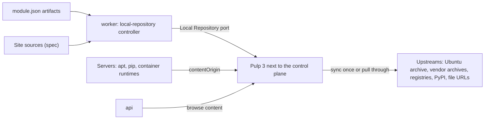

# Local Repository 設計與規範

本文件是 Site 的 [Local Repository](glossaries/terms/local-repository.md) 的現行規格：部署需要的 artifact（OS 套件、
container image、Python 套件與檔案）從哪裡取得、swallow 擁有什麼、provider（目前是 Pulp 3）實現什麼，以及部署如何只從
它取得。決策與否決過的方案見 [decision 078](../decisions/078-local-repository.md)（local repository）。

> **讀者**：修改 Local Repository 本身的開發者與 agent：它的 provider interface 與 Pulp adapter、controller、受理時的
> 檢查、trusted var `swallow_local_repository` 與共用 role `local_repo_client`，或新增一種格式。只在模組中宣告
> `artifacts`，或撰寫從 Local Repository 取得 artifact 的 role 時，讀 [module-authoring.md](module-authoring.md)；
> 只透過 API 讀寫時讀契約
> [local-repository.md](../../api-server/docs/development/api-contracts/api-server/local-repository.md)。Pulp 的
> service、資料庫與 port 見 [installation.md](installation.md)。

> **現況**：`deb`、`oci`、`python`、`file` 四種格式由 Pulp adapter 實現；`rpm`、arm64 與離線匯入只在設計上預留（§9）。

---

## 1. 要解決的問題

以前每個 role 在部署時直接從網際網路取得 artifact：Ubuntu 與廠商的 apt 套件庫、GitHub release 的 binary、
Docker Hub、Quay 與 `registry.k8s.io` 的 image、PyPI 的 Python 套件。結果是：

- **部署時間隨 Server 數與對外頻寬增加**：每台 Server 各自下載同樣的東西，而對外速度隨時間大幅變動。2026-11-05 晚上
  lab 的三台 VM 同時下載 k0s，各只有約 60 KB/s，262 MB 的 binary 下載到約 230 MB 時中斷，部署失敗；隔天早上同一條
  路徑是 7 MB/s。
- **沒有網際網路的 Site 不能部署。**
- **站點上沒有固定、也沒有驗證**：部署裝了什麼，取決於上游當天提供什麼；上游移除某個版本，用到它的部署就失敗。

## 2. 設計

**部署需要的每個 artifact 都從 Site 的 Local Repository 取得。** Local Repository 是一個 provider 類別：core 定義它的
port，Pulp 3 是目前的 adapter，以 Site 的 `repository` Integration 登錄，與控制平面共置。swallow 擁有「它必須包含什麼」，
provider 擁有 artifact 本身；worker 的 controller 把前者收斂到 provider。Server 上的 apt、pip 與 container runtime
（containerd、Docker、Podman）都指向它，不再連到上游。

每個 artifact 在一個 Site 只跨過網際網路一次（預先抓取時，或第一次被要求時），之後每台 Server 都從同一個 LAN 位址
讀取；內容在站點上固定、經過驗證，之後也能改成匯入而不是同步，讓沒有網際網路的 Site 部署（§9）。

## 3. 所有權

依 [desired-state-model.md](desired-state-model.md) §3 分類：

| 事實 | 類別 | 寫入者 | 儲存 |
| --- | --- | --- | --- |
| 模組宣告的 artifact（`module.json` 的 `artifacts`） | desired，由 release 編入的模組決定 | 模組作者，隨 release 改變 | 不存；每次由模組 registry 讀取 |
| Site 的 user 來源（`spec.sources`）與 `generation` | desired | API（admin） | `local_repositories` |
| 有效內容：兩者的合併（§5.3），與每一項的 `declaredBy` | derived | — | 不存，每次重算 |
| 每個來源、檔案與宣告的 image 的同步狀態（`state`、`message`、`lastSyncedAt`、`contentCount`、`sizeBytes`）與 `observedAt` | observed | Local Repository controller 讀回 provider | `local_repositories` |
| `ready` | derived | — | 由同步狀態推導 |
| artifact 本身、套件索引與 metadata | provider | provider | 不存；瀏覽時即時讀取（§7.3） |
| endpoint、`contentOrigin`、admin credential | Integration 的設定 | API | `integrations`（credential 封存，只寫不讀） |
| deb 的簽章金鑰 | provider | 安裝時在 provider 建立 | 私鑰只在 provider；公鑰由 adapter 讀出，交給部署（§8.1） |

swallow 不保存 artifact：它擁有的是「Site 必須有什麼」，不是內容本身。

## 4. Integration 與 provider

### 4.1 `repository` Integration

- kind `repository`、provider kind `pulp`。一個 Site 至多一個。
- **endpoint**：swallow 呼叫 provider API 的位址（開發環境是 Compose 網路內的 `http://pulp-web:8080`）。
- **setting `contentOrigin`**：Server 讀取內容的位址，production 是 `http://<SWALLOW_ADDRESS>:<port>`，開發環境是主機
  的 LAN 位址加 `PULP_HTTP_PORT`（例如 `http://10.170.168.20:8080`）。它與 endpoint 分開，因為 swallow 在 Compose 網路內
  連到 provider，Server 則從 LAN 連到它。
- **credential**：Pulp admin 的密碼（Basic auth，帳號 `admin`），封存、只寫不讀。
- production 由 `deploy/production/bootstrap.sh` 經已發佈的 API 登錄這個 Integration，並寫入 Site 的 `ubuntu` 來源
  （§5.2）；開發環境由 `deploy/dev/seed.sh` 以同樣的方式登錄（設了 `PULP_ORIGIN` 時）。

### 4.2 port 與 adapter

- port `Repository` 在 `internal/core/localrepo/domain`（路徑相對於 `api-server/`；application 與 delivery 在同一個
  context），只用 core 的詞彙：格式 `deb`、`rpm`、`oci`、`python`、`file`，來源、檔案、image、Python requirement 與
  同步狀態。`pulp`、`apt`、`dnf` 只出現在 adapter 與模組（[core-and-extensions.md](core-and-extensions.md) §3）。
- Pulp adapter 在 `internal/adapters/localrepo/pulp`：把有效內容翻譯成 Pulp 的 remote、repository、publication 與
  distribution，把 Pulp 的 task 與已儲存的內容讀回成同步狀態。它不在記憶體保存同步狀態，每次都依名稱找 Pulp 的物件、讀
  Pulp 的 task，所以 Pulp 物件的名稱與 base path 是和既有安裝之間的契約，改了就會讓已有的內容失去對應。唯一的例外是
  adapter 自己經 registry 下載宣告的 image（Pulp 沒有對應的 task）：process 記得正在下載哪些 image、哪些最近下載失敗，
  只用來避免重複下載與控制重試的間隔，由同一個 factory 交出的每個 Repository 共用；image 是否已儲存仍每次讀 Pulp。
  process 重新啟動後這些紀錄就沒了，被中斷的下載在下一輪重新開始（§7.1）。
- adapter 確保的每個 remote（deb、oci 的 pull-through、python）都帶下載逾時：整體 `total_timeout` 6 小時、
  `sock_read_timeout` 5 分鐘；以 `file_url` 下載檔案時以 `downloader_config` 帶同樣的值。既有的 remote 沒有這些值時更新
  它，oci 來源還包括 Pulp 為每個經它 pull 過的 image 建立的 remote。營運注意：2026-11-06 在 lab 更新既有 remote 的逾時
  之後，已在執行的 pulp-content 仍以舊的 300 秒中斷下載，重新啟動 pulp-content 後才生效；既有的安裝升級後，在 worker
  更新了 remote 之後重新啟動 pulp-content。
- 錯誤分三類回報：`unavailable`（無法連線、逾時或 provider 端失敗，暫時性，重試）、`auth`（credential 被拒，修正
  Integration 後重試）、`rejected`（provider 拒絕這個請求，重複相同的請求也會失敗）。
- store 在 `internal/adapters/store/mongodb/localrepo`，collection `local_repositories`，每個 Site 一份。

改 adapter 前要知道的 Pulp 事實（2026-11-06 依官方文件與原始碼確認）：

- all-in-one image 一律啟動內建的 PostgreSQL；使用外部資料庫時改用 `pulp-minimal`（api、content、worker 分開執行）
  加 `pulp-web`（nginx）。
- registry 的 `/v2/` 必須在 Pulp 的 host:port 根路徑，所以 registry 與其他內容共用一個位址，不能放在路徑之下。
- container 的匿名 pull-through 需要 pulp_container 2.30.1／2.29.3 以上。
- deb 沒有 pull-through，以 `on_demand` 同步加 APT（structured）publisher；Release 要簽章，主機才不必 `trusted=yes`。
- python 的 pull-through 是在 distribution 上設 `remote`，simple API 在 `/pypi/<base_path>/simple/`。
- file 可以用 `file_url` 讓 Pulp 的 worker 下載單一 URL，但不能事先指定 sha256，所以下載後比對。
- remote 的 `total_timeout` 是 `null` 時，pulpcore 改用 aiohttp 預設的整體逾時 300 秒（`0` 不能關閉它），對外頻寬慢時
  超過 5 分鐘的下載會被中斷、從頭重來（`[PLP0005] Request timed out`）。`file_url` 的下載不經 remote，逾時要以
  `downloader_config` 指定。
- container 的 pull-through 為每個被 pull 的 image 建立一個 container remote，建立時複製 pull-through remote 的設定，
  之後那個 image 的 blob 都經它下載；之後再改 pull-through remote 不會改到已建立的 image remote。
- pull-through 只記下 upstream 的 blob 在 `/content/container/blobs/` 的 `artifact` 是 `null`，Pulp 完整下載它之後
  才儲存、有 artifact；`digest__in` 可以一次查多個 digest。

### 4.3 授權

Pulp 的 pulpcore 與 deb、container、python、file、rpm plugin 都是 GPLv2-or-later。swallow 以未修改的獨立 service 使用
它，只經 HTTP API 溝通，不修改也不 link 它，所以可以商用。release 若自己附帶 Pulp 的 image，而不是釘選上游的 image，
就要盡 GPL 的再散布義務（提供對應原始碼的取得方式）。這不是法律意見，正式商用前請法務確認。

## 5. 內容：模組宣告與 Site 的來源

### 5.1 模組宣告

每個模組在 `module.json` 的 `artifacts` 宣告它的 playbook 要取得的東西（欄位與寫法見
[module-authoring.md](module-authoring.md)）：

- `sources`：OS 套件來源（[Repository Source](glossaries/terms/repository-source.md)），含 `name`、`format`、`url`、
  `suites`、`components`、`architectures`，例如 Docker CE 的 `docker-ce`。
- `files`：單一檔案的 `path`、`url` 與 `sha256`，例如 k0s 的 binary。
- `images`：container image 的 reference，例如 `quay.io/k0sproject/pause:3.10.2-0`。
- `python`：Python requirement，例如 `numpy==2.5.4`。

同一個 path 的 file 在模組之間必須有相同的 URL 與 sha256，否則模組 registry 建立失敗。source 的合併規則見 §5.3。

### 5.2 Site 的來源

- user 的來源存在 Site 的 Local Repository spec（`spec.sources`，帶 `generation`），形狀與模組宣告的 source 相同。
  寫入整份取代；帶的 `generation` 與目前的不同時回 `409`（[desired-state-model.md](desired-state-model.md) §11.1）；
  與模組宣告矛盾的來源（同名但格式或 URL 不同）拒絕寫入。
- user 也可以加其他格式的來源，例如以 registry host 為名的 `oci` 來源，把那個 registry 的上游換成內部 mirror（§5.3）。
- OS 的套件來源是 Site 的來源，不是模組宣告：它屬於 Site 部署的 OS，不屬於任何模組，要換成內部 mirror 或加上 suite
  時只改 Site 的 spec。Ubuntu archive 是 `ubuntu`：`http://archive.ubuntu.com/ubuntu/`，suites `noble`、
  `noble-updates`、`noble-security`，components `main`、`universe`，`amd64`。production 的 `bootstrap.sh` 與開發環境的
  `seed.sh` 只在 spec 從未寫入過（`generation` 為 `0`）時寫入它，user 之後刪掉它也不會被加回。
- spec 的寫入直接收斂，不經 Change Plan：它決定之後的部署能取得什麼，不改變已部署主機上的軟體。從 spec 移除的來源，
  controller 也從 provider 移除它建立的物件（§7.1）。

### 5.3 有效內容

- 有效內容是模組宣告與 Site 來源的合併；`declaredBy` 列出每一項的宣告者，值是 `module:<id>` 或 `user`。
- 同名的 source 合併：第一個宣告決定格式與 URL，之後格式與 URL 相同的宣告加入它的 suite、component 與 architecture
  （取聯集）。格式或 URL 不同的宣告是矛盾，不納入有效內容並記在 log；user 的寫入會造成矛盾時直接拒絕（§5.2）。
- oci 與 python 的上游不必宣告，由宣告推導出 pull-through 的來源：每個被宣告的 image 引用的 registry host 一個 `oci`
  來源，名稱就是 host（例如 `docker.io`），上游是 `https://<host>`；有 Python requirement 時一個 `python` 來源 `pypi`
  （`https://pypi.org/`）。已宣告同名、同格式的來源時，以它的 URL 為上游。
- 宣告的 image 在它的 registry 來源 `ready` 之後預先抓進 provider，並持續觀察到它的每一層都已儲存；下載被中斷或失敗時
  重新抓取。其他 pull-through 的內容（包括 Python 套件）在第一次被要求時取得並保留。

## 6. 各格式怎麼實現

| 格式 | 上游 | provider 怎麼取得 | Server 怎麼讀 |
| --- | --- | --- | --- |
| `deb` | 宣告的來源（模組或 Site） | `on_demand` 同步宣告的 suite、component 與 architecture：metadata 先鏡像，套件在第一次被要求時取得並保留；每次同步以上游為準（mirror），additive 同步會讓上游更新後同路徑的新舊索引並存而被 Pulp 拒絕；以 Site 自己的金鑰簽章 Release | deb822 來源 `<contentOrigin>/pulp/content/deb/<name>/`，以 Signed-By 驗證 |
| `oci` | 每個 registry host 一個 pull-through 來源 | 第一次 pull 時取得並保留；宣告的 image 預先經 registry 抓取（index 取 linux/amd64），直到 config 與每一層都已儲存才是 `ready`；下載失敗時隔一段間隔再抓，被中斷的下載在下一輪重新開始 | containerd 的 mirror `<contentOrigin>/v2/<host>`；Docker 直接寫 `<registry>/<host>/<repository>:<tag>` |
| `python` | `pypi` | pull-through：第一次被要求時取得並保留 | pip 的 index `<contentOrigin>/pypi/pypi/simple/` |
| `file` | 每個宣告檔案自己的 URL | 下載一次，與宣告的 sha256 比對；不符時移除、該檔案為 `failed`，隔一段間隔再重新下載 | `<contentOrigin>/pulp/content/files/<path>`，role 再以 sha256 驗證 |
| `rpm` | 宣告的來源 | 設計上預留（§9） | — |

deb 內容以 Site 的簽章驗證，檔案以 sha256 驗證；oci 與 python 和安裝的其他部分一樣以 plain HTTP 提供
（[installation.md](installation.md)）。

## 7. 收斂與狀態

### 7.1 controller

- worker 的 `local-repository` controller，key 是 Site，遵守 [desired-state-model.md](desired-state-model.md) §7。
  觸發來源：spec 的寫入（change feed）、`repository` Integration 的登錄、變更與刪除、定期 resync（desired-state-model §7.6），以及 user
  要求的立即收斂（`POST .../sync`，寫入 convergence request，喚醒每個 Site）。
- 每一輪：重算有效內容；先從 provider 移除 swallow 之前建立、但已不在有效內容中（或改了格式）的來源；再經 port 在
  provider ensure 每個來源與檔案，接著 ensure registry 來源已 `ready` 的每個宣告的 image（來源還沒 `ready` 的 image 不問
  provider，記為 `pending`）；讀回 Server 讀取內容的位址；最後把每一項的同步狀態連同 `observedAt` 寫入 status，它是
  status 唯一的寫入者。ensure 不等待同步完成：還有 `pending` 或 `syncing` 的項目時，這一輪以錯誤結束，由 runtime 以
  有上限的退避再跑（等待一個 `failed` 來源的 image 除外，它等定期 resync）。每一輪都是 ensure，所以在 provider 中被刪除
  的內容會在下一輪補回，沒有下載完的 image（例如 process 重新啟動而中斷）也在下一輪重新下載。
- 模組宣告隨 release 改變：升級後 process 重新啟動，下一輪就收斂新的宣告。
- provider 無法連線或拒絕 credential 時，這一輪停止，依 desired-state-model §7.5 退避，status 保留上一次的觀察（只是
  變舊）。單一來源、檔案或 image 失敗（provider 拒絕它、上游取不到、sha256 不符、registry 沒有這個 image）時，只有那一項
  為 `failed` 並帶 `message`，其他項目照常收斂；之後的每一輪都再 ensure 它，adapter 對最近失敗的項目隔一段間隔才重新抓取。
- `repository` Integration 停用時暫停：不收斂、保留 status。Integration 被刪除時清空 status、保留 spec，讓之後登錄的
  Integration 從同一份 spec 開始；Site 刪除後連紀錄一起刪除。

### 7.2 狀態

- 每個來源、檔案與宣告的 image 的 `state` 是 `pending`、`syncing`、`ready` 或 `failed`（意義見 glossary
  [Repository Source](glossaries/terms/repository-source.md)）。image 只有在 provider 儲存了它的 config 與每一層之後才是
  `ready`，`sizeBytes` 是它們的總大小。
- 定義變了、還沒以新定義觀察過的項目讀成 `pending`；status 裡沒有的 image（還沒觀察過，或 reference 改了）也是。
- `ready`：Site 的 `repository` Integration 已啟用，controller 最近一輪沒有因 Integration 或 provider 而停止（連不上、
  credential 缺少或被拒、沒有 `contentOrigin`、設定被 adapter 拒絕），有效內容的每個來源、檔案與宣告的 image 都是
  `ready`，而且已讀到 Server 讀取內容的位址。不是 `ready` 時，API 列出要登錄、啟用、修正或等待什麼。部署的受理只看它
  （§8.1），所以 image 還沒抓完時部署被拒絕，而不是在部署時才由 provider 從網際網路抓取。
- controller 把判斷寫成三個 condition（desired-state-model §4.2）：`ready`、`realized`（provider 是否提供每一項有效內容）
  與 `requires_attention`（user 必須修正 Integration 時為 `true`）。reason 的完整清單以契約的 Conditions 一節為準。

### 7.3 API 與 dashboard

- API（admin）：讀取摘要與同步狀態、依格式分頁瀏覽內容（標出宣告的模組）、寫入 user 的來源、要求立即收斂。路由與欄位
  以契約 [local-repository.md](../../api-server/docs/development/api-contracts/api-server/local-repository.md) 為準。
- 瀏覽內容時由 api 經 port 即時讀取 provider，不存在 swallow。
- dashboard：Infrastructure 底下的 Local repository 頁，顯示來源、檔案與宣告的 image 的同步狀態，並可依格式瀏覽內容。
  CLI 目前沒有指令。

## 8. 部署怎麼只從 Local Repository 取得

### 8.1 playbook 的旗標、trusted var 與受理

- `api-server/modules/manifest.json` 中標成 `"usesLocalRepository": true` 的 playbook，由
  `ExecutionService.PrepareAnsibleStep` 注入 trusted var `swallow_local_repository`（`swallow_` 前綴的變數 client 不能
  偽造，見 [software-deployment.md](software-deployment.md) §4.2）：

  | key | 內容 |
  | --- | --- |
  | `deb` | 每個 deb 來源的 `name`、`uri`（`<contentOrigin>/pulp/content/deb/<name>/`）、`suites`、`components` |
  | `deb_signing_key` | Site 的 deb 簽章公鑰（ASCII armor） |
  | `registry` | registry 的 host:port，也就是 `contentOrigin` 去掉 scheme |
  | `registry_mirrors` | 每個 registry host 的 mirror URL（`<contentOrigin>/v2/<host>`） |
  | `python_index` | `<contentOrigin>/pypi/pypi/simple/` |
  | `files` | `<contentOrigin>/pulp/content/files/`；檔案的 URL 是它加上宣告的 path |

- 受理會執行這類 playbook 的 Workflow 時，Site 的 Local Repository 不是 `ready` 就以 `ErrLocalRepositoryUnavailable`
  拒絕（`409`），訊息指出要登錄或啟用 `repository` Integration，或要等待（或修正）哪個來源、檔案或 image。受理只讀 store 中
  controller 記錄的 status，不呼叫 provider，所以 provider 暫時沒有回應不會讓受理卡住。
- `deb` 只列有效內容中的 deb 來源，主機永遠不會被指向 swallow 不管理的來源。
- swallow 不退回網際網路：沒有能力時不建立同形狀的替代品（[architecture-spec.md](architecture-spec.md) 的原則 8）。

### 8.2 `local_repo_client`

每個這類 playbook 在取得 package hold
（[decision 073](../decisions/073-hold-os-package-maintenance-during-automation.md)（hold os package maintenance during
automation））之後，在安裝或下載任何東西之前，先跑共用 role `local_repo_client`。沒有 `swallow_local_repository`
時它以 `[local_repository_missing]` 失敗。它寫入：

- apt：`/etc/apt/keyrings/swallow-local-repository.asc` 與 `/etc/apt/sources.list.d/swallow-local-repository.sources`
  （deb822，Signed-By），並設 `Acquire::http::Proxy::<repo host> "DIRECT";`，讓 apt 即使在 provisioner 設了 HTTP proxy
  時也直接連到 Local Repository。主機其他所有含有效行的 apt sources（`sources.list` 與 `sources.list.d` 中的每個
  `*.list`、`*.sources`，不論是發行版、image（例如 GPU 廠商的 archive）或 user 加的）都改名停用而不刪除，否則 apt
  每次 update 仍會從網際網路抓它們的索引；主機還需要的 archive 要加成 Site 的 user 來源（§5.2）。
- pip：`/etc/pip.conf`（`index-url` 與 `trusted-host`）。
- 呼叫者指定要設定的 container runtime：
  - k0s 的 containerd：`/etc/k0s/containerd.d/swallow-registry-mirrors.toml`（`version = 3`，`config_path`），以及
    `certs.d/<host>/hosts.toml`（`override_path = true`）。k0s 1.36 使用 containerd 2，drop-in 必須是 `version = 3`；
    hosts.toml 帶路徑時要 `override_path = true`。
  - Docker：`/etc/docker/daemon.json` 的 `insecure-registries`。
  - Podman：`/etc/containers/registries.conf.d/` 的 drop-in，把 registry 標成 plain HTTP。

Docker 上的 image 直接寫成 `{{ swallow_local_repository.registry }}/docker.io/grafana/grafana:12.4.12`；檔案的 URL 是
`{{ swallow_local_repository.files }}<path>`，role 以宣告的 sha256 驗證。

### 8.3 防止回退

內容測試（`internal/adapters/hostautomation/ansible/local_repository_playbook_test.go`）在 `go test ./...` 中守住：

- 會安裝、下載或 pull 的 playbook（uninstall 除外）都標成 `usesLocalRepository`，所以新的 playbook 不能悄悄從網際網路
  取得東西。
- 標成 `usesLocalRepository` 的 playbook 在任何取得的動作之前，先讓每個目標跑 `local_repo_client`，並設定它用到的
  container runtime。
- 發佈的 role 與 playbook 在註解以外不寫網際網路的 URL，下載一律取自 `swallow_local_repository.files`；仍存在的例外列在
  測試的 allowlist 並寫出理由。
- role 釘選的檔案（defaults 中的 path 與 sha256）都是模組宣告的 file artifact，而且 checksum 相同。

另外，沒有 ready 的 Local Repository 時，部署在受理時就被拒絕，不會跑到一半才因為下載失敗而停下（§8.1）。

## 9. 之後的格式與能力

- **rpm**：來源的形狀相同，`format` 是 `rpm`。之後只需要加上 adapter 的 rpm 分支（Pulp 的 rpm plugin）與
  `local_repo_client` 的 dnf 設定；core、API 與模組宣告不必改。
- **arm64**：來源已帶 `architectures`；檔案與 image 的多架構另行設計。
- **離線匯入**：以 Pulp 的 import／export 把內容做成 bundle，讓沒有網際網路的 Site 匯入而不是同步。

## 10. 程式與資產位置對照（導航用）

| 要找 | 位置 |
| --- | --- |
| port、domain 型別、controller、use case、HTTP handler | `api-server/internal/core/localrepo/`（domain、application、delivery） |
| Pulp adapter | `api-server/internal/adapters/localrepo/pulp/` |
| `local_repositories` 的 repository | `api-server/internal/adapters/store/mongodb/localrepo/` |
| 模組宣告的型別（`Artifacts`）與 `Registry.Artifacts()` | `api-server/internal/core/module/domain/` |
| 注入 `swallow_local_repository` | `api-server/internal/core/workflow/application/execution_service.go`（`PrepareAnsibleStep`） |
| 共用 role | `api-server/modules/shared/roles/local_repo_client/` |
| 防止回退的內容測試 | `api-server/internal/adapters/hostautomation/ansible/local_repository_playbook_test.go`、`local_repo_client_role_test.go` |
| 開發環境的 Pulp | `deploy/dev/compose.yaml`、`deploy/dev/pulp/` |

## 11. 相關文件

- 決策理由與否決的方案：decision 078。
- 資源的所有權與收斂：[desired-state-model.md](desired-state-model.md)；provider 類別與 adapter 的規則：
  [core-and-extensions.md](core-and-extensions.md) §3。
- 模組的 `artifacts` 宣告與 role 的寫法：[module-authoring.md](module-authoring.md)。
- Pulp 的安裝拓樸：[installation.md](installation.md)。
- glossary：[Local Repository](glossaries/terms/local-repository.md)、
  [Repository Source](glossaries/terms/repository-source.md)、[Integration](glossaries/terms/integration.md)、
  [Provisioner HTTP Proxy](glossaries/terms/provisioner-http-proxy.md)（只轉送套件流量，不是 Local Repository）。
