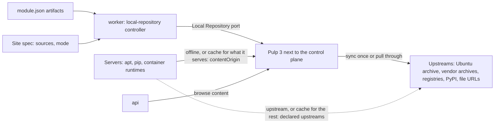

# Local Repository 設計與規範

本文件是 Site 的 [Local Repository](glossaries/terms/local-repository.md) 的現行規格：部署需要的 artifact（OS 套件、
container image、Python 套件與檔案）從哪裡取得、Site 怎麼以模式選擇不用它、把它當成快取，或只從它取得、swallow 擁有
什麼、provider（目前是 Pulp 3）實現什麼。決策與否決過的方案見 [decision 078](../decisions/078-local-repository.md)（local
repository）。

> **讀者**：修改 Local Repository 本身的開發者與 agent：它的 provider interface 與 Pulp adapter、controller、Site 的模式
> `mode`、受理時的檢查、trusted var `swallow_artifacts` 與共用 role `artifact_sources`，或新增一種格式。只在
> 模組中宣告 `artifacts`，或撰寫取得 artifact 的 role 時，讀 [module-authoring.md](module-authoring.md)；
> 只透過 API 讀寫時讀契約
> [local-repository.md](../../api-server/docs/development/api-contracts/api-server/local-repository.md)。Pulp 的
> service、資料庫與 port 見 [installation.md](installation.md)。

> **現況**：`deb`、`oci`、`python`、`file` 四種格式由 Pulp adapter 實現；`rpm`、arm64 與從磁碟匯入只在設計上預留（§9）。

---

## 1. 要解決的問題

以前每個 role 在部署時直接從網際網路取得 artifact：Ubuntu 與廠商的 apt 套件庫、GitHub release 的 binary、
Docker Hub、Quay 與 `registry.k8s.io` 的 image、PyPI 的 Python 套件。結果是：

- **部署時間隨 Server 數與對外頻寬增加**：每台 Server 各自下載同樣的東西，而對外速度隨時間大幅變動。2026-11-05 晚上
  lab 的三台 VM 同時下載 k0s，各只有約 60 KB/s，262 MB 的 binary 下載到約 230 MB 時中斷，部署失敗；隔天早上同一條
  路徑是 7 MB/s。
- **沒有網際網路的 Site 不能部署。**
- **站點上沒有固定、也沒有驗證**：部署裝了什麼，取決於上游當天提供什麼；上游移除某個版本，用到它的部署就失敗。

## 2. 設計

**部署需要的每個 artifact 都由模組宣告，Site 以模式選擇從哪裡取得**：模組宣告的上游、把 Site 的 Local Repository 當成
快取，或只從 Local Repository 取得（§2.1）。各種來源取得的是同一份宣告：版本、檔案的 sha256 與 deb 來源的簽章金鑰都
相同，差別只在位址。

Local Repository 是一個 provider 類別：core 定義它的 port，Pulp 3 是目前的 adapter，以 Site 的 `repository` Integration
登錄，與控制平面共置，每個 installation 都安裝。swallow 擁有「它必須包含什麼」，provider 擁有 artifact 本身；Site 使用
它時，worker 的 controller 把前者收斂到 provider，Server 上的 apt、pip、uv 與 container runtime（containerd、Docker、Podman）
指向它：`offline` 模式全部指向它，`cache` 模式只把它已經提供的部分指向它。

Site 使用 Local Repository 時，每個 artifact 在一個 Site 只跨過網際網路一次（預先抓取時，或第一次被要求時），之後每台
Server 都從同一個 LAN 位址讀取；內容在站點上固定、經過驗證，之後也能改成匯入而不是同步，讓沒有網際網路的 Site 部署
（§9.1）。

### 2.1 Site 的模式：`mode`

Site 的 Local Repository spec 有 `mode`（[Local Repository Mode](glossaries/terms/local-repository-mode.md)），預設
`upstream`：

| `mode` | 部署從哪裡取得 | controller（§7.1） | 受理（§8.1） |
| --- | --- | --- | --- |
| `upstream`，或 Site 沒有 `repository` Integration | 每個 artifact 從模組宣告的上游：檔案從它的 URL（以 sha256 驗證）、image 從它的 registry、Python 套件從 PyPI、模組宣告的 deb 來源從它的 URL（以模組宣告的 `signingKey` 驗證）；主機保留自己的 OS 套件來源 | 不收斂；`ready` 為 `false`，reason `not_serving` | 不看 Local Repository |
| `cache` | Local Repository 已經提供的從它取得，其餘從模組宣告的上游，在受理時逐項決定（§8.1） | 收斂 | Local Repository 能使用（Integration 啟用、上一輪沒有被擋下、已觀察過、位址已讀到）就受理，不等內容同步；否則 `409` |
| `offline` | 每個 artifact 從 Local Repository | 收斂 | Local Repository 提供每一項（§7.2 的 `ready`）才受理，否則 `409` |

- **`offline` 不是 fallback**：Local Repository 還沒 `ready` 時，部署照樣被拒絕，swallow 不改從上游取得
  （[architecture-spec.md](architecture-spec.md) 的原則 8：沒有能力時不建立同形狀的替代品）。`repository` Integration
  停用是暫停（§7.1），不切換來源：`cache` 或 `offline` 的 Site 在 Integration 停用期間不能部署。
- **`cache` 是 user 明確的選擇**：它不是 Local Repository 沒準備好時的替代品，而是 user 選擇「有就從它取得、還沒有就從
  上游」；每次執行的 `swallow_artifacts` 記下每一項從哪裡取得（§8.1）。Server 因此必須連得到上游。
- **`offline` 還不是 air-gap**：Server 只連 Local Repository，但 deb 套件以 `on_demand` 取得、Python 套件經 pull-through，
  Local Repository 本身仍在第一次被要求時連上游，所以控制平面要能連網際網路。完全離線的 Site 等從磁碟匯入（§9.1）。
- **預設**：installation 登錄 Integration 時寫入 `upstream`，user 為 Site 換成其他模式（§4.1）。開發環境
  （`deploy/dev/seed.sh`）寫入 `cache`。
- **切換**：寫入 spec，不經 Change Plan：它決定之後的部署從哪裡取得，不改變已部署主機上的軟體。換成 `cache` 或
  `offline` 時 controller 開始收斂；換成 `upstream` 時 controller 停止收斂，Pulp 裡已有的內容保留，再換回來時從這些內容
  繼續收斂。已受理的 Workflow 沿用受理時的來源；已部署的主機在下一支取得 artifact 的 playbook 在它上面執行時，與 Site
  目前的模式一致（§8.2）。

## 3. 所有權

依 [desired-state-model.md](desired-state-model.md) §3 分類：

| 事實 | 類別 | 寫入者 | 儲存 |
| --- | --- | --- | --- |
| 模組宣告的 artifact（`module.json` 的 `artifacts`） | desired，由 release 編入的模組決定 | 模組作者，隨 release 改變 | 不存；每次由模組 registry 讀取 |
| Site 的 user 來源（`spec.sources`）、`spec.mode` 與 `generation` | desired | API（admin） | `local_repositories` |
| 有效內容：兩者的合併（§5.3），與每一項的 `declaredBy` | derived | — | 不存，每次重算 |
| 每個來源、檔案與宣告的 image 的同步狀態（`state`、`message`、來源的 `serving`、`lastSyncedAt`、`contentCount`、`sizeBytes`）與 `observedAt` | observed | Local Repository controller 讀回 provider | `local_repositories` |
| `ready` | derived | — | 由 spec 的模式與同步狀態推導（§7.2） |
| 一次部署的 artifact 來源（trusted var `swallow_artifacts`） | derived | Workflow 的受理 | 受理時凍結在 Task 的 trusted vars（§8.1） |
| artifact 本身、套件索引與 metadata | provider | provider | 不存；瀏覽時即時讀取（§7.3） |
| endpoint、`contentOrigin`、admin credential | Integration 的設定 | API | `integrations`（credential 封存，只寫不讀） |
| deb 的簽章金鑰 | provider | 安裝時在 provider 建立 | 私鑰只在 provider；公鑰由 adapter 讀出，交給部署（§8.1） |

swallow 不保存 artifact：它擁有的是「Site 必須有什麼」與「從哪裡取得」，不是內容本身。

## 4. Integration 與 provider

### 4.1 `repository` Integration

- kind `repository`、provider kind `pulp`。一個 Site 至多一個。
- **endpoint**：swallow 呼叫 provider API 的位址（開發環境是 Compose 網路內的 `http://pulp-web:8080`）。
- **setting `contentOrigin`**：Server 讀取內容的位址，production 是 `http://<SWALLOW_ADDRESS>:<port>`，開發環境是主機
  的 LAN 位址加 `PULP_HTTP_PORT`（例如 `http://10.170.168.20:8080`）。它與 endpoint 分開，因為 swallow 在 Compose 網路內
  連到 provider，Server 則從 LAN 連到它。
- **credential**：Pulp admin 的密碼（Basic auth，帳號 `admin`），封存、只寫不讀。
- production 由 `deploy/production/bootstrap.sh` 經已發佈的 API 登錄這個 Integration，並在 spec 從未寫入過時寫入 Site 的
  `ubuntu` 來源（§5.2）與 `mode` `upstream`；testing stack 的 `deploy/testing/seed.sh` 相同。開發環境由
  `deploy/dev/seed.sh` 以同樣的方式登錄（設了 `PULP_ORIGIN` 時），但寫入 `mode` `cache`，讓開發站預設把 Local
  Repository 當成快取，不必等第一次同步完成就能部署。

### 4.2 port 與 adapter

- port `Repository` 在 `internal/core/localrepo/domain`（路徑相對於 `api-server/`；application 與 delivery 在同一個
  context），只用 core 的詞彙：格式 `deb`、`rpm`、`oci`、`python`、`file`，來源、檔案、image、Python requirement 與
  同步狀態。`pulp`、`apt`、`dnf` 只出現在 adapter 與模組（[core-and-extensions.md](core-and-extensions.md) §3）。
- Pulp adapter 在 `internal/adapters/localrepo/pulp`：把有效內容翻譯成 Pulp 的 remote、repository、publication 與
  distribution，把 Pulp 的 task 與已儲存的內容讀回成同步狀態。它不在記憶體保存同步狀態，每次都依名稱找 Pulp 的物件、讀
  Pulp 的 task，所以 Pulp 物件的名稱與 base path 是和既有安裝之間的契約，改了就會讓已有的內容失去對應。唯一的例外是
  adapter 自己經 registry 下載宣告的 image（Pulp 沒有對應的 task）：process 記得正在下載哪些 image、哪些最近下載失敗，
  只用來避免重複下載與控制重試的間隔，由同一個 factory 交出的每個 Repository 共用；image 是否已儲存仍每次讀 Pulp。
  process 重新啟動後這些紀錄就沒了，被中斷的下載在下一輪重新開始（§7.1）。
- adapter 確保的每個 remote（deb、oci 的 pull-through、python）都帶下載逾時：整體 `total_timeout` 6 小時、
  `sock_read_timeout` 5 分鐘；以 `file_url` 下載檔案時以 `downloader_config` 帶同樣的值。既有的 remote 沒有這些值時更新
  它，oci 來源還包括 Pulp 為每個經它 pull 過的 image 建立的 remote。營運注意：2026-11-06 在 lab 更新既有 remote 的逾時
  之後，已在執行的 pulp-content 仍以舊的 300 秒中斷下載，重新啟動 pulp-content 後才生效；既有的安裝升級後，在 worker
  更新了 remote 之後重新啟動 pulp-content。
- 錯誤分三類回報：`unavailable`（無法連線、逾時或 provider 端失敗，暫時性，重試）、`auth`（credential 被拒，修正
  Integration 後重試）、`rejected`（provider 拒絕這個請求，重複相同的請求也會失敗）。
- store 在 `internal/adapters/store/mongodb/localrepo`，collection `local_repositories`，每個 Site 一份。

改 adapter 前要知道的 Pulp 事實（2026-11-06 依官方文件與原始碼確認）：

- all-in-one image 一律啟動內建的 PostgreSQL；使用外部資料庫時改用 `pulp-minimal`（api、content、worker 分開執行）
  加 `pulp-web`（nginx）。
- registry 的 `/v2/` 必須在 Pulp 的 host:port 根路徑，所以 registry 與其他內容共用一個位址，不能放在路徑之下。
- container 的匿名 pull-through 需要 pulp_container 2.30.1／2.29.3 以上。
- deb 沒有 pull-through，以 `on_demand` 同步加 APT（structured）publisher；Release 要簽章，主機才不必 `trusted=yes`。
- python 的 pull-through 是在 distribution 上設 `remote`，simple API 在 `/pypi/<base_path>/simple/`。
- file 可以用 `file_url` 讓 Pulp 的 worker 下載單一 URL，但不能事先指定 sha256，所以下載後比對。
- remote 的 `total_timeout` 是 `null` 時，pulpcore 改用 aiohttp 預設的整體逾時 300 秒（`0` 不能關閉它），對外頻寬慢時
  超過 5 分鐘的下載會被中斷、從頭重來（`[PLP0005] Request timed out`）。`file_url` 的下載不經 remote，逾時要以
  `downloader_config` 指定。
- container 的 pull-through 為每個被 pull 的 image 建立一個 container remote，建立時複製 pull-through remote 的設定，
  之後那個 image 的 blob 都經它下載；之後再改 pull-through remote 不會改到已建立的 image remote。
- pull-through 只記下 upstream 的 blob 在 `/content/container/blobs/` 的 `artifact` 是 `null`，Pulp 完整下載它之後
  才儲存、有 artifact；`digest__in` 可以一次查多個 digest。

### 4.3 授權

Pulp 的 pulpcore 與 deb、container、python、file、rpm plugin 都是 GPLv2-or-later。swallow 以未修改的獨立 service 使用
它，只經 HTTP API 溝通，不修改也不 link 它，所以可以商用。release 若自己附帶 Pulp 的 image，而不是釘選上游的 image，
就要盡 GPL 的再散布義務（提供對應原始碼的取得方式）。這不是法律意見，正式商用前請法務確認。

## 5. 內容：模組宣告與 Site 的來源

### 5.1 模組宣告

每個模組在 `module.json` 的 `artifacts` 宣告它的 playbook 要取得的東西（欄位與寫法見
[module-authoring.md](module-authoring.md)）：

- `sources`：OS 套件來源（[Repository Source](glossaries/terms/repository-source.md)），含 `name`、`format`、`url`、
  `suites`、`components`、`architectures`，例如 Docker CE 的 `docker-ce`。deb（與之後的 rpm）來源必須帶 `signingKey`：
  上游簽它的 metadata 的公鑰，`url`（https）與 `fingerprint`（OpenPGP fingerprint，40 個十六進位字，以大寫保存），其他
  格式不得有。Site 從上游取得時，主機下載這把金鑰、確認 fingerprint 之後以它驗證來源（§8.2）；從 Local Repository 取得
  時，主機以 Site 自己的金鑰驗證（§6）。
- `files`：單一檔案的 `path`、`url` 與 `sha256`，例如 k0s 的 binary。
- `images`：container image 的 reference，例如 `quay.io/k0sproject/pause:3.10.2-0`。
- `python`：Python requirement，例如 `numpy==2.5.4`。

同一個 path 的 file 在模組之間必須有相同的 URL 與 sha256，同名的 source 必須有相同的格式、URL 與 `signingKey`，否則模組
registry 建立失敗。source 的合併規則見 §5.3。

### 5.2 Site 的來源

- user 的來源存在 Site 的 Local Repository spec（`spec.sources`，帶 `generation`），形狀與模組宣告的 source 相同，但沒有
  `signingKey`：它們只經 Local Repository 提供，Site 從上游取得時主機不加入它們。寫入整份取代 spec（`mode`
  必填）；帶的 `generation` 與目前的不同時回 `409`（[desired-state-model.md](desired-state-model.md) §11.1）；與模組宣告
  矛盾的來源（同名但格式或 URL 不同）拒絕寫入。
- user 也可以加其他格式的來源，例如以 registry host 為名的 `oci` 來源，把那個 registry 的上游換成內部 mirror（§5.3）。
- OS 的套件來源是 Site 的來源，不是模組宣告：它屬於 Site 部署的 OS，不屬於任何模組，要換成內部 mirror 或加上 suite
  時只改 Site 的 spec。Ubuntu archive 是 `ubuntu`：`http://archive.ubuntu.com/ubuntu/`，suites `noble`、
  `noble-updates`、`noble-security`，components `main`、`universe`，`amd64`。production 的 `bootstrap.sh`、testing 與
  開發環境的 `seed.sh` 只在 spec 從未寫入過（`generation` 為 `0`）時寫入它與 `mode`（§4.1），user 之後刪掉
  它也不會被加回。主機的 apt 從上游取得時（`upstream` 模式，或 `cache` 模式還沒提供每個 deb 來源時），OS 套件來自主機
  自己的 OS 套件來源，不經這個來源。
- spec 的寫入直接收斂，不經 Change Plan：它決定之後的部署能取得什麼、從哪裡取得，不改變已部署主機上的軟體。從 spec
  移除的來源，controller 也從 provider 移除它建立的物件（§7.1）。

### 5.3 有效內容

- 有效內容是模組宣告與 Site 來源的合併；`declaredBy` 列出每一項的宣告者，值是 `module:<id>` 或 `user`。
- 同名的 source 合併：第一個宣告決定格式與 URL，之後格式與 URL 相同的宣告加入它的 suite、component 與 architecture
  （取聯集）。格式或 URL 不同的宣告是矛盾，不納入有效內容並記在 log；user 的寫入會造成矛盾時直接拒絕（§5.2）。
- oci 與 python 的上游不必宣告，由宣告推導出 pull-through 的來源：每個被宣告的 image 引用的 registry host 一個 `oci`
  來源，名稱就是 host（例如 `docker.io`），上游是 `https://<host>`；有 Python requirement 時一個 `python` 來源 `pypi`
  （`https://pypi.org/`）。已宣告同名、同格式的來源時，以它的 URL 為上游。
- 宣告的 image 在它的 registry 來源 `ready` 之後預先抓進 provider，並持續觀察到它的每一層都已儲存；下載被中斷或失敗時
  重新抓取。其他 pull-through 的內容（包括 Python 套件）在第一次被要求時取得並保留。所以 `python` 來源 `ready` 只表示
  provider 能提供它，不表示宣告的 Python 套件已在 Site：Site 第一次部署需要它們的 playbook 時，provider 必須連得到
  PyPI。沒有網際網路的 Site 要等從磁碟匯入（§9.1）。

## 6. 各格式怎麼實現

Site 使用 Local Repository 時，各格式這樣實現；從上游取得時主機怎麼設定見 §8.2。

| 格式 | 上游 | provider 怎麼取得 | Server 怎麼讀 |
| --- | --- | --- | --- |
| `deb` | 宣告的來源（模組或 Site） | `on_demand` 同步宣告的 suite、component 與 architecture：metadata 先鏡像，套件在第一次被要求時取得並保留；每次同步以上游為準（mirror），additive 同步會讓上游更新後同路徑的新舊索引並存而被 Pulp 拒絕；以 Site 自己的金鑰簽章 Release | deb822 來源 `<contentOrigin>/pulp/content/deb/<name>/`，以 Signed-By 驗證 |
| `oci` | 每個 registry host 一個 pull-through 來源 | 第一次 pull 時取得並保留；宣告的 image 預先經 registry 抓取（index 取 linux/amd64），直到 config 與每一層都已儲存才是 `ready`；下載失敗時隔一段間隔再抓，被中斷的下載在下一輪重新開始 | containerd 的 mirror `<contentOrigin>/v2/<host>`；Docker 與 Podman 直接寫 `<registry>/<host>/<repository>:<tag>` |
| `python` | `pypi` | pull-through：第一次被要求時取得並保留 | pip 與 uv 的 index `<contentOrigin>/pypi/pypi/simple/` |
| `file` | 每個宣告檔案自己的 URL | 下載一次，與宣告的 sha256 比對；不符時移除、該檔案為 `failed`，隔一段間隔再重新下載 | `<contentOrigin>/pulp/content/files/<path>`，role 再以 sha256 驗證 |
| `rpm` | 宣告的來源 | 設計上預留（§9） | — |

deb 內容以 Site 的簽章驗證，檔案以 sha256 驗證；oci 與 python 和安裝的其他部分一樣以 plain HTTP 提供
（[installation.md](installation.md)）。

## 7. 收斂與狀態

### 7.1 controller

- worker 的 `local-repository` controller，key 是 Site，遵守 [desired-state-model.md](desired-state-model.md) §7。
  觸發來源：spec 的寫入（change feed，包括切換 `mode`）、`repository` Integration 的登錄、變更與
  刪除、定期 resync（desired-state-model §7.6），以及 user 要求的立即收斂（`POST .../sync`，寫入 convergence request，
  喚醒每個 Site）。
- 每一輪：重算有效內容；先從 provider 移除 swallow 之前建立、但已不在有效內容中（或改了格式）的來源；再經 port 在
  provider ensure 每個來源與檔案，接著 ensure registry 來源已 `ready` 的每個宣告的 image（來源還沒 `ready` 的 image 不問
  provider，記為 `pending`）；讀回 Server 讀取內容的位址；最後把每一項的同步狀態連同 `observedAt` 寫入 status，它是
  status 唯一的寫入者。ensure 不等待同步完成：還有 `pending` 或 `syncing` 的項目時，這一輪以錯誤結束，由 runtime 以
  有上限的退避再跑（等待一個 `failed` 來源的 image 除外，它等定期 resync）。每一輪都是 ensure，所以在 provider 中被刪除
  的內容會在下一輪補回，沒有下載完的 image（例如 process 重新啟動而中斷）也在下一輪重新下載。
- 模組宣告隨 release 改變：升級後 process 重新啟動，下一輪就收斂新的宣告。
- provider 無法連線或拒絕 credential 時，這一輪停止，依 desired-state-model §7.5 退避，status 保留上一次的觀察（只是
  變舊）。單一來源、檔案或 image 失敗（provider 拒絕它、上游取不到、sha256 不符、registry 沒有這個 image）時，只有那一項
  為 `failed` 並帶 `message`，其他項目照常收斂；之後的每一輪都再 ensure 它，adapter 對最近失敗的項目隔一段間隔才重新抓取。
- `mode` 是 `cache` 或 `offline` 時收斂，兩者的收斂相同，差別只在受理（§8.1）。`mode` 是 `upstream` 時不收斂：不呼叫
  provider，不同步、不抓取、也不移除，provider 已有的內容保留；只把 `ready` condition 記為 `false`、reason `not_serving`，`realized` 保留上一次的判斷，來源、檔案與 image
  保留上一次的觀察。
- `repository` Integration 停用時同樣暫停，reason 是 `integration_disabled`。Integration 被刪除時清空 status、保留 spec，
  讓之後登錄的 Integration 從同一份 spec 開始；Site 刪除後連紀錄一起刪除。

### 7.2 狀態

- 每個來源、檔案與宣告的 image 的 `state` 是 `pending`、`syncing`、`ready` 或 `failed`（意義見 glossary
  [Repository Source](glossaries/terms/repository-source.md)）。image 只有在 provider 儲存了它的 config 與每一層之後才是
  `ready`，`sizeBytes` 是它們的總大小。
- 定義變了、還沒以新定義觀察過的項目讀成 `pending`；status 裡沒有的 image（還沒觀察過，或 reference 改了）也是。
- 來源另有 `serving`（glossary 的 served）：provider 正在提供這個來源**目前定義**的內容，與 `state` 分開，由 adapter
  讀回。deb 來源在最後一次成功的同步是以目前的 remote 定義執行、而且 repository 有 publication 時為 `true`；每天的重新同步
  （`resyncInterval`）執行中（`syncing`）或失敗（`failed`）時仍是 `true`，因為 distribution 照樣提供上一次同步的
  publication；定義改了之後，到以新定義同步完成之前是 `false`。oci 與 python 的 pull-through 來源在 provider 能經它
  pull（`state` 為 `ready`）時為 `true`。定義變了、還沒以新定義觀察過的來源讀成 `false`。
- `ready`：部署在 Site 的模式下會被受理。
  - `upstream`：永遠是 `false`（reason `not_serving`），部署從上游取得，不看它。
  - `cache`：Site 的 `repository` Integration 已啟用，controller 已觀察過、最近一輪沒有因 Integration 或 provider 而
    停止（連不上、credential 缺少或被拒、沒有 `contentOrigin`、設定被 adapter 拒絕），而且已讀到 Server 讀取內容的位址。
    內容的同步狀態不在其中。
  - `offline`：除了 `cache` 的條件，有效內容的每個來源都在提供中（`serving`），每個檔案與宣告的 image 都是 `ready`。
    所以 image 還沒抓完時部署被拒絕，而不是在部署時才由 provider 從網際網路抓取；而來源每天重新同步時不拒絕部署。

  不是 `ready` 時，API 列出要換模式、啟用、修正或等待什麼。
- controller 把判斷寫成三個 condition（desired-state-model §4.2）：`ready`、`realized`（provider 是否提供每一項有效內容）
  與 `requires_attention`（user 必須修正 Integration 時為 `true`）。reason 的完整清單以契約的 Conditions 一節為準。

### 7.3 API 與 dashboard

- API（admin）：讀取摘要與同步狀態、依格式分頁瀏覽內容（標出宣告的模組）、寫入 spec（user 的來源與
  `mode`）、要求立即收斂。路由與欄位以契約
  [local-repository.md](../../api-server/docs/development/api-contracts/api-server/local-repository.md) 為準。
- 瀏覽內容時由 api 經 port 即時讀取 provider，不存在 swallow。
- dashboard：Infrastructure 底下的 Local repository 頁，可切換 Site 的 `mode`（Upstream sources、Cache、Offline），顯示
  來源、檔案與宣告的 image 的同步狀態（包括同步中仍提供上一次同步的來源），並可依格式瀏覽內容。CLI 目前沒有指令。

## 8. 部署從哪裡取得

### 8.1 playbook 的旗標、trusted var 與受理

- `api-server/modules/manifest.json` 中標成 `"fetchesArtifacts": true` 的 playbook 會安裝或下載模組宣告的 artifact。
  受理會執行這類 playbook 的 Workflow 時（OS 部署的 Task、Platform 的部署、Managed Software 的 install 或 uninstall，
  以及 `POST /api/v1/workflows`），swallow 讀 store 決定 Site 的 artifact 從哪裡取得（不呼叫 provider，所以 provider 暫時
  沒有回應不會讓受理卡住）：
  - Site 沒有 `repository` Integration，或 `mode` 是 `upstream`：從上游取得，不看 Local Repository。
  - `offline`：從 Local Repository 取得。它不是 `ready`（§7.2）時以 `ErrLocalRepositoryUnavailable` 拒絕（`409`），在
    建立任何 Workflow 之前；訊息指出要啟用 `repository` Integration、修正 controller 上一輪停止的原因（例如缺少
    `contentOrigin`），或要等待（或修正）哪個來源、檔案或 image。swallow 不退回上游（§2.1）。
  - `cache`：Local Repository 不是 `ready`（Integration 停用、上一輪被擋下、還沒觀察過或位址還沒讀到）時同樣以
    `ErrLocalRepositoryUnavailable` 拒絕；內容的同步狀態不拒絕。受理時依 status 逐項決定：
    - apt 整組決定：有效內容至少有一個 deb 來源，而且每個都在提供中（`serving`）時從 Local Repository，否則整組從上游
      （主機保留自己的 OS 套件來源，只加模組宣告的 deb 來源）。沒有任何 deb 來源時從上游，否則主機的 apt 來源會全部被
      停用而沒有替代。不逐來源混用，因為 user 的來源沒有 `signingKey`，不能從上游驗證；而且只有
      Site 的 OS 套件庫在提供中時，才能停用主機自己的來源。
    - Python：`python` 來源（`pypi`）在提供中時用 Local Repository 的 index，否則 `""`。
    - image：所屬 registry host 的 `oci` 來源在提供中時經 Local Repository（pull-through 在第一次 pull 時取得），否則用原本
      的 reference；`registry_mirrors` 只列提供中的 host。宣告 image 的預先抓取照舊，但不影響這個決定。
    - 檔案：`ready` 的從 Local Repository，其餘從宣告的 URL。兩種都以宣告的 sha256 驗證。

  worker 啟動的 Platform Workflow（platform controller 收斂 spec 的變更）同樣被拒絕，由 Platform 的 `realized`
  Condition 回報訊息。
- 受理時 `ExecutionService.PrepareAnsibleStep` 注入 trusted var `swallow_artifacts`，之後不再改變（`swallow_` 前綴的變數
  client 不能偽造，見 [software-deployment.md](software-deployment.md) §4.2）。各模式的 key 相同：

  | key | `offline`（`source: local_repository`） | `upstream`（`source: upstream`） | `cache`（`source: cache`） |
  | --- | --- | --- | --- |
  | `source` | `local_repository` | `upstream` | `cache` |
  | `apt` | `local_repository` | `upstream` | apt 整組的決定，`local_repository` 或 `upstream` |
  | `deb` | 有效內容中每個 deb 來源（模組與 Site 的），依 `name` 排序：`name`、`uri`（`<contentOrigin>/pulp/content/deb/<name>/`）、`suites`、`components`；`signing_key_url` 與 `signing_key_fingerprint` 是 `""` | 只有模組宣告的 deb 來源：`uri` 是宣告的 URL，`signing_key_url` 與 `signing_key_fingerprint` 是宣告的 `signingKey` | 依 `apt`，同左邊兩欄之一 |
  | `deb_signing_key` | Site 的 deb 簽章公鑰（ASCII armor；沒有簽章時 `""`） | `""` | `apt` 是 `local_repository` 時同 `offline`，否則 `""` |
  | `registry` | registry 的 host:port，也就是 `contentOrigin` 去掉 scheme | `""` | 有任何 image 或 mirror 經 Local Repository 時同 `offline`，否則 `""` |
  | `registry_mirrors` | 每個 registry host 的 mirror URL（`<contentOrigin>/v2/<host>`） | `{}` | 只列提供中的 host |
  | `python_index` | `<contentOrigin>/pypi/pypi/simple/` | `""`（pip 用它自己的預設 index） | `pypi` 提供中時同 `offline`，否則 `""` |
  | `files` | 宣告的 path → `<contentOrigin>/pulp/content/files/<path>` | 宣告的 path → 宣告的 URL | 逐項，同左邊兩欄之一 |
  | `images` | 宣告的 reference → `<registry>/<reference>` | 宣告的 reference → 它自己 | 逐項，同左邊兩欄之一 |

  `files` 與 `images` 永遠列出每個宣告的檔案與 image；沒有內容的 key 是空的。`apt` 是後來加的：之前受理、已凍結的值
  沒有它，role 由 `source` 推導。形狀與範例以契約的 Deployments 一節為準。
- `deb` 只列有效內容（Local Repository）或模組宣告（上游）中的 deb 來源，主機永遠不會被 swallow 指向它不管理的來源。

### 8.2 `artifact_sources`

每個這類 playbook 在取得 package hold
（[decision 073](../decisions/073-hold-os-package-maintenance-during-automation.md)（hold os package maintenance during
automation））之後，在安裝或下載任何東西之前，先跑共用 role `artifact_sources`
（`api-server/modules/shared/roles/artifact_sources/`）。沒有 `swallow_artifacts`，或它的 `source` 不是
`local_repository`、`upstream` 或 `cache`，或 apt 的來源（`apt`，沒有時由 `source` 推導）不是 `local_repository` 或
`upstream` 時，它以 `[artifact_sources_missing]` 失敗。呼叫者以 `artifact_sources_containerd`、
`artifact_sources_docker`、`artifact_sources_podman` 指定它的 run 用哪些 container runtime 拉 image；
`artifact_sources_root` 是加在每個寫入路徑前面的前綴，只給內容測試把 role 指到暫存目錄（主機上是空的）。

role 不看整體的 `source`，每個管道看自己的資料，所以 `cache` 模式的混合結果不需要第三套行為：

| 管道 | 指向 Local Repository（下面的 `local_repository`） | 指向上游（下面的 `upstream`） |
| --- | --- | --- |
| apt | `apt` 是 `local_repository` | `apt` 是 `upstream` |
| pip 與 uv | `python_index` 不是空的 | `python_index` 是空的 |
| containerd、Docker、Podman | `registry` 不是空的（只設定呼叫者指定的 runtime） | `registry` 是空的 |

主機上的路徑在兩種方向相同，也和改名前的 role 相同，所以舊 role 收斂過的主機由它接手：

| 路徑 | 內容 |
| --- | --- |
| `/etc/apt/sources.list.d/swallow-local-repository.sources` | role 加的 apt 來源（deb822），兩種方向都寫在這裡，每個 stanza 有自己的 Signed-By |
| `/etc/apt/keyrings/swallow-local-repository.asc` | Site 的 deb 簽章公鑰（只在 `local_repository`） |
| `/etc/apt/keyrings/swallow-upstream-<name>.gpg` | 每個上游 deb 來源驗證過的金鑰，binary（只在 `upstream`） |
| `/etc/apt/apt.conf.d/90swallow-local-repository` | `Acquire::http::Proxy::<repo host> "DIRECT";`（只在 `local_repository`） |
| `/etc/pip.conf` | pip 的 index（只在 `local_repository`，帶 swallow 的標記） |
| `/etc/uv/uv.toml` | uv 的系統層級設定：預設 index 與 `python-downloads = "never"`（只在 `local_repository`，帶 swallow 的標記） |
| `/etc/k0s/containerd.d/swallow-registry-mirrors.toml` 與 `/etc/k0s/containerd.d/certs.d/` | k0s 的 containerd 的 mirror（只在 `local_repository`） |
| `/etc/docker/daemon.json` 的 `insecure-registries`，與 `/var/lib/swallow/artifact-sources/docker-insecure-registry` | role 加入的 registry 與它的紀錄（只在 `local_repository`） |
| `/etc/containers/registries.conf.d/50-swallow-local-repository.conf` | Podman 的 drop-in（只在 `local_repository`） |

**`local_repository`**：

- apt：寫入 Site 的金鑰與 Local Repository 的每個 deb 來源，並寫入 DIRECT 設定，讓 apt 即使在 provisioner 設了 HTTP
  proxy 時也直接連到 Local Repository。主機其他所有含有效行的 apt sources（`sources.list` 與 `sources.list.d` 中的每個
  `*.list`、`*.sources`，不論是發行版、image（例如 GPU 廠商的 archive）或 user 加的）都改名為 `.disabled-by-swallow`
  停用而不刪除，否則 apt 每次 update 仍會從網際網路抓它們的索引；主機還需要的 archive 要加成 Site 的 user 來源（§5.2）。
  移除每個 `swallow-upstream-*.gpg` 金鑰，再刷新套件索引。
- pip：`/etc/pip.conf`（`index-url` 與 `trusted-host`）。
- uv：`/etc/uv/uv.toml`，以 Local Repository 的 Python index 為唯一的預設 index（`[[index]]` 的 `default = true`），並以
  `python-downloads = "never"` 禁止 uv 自己下載 Python（Python 由使用 uv 的 role 提供，[decision 080](../decisions/080-host-toolchains-probe-first.md)（host toolchains probe first））。uv
  讀這個系統層級的檔，環境變數與命令列參數優先於它，所以 role 不必傳任何 index。plain HTTP 的 index 不需要
  `allow-insecure-host`（2026-11-08 以 uv 0.13.7 對 plain HTTP 的 PEP 503 index 確認；對 Pulp 的 index 仍待 lab 確認）。
- container runtime（呼叫者指定的才設定）：
  - k0s 的 containerd：drop-in（`version = 3`，`config_path`）與 `certs.d/<host>/hosts.toml`（`override_path = true`）。
    k0s 1.36 使用 containerd 2，drop-in 必須是 `version = 3`；hosts.toml 帶路徑時要 `override_path = true`。
  - Docker：把 Local Repository 的 registry 加進 `daemon.json` 的 `insecure-registries`，並把加入的 registry 記在
    `/var/lib/swallow/artifact-sources/docker-insecure-registry`。原本就列著的 registry 算是 user 的，不記錄，之後也不移除；
    registry 改了時，以新的換掉紀錄中的舊值。`daemon.json` 的其他 key 與項目不動；檔案改了而 Docker 在執行時 reload 它
    （dockerd 在 SIGHUP 時重讀 `insecure-registries`，container 不中斷）。
  - Podman：drop-in，把 registry 標成 plain HTTP。

**`upstream`**：

- apt：
  - 把每個 `*.disabled-by-swallow` 的來源改回原名；原名的檔案已經又存在時保留主機的那一份。
  - 主機某個有效的來源行已經含有某個宣告來源的 URI 時，那個來源交給主機自己的檔案，role 不加：apt 在同一個 URI 有兩個
    不同的 Signed-By 時拒絕讀取所有來源，而在 Local Repository 之前由 swallow 安裝過 Docker CE 或 Grafana 的主機帶著
    `docker.list`、`grafana.list`。
  - 其他每個宣告的來源：把 `signing_key_url` 的金鑰下載到暫存目錄，以 `gpg --show-keys --with-colons` 確認其中每把
    primary key 的 fingerprint 都等於 `signing_key_fingerprint`（apt 信任 keyring 中的每一把金鑰，所以多一把也不行），
    以 binary 安裝成 `/etc/apt/keyrings/swallow-upstream-<name>.gpg`，再為每個來源寫一個以它自己的金鑰 Signed-By 的
    stanza。fingerprint 不符時以 `[artifact_signing_key_mismatch]` 失敗；主機沒有 gpg，或 URL 提供的不是 OpenPGP
    公鑰時以 `[artifact_signing_key_unverifiable]` 失敗。兩者都在 apt 讀到任何以它簽章的東西之前停下，所以主機需要 gpg。
  - 移除 Site 的金鑰、DIRECT 設定與這次不再加的來源的金鑰，再刷新套件索引。主機的 OS 套件來源照舊使用。
- pip 與 uv：移除帶 swallow 標記的 `/etc/pip.conf` 與 `/etc/uv/uv.toml`（沒有標記的是 user 的，保留）。
- container runtime：移除 containerd 的 drop-in 與整個 `certs.d` 目錄、紀錄中的 Docker registry（保留 `daemon.json` 的
  其他 key 與 user 的項目，再 reload Docker）與 Podman 的 drop-in。這些清除不看 `artifact_sources_containerd`、`_docker`、
  `_podman`：主機上任何指向 Local Repository registry 的設定都要移除。

兩種方向都是 ensure：Site 切換模式之後（或 `cache` 模式的 Local Repository 提供了更多內容之後），主機在下一支這類
playbook 在它上面執行時與那次受理的來源一致，再次執行沒有變更（套件索引每次都刷新）。沒有再執行這類 playbook 的主機
保留上一次的設定。

role 取得 artifact 的方式在各模式相同：檔案以 `{{ swallow_artifacts.files['<path>'] }}` 下載、以宣告的 sha256 驗證；
Docker 與 Podman 上的 image 寫成 `{{ swallow_artifacts.images['<reference>'] }}`；k0s 上的 image 寫原本的 reference
（從 Local Repository 取得時，containerd 經 mirror 解析）；模組宣告的 deb 來源以名稱確認它在 `swallow_artifacts.deb`
裡（`docker_ce` 與 `grafana` 沒有時以 `[artifact_source_missing]` 失敗）；pip 與 uv 不由 role 指定 index，讀這個 role 寫的
節點設定，所以只有這個 role 讀 `python_index`（decision 080）。
模組沒有宣告的 Grafana 版本仍會被拉取：從 Local Repository 時是 `<registry>/<reference>`，從上游時是原本的 reference。

### 8.3 防止回退

內容測試（`internal/adapters/hostautomation/ansible/artifact_sources_playbook_test.go`）在 `go test ./...` 中守住：

- 會安裝、下載或 pull 的 playbook（uninstall 除外）都標成 `fetchesArtifacts`（`TestFetchingPlaybooksAreMarkedFetchesArtifacts`），
  所以新的 playbook 不能悄悄從未宣告的地方取得東西。
- 標成 `fetchesArtifacts` 的 playbook 在任何取得的動作之前，先讓每個目標跑 `artifact_sources`
  （`TestArtifactPlaybooksPointAtTheirSourcesBeforeFetching`），並設定它用到的 container runtime
  （`TestArtifactPlaybooksConfigureTheirContainerRuntime`）。
- 發佈的 role 與 playbook 在註解以外不寫網際網路的 URL，下載一律取自 `swallow_artifacts.files`，引用的 image 都是宣告
  過的（`TestShippedContentFetchesOnlyDeclaredArtifacts`）；仍存在的例外列在測試的 allowlist 並寫出理由。
- role 釘選的檔案（defaults 中的 path 與 sha256）都是模組宣告的 file artifact，而且 checksum 相同
  （`TestPinnedFilesAreDeclaredModuleArtifacts`）。

其他守住這條路徑的測試：

- `artifact_sources_role_test.go` 在 localhost 實際執行 role：從 Local Repository 取得
  （`TestArtifactSourcesPointsTheHostAtTheLocalRepository`）、從上游取得（`TestArtifactSourcesAddsTheDeclaredUpstreams`，
  以 httptest 提供金鑰）、兩個方向的切換（`TestArtifactSourcesSwitchesModesBothWays`），以及 `cache` 模式的混合結果與
  它和兩種純方向之間的切換（`TestArtifactSourcesMixesChannelsInCacheMode`）。
- `playbook_catalog_artifacts_test.go`：manifest catalog 回報哪些 playbook 取得 artifact，並拒絕 schema 沒有的 key
  （包括退役的舊旗標），讓取得 artifact 的 playbook 不會在沒有 trusted var 的情況下執行。
- `internal/core/workflow/application/execution_service_artifacts_test.go`：`PrepareAnsibleStep` 注入
  `swallow_artifacts`，以及 Site 的 Local Repository 是 `cache` 或 `offline` 而它沒有 ready 時受理被拒絕。
- `internal/core/localrepo/application/resolver_test.go`：各模式的 `swallow_artifacts`，包括 `cache` 模式的逐項決定。

模組 registry 另外要求每個模組宣告的 deb 來源都帶 `signingKey`（§5.1），所以從上游取得的來源都經過驗證；`offline` 的
Local Repository 沒有 ready 時，部署在受理時就被拒絕，不會跑到一半才因為下載失敗而停下（§8.1）。

## 9. 之後的格式與能力

- **rpm**：來源的形狀相同，`format` 是 `rpm`，同樣帶 `signingKey`。之後只需要加上 adapter 的 rpm 分支（Pulp 的 rpm
  plugin）與 `artifact_sources` 的 dnf 設定；core、API 與模組宣告不必改。
- **arm64**：來源已帶 `architectures`；檔案與 image 的多架構另行設計。
- **從磁碟匯入**：見 §9.1。

### 9.1 從磁碟匯入（規劃中，尚未實作）

本節是之後版本的設計方向，不是現行行為。**啟動條件**：有完全離線的 Site 需求時再開發。

**目標**：只有區域網路、完全不能連網際網路的 Site 也能讓 swallow 整體在區域網路內運作。installation 本身的離線媒體已由
`deploy/third-party/offline-media-manifest.json` 描述；Local Repository 的內容改為從磁碟上的 bundle 匯入，而不是向上游
同步。這樣的 Site 連不到上游，所以部署只能從 Local Repository 取得（`mode` 為 `offline`，§2.1）；`offline` 模式已經
存在，匯入補上的是它目前還需要網際網路的部分（Local Repository 本身向上游取得 deb 與 Python 套件）。

**取得內容的方式**：

- Local Repository 取得內容的方式多一種「從匯入取得」，與現在的「向上游同步或 pull-through」（§6）並列；它決定 provider
  的內容從哪裡來，不改變部署從哪裡取得（那是 `mode`）。
- 這個模式下 controller 不連上游，只觀察 bundle 是否已提供宣告的內容（模組的 `artifacts` 與 Site 的來源，§5.3）。
- `ready` 的語意不變：宣告的內容都到齊才 `ready`，部署的受理照舊只看它（§8.1）。缺的項目回報為需要匯入，而不是
  `syncing`；需要新的狀態值時，依 glossary 的流程加入 [Repository Source](glossaries/terms/repository-source.md) 的
  值集與契約。

**bundle 的準備**：在有網路的地方，依 swallow 的宣告（模組的 `artifacts` 與 Site 的來源）產生清單並取得內容，再做成
bundle 帶進離線的 Site。Pulp 的 import／export 是候選做法。

**已知限制**（Pulp 文件與 2026-11-06 的 lab）：

- `on_demand` 取得的內容不能匯出：準備的一端必須以 immediate 取得，把內容實際存下。
- 兩端的 pulpcore 與各 plugin 的 X.Y 版本與組合要相同，所以 bundle 綁定 swallow 的 release。
- 匯入的路徑要列在 Pulp 的 `ALLOWED_IMPORT_PATHS`。
- Python 的依賴（包括建置依賴）要在準備時解析完整，只靠宣告的 pin 不夠。Omnistat 的環境以 hash lock 安裝，lock 列出
  它的執行與建置依賴（cmake、ninja 等），模組也宣告了同樣的 pin，所以它已是完整的清單；之後以 pip 或建置隔離安裝的元件
  要同樣處理，否則建置依賴只在第一次被要求時才取得。
- Ubuntu archive 要決定收全量，還是只收部署用到的套件與它們的依賴。

## 10. 程式與資產位置對照（導航用）

| 要找 | 位置 |
| --- | --- |
| port、domain 型別、controller、use case、HTTP handler | `api-server/internal/core/localrepo/`（domain、application、delivery） |
| Pulp adapter | `api-server/internal/adapters/localrepo/pulp/` |
| `local_repositories` 的 repository | `api-server/internal/adapters/store/mongodb/localrepo/` |
| 模組宣告的型別（`Artifacts`、`ArtifactSigningKey`）與 `Registry.Artifacts()` | `api-server/internal/core/module/domain/` |
| 注入 `swallow_artifacts` | `api-server/internal/core/workflow/application/execution_service.go`（`PrepareAnsibleStep`） |
| 共用 role（路徑與 runtime 變數在 `defaults/main.yml`） | `api-server/modules/shared/roles/artifact_sources/` |
| 防止回退的內容測試與 role 的執行測試 | `api-server/internal/adapters/hostautomation/ansible/artifact_sources_playbook_test.go`、`artifact_sources_role_test.go` |
| manifest 的 `fetchesArtifacts` 旗標與它的測試 | `api-server/internal/adapters/hostautomation/ansible/playbook_catalog.go`、`playbook_catalog_artifacts_test.go` |
| 受理與注入的測試 | `api-server/internal/core/workflow/application/execution_service_artifacts_test.go` |
| 開發環境的 Pulp | `deploy/dev/compose.yaml`、`deploy/dev/pulp/` |

## 11. 相關文件

- 決策理由與否決的方案：decision 078。
- 資源的所有權與收斂：[desired-state-model.md](desired-state-model.md)；provider 類別與 adapter 的規則：
  [core-and-extensions.md](core-and-extensions.md) §3。
- 模組的 `artifacts` 宣告與 role 的寫法：[module-authoring.md](module-authoring.md)。
- Pulp 的安裝拓樸：[installation.md](installation.md)。
- glossary：[Local Repository](glossaries/terms/local-repository.md)、
  [Repository Source](glossaries/terms/repository-source.md)、[Integration](glossaries/terms/integration.md)、
  [Provisioner HTTP Proxy](glossaries/terms/provisioner-http-proxy.md)（只轉送套件流量，不是 Local Repository）。
