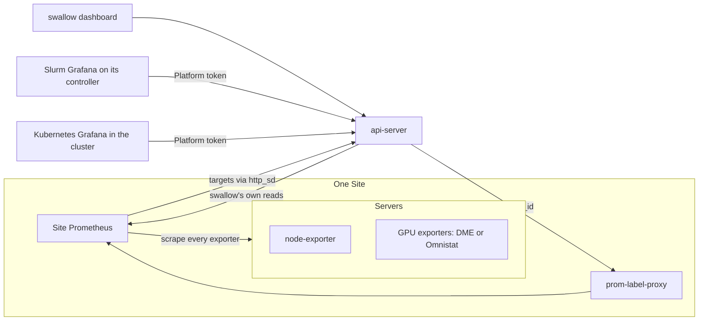

# Monitoring 設計

本文件說明 swallow 的監控怎麼設計：監控分成哪些層級、exporter 怎麼安裝、資料由誰收集、在哪裡顯示，以及
各 Platform 如何只看到自己的資料。它寫給要理解或修改監控的開發者，先講設計與理由，再講規則。

> **讀者**：設計或修改監控的開發者與 agent：exporter 的安裝與收集、Site 的 Prometheus、Platform 的 Grafana、
> 監控資料的多租戶、swallow 的 metrics 與 health。只透過 API 讀取 metrics 或 alerts 時讀契約即可：
> [server-metrics.md](../../api-server/docs/development/api-contracts/api-server/server-metrics.md)、
> [monitoring-alerts.md](../../api-server/docs/development/api-contracts/api-server/monitoring-alerts.md)、
> [discovery-prometheus.md](../../api-server/docs/development/api-contracts/api-server/discovery-prometheus.md)。

> **本文件先於實作寫成**：它描述這一版要達成的設計。實作分階段進行，尚未完成的部分列在 §11；在那之前，
> 現行行為以契約與各功能規格為準。

---

## 1. 要解決的問題

- **資料由誰收集**：如果 exporter 只由各 Platform 自己的 Prometheus 收集，swallow 就看不到監控資料；如果 swallow
  與 Platform 的 Prometheus 都收集同一批 exporter，整個環境就有大量重複的資料。
- **exporter 的安裝方式很混亂**：除了 node-exporter，還有 Device Metrics Exporter（DME）、Omnistat，以及暫時退場的
  RDC exporter。有的由 Platform 觸發安裝（AMD GPU Operator、Omnistat、Kubernetes 的 DaemonSet），有的由 Ansible
  安裝；每條路徑又由不同的 Prometheus 收集，有的甚至沒有人收集。

## 2. 核心原則

**基礎設施的監控資料只收集一次。** 每個 [Site](glossaries/terms/site.md) 有一套由 swallow 管理的 Prometheus，負責
收集該 Site 所有的 exporter。顯示的介面可以有很多個——swallow dashboard、各 Platform 自己的 Grafana——但資料都從
這一套讀；每個 Platform 只讀得到自己成員的資料。

理由：swallow 需要所有 Server 的基礎資料（health、容量、使用率）才能管理整個 datacenter，所以收集一定在 swallow
這一側；Platform 需要的是自己成員的完整資料，這可以從同一份資料中依成員篩選出來，不需要再收集一次。

## 3. 監控的三個層級

| 層級 | 內容 | 安裝在哪裡 |
| --- | --- | --- |
| 基礎監控 | node-exporter：CPU、memory、disk、network | 每台 `deployed` 且由 swallow 自動化的 Server（§4.1） |
| GPU 監控 | DME 或 Omnistat：GPU 的使用率、溫度、功耗、記憶體等 | 只在有 GPU 的地方，依情境選擇（§4.2） |
| AI NIC 監控 | 之後的 NIC exporter | 這一版不做；形狀會與 GPU 監控相同 |

**GPU 不是必要條件。** swallow 以 GPU datacenter 為目標，但 CPU-only 的 Server 與 Platform 都要完整支援：基礎監控
不依賴 GPU，GPU 監控只在有 GPU 的地方安裝，沒有 GPU 時一切照常運作。

## 4. exporter 怎麼安裝

### 4.1 基礎監控：node-exporter

- **屬於 OS provisioning**：OS 部署完成後（時間同步之後）安裝 node-exporter，disk 與 RAM 部署都一樣。它以 OS 的
  套件安裝（Debian／Ubuntu 用 apt、RHEL 家族用 dnf），由套件自己的 systemd service 執行，不用 container。安裝的
  細節見 [software-deployment.md](software-deployment.md) 的 Node Exporter。
- **Platform 不擁有它**：uninstall Platform 不移除 node-exporter。為了避免監控方案（GPU Operator、Omnistat）的移除
  連帶影響它，保留主機的 uninstall 結束後一律再安裝一次（安裝是冪等的，已經在的不會改變）；uninstall 同時 release
  Server 時不安裝，因為 release 會清空主機。
- **是 desired state**：每台存在、provisioning 為 `deployed`（disk 或 RAM）、沒有 lock、所屬 Site 的 automation 已啟用
  的 Server「應該有 node-exporter」。這是由政策推導的 desired（[desired-state-model.md](desired-state-model.md) §3.2），
  沒有 spec 欄位。worker 的 Node Exporter controller 以 Software Assignment 與 Site Prometheus 對它的 `up` 為 observed：
  沒有 assignment 或 absent 時安裝；`failed` 時依退避重試；`installed` 但 10 分鐘內每次收集都失敗時重新安裝；Site
  沒有 Prometheus 或讀取失敗時只依 assignment 動作。它不卸載不再受涵蓋的 Server 上的 node-exporter。完整規則、
  auto-correct 的理由與退避見 [software-deployment.md](software-deployment.md) 的 Node Exporter。OS 部署與 uninstall
  之後的安裝仍保留，讓 Server 一部署好就有監控；controller 負責之後的變化，例如套件被外部移除或 service 停止。

### 4.2 GPU 監控：依情境安裝

| 情境 | 方案 | 誰安裝 |
| --- | --- | --- |
| 單機 | DME | user 從 software deployment 單獨安裝（Managed Software），由 Workflow 驅動 Ansible 部署 |
| Kubernetes Platform | DME | AMD [GPU Operator](glossaries/terms/gpu-operator.md) 控管；swallow 只設定 operator，讓 Site 的 Prometheus 收得到 |
| Slurm Platform | Omnistat（預設）或 DME | Omnistat 與 DME 都由 Workflow 驅動 Ansible 部署 |

- **單機**：[Device Metrics Exporter](glossaries/terms/device-metrics-exporter.md) 裝在主機上（port 5001）。
- **Kubernetes**：GPU Operator 的 metrics exporter 就是 DME。swallow 讓它使用主機網路與 port 5001，並設成與其他兩條
  路徑相同的指標前綴，讓同一份 Grafana dashboard 在三個情境都適用。
- **Slurm**：[Omnistat](glossaries/terms/omnistat.md) 是預設，它除了 GPU，也收集主機與 Slurm job 的指標，所以 CPU-only
  的 Slurm Platform 也適用（沒有 GPU 時只收集主機與 job）；也可以改選 DME（需要至少一台 GPU compute node），或明確
  選擇不安裝。
- **RDC exporter**：理想上能裝 DME 的地方就能裝 RDC exporter，但它目前不是重點，所以暫時退場，日後以實驗性 feature
  加回。

### 4.3 退場的做法：Exporter Ownership

過去 Kubernetes Platform 可以把 exporter 交給叢集內的 DaemonSet（Exporter Ownership 的 `k8s`，即 Platform 的
`exporterOwner`）。node-exporter 改由 OS provisioning 一律帶入之後，主機上永遠只有一個 node-exporter，這個選項與那些
DaemonSet 都不再需要，一起退場：Platform 沒有 `exporterOwner`（schema v12 移除既有的值），standalone 安裝
node-exporter 不再檢查擁有者，`deploy-k8s-exporters` 與 `remove-k8s-exporters` 也不再是受理的 Workflow kind。GPU 的
exporter 則依 §4.2 的情境決定，不再有「誰擁有 exporter」的政策。

## 5. 資料怎麼收集

### 5.1 每個 Site 一套 Prometheus

- **一個 Site 一套**：每個 Site 有自己的一套 Prometheus，由 swallow 安裝與管理，只收集自己 Site 的 exporter。
- **這一版的部署方式**：比照共置的 MAAS（[installation.md](installation.md) §2.4），Prometheus 與 prom-label-proxy 隨
  安裝的 Site 一起部署在控制平面，安裝時登錄為該 Site 的 metrics [Integration](glossaries/terms/integration.md)。一個
  Site 至多一個 metrics Integration；swallow 讀某台 Server 的資料時，找它所屬 Site 的那一套。
- **multi-site 不寫死**：swallow 的 multi-site 概念還在發展，第二個 Site 的 Prometheus 要裝在哪裡、怎麼升級，這一版
  不規劃。程式只依「Server 屬於哪個 Site、那個 Site 用哪一套 Prometheus」查詢，不假設全域只有一套；沒有 Prometheus
  的 Site，它的 Server 監控就是「無法取得」。

### 5.2 收集哪些 target

- **只收集確知存在的 exporter**：Prometheus 只有一個 scrape job，從 api-server 的單一 http_sd 端點取得 target。端點只
  回傳 swallow 確知已經安裝的 exporter：node-exporter 看 Software Assignment，DME 看 Software Assignment 或 Platform
  的設定，Omnistat 看 Slurm Platform 的設定。沒有 exporter 的 Server 不會出現，所以不會被誤判成 down。
- **哪些 exporter 存在由模組宣告**：每個 exporter 由提供它的模組宣告名稱與 port（node-exporter 9100、DME 5001、
  Omnistat 8001）。新增一種 exporter 不必改 Prometheus 的設定，core 也不出現產品名稱
  （[core-and-extensions.md](core-and-extensions.md)）。

### 5.3 label 契約

每個 target 帶以下 label，Prometheus 收集到的每一條 series 都帶著它們：

| label | 值 | 用途 |
| --- | --- | --- |
| `server_id` | Server 的 opaque id | 對回 swallow 的 Server，不用 hostname 或位址 |
| `site` | Site id | 區分 Site |
| `platform_id` | Server 的 [Platform Claim](glossaries/terms/platform-claim.md) 所屬的 Platform；沒有時不帶 | 多租戶（§7） |
| `exporter` | exporter 的名稱，例如 `node-exporter` | 區分同一台 Server 上的多個 exporter |

`platform_id` 取自 Platform Claim，而不是從叢集觀察到的 membership：Platform Claim 是 swallow 擁有的事實，Platform
建立時就寫入，不會因為叢集暫時連不上而改變。Server 離開 Platform 之後，它在成員期間的舊資料仍屬於那個 Platform，
新的資料不再屬於它。

## 6. 在哪裡顯示

### 6.1 swallow dashboard

- **基礎監控**：所有 Server 的 health 與 CPU、memory、disk、network 的目前值與圖表。
- **GPU 圖這一版不提供**。之後只展示通用且重要的 GPU 指標，例如 GPU 使用率、溫度與 busy，而且只在 Server 有 GPU 類
  exporter 時顯示。不同 exporter（DME、Omnistat、日後的 RDC）的指標名稱不同，由後端依 exporter 的宣告轉成通用指標，
  dashboard 不認得任何產品的指標名稱。
- 完整的 GPU 監控資料由 Platform 自己的 Grafana 展示。
- **alerts 仍是實驗功能**：告警列表與 acknowledge（讀自 user 自備的 Alertmanager，§9）只在 development build 顯示，
  release build 只顯示基礎監控。

### 6.2 Platform 自己的 Grafana

- **每個 Platform 都可以有自己的 Grafana**：預設開啟，可以關閉；CPU-only 的 Platform 也一樣。開關是 Platform spec 的
  一部分，部署時決定。
- **dashboard**：一律包含 node-exporter 的 dashboard，再加上監控方案的 dashboard——Kubernetes 開了 GPU Operator 的 DME
  時加上 DME 的，Slurm 加上 Omnistat 或 DME 的。
- **資料來源**：一律是 Site 的 Prometheus，經 §7 的閘道，只看得到自己成員的資料。
- **部署方式依 Platform 類型**：

  | Platform | 部署方式 | 理由 |
  | --- | --- | --- |
  | Slurm | Grafana Managed Software，裝在 primary controller | Slurm 沒有叢集排程器，主機上的 service 是自然的做法 |
  | Kubernetes | Helm chart，部署在叢集內，以固定的 NodePort 對外 | 生命週期跟著叢集（叢集移除時一起消失）、由叢集排程；swallow 已經以同樣的方式部署 GPU Operator |

  Kubernetes 用的是 grafana-community 維護的 Helm chart（Grafana 官方的 chart 已在 2026-01-30 移交社群），chart 與
  image 都固定版本。兩種部署方式的 dashboard JSON 與 datasource 設定只維護一份，差別只在交付方式。
- Platform 的 Grafana 只供檢視：不保存狀態，所有 dashboard 與 datasource 都由部署時的設定產生；以匿名檢視開放給管理
  網路。

### 6.3 swallow 自己的 Grafana

之後有需要時再提供；它可以直接讀 Site 的 Prometheus，看到全部的基礎資料。

## 7. 多租戶：每個 Platform 只看到自己的資料

Prometheus 沒有多租戶的概念，因此引入 [prom-label-proxy](https://github.com/prometheus-community/prom-label-proxy)：它
改寫每一個查詢，強制加上指定的 label 條件，讓查詢只能取得那個 label 值的 series。

- **prom-label-proxy 本身不驗證身分**，所以由 api-server 當閘道：Platform Grafana 的 datasource 指向 api-server 的閘道，
  帶 Platform 專屬的 token；閘道驗證 token 之後，以該 Platform 的 `platform_id` 轉給 prom-label-proxy。
- **token**：swallow 為每個 Platform 產生，只保存 hash；部署 Grafana 時以 secret 交給它的 datasource，重新部署時輪替，
  Platform 刪除時失效。
- **閘道只放行讀取**：查詢類的 API 與 `/federate`。`/federate` 預留給日後 Platform 自帶 Prometheus 的情境（§10）。
- **swallow 自己的查詢不經過 prom-label-proxy**，直接讀 Site 的 Prometheus，看得到全部的資料。

## 8. health

Server 的 health（`up`／`down`）只看它的 node-exporter：node-exporter 被收集到時是 `up`，收集失敗時是 `down`；沒有
node-exporter 的 target 時是 unknown，不是 `down`——swallow 沒有在監控它，就不知道它的狀況
（[Server Status](glossaries/terms/server-status.md)）。assignment 為 `pending` 或 `failed` 時也沒有 target，所以 Node
Exporter controller 的安裝進行中或失敗時，health 是 unknown。GPU 與其他 exporter 的狀態不影響 health。

## 9. 相關的做法

- **Slurm 不再自己架 Prometheus**：過去 Slurm 的 Omnistat 與 DME 會在 controller 上另外安裝一套只聽 loopback 的
  Prometheus；現在它們由 Site 的 Prometheus 收集，Slurm 只保留 Grafana。已經裝好的那套 Prometheus 不會被自動移除。
- **swallow 的 metrics API 只提供基礎監控**：GPU 指標之後依 §6.1 的方式加回，查詢的寫法放在 adapter 與模組，不在 core。
- **alerts**：讀取 user 自備的 Alertmanager 的行為不變；swallow 不內建 Alertmanager，也不提供 alert rule。

## 10. 刻意不在這一版

- **Platform 自帶 Prometheus**（部署 Platform 時選用；node-exporter 不動）。目前的方向：基礎設施的 exporter（node、GPU、
  日後的 NIC）仍只由 Site 的 Prometheus 收集，資料只有一份；Platform 自己的 Prometheus 只收集 workload 的指標（例如
  kube-state-metrics、應用程式）。Platform 需要成員的基礎資料時，可以讓 Grafana 同時接 Site 閘道與自己的 Prometheus
  兩個 datasource，或讓自己的 Prometheus 以 Platform token 經閘道的 `/federate` 取回成員的 series。還要評估這會不會讓
  整個監控變得太複雜。
- **內建的 Alertmanager 與 alert rule**。
- **AI NIC 監控**。
- **multi-site 的實際部署**（§5.1）。
- **離線環境**：Kubernetes Grafana 的 image 與 helm 的鏡像（chart 隨發行包附帶；GPU Operator 也有同樣的問題）。
- **Kubernetes Grafana 的 Ingress 或 LoadBalancer**：這一版只提供 NodePort。
- **Platform Grafana 的登入**：這一版以匿名檢視開放給管理網路。
- **RDC exporter** 以實驗性 feature 加回。

## 11. 實作現況

本設計正在實作。以下是目前程式與本設計不同的地方，實作完成時從這裡移除：

- Omnistat 的 exporter 已是 scrape target，但名稱與 port 由 composition root 依 Slurm Platform 的 Omnistat State 列出，
  還不是由模組宣告；GPU Operator 的 DME 由 composition root 依 Kubernetes Platform 的 GPU Operator State 列出（名稱與 port
  取自 DME 模組的宣告），成員是 swallow 從 GPU inventory 推得的納管節點，不是 NFD 的結果。
- 啟用 firewalld 的主機（RHEL 家族的 Kubernetes 成員一定啟用）沒有替 Site 的 Prometheus 開 exporter 的 port（node-exporter
  9100、DME 5001），所以它們收集不到；只有 Kubernetes 的 Platform Grafana 的 NodePort 有開。node-exporter 的 `up` 因此一直
  是 0，Node Exporter controller 會依退避重新安裝（最後每天一次），直到 port 開啟。

## 12. 相關文件

- [decision 003](../decisions/003-metrics-label-contract.md)（metrics label contract）：監控拓撲與 label 契約的決策。
- [decision 062](../decisions/062-swallow-managed-gpu-operator.md)（swallow managed GPU Operator）、
  [decision 063](../decisions/063-omnistat-slurm-observability.md)（Omnistat Slurm observability）、
  [decision 068](../decisions/068-device-metrics-exporter-managed-software.md)（Device Metrics Exporter as Managed Software）。
- [software-deployment.md](software-deployment.md)：Node Exporter、DME、Grafana 的安裝。
- [platform-deployment.md](platform-deployment.md)：GPU Operator、Omnistat、DME 在 Platform 部署中的組入。
- [installation.md](installation.md)：控制平面的安裝。
- [desired-state-model.md](desired-state-model.md)：deployment 以 desired state 開發（§1.1）。
