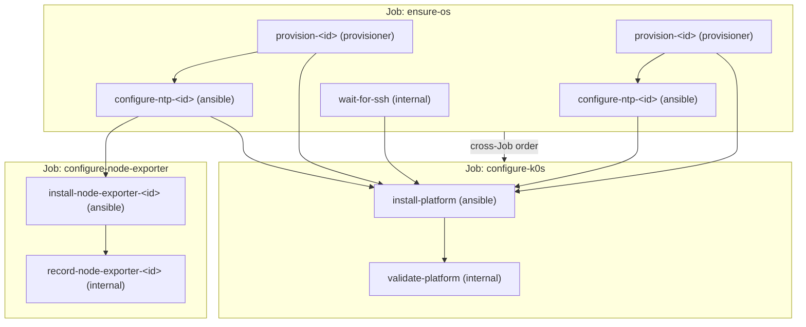

# Platform Deployment 設計、開發與規範

本文件為 swallow **platform deployment** 的權威設計文件（design）、開發指引（development
guide）與整合規範（standards）。它把
[decision 072](../decisions/072-store-driven-workflow-execution.md) (store driven workflow execution)、
decision 072、
decision 072 以及 root glossary 的
Workflow / Job / Task / Runner 語言，落成「swallow 如何佈署一個 platform」與「如何整合一個
新的 platform」的具體設計與規範。

> **本文件的定位（定調）**：以 **k0s (Kubernetes)** 作為 reference implementation，確立
> platform deployment 的骨架與**整合契約 (integration contract)**。未來整合其他 platform
> （例如 **Slurm**、storage），原則是**交付一支 idempotent 的 Ansible playbook、遵守 inventory
> 與 trusted-vars 契約、並在 manifest 註冊**；OS 佈署、SSH 就緒、credential 記錄等骨架由
> swallow 提供並重用，不必為每個 platform 重寫。

> **目標結構**：依 [decision 070](../decisions/070-core-providers-and-extensions.md)（core providers and extensions），新增一種 platform
> 的目標做法是交一個 **Platform 模組**（見 [core-and-extensions.md](core-and-extensions.md)）；本文件的
> playbook 與 inventory／trusted-vars 契約是該模組的 host automation 內容。所有權與收斂規則以
> [desired-state-model.md](desired-state-model.md) 為準。Kubernetes 與 Slurm 已是模組，但 Workflow 的組合與
> trusted vars 仍在 `internal/app` 與 core；本文件 §6 描述現在允許的做法，它屬於
> [core-and-extensions.md](core-and-extensions.md) §3.6 的過渡期規則，新增的位置要登錄在同一節。

> **與 software deployment 的分界**：platform 的 deploy target 是**由多個 component 組成的 runtime
> 整體**；單一軟體（Docker CE、Podman、NFS…）的安裝屬於 **software deployment**（見
> [software-deployment.md](software-deployment.md) 與 [decision 038](../decisions/038-software-deployment.md)（software deployment））。
> 分界是 deploy target 的粒度，不是有沒有碰 OS provisioning。platform 需要某個軟體 component 時，
> **把該 software 的 Job 組入自己的 parent Workflow**（cross-Job `DependsOn`、共用 roles），
> **不得** `ExecuteChildWorkflow` 一個完整的獨立 software Workflow，也不得只靠 `include_role` 連動。
>
> **Slurm NFS 現況（過渡）**：Slurm 的 HA state 與 workload NFS 目前仍內嵌在 `slurm_*` roles
> （`slurm_state_server`、`slurm_controller_state`、`slurm_workload_storage_*`），**尚未**改用 generic
> software NFS。把它抽成可被 Slurm 組入的 `configure-nfs` Job 是後續 slice；在那之前，**generic NFS
> ≠ Slurm managed state NFS**，兩者不可混為一談。

## 讀者與使用方式

- **開發者**：理解 deployment pipeline、擴充或除錯 orchestration、撰寫新的 platform playbook。
- **AI agent（同等重要）**：本文件是理解 deployment 設計的入口。涉及 platform deployment 的
  orchestration、Runner、inventory/trusted-vars 契約，或「新增一個 platform」的任務時，必須
  先讀本檔；要改程式時再依 `api-server/AGENTS.md` 定位實作（只讀程式確認細節不需要）。只改 Platform 模組的 playbook 或 role 時，只需要
  §2.3（OS 的差異）與 §5，其餘依[模組撰寫指南](module-authoring.md)。本檔很長：先看標題，再讀任務需要的章節。

本文件**不重述** ADR 與 glossary，只做 elaboration；語言以 root glossary 為準，決策理由以
ADR 為準。實作細節（Clean Architecture 分層、Go coding style）由
[`api-server`](../../api-server/AGENTS.md) 的文件負責，本檔只指出「設計」與「契約」，並在
§7 提供程式位置對照供導航。

---

## 1. 心智模型：Workflow → Job → Task → Runner

deployment 一律以這四層表達（完整定義見 glossary：
[Workflow](glossaries/terms/workflow.md)、[Job](glossaries/terms/job.md)、
[Task](glossaries/terms/task.md)、[Runner](glossaries/terms/runner.md)）：

- **Workflow** — user 的意圖，表達為「一組 resource 的 desired end-state」（例如「這 7 台
  Server 是一個帶這些角色的 k0s Platform」）。durable、可觀察、可取消；狀態在 store，由 Temporal 的 driver
  執行（[workflow-execution.md](workflow-execution.md) §2）。
- **Job** — 可重用、convergent 的中間單元，把一組 resource 帶到子目標（`ensure-os`、
  `configure-k0s`），並宣告自己的重試粒度（[workflow-execution.md](workflow-execution.md) §5.4）。
- **Task** — 由**單一 Runner** 執行的原子單元（「在 Server X 上 ensure OS」「跑 k0s playbook」
  「驗證 membership」）。**idempotent（ensure）**：目標已在 desired state 時為 no-op。
- **Runner** — 執行 Task 的機制：`provisioner`（透過 vendor adapter 驅動 OS provisioning
  provider）、`ansible`（在遠端主機跑一支有界的 idempotent playbook）、`internal`（swallow
  自身邏輯）。

### 兩條不可違反的原則

1. **Desired-state / convergent（收斂）**：Workflow 宣告 end-state，對**每台 resource 各自
   收斂**，因此 targets 可以**起始於不同狀態**（有些 Server 已裝 OS、有些沒有）。deployment
   不再要求整批同狀態。
2. **Orchestration up, host-config down**（decision 072 §3）——
   邊界由「誰擁有該能力」決定：
   - **跨 Runner 或可跨 platform 重用的動作 → swallow 擁有的 Workflow Task**：OS 佈署與網路
     （`provisioner`）、SSH 就緒（`internal`）、credential/membership 記錄（`internal`）。
   - **單一 platform 的遠端主機設定 → 每種 platform 一支 idempotent playbook**，由 `ansible`
     Runner 執行。playbook **內部**的排序（`serial:1` controller join、handlers、host loop）
     刻意留在 playbook 裡，那是 ansible 的職責，不要拆成 Task 從 Workflow 逐一驅動。

> 這條邊界就是「新增一個 platform = 交一支 playbook」的根據：orchestration 的骨架屬 swallow，
> 遠端主機設定屬 platform 的 playbook。

---

## 2. 一次 platform deployment 的解剖（k0s reference）

- Workflow `kind` = `deploy-kubernetes`；definition = `platform-deployment`（version 1）。
- 由 launcher [`platformDeploymentLauncher`](../../api-server/internal/app/platform_deployment_adapter.go)
  組裝，經 `WorkflowService.Create` 受理，由 `workflow-dispatch` 派發給 driver。
- 分成兩個 Job，依 **cross-Job 依賴序**執行：先 `ensure-os`，後 `configure-k0s`；本次 provision 了 Server 時另有
  `configure-node-exporter`（§2.2），GPU Operator 與 Platform 的 Grafana 各在最後加一個 Job（§2.3.1、§2.3.3）。每個 Job 都宣告重試粒度 `job`：重試會讓整個 Job 的 Task 以下一個 attempt 重跑。

**拓樸與角色**（[decision 007](../decisions/007-cluster-deployment-ownership.md)（cluster deployment ownership）、
[decision 011](../decisions/011-flexible-k0s-topologies.md)（flexible k0s topologies））：deploy 請求以 `roleAssignments[]`
（[Node Role](glossaries/terms/node-role.md) `control-plane | worker`，control-plane 可選 `runWorkloads`）表達意圖；
deploy use case 由它推導 [Kubernetes Topology](glossaries/terms/kubernetes-topology.md)（`standalone`、`multi-node`、
`high-availability`），並在建立任何紀錄前驗證。欄位與錯誤見
[platforms.md](../../api-server/docs/development/api-contracts/api-server/platforms.md#create-a-platform)。

- control-plane 為 1 台或至少 3 台的奇數（2 台與偶數拒絕），且至少一台 Server 跑 workload。`runWorkloads` 只是
  placement，不改 Node Role：observed membership 維持封閉的 `control-plane | worker`。
- pod／service CIDR 不得涵蓋任何 target 的位址；HA 的 VIP 不得等於 target 位址（子網規則見 §2.3 的 HA VIP 契約）。
- 只有 HA 設定 keepalived 並需要 `apiVip`：k0s control plane load balancing（keepalived VRRP VIP）加 node-local load
  balancing（`EnvoyProxy`），不用外部 load balancer；VRRP 密碼是 sealed secret（§4.3）。單一 control-plane 以該 Server
  的 observed 位址為 API endpoint，不建立 VIP。Dashboard 在送出前標示非 HA 拓樸沒有 control-plane failover。
- 角色由 server-side 組成 trusted vars（§4.2），user 的變數無法影響哪台成為 controller。controller 預設為
  dedicated（不帶 `--enable-worker`，不註冊成 Kubernetes node）；`runWorkloads` 的 controller 以
  `--enable-worker --no-taints` 安裝。其他 controller 以 k0s controller join token 加入，token 帶 CA material，
  主機之間不複製憑證。
- `k0s_verify` 斷言 etcd member 數等於 control-plane 數、Kubernetes node 數等於跑 workload 的 Server 數。
- playbook 以既有的 k0s systemd unit（`k0scontroller.service`／`k0sworker.service`）判定已安裝，所以重跑是安全的。
- 不在範圍：叢集升級與 bootstrap 後的叢集設定變更。bootstrap 時只有初始 controller 的設定生效，之後改叢集設定
  不是單純重跑。

設計理由：否決 k0sctl、外部 load balancer、保存 admin kubeconfig、由 swallow 記錄 controller 清單，見 decision 007；
不新增 `control-plane-worker` role、不允許偶數 control-plane、非 HA 不要求 VIP，見 decision 011。

### 2.1 Task 組成

| Job | Task ID | Kind | Runner | Targets | DependsOn | 主要 Parameters |
| --- | --- | --- | --- | --- | --- | --- |
| `ensure-os` | `ensure-boot-media-<serverId>`（僅限啟用 Boot Media 的 Server，[decision 047](../decisions/047-redfish-boot-media.md)（redfish boot media）） | `ensure-boot-media` | `internal` | 單一 Server | — | `isoUrl`（受理時的 Boot Media ISO URL） |
| `ensure-os` | `provision-<serverId>`（每台需裝 OS 者一個） | `provision-os` | `provisioner` | 單一 Server | —（Job 內並行；啟用 Boot Media 者依賴其 `ensure-boot-media-<serverId>`） | `request`（凍結的 per-Server 佈署輸入）；啟用 Boot Media 者另有 `bootMediaIsoUrl` |
| `ensure-os` | `wait-for-ssh` | `wait-for-ssh` | `internal` | 已 `deployed` 的 targets | — | — |
| `ensure-os` | `configure-ntp-<serverId>`（每台本次 provision 的 Server 一個，[decision 065](../decisions/065-control-plane-ntp-and-post-provision-time-sync.md)（control plane ntp and post provision time sync）） | `ansible-playbook` | `ansible` | 單一 Server | `provision-<serverId>` | `playbook`（`configure-ntp`）、`extraVars`（含 `swallow_ntp_servers`） |
| `configure-node-exporter` | `install-node-exporter-<serverId>`（每台本次 provision 的 Server 一個） | `ansible-playbook` | `ansible` | 單一 Server | `configure-ntp-<serverId>` | `playbook`（`deploy-node-exporter`）、`extraVars` |
| `configure-node-exporter` | `record-node-exporter-<serverId>` | `record-software-assignment` | `internal` | 單一 Server | `install-node-exporter-<serverId>` | `softwareKind`（`node-exporter`）、`serverIds` |
| `configure-k0s` | `install-platform` | `ansible-playbook` | `ansible` | 全部 targets | 所有 `provision-*` + `wait-for-ssh` + `configure-ntp-*` | `playbook`、`extraVars`（含時鐘檢查的 `swallow_time_sync_check`） |
| `configure-k0s` | `validate-platform` | `validate-platform-health` | `internal` | 全部 targets | `install-platform` | — |
| `configure-platform-grafana`（`monitoringDashboards` 開啟時，§2.3.3） | `install-platform-grafana` | `ansible-playbook` | `ansible` | 全部 targets | `install-gpu-operator`，沒有 GPU Operator 時 `validate-platform` | `playbook`（`configure-kubernetes-grafana`）、`extraVars`（含 `swallow_k0s_grafana_*`）；token 是 sealed secret |

### 2.2 `provision_os` 與 `existing_os`：只差在「如何讓 OS 就緒」

`machinePreparation.mode` 決定 `ensure-os` 的內容，**`configure-k0s` 完全相同**：

- **`provision_os`**：對仍需 OS 的 Server 產生 `provision-<serverId>`（`provisioner` Runner 佈署
  OS 並等待就緒）；對**同一批中已 `deployed`** 的 Server 只加一個 `wait-for-ssh`（不重裝）。
  這就是 convergent deploy——一次佈署可**混合** `ready` 與 `deployed` 的 Server（Kubernetes 的成員仍須全在 RAM
  或全在 disk 上執行，見 §2.3.2）。
- **`existing_os`**：不佈署，只以單一 `wait-for-ssh` 確認全部 targets 的 SSH 就緒。

時間（[decision 065](../decisions/065-control-plane-ntp-and-post-provision-time-sync.md)）在 OS
佈署時就設定好；platform 佈署不設定，只在自己的 install playbook 裡檢查：

- **設定（屬於 OS provisioning）**：`provision_os` 模式中，每台本次 provision 的 Server 在
  `provision-<serverId>` 之後有自己的 `configure-ntp-<serverId>`，與 Deploy OS 完全相同——以受理時
  凍結的 `swallow_ntp_servers`（api-server 設定 `SWALLOW_API_NTP_SERVER`，production 為
  `SWALLOW_ADDRESS`）跑 `configure-ntp` playbook。它設定 OS 已有的時間 client（依序
  `systemd-timesyncd`、`chrony`、`ntpd`；都沒有才安裝 chrony），停用其他 client，並在有限時間內等到
  回應（否則 `[ntp_not_synchronized]`）。沿用的 `deployed` Server 與 `existing_os` 的 targets 不重新
  設定。需要 provision 卻沒有 NTP server 時，受理即以 `ErrNTPServerMissing`（409）拒絕。Launcher 直接
  指名 playbook，不需 site `playbookMappings`。`configure-ntp-<serverId>` 不宣告任何結果類的完成行為，所以
  不會觸發 platform 的 credential 記錄（完成行為的宣告見 [workflow-execution.md](workflow-execution.md) §12）。
- **檢查（屬於各 platform）**：`deploy-kubernetes.yml` 在下載 k0s 之前、`deploy-slurm.yml` 在
  `slurm_preflight`（MUNGE 之前）先跑 role `time_sync_check`，涵蓋全部 targets，不改主機：讀
  `timedatectl` 的 `NTPSynchronized`，有 NTP server 時再以 SNTP 量測與它的 offset（上限
  `swallow_time_sync_max_offset`，1 秒）。Launcher 把這些 vars 併進 `install-platform` 的 trusted vars；
  `DeploymentLaunch.TimeSyncCheck`（deploy 欄位 `timeSyncCheck`，Dashboard 的 "Require synchronized
  clocks"）決定結果：`enforce`（預設）時以 `any_errors_fatal` 在任何節點安裝前讓 `install-platform`
  失敗，並以 `[time_not_synchronized]` 指出節點；`warn` 時只輸出 `[time_sync_warning]` 並繼續。
  沒有獨立的時間檢查 Task。

Node Exporter 同樣在 OS 佈署時安裝（[software-deployment.md](software-deployment.md) §5）：`provision_os` 模式中，
每台本次 provision 的 Server 在 `configure-ntp-<serverId>` 之後由 `configure-node-exporter` Job 以 Managed Software
安裝它，與 Deploy OS 相同，不分 Platform 類型。沒有 Task
依賴這個 Job，`install-platform` 不等它，因此安裝失敗不會擋住 Platform，但 Workflow 會停在 `requires_attention`
直到 user 重試。沿用的 `deployed` Server 與 `existing_os` 的 targets 不安裝。

> **設計理念**：對「佈署 k0s」而言，`provision_os` 與 `existing_os` 之後的行為必須**完全一致**
> ——差別只在 OS 是本次 workflow 裝的、還是先前就有的，而不是佈署機制本身。`configure-k0s`
> 對兩者是同一段。SSH host key 由 workflow 於執行前自行擷取（見 §4.6），不需人工介入。

---

### 2.3 OS 支援：Ubuntu 與 Rocky/RHEL 同一套流程

`configure-k0s` 的 `deploy-kubernetes.yml` 是**單一 OS-conditional 流程**，同時 fulfill Debian
家族（Ubuntu）與 RHEL 家族（Rocky Linux）host，分支一律以 `ansible_facts['os_family']` 判斷（只影響某個版本時，在 `os_family` 條件內再加
`ansible_facts['distribution_major_version']`），
Debian 路徑維持不變。RHEL 專屬行為集中在 `k0s_prereq`、`k0s_host_preflight`、`k0s_worker_join`
（皆 gated on `RedHat`），OS 中立的 kernel 網路前置（modules-load、bridge/forward sysctl）對兩族
都持久化。

RHEL（Rocky）額外處理（Ubuntu 不需要）：

- **套件**：`dnf` 安裝 `conntrack-tools`、`iproute`、`iptables-nft`、`firewalld`；worker 另裝
  `container-selinux`、`policycoreutils-python-utils`（`semanage`）。
- **SELinux（Enforcing，不關閉）**：preflight 斷言 `getenforce == Enforcing`；worker 寫入
  containerd v3 `enable_selinux` drop-in、以 `semanage fcontext` 標記 k0s 的 containerd/runc/CNI
  路徑、建立並 `restorecon` CNI 目錄；worker join 後對 k0s 解壓出的 `/var/lib/k0s/bin`、
  containerd 目錄 `restorecon` 再 `restart k0sworker`（僅新 worker）。
- **firewalld（nftables backend）**：在 k0s 啟動前開 control-plane（2380/6443/8132/9443）與
  worker（10250/179 tcp、4789 udp）埠、把 pod/service CIDR 加入 trusted zone、HA controller 開
  `protocol vrrp`（供 k0s CPLB keepalived 廣播 API VIP）、worker 開 masquerade，最後 `--reload`
  一次（此時尚無 kube-router 的 nft 規則，reload 安全）。

**節點命名契約（跨 OS 一致）**：worker（與 `--enable-worker` 的 workload controller）以
`--kubelet-extra-args=--hostname-override=<swallow node name>` 安裝，把 Kubernetes node 名固定為
swallow 的短 hostname。這是必要的：RHEL/Rocky 的 OS hostname 是 FQDN（如 `lab-compute-1.maas`），
若不覆寫，kubelet 會以 FQDN 註冊，而 readiness 等待與 membership sync 都以短名為 key，會誤判節點
`NotFound`。Ubuntu 短名一致故行為不變。

**HA VIP 契約**：VIP 必須落在 control plane 共用的子網內，prefix 必須等於該子網的 prefix。部署 API 從 provisioner
讀各 control-plane 開機網卡的子網（provision_os 則看 network assignment 指定的子網）：`apiVipPrefix` 未填就採用它，
不符就在建立任何東西前回 `validation_error`；讀不到子網時，`k0s_host_preflight` 在每台 control-plane 以主機自己的
IPv4 子網再檢查一次。理由（lab 實測）：VIP 用較長的 prefix（例如 `/23` 子網用 `/24`）時，keepalived 會新增一條
來源為 VIP 的較窄路由，持有 VIP 的節點對那段子網改以 VIP 連線，etcd 依憑證拒絕它，其他 controller 無法 join。

**API 位址契約**：每台 controller 的 `k0s.yaml` 都以 `spec.api.address: <ansible_host>` 明示自己的位址（其餘設定各台
相同），不交給 k0s 自動偵測。join token 會內嵌 initial controller 的這個位址；升級 systemd 時
`systemd-networkd` 重啟、DHCP 位址消失數秒，若此時建立 token，自動偵測只找得到 IPv6 link-local，其他 controller
便無法 join（lab 實測：新部署的主機在佈署期間跑 unattended-upgrades）。部署期間 OS 自己的套件維護由
`package_maintenance_hold` 暫緩（[decision 073](../decisions/073-hold-os-package-maintenance-during-automation.md)（hold os package maintenance during automation），
規則見 [core-and-extensions.md](core-and-extensions.md) §5.2）；固定位址與 ansible-runner 的 `ANSIBLE_SSH_RETRIES`
仍保留，以防 swallow 以外的升級，以及 hold 開始時已在執行、hold 正在等它完成的升級。

此流程已在 lab 以全 Rocky 10.2 的 3 controller + 4 worker HA k0s 驗證（platform active、4 worker
Ready、membership matched 7/7）。cgroup v1 fallback、cri-dockerd、RHEL DNS nmcli fallback 與「單一
cluster 內混合 OS」不在目前範圍。

### 2.3.1 選用功能：AMD GPU Operator（decision 062）

Kubernetes Platform 的 spec 可帶 `gpuOperator` 設定，在 deploy Workflow 中安裝 AMD GPU Operator；之後改 spec 的
`gpuOperator` 由另一個 Workflow 調整或卸載：啟用直接收斂，調整或停用要經 Change Plan（契約見
[platforms.md](../../api-server/docs/development/api-contracts/api-server/platforms.md#manage-the-gpu-operator)）。
它是 platform 的元件（deploy target 是 Platform），不是 Managed Software。

**規範：節點範圍自動判斷，不讓使用者列舉 Server。** 作用在叢集節點上的平台功能（GPU Operator 是第一個），
要處理哪些節點一律由叢集本身或 swallow 自動判斷；API、CLI、dashboard 都不提供讓使用者逐台挑選或確認
Server 的設定（例如 `serverIds` 清單、預先勾好的節點清單）。理由：一個叢集可能混著上萬台 CPU-only 與 GPU
節點，要求使用者逐台檢查不可行，而且叢集內的偵測（例如 NFD）比 swallow 的 inventory 更接近實況。若日後確實
需要個別控制，只能設計成「從自動判斷的結果排除特定 Server」，不能改回逐台納入。

| Workflow | Job | Task | Runner | DependsOn |
| --- | --- | --- | --- | --- |
| `deploy-kubernetes`（帶 `gpuOperator.enabled`） | `configure-gpu-operator` | `install-gpu-operator`（`ansible-playbook`，playbook `configure-amd-gpu-operator`） | `ansible` | `validate-platform` |
| `deploy-kubernetes`（`monitoringDashboards` 開啟，§2.3.3） | `configure-platform-grafana` | `install-platform-grafana`（`ansible-playbook`，playbook `configure-kubernetes-grafana`） | `ansible` | `install-gpu-operator`，沒有 GPU Operator 時 `validate-platform` |
| `configure-gpu-operator`（部署後調整） | `prepare-hosts` → `configure-gpu-operator` | `wait-for-ssh` → `install-gpu-operator` | `internal` → `ansible` | — → `wait-for-ssh` |

- 兩種 Workflow 的 ansible Task 都以 Platform 的全部 deployment targets 為 targets，playbook 名由 launcher 硬編碼，
  不需 site `playbookMappings`。只有 `install-platform` 宣告 `kubernetes-credential`，所以 GPU Operator 的 Task 不會
  記錄 credential。
- Platform 保存目標設定與 GPU Operator State。`install-gpu-operator` 宣告投影類完成行為 `gpu-operator-state`
  （參數 `platformId`、`recordId`、`mode`），在 Task 每次轉換時寫回 GPU Operator State，並以 `recordId` 擋下
  較舊的 Workflow。
- 只沿用 OS image 的 driver：chart 以 `kmm.enabled=false`、`remediation.enabled=false` 安裝，不需 cert-manager。
  節點檢查只確認 image 有 `amdgpu` module（`modinfo`）；image 可能以 `modprobe.blacklist=amdgpu` 讓開機時不載入，
  所以 cluster play 之後、DeviceConfig 之前，每個納管節點都裝 `swallow-amdgpu-load.service`（共用 role
  `amdgpu_loader`，Slurm GPU GRES 也用同一份；SSH 起來後才
  `modprobe amdgpu`，`TimeoutStartSec=300`），並以 drop-in 讓 `k0scontroller`／`k0sworker` 排在它之後，再啟動它並等
  `/dev/kfd`。不再納管的節點、卸載 operator、`uninstall-kubernetes` 保留主機時都移除 unit 與 drop-in，但不卸載已載入的 driver。
- helm 在 `swallow_amd_gpu_operator_controller_id`（初始 controller）上執行：共用 role `helm` 下載固定版本的 helm、核對
  SHA-256（放在 `/usr/local/lib/swallow/helm/<version>/`，Kubernetes 的 Platform Grafana 也用同一份），playbook 複製隨發行包附帶的
  chart（`roles/amd_gpu_operator/files/`），以 `/var/lib/k0s/pki/admin.conf` `upgrade --install --wait`。k0s 的 Chart CR
  已否決：卸載時 helm timeout 為 0，chart 的 pre-delete hook 永遠失敗。
- 納管節點依上面的規範由 chart 附帶的 NFD 判斷：NFD worker 照官方預設跑在所有節點，依 PCI id 把實體 GPU 標成
  `feature.node.kubernetes.io/amd-gpu=true`、SR-IOV VF 標成 `feature.node.kubernetes.io/amd-vgpu=true`。playbook 在
  helm 之後等 NFD 處理完每個節點（每個 node 都有 NFD 的 `nfd.node.kubernetes.io/feature-labels` annotation），
  把帶這兩個 label 之一的節點鏡射成 `swallow.dev/amd-gpu-operator=managed`，不再帶的節點則移除該 label 與
  `amd.com/gpu.*` label。單一 DeviceConfig（`kube-amd-gpu/swallow`）只選 swallow 的 label：DeviceConfig 的 selector
  是只能 AND 的 label map，無法同時選 `amd-gpu` 與 `amd-vgpu`。NFD 沒標到任何 GPU 節點時以
  `[amd_gpu_not_detected]` 失敗。日後若要支援排除，只需要在鏡射時跳過被排除的 Server。
- 節點層級的檢查與準備（driver module、amdgpu loader、DRA link）只套用在 NFD 選中的節點，所以排在 cluster play
  之後；`[amdgpu_driver_missing]` 因此在 helm release 安裝之後、DeviceConfig 之前回報。
- swallow 端只保留一個開關前提：Platform 至少一台 workload 節點的 GPU inventory 有 AMD 運算 GPU，才能啟用。
  這決定功能能不能開，不決定納管哪些節點。
- DRA 在 k0s 需要 `/var/lib/kubelet/plugins{,_registry}` → `/var/lib/k0s/kubelet/plugins{,_registry}` 兩個精確
  symlink；playbook 只建立目的地不存在的 link，關閉 DRA 或卸載時以 `readlink` 確認後才移除。
  `uninstall-kubernetes` 保留主機時也移除它們，以及 DRA driver 寫在 k0s 狀態之外的
  `/var/run/cdi/k8s.gpu.amd.com-gpu_common.yaml`。
- 每次 Workflow 都重讀 NFD 的結果，所以新加入叢集的節點在下一次變更時納管。
- 一次只有一種 [GPU Allocation Mode](glossaries/terms/gpu-allocation-mode.md)：切換時先關閉舊模式、等它消失再啟用新模式；
  有 Pod 佔用 AMD GPU 或有已配置的 `gpu.amd.com` `ResourceClaim` 時，拒絕切換與卸載（`[gpu_workloads_present]`）。
- 不接管 swallow 沒有安裝的 operator：叢集已有 AMD GPU Operator、`DeviceConfig` 或手動套用的 AMD device plugin／labeller
  時以 `[gpu_operator_unmanaged]` 拒絕。其他失敗碼見 platforms 契約的 "What The Workflow Does"。
- 支援的版本是 swallow 的 release catalog（chart、DRA driver 版本、固定的 operand image），以
  `GET /platforms/gpu-operator/releases` 讀取。新增版本＝新增 catalog 項目、隨發行包附帶的 chart archive，以及一次 lab
  驗證。chart 與 helm checksum 隨發行包；operand image 依固定 tag 從 Docker Hub（`docker.io/rocm/...`）拉取，helm binary
  於執行時下載。
- `gpuStackOwner` 隨功能推導：啟用 operator 即為 `gpu-operator`；swallow 管理 operator 期間（state 不是 `absent`）不能
  改回 `provisioning`。`gpu-operator` 卻沒有 swallow 管理的 operator，表示 operator 由 swallow 以外管理。
- 監控（[monitoring.md](monitoring.md) §4.2、§5.2）：operator 的 Device Metrics Exporter 為選用（`metricsExporter`），開啟時就是
  Platform 的 GPU 監控。DeviceConfig 讓它用 host network、port 5001（`port`，launcher 以 trusted var
  `swallow_amd_gpu_operator_metrics_exporter_port` 帶入 platform domain 的 exporter port），並以 ConfigMap
  `kube-amd-gpu/swallow-metrics-exporter`（DeviceConfig 的 `metricsExporter.config.name`，掛成 exporter 的 `config.json`）
  設成與 standalone 和 Slurm 的 DME 相同的指標前綴 `amd_`、開啟 health 指標、關閉 profiler，所以同一份
  `device-metrics-exporter` dashboard bundle 三個情境都適用；operator 忽略檔案裡的 `ServerPort`。關閉時 ConfigMap 在
  DeviceConfig 不再引用它之後刪除。每個納管節點在 DeviceConfig Ready 之後都要在 `http://<ansible_host>:5001/metrics`
  回應，否則 `[gpu_operator_not_ready]`。Site 的 Prometheus 在 GPU Operator State 為 `ready` 且 `metricsExporter`
  開啟時，把 applied spec 中 workload 成員裡 GPU inventory 有 AMD 運算 GPU 的 Server 當成 `device-metrics-exporter`
  target（port 5001）；swallow 不讀 NFD 的結果，所以這是 swallow 所知的納管節點。
- port 5001 在 Kubernetes 成員上不會被 swallow 的其他 exporter 佔用：standalone 的 DME（同一個 port）拒絕 Kubernetes
  member 與帶 Platform Claim 的 Server，node-exporter 用 9100，5000 保留給 RDC exporter。但 Server 可能在成為 Platform
  成員之前就裝了 standalone DME，所以開啟 `metricsExporter` 時 host preflight 在納管節點上發現 AMD 的
  `amd-metrics-exporter.service` 就以 `[metrics_exporter_port_conflict]` 失敗，而不是讓 operator 的 exporter 起不來。
- GPU Operator 的安裝是部署成功的一部分：GPU Task 失敗讓部署停在 `requires_attention`，該 Task 可重試。
- 設計理由：選 Platform Job 而非 Managed Software、否決 k0s Chart CR、直接以 NFD label 選節點、讓使用者勾選 Server
  與第一版採 KMM，見 [decision 062](../decisions/062-swallow-managed-gpu-operator.md)（swallow managed gpu operator）。

### 2.3.2 Ephemeral（RAM）Kubernetes（decision 028）

Kubernetes deploy 以 `machinePreparation.settings.deployTarget: "ram"`（[Deploy Target](glossaries/terms/deploy-target.md)；
deprecated 的 `settings.ephemeral: true` 同義）選擇 RAM：provider 以 memory-backed root 開機、不碰磁碟。這是刻意 volatile 的契約：節點重開後 OS、etcd、
container runtime 與 workload state 全部消失，swallow 不自動復原，user 需重建或重新部署 Platform。

- 成員都在 RAM 上執行時，launcher 帶 trusted var `swallow_k0s_ephemeral_root`；`k0s_host_preflight` 在每台主機斷言 `/` 為
  `overlay`（MAAS overlayroot）或 `tmpfs`（custom `root.tgz`），並把 containerd 改用 `native` snapshotter
  （overlayroot 上 nested overlayfs 會造成不穩定的 `EINVAL` pod mount）。
- 這個處理是整個 Platform 共用的，所以一個 Kubernetes Platform 的成員必須**全在 RAM 或全在 disk** 上執行：混合時 disk
  主機過不了斷言，沒有 var 的 RAM 主機則 nested overlayfs。每個成員的有效 root：本次 provision 的 Server（`provision_os`
  下的 `ready`）取要求的 Deploy Target（省略為 disk）；已 `deployed` 的 Server（`provision_os` 沿用的，或 `existing_os`
  的全部 targets）取觀察到的 `Provisioning.Ephemeral`，也就是它當初部署的方式。有效 root 不一致時，Kubernetes 的
  `validate` 在受理時以 `ErrInvalidDeployment`（`400 validation_error`）拒絕，訊息列出 RAM 與 disk 的 Server；建立
  Platform、spec 加成員與 controller 的 redeploy 都經過這個 validation，所以不會等到 `install-platform` 才失敗。var 由
  成員共同的有效 root 決定，因此成員全以 RAM 部署的 `existing_os` 也帶它。Slurm 沒有這條規則：它的 role 逐台偵測 root。
- 每個 k0s 部署（不限 ephemeral）都在 k0s binary 安裝後、任何 controller／worker 啟動前 fail-closed 檢查實際開機的
  主機：必要指令、cgroup v2、必要 kernel modules，並執行與版本相符的 `k0s sysinfo` 記錄報告。相容性失敗因此發生在
  叢集狀態建立之前，保留的 Ansible stdout 就是診斷依據。
- image 由 swallow 以外建置，必須帶有與 provider 開機 kernel 相符的 modules；image metadata 不足以證明相容，所以以開機後
  的主機為準。
- 設計理由：否決「繼續拒絕 ephemeral」、「相信 image tag」、「把 k0s 烤進 image」與「當成持久叢集」，見
  [decision 028](../decisions/028-ephemeral-kubernetes-deployment.md) (ephemeral kubernetes deployment)。

### 2.3.3 Platform 的 Grafana（[monitoring.md](monitoring.md) §6.2）

Platform spec 的 `settings.monitoringDashboards`（desired，省略或 `null` 即開啟，CPU-only 也一樣）決定 Kubernetes Platform
是否有自己的 Grafana，與 Slurm 是同一個設定（§6.3）。差別只在交付方式：Kubernetes 以 grafana-community 的 Helm chart
裝在叢集內，生命週期跟著叢集，以固定的 NodePort 對外。

- deploy use case 在開啟時於 `DeploymentLaunch.MonitoringDashboards` 帶初始 controller（`ServerID`，helm 在這裡執行）、
  workload 成員（`EndpointServerIDs`，只有它們是 Kubernetes node、會回應 NodePort），以及 GPU Operator 的
  `metricsExporter` 是否開啟（`GPUMetrics`）。launcher（`planKubernetesGrafana`）在 `validate-platform` 之後、有
  GPU Operator 時在 `install-gpu-operator` 之後組入 `configure-platform-grafana` Job（§2.1 的表），playbook 名
  `configure-kubernetes-grafana` 由 launcher 硬編碼，Task 以全部 deployment targets 為 targets。
- datasource 與 Slurm 相同：Platform metrics 閘道 `<SWALLOW_API_PUBLIC_URL>/api/v1/platform-metrics/<platformId>/prometheus`，
  token 在 `PersistDeployment` 以 `PlatformAccess.Issue` 發出（每次受理都輪替），只以 sealed secret var
  `swallow_grafana_datasource_token` 交給 `install-platform-grafana`。installation 沒有 `SWALLOW_API_PUBLIC_URL` 時在規劃時以
  `ErrMonitoringEndpointMissing` 拒絕。dashboards 一律有 `node-exporter`，`GPUMetrics` 時加上 `device-metrics-exporter`。
- playbook 在初始 controller 上以共用 role `helm` 的固定 helm 與 k0s 的 `/var/lib/k0s/pki/admin.conf`，把隨發行包附帶的
  chart（`roles/k0s_platform_grafana/files/grafana-11.6.1.tgz`，Grafana 12 的最後一條 chart 線；archive 的 SHA-256 在
  `defaults/` 並於執行時核對）`upgrade --install --wait` 成 namespace `swallow-grafana` 的 release `platform-grafana`
  （`--labels swallow-managed=true`）。image 是 Grafana Managed Software 的同一個版本（`docker.io/grafana/grafana:12.4.12`），
  以 digest 固定；chart 的 `testFramework` 關閉，所以不拉其他 image。
- values（`templates/values.yaml.j2`）：persistence 關閉；anonymous Viewer、無 login form；Service 為 NodePort
  `30300`（只定義在 role 的 `k0s_platform_grafana_node_port`）；admin 帳密在 role 第一次執行時產生、只存在 Secret
  `swallow-grafana-admin`（`admin.existingSecret`），之後沿用；token 以 Secret `swallow-grafana-datasource` 的
  `SWALLOW_DATASOURCE_AUTHORIZATION=Bearer <token>` 經 `envFromSecrets` 交給 Grafana，datasource 只引用環境變數。
  token Secret 的 resourceVersion 寫在 Pod annotation，所以新的 token 會滾動 Pod，同一個 token 不改變任何東西。兩個
  Secret 都由 `no_log` 的 task 以 stdin 建立，不進 values、log 或 Workflow。
- datasource 與 dashboard provider 的設定、dashboard JSON 都來自共用 role `grafana_provisioning`（與 Grafana Managed
  Software 同一份）：每個 bundle 一個 ConfigMap `swallow-grafana-dashboards-<bundle>`（server-side apply，因為 bundle
  可能超過 client-side apply 的 annotation 上限），由 chart 的 `dashboardsConfigMaps` 掛到
  `/var/lib/grafana/dashboards/<bundle>`；不再要求的 bundle 的 ConfigMap 會刪除。
- 冪等：release 已是 `deployed`、chart 版本相同、`helm get values` 等於這次 render 的 values 時不跑 helm；ConfigMap 只在
  內容改變或不存在時套用。preflight：另一個 Service 已佔用 NodePort 30300 時以 `[platform_grafana_node_port_in_use]` 失敗。
  RHEL 家族的 workload 節點在 firewalld 啟用時（deploy-kubernetes 會啟用它）開啟 30300/tcp（runtime 與 permanent，不 reload）。
- playbook 從 controller 對第一個 workload 成員的 `http://<ansible_host>:30300` 等到 `/api/health` 回應、匿名的
  `/api/search` 看得到每個 dashboard，才把 `{grafanaUrl}` 寫進 result：同一個位址加上首頁 dashboard 的 `/d/<uid>/<slug>`
  （`GPUMetrics` 時是 DME 的 Overview，否則是 Servers；選法見 [software-deployment.md](software-deployment.md) §2 的
  首頁 dashboard）。`install-platform-grafana` 宣告 `platform-grafana-result`，寫入 Monitoring Link `Platform Grafana`。
- 部署後開啟是非破壞性的（重跑 deploy 收斂），關閉尚未實作（`409`）。`uninstall-kubernetes` 的 `k0s reset` 隨叢集移除
  release 與 Secret，playbook 另外刪除 controller 上的 `/usr/local/lib/swallow/platform-grafana` 與 `/usr/local/lib/swallow/helm`；
  uninstall 完成時移除 swallow 寫的 Monitoring Link。
- 叢集內的 Grafana 是 Platform 的一部分、由 deploy 收斂，不是 Managed Software，沒有 Software Assignment；被外部移除不會被
  發現，直到下一次 deploy 重跑。沒有 Platform Grafana 的 Platform（在這之前部署的，或 Grafana 沒有裝成功的）由 schema v13 把
  spec 與 applied spec 的 `monitoringDashboards` 記為 `false`；user 改成 `true` 就是一個變更，Platform 重新部署並組入 Grafana。

### 2.4 Uninstall 的 Job 分組（對稱於 deploy）

Uninstall 與 deploy 一樣把 Task 以 `Task.Job` 分組，因此 API 的 `steps[].job` 與 dashboard 會用
同一套 Job 分組（以及 per-Task events）呈現 uninstall，不再是扁平單一 step。每個 Job 的顯示名稱（例如
`Remove Platform Software`）登錄在 plan catalog，由 Workflow 的 `jobs` 提供，dashboard 不自行推導。分組由
[`platform_deployment_adapter.go`](../../api-server/internal/app/platform_deployment_adapter.go)
的 `uninstallSteps` 指派：

| 情境 | Job | Task | Runner |
| --- | --- | --- | --- |
| 保留主機 | `uninstall-platform` | `uninstall-platform`（跑 `uninstall-<type>` playbook） | `ansible` |
| 保留主機 | `configure-node-exporter` | 每台可安裝的 target 一組 `install-node-exporter-<serverId>`（`DependsOn` `uninstall-platform`）與 `record-node-exporter-<serverId>`（§2.5） | `ansible`、`internal` |
| Release 主機 | `release-servers` | 每台 `release-<serverId>`（Job 內並行） | `provisioner` |
| Release 主機 | `finalize-uninstall` | `complete-uninstall`（`DependsOn` 全部 `release-*`） | `internal` |

與 deploy 相同，Job 順序由 **cross-Job 的 `DependsOn`** 推導（`finalize-uninstall` 依賴
`release-servers` 的全部 Task，故在其整包成功後才跑），每個 Job 宣告重試粒度 `job`。events/live 本來就是
per-Task，故分組後即與 deploy 一致，無需另外處理。Release 捷徑（略過 ansible）仍依
[decision 010](../decisions/010-cluster-lifecycle-actions.md)（cluster lifecycle actions），此處只加 Job 邊界，不改步驟語意。

**Release 捷徑**（decision 010）：release 會清除 OS，所以帶 `releaseServers`
時不跑 platform 軟體的 uninstall playbook，直接並行 release 每台成員。`complete-uninstall` 做的就是保留主機路徑上
`uninstall-platform` 成功時由結果類完成行為 `platform-uninstall` 做的投影清理（`CompleteUninstall`，§2.5），
只需要 Platform id、不帶 ansible result；released 主機已被清除，所以不還原 exporter。保留主機的路徑不變。

- 只用於整個 Platform 的 uninstall。未來的 scale-in 必須先把節點從叢集移除（drain／remove）再 release，不沿用此捷徑。
- Workflow kind 仍是 `uninstall-kubernetes`／`uninstall-slurm`（definition `platform-uninstall` v1），lifecycle 照舊由
  Workflow 狀態推導（`uninstalling` → `uninstalled`），`retryOfOperationId` 的重試規則相同。
- 設計理由：否決「保留 uninstall step 但當 no-op」、「改接通用的 operation-success hook」與「受理時就清理投影」，
  見 decision 010。

### 2.5 Uninstall 與 Delete：分開的 lifecycle 動作（decision 010）

Platform 的移除分成兩個指令（decision 010）。欄位、eligibility 與錯誤見
platforms 契約的 [Delete A Platform](../../api-server/docs/development/api-contracts/api-server/platforms.md#delete-a-platform)
與 [List, Get, Update, And Delete Only The Record](../../api-server/docs/development/api-contracts/api-server/platforms.md#list-get-update-and-delete-only-the-record)。

- **Uninstall** 只適用 swallow 部署的 Platform（`registered` 拒絕）。target set 一律是最新 deploy Workflow 的完整
  `targetServerIds` snapshot，不看 membership（membership 可能過期、未比對，或在失敗部署後正好消失）；任一 target 缺少、
  absent、locked 或 busy 時，核准的 Change Plan 不會開始 uninstall，由 controller 以 `realized` Condition 回報並重試
  （busy 可用 `cancelActiveWorkflows`，§4.8）。保留主機時跑
  `uninstall-<type>` playbook，移除 swallow 安裝的 runtime 狀態、保留 OS；也可 release 主機（§2.4）。失敗或取消的
  uninstall 以 rerun 重跑（新 Workflow 以 `retryOfOperationId` 指向前一次，沿用同一份凍結的 target set；playbook
  冪等），期間 Platform 維持 `uninstall_failed`。Platform 紀錄與 Workflow 歷史保留，供診斷與重試。
- **成功後的清理**（`CompleteUninstall`）：清 membership、釋放 Platform Claim（§2.6）、只刪證明為 swallow 擁有的 credential
  Integration（新部署會記錄自己擁有的 Integration id；legacy 紀錄要 deploy provenance 與完整的自動產生 Integration 簽章
  都相符才刪），並清 integration／sync 投影。uninstall 不移除 Node Exporter；保留主機時，同一個
  uninstall Workflow 在 `uninstall-platform` 之後另有 `configure-node-exporter` Job（§2.4），為受理時 present、deployed、
  unlocked 的 target 安裝 Node Exporter（已有的不變，沒有的補上）；清理在 `uninstall-platform` 成功時就已完成，這個 Job 失敗不回滾 uninstall。
- **Delete**（`DELETE /platforms/{id}`）把 spec 標為 absent（帶 release 等選擇），uninstall 經 Change Plan 核准後由
  platform controller 啟動；uninstall 成功時在清理的最後刪除紀錄，刪除的紀錄與投影與只刪紀錄相同，但不取消 Workflow，
  因為正在完成的 uninstall 就是持有 target 的 Workflow。失敗或取消時保留紀錄（`uninstall_failed`）。
  清理把已不存在的紀錄視為成功，所以重試是安全的。從未核准安裝的 Platform 沒有動過任何機器，直接刪除。
- **只刪紀錄**（`DELETE /platforms/{id}?recordOnly=true`）只移除紀錄與 swallow 擁有的投影：先對該 Platform 未完成的 Workflow 寫入取消命令（它們在取消
  路徑結束時釋放所有權；寫不進去就拒絕 Delete、保留紀錄），再清 membership、Platform Claim 與 swallow 擁有的 credential Integration，最後刪紀錄。它永不執行
  automation、不改主機、不等 uninstall、不還原 exporter，target locked 時仍可執行。Platform 刪除後，已結束的
  deploy／uninstall Workflow 不能再重試。
- **Lifecycle read model**：`origin`、`lifecycleState`、`lifecycleOperationId` 由 API 從 durable deploy 與 uninstall
  Workflow 以一次 batch 推導（[Platform Lifecycle State](glossaries/terms/platform-lifecycle-state.md)）；client 不得從
  membership 或 `integrationId` 推論。
- **Dashboard**：移除是單一紅色控制項。仍可 uninstall 時是 split button，主要部分開 Uninstall，選單內是「Delete only」；
  已 `uninstalled`、`planned` 或永遠不能 uninstall 時只剩 Delete（`planned` 的 Delete 經 spec 刪除，一併撤回安裝的 plan）。
  Uninstall 對話框送出的是 Change Plan，核准後才執行，成功後刪除紀錄。讓 runtime 留在主機上的動作永遠不是最顯眼的那個。
  不要在 uninstall 執行中只刪紀錄來達到同樣效果：只刪紀錄會先取消那個 uninstall。
- 設計理由：Delete 不做 k0s reset、不以 membership 推導 target、不刪所有連結的 Integration、uninstall 後不移除紀錄、
  不加 Force／Forget 指令，以及 dashboard 不在 uninstall 後自行送 Delete，見 decision 010。

### 2.6 Platform Claim：Platform 對其 Server 的佔用（decision 067）

Platform 對 target 的佔用存成 Server 上 swallow 擁有的 [Platform Claim](glossaries/terms/platform-claim.md)：claiming
Platform 的 id 與 deploy 受理時間，不存 Platform 名稱（名稱可以改）。API 投影為 Server 的 `platformClaim`
（[servers-list.md](../../api-server/docs/development/api-contracts/api-server/servers-list.md#platform-claim)）。

- **寫入**：建立 Platform 與加入成員的 spec 寫入，在同一個 transaction 為每個成員寫 claim；spec 移除的成員保留 claim，
  直到移除它的變更真的執行。deploy 受理分兩段（[decision 069](../decisions/069-swallow-owns-desired-state.md)（swallow owns desired state））。先在 store transaction 之外完成驗證與 Workflow 規劃（provider 讀取、
  lock 檢查、網路解析、Task 組合，不寫入任何紀錄）；再以一個 transaction 依序寫入 claim、Platform 紀錄、功能紀錄
  （GPU Operator、Omnistat、Device Metrics Exporter）、Workflow 與它組入的 Software Assignment 和初始 deployment 投影。
  claim 對 `targetServerIds` 的每台以「只符合未被 claim 的 Server」的條件寫入：兩個同時受理的 deploy 在同一台 Server
  上衝突，driver 重試較晚的那個，它的新 snapshot 看到對方的 claim 後以 already claimed 拒絕。任何一步被拒（claim
  衝突、target busy、規劃失敗）都不留下 Platform、claim 或 Workflow。deploy preflight 讀 claim，不重算 lifecycle 歷史；
  帶 claim 或帶任何 observed membership 的 target 都拒絕。
- **保留與釋放**：Platform 為 `deploying`、`deploy_failed`、`active`、`uninstalling`、`uninstall_failed` 時保留，因為主機
  可能仍帶 platform 狀態；uninstall 成功與只刪紀錄時釋放。provider reconcile 保留 claim，
  與 Server 的 Deployment result 相同。
- **保護**：claimed Server 的 Release（Release Workflow、Recover 已 `deployed` 的 Server）與
  Server Delete（在呼叫 provisioner 之前，即使 Machine 已不存在）一律 `409 conflict`，訊息指名 Server 與 Platform，
  `cancelActiveWorkflows` 也繞不過。Recover 處於不可用狀態（`failed`／`broken`／`rescue`／`allocated`）的 claimed Server
  仍允許，因為那是修復失敗部署的方式。代表該 Platform 執行的 Workflow（例如 uninstall 的 `release-os`）不受此規則限制；
  Platform 的 Server 只透過 uninstall 搭配 `releaseServers` 釋放。
- **由 spec 推導**：Platform 的 spec 是 claim 的來源。建立 Platform、加入成員的 spec 寫入與 claim 在同一個 transaction；
  spec 移除的成員保留 claim，直到移除它的變更真的執行。worker 的 platform controller 讓 present spec 的成員都有 claim
  （spec 出現前部署的 Platform 由它從最近一次部署接管時取得），並釋放指向已不存在 Platform 的 claim。這是 desired-state
  controller 依 spec 收斂推導出的欄位（[desired-state-model.md](desired-state-model.md) §4.3），不是修補另一條寫入路徑的
  修復 sweep：spec 與 claim 的不變式由上面的 transaction 保證，controller 只處理 spec 之外發生的變化（接管、Platform
  消失）。claim 是選用欄位，不需 schema migration。
- **只刪紀錄與 uninstall 完成**：只刪紀錄時先對未完成的 Workflow 寫入取消命令（§2.5），之後清除 membership、釋放
  claim、刪除 owned Integration 與刪除紀錄是同一個 transaction；`CompleteUninstall` 的整段清理也是一個 transaction。
- Dashboard 與 CLI 從 Server 投影讀 `platformClaim`：Dashboard 以 Platform 名稱停用 Release 與 Delete，CLI 指向
  `platforms delete --release-servers`（Server Delete 另指 `platforms delete --record-only`）。
- 失敗部署期間的處理見 §4.8 的「Platform Claim 與 `deploy_failed`」。設計理由：否決每次重算、以 membership 判斷、
  警告後仍允許 release 與新增 schema migration，見 [decision 067](../decisions/067-platform-claim-on-server.md)（platform claim on server）。

## 3. Runners（執行機制）

| Runner（glossary） | code 值 | 負責的 Task kind | 行為 |
| --- | --- | --- | --- |
| `internal` | `internal` | `wait-for-ssh`、`validate-platform-health`、`complete-uninstall`、`noop` | swallow 自身邏輯（`complete-uninstall` 見 §2.4）：**驗證式 SSH 就緒**（以 Deployment Key 對每台 target 實際完成 SSH 認證；登入帳號為 per-host 解析：image default user 優先，否則 candidate 探測；非只探 TCP；20 分鐘上限）、輪詢 membership 驗證 |
| `ansible` | `ansible` | `ansible-playbook` | 在遠端主機跑一支 manifest 註冊的 idempotent playbook |
| `provisioner` | `maas`（值待改名） | `provision-os`、`release-os` | 透過 provisioner adapter（目前是 MAAS）驅動 OS provisioning，含佈署後 SSH 就緒；佈署前先確保 provisioner 持有 swallow 的 SSH Keys（見 §4.6.1） |

所有 Task 都必須 **idempotent**：重跑已收斂的 Task 為 no-op（`provisioner` 在已 `deployed`
且 image 相符且 SSH 可達時直接成功；`ansible` 靠 playbook 本身冪等）。

`provision-os` 的成功條件會同時比對請求的 image 與 ephemeral mode；僅 image 相同、但
provider 回報的 `ephemeral` 不同，不能視為已收斂。

provider 回報 `Deploying` 期間，`provision-os` 會把最新的 machine event（例如 *Configuring OS*）投影成
deployment 的非終態 stage；同一 stage 25 分鐘未推進即 `requires_attention`（`deployment_provider_stage_stall`），
不必等兩小時上限（[decision 046](../decisions/046-os-deployment-progress-and-stall.md)（os deployment progress and stall））。這讓「平台佈署卡在
`ensure-os`」有明確的成因碼與卡住的階段，而不是靜默的 `deploying`。

> **命名現況（glossary vs 現行 code）**：glossary 已採 Workflow/Job/Task/Runner，但 code 與
> 部分 wire/BSON 仍是舊名（`Operation`/`Step`/`executor`、`Task.Executor` 的 bson tag 為
> `runner`、`Workflow.Steps` 的 bson 為 `tasks`、`RunnerKindProvisioner` 的值仍是 `maas`）。HTTP 只有
> `/workflows`（`/operations` alias 已移除，[decision 074](../decisions/074-retire-schema-v2-and-deprecated-aliases.md)（retire schema v2 and deprecated aliases））。導航 code 時以此對照，這是
> decision 072 追蹤中的 rename。

---

## 4. Platform 整合契約（published language）

這是新增 platform 時**唯一要遵守的介面**。swallow 準備好一個 serverId-keyed 的 inventory 與
一組 trusted variables，交給 platform 的 playbook 消費；契約穩定，playbook 只依賴契約，不假設
swallow 的內部實作。資料流總覽見
[automation-execution context map](context-maps/automation-execution.md)。

### 4.1 Dynamic inventory（swallow 對 playbook 的 published language）

由 discovery 產生並在 Task 建立時**凍結**進該次執行（見
[`discovery`](../../api-server/internal/core/discovery/application/discovery.go)）。runner 以
`--limit <本次 target server IDs>` 執行。

- **host key = serverId**（不是 IP）：playbook 與其輸出以 swallow 的穩定識別子為準，重裝後
  也不變。連線位址在 `ansible_host`。
- `_meta.hostvars[serverId]` 提供的鍵（playbook 可依賴）：
  - 連線：`ansible_host`；`ansible_user`、`ansible_port` 於**執行時**注入：`ansible_user` 優先取
    `default_user`（Server 的 effective Server Default User：Server 上設定的值，否則所佈署 OS Image 的
    default user，[decision 039](../decisions/039-ssh-key-management-and-default-user.md)（ssh key management and default user）／decision 039），
    否則依 §4.6.1 的候選解析；`ansible_port` 來自 site Automation Configuration。playbook 可把
    `ansible_user` 當成該 Server 的 default user（例如 Docker CE 把它加入 `docker` group）。
  - 身分：`server_id`、`site_id`、`integration_id`、`provider_machine_id`。
  - 觀測：`hostname`、`fqdn`、`architecture`、`cpu_cores`、`memory_mib`。
  - 佈建：`provisioning_state`、`os_system`、`distro_series`、`default_user`（effective Server Default
    User）與 `image_default_user`（OS Image 的 default user），兩者都僅在已知時出現。
  - 成員：`platform_id`、`platform_role`、`platform_node_name`（若已加入 platform）。
  - 其他：`gpu_vendors`（僅運算型 GPU；排除本機 console／BMC 顯示控制器）、
    `server_tags`（避開 Ansible 保留字 `tags`）。
- 動態 group（非 `[a-z0-9_]` 的字元會被 tokenize 成 `_`）：`site_<id>`、
  `provisioning_<state>`（例如 `provisioning_deployed`）、`platform_<id>`、`role_<role>`、
  `gpu_<vendor>`、`tag_<tag>`；`all` 收斂上述。
- playbook 若需自己的分組（例如 k0s 的 `k0s_initial_controller`/`k0s_controller`/`k0s_worker`）
  應在 playbook 內以 `group_by` 依 trusted vars 建立，**不要**假設 swallow 提供 platform 專屬
  group。

### 4.2 Trusted variables 契約

swallow 以 server-side use case 組裝 extra vars 注入 ansible run；**`swallow_` 前綴為保留字**，
client/user **不可偽造**（user 只能提供非 `swallow_` 前綴的變數）。

- **每個 run 的 standard vars**（所有 platform 皆有）：`swallow_operation_id`、
  `swallow_operation_kind`、`swallow_site_id`、`swallow_server_ids`、`swallow_platform_id`、
  `swallow_server_hostnames`。
- **platform 專屬 trusted vars**：由該 platform 的 Go launcher 組裝（過渡期做法，見 §6.1 (B) 與
  core-and-extensions §3.6）。k0s 的範例（見
  [`deploy_platform.go`](../../api-server/internal/core/platform/application/deploy_platform.go)
  的 `buildDeploymentVars`）：

  | 變數 | 意義 |
  | --- | --- |
  | `swallow_k0s_version` | k0s 版本 |
  | `swallow_k0s_pod_cidr` / `swallow_k0s_service_cidr` | 網路 CIDR |
  | `swallow_k0s_high_availability` | 是否 HA |
  | `swallow_k0s_api_address` | API endpoint |
  | `swallow_k0s_api_vip` / `swallow_k0s_api_vip_prefix` | HA VIP 與遮罩 |
  | `swallow_k0s_platform_name` | Platform 名稱 |
  | `swallow_k0s_roles` | `{serverId: "control-plane"｜"worker"}` |
  | `swallow_k0s_controller_ids` / `swallow_k0s_worker_ids` | 角色成員清單 |
  | `swallow_k0s_workload_ids` / `swallow_k0s_workload_controller_ids` | 可跑 workload 的節點 |
  | `swallow_k0s_initial_controller_id` | 第一個 bootstrap 的 controller |
  | `swallow_k0s_ephemeral_root` | 全部成員都在 RAM 上執行：本次以 `ram` Deploy Target provision，或沿用已以 RAM 部署的 Server（§2.3.2，成員不得混合 RAM 與 disk）；只在為 true 時送出 |

  HA 的 keepalived 密碼 `swallow_k0s_vrrp_auth_pass` 是 sealed secret（§4.3），不在 trusted vars 內。

  注意 `inventory_hostname` 即 serverId，因此 `swallow_k0s_roles[inventory_hostname]` 可在
  playbook 內解析每台角色（deploy-kubernetes.yml 即如此）。

  時間相關的 trusted vars（§2.2，decision 065）由 `ntpStepPlanner` 組裝：`configure-ntp-<serverId>`
  帶 `swallow_ntp_servers`，`install-platform` 另併入時鐘檢查的三個變數：

  | 變數 | 意義 |
  | --- | --- |
  | `swallow_ntp_servers` | Installation 的 NTP server（`SWALLOW_API_NTP_SERVER`，IP 或 host name；api-server 已驗證），受理時凍結為單一元素 list；`configure-ntp-<serverId>` 與 `install-platform` 都帶，後者在未設定時為空 list |
  | `swallow_time_sync_check` | `install-platform` 開頭時鐘檢查的模式：`enforce` 或 `warn` |
  | `swallow_time_sync_max_offset` | 時鐘檢查容許與 NTP server 的最大 offset（秒，`1.0`） |

  AMD GPU Operator（§2.3.1）的 trusted vars 由 `buildGPUOperatorVars` 組裝，部署與部署後調整共用：

  | 變數 | 意義 |
  | --- | --- |
  | `swallow_amd_gpu_operator_state` | `present`（安裝或調整）或 `absent`（卸載） |
  | `swallow_amd_gpu_operator_version` | chart 版本（版本清單內） |
  | `swallow_amd_gpu_operator_allocation_mode` | `device-plugin` 或 `dra` |
  | `swallow_amd_gpu_operator_resource_naming` | `single` 或 `mixed` |
  | `swallow_amd_gpu_operator_node_labeller` / `_metrics_exporter` | 布林 |
  | `swallow_amd_gpu_operator_controller_id` | 執行 helm 的 controller serverId |
  | `swallow_amd_gpu_operator_images` | 該版本固定的 operand image（`devicePlugin`、`nodeLabeller`、`utils`、`metricsExporter`、`draDriver`） |
  | `swallow_amd_gpu_operator_metrics_exporter_port` | metrics exporter 的 host port（`5001`）；由 launcher 依 platform domain 的 exporter port 填入，與 Site 的 Prometheus 收集的 port 相同 |

  Kubernetes 的 Platform Grafana（§2.3.3）由 launcher 組裝，token 是 sealed secret（§4.3），不在其中：

  | 變數 | 意義 |
  | --- | --- |
  | `swallow_k0s_grafana_controller_id` | 執行 helm 的 controller serverId（初始 controller） |
  | `swallow_k0s_grafana_node_ids` | workload 成員的 serverId；Monitoring Link 開啟第一台位址上的首頁 dashboard，firewalld 在它們上開 NodePort |
  | `swallow_k0s_grafana_datasource_url` | Platform metrics 閘道的 URL |
  | `swallow_k0s_grafana_dashboards` | dashboard bundles（`node-exporter`，GPU Operator 的 `metricsExporter` 開啟時加上 `device-metrics-exporter`） |

  Slurm 的 GPU GRES 與 Omnistat（§6.3、[decision 063](../decisions/063-omnistat-slurm-observability.md)（omnistat slurm observability））新增：

  | 變數 | 意義 |
  | --- | --- |
  | `swallow_slurm_gpu_compute_ids` | 有 AMD compute GPU 的 compute serverId（一律為 list） |
  | `swallow_slurm_gpu_gres_type` | GPU node 的 GRES type；空字串＝依 GPU 架構推導（一律送出） |
  | `swallow_gpu_driver_module_options` | user 的 amdgpu module options（`{name: value}`，一律送出，可為空）；Slurm 與 GPU Operator 共用 |
  | `swallow_slurm_omnistat_enabled` | `deploy-slurm` 渲染 Omnistat 的 Slurm 端 overlay |
  | `swallow_omnistat_version` / `swallow_omnistat_port` | Omnistat 版本（`1.15.0`）與 exporter port（`8001`） |
  | `swallow_omnistat_compute_ids` | 裝 exporter 的 compute serverId |
  | `swallow_omnistat_observability_id` | 放 Platform Grafana 的 serverId（primary controller） |
  | `swallow_omnistat_grafana_port` | 由 launcher 依 software domain 填入（`3000`）；compute 的 `omnistat-query` 經 Platform Grafana 的 datasource proxy（`:3000/api/datasources/proxy/uid/prometheus`）查詢，也就是經閘道讀 Site 的 Prometheus |
  | `swallow_omnistat_scrape_addresses` | Site 的 Prometheus 收集時的來源位址（launcher 由 `SWALLOW_API_MONITORING_SCRAPE_ADDRESSES` 帶入）；`allowed_ips` 只允許 `127.0.0.1` 與它們 |
  | `swallow_omnistat_system_name` | omnistat-query 報表標籤（cluster name） |

  Slurm 的 job hook、DME、OCI 與 PMIx（§6.3、[decision 066](../decisions/066-slurm-job-hooks-and-device-metrics-exporter.md)（slurm job hooks and device metrics exporter））新增：

  | 變數 | 意義 |
  | --- | --- |
  | `swallow_slurm_device_metrics_exporter_enabled` | `deploy-slurm` 安裝 `20-device-metrics-exporter` job hook |
  | `swallow_slurm_oci_containers` / `swallow_slurm_pmix` | native OCI 與 host MPI 功能（布林，一律送出） |
  | `swallow_device_metrics_exporter_version` / `_port` | DME 版本（`1.5.3`）與 exporter port（`5001`，避開 RDC 的 5000） |
  | `swallow_device_metrics_exporter_compute_ids` | 裝 exporter 的 GPU compute serverId |
  | `swallow_device_metrics_exporter_cluster_name` | exporter 的 `cluster_name` label（Slurm cluster name） |

### 4.3 Secrets

secret **永不進入** workflow history。流程：launcher 提供 secret 值 → `WorkflowService.Create`
加密存入 sealed store，Task 只帶不透明 `SecretRefs` → 執行時 resolve 並與 extra vars 合併
（secret 覆寫同名 key）。範例：HA 的 `swallow_k0s_vrrp_auth_pass`（keepalived 密碼）、
provision 的 cloud-init `userData`、Platform Grafana 的 `swallow_grafana_datasource_token`（Platform 的 monitoring
token，`PersistDeployment` 發出後只封入 Slurm 的 `install-grafana` 或 Kubernetes 的 `install-platform-grafana`）。platform 專屬 secret 以同機制傳遞，playbook 端當作一般
extra var 使用。

### 4.4 Result / credential 契約

playbook 若需回傳結果（例如叢集 credential），寫入 runner 提供的 `swallow_result_path`
（該次 run private dir 的 `result.json`）；credential 因此不經過 run output 或保留的 artifacts，碰到 token 的 task 皆
`no_log`。無 credential 需求的 platform 可不寫。

- **k0s**（[decision 007](../decisions/007-cluster-deployment-ownership.md)）：`k0s_cluster_credential` 在新叢集建立
  ServiceAccount `swallow-reader`（`kube-system`，綁定 `swallow_k0s_reader_clusterrole`，預設 `cluster-admin`）與它的
  token Secret，寫入 `{ "apiEndpoint": "https://<API 位址>:6443", "token": "...", "caCertificate": "<PEM>" }`（CA 取自
  同一個 token Secret 的 `ca.crt`；API 位址是 HA VIP，或非 HA 的初始
  controller 位址）。成功後 Kubernetes 模組的 `platform-credential` hook 把 result 讀成 Credential，`DeploymentCredentialService.Record` 建立 sealed 的
  `platform` kind Integration（與其他 Integration credential 同一把加密金鑰，所以該金鑰的備份與輪替也涵蓋叢集存取），
  記為該 Platform 擁有的 Integration，並立即讀一次 membership。在此之前 Platform 沒有 Integration（`integrationId` 為
  `null`）。Integration 以設定 `caCertificate` 記下這個 CA，Kubernetes reader 與 explorer client 只信任它來驗證 API
  的憑證（k0s 的憑證 SAN 已包含 API 位址）；在這個 role 之前部署、沒有 CA 的 Platform 仍是 `insecureSkipVerify`，
  重新部署後才會驗證。k0s 的
  credential 是必要的，Slurm 的是選用（§6.3）。
- **k0s membership 來源**：worker 與帶 `--enable-worker` 的 controller 從 `/api/v1/nodes` 讀，只回報一次；dedicated
  controller 不是 node，改從 `kube-node-lease` 的 `k0s-ctrl-*` Lease 讀。Lease 讀取是 per-Integration 設定
  （`controllerLeaseDiscovery`），因為 lease 命名是 k0s 的實作細節，不能假設每個 Kubernetes 叢集都有；swallow 部署的
  Integration 一律開啟。runtime 仍是自身 membership 的權威（[decision 002](../decisions/002-server-identity.md)（server identity）），
  swallow 不另存 controller 清單。

### 4.5 Playbook manifest 與 site playbookMappings

- **Release manifest**（allow-list，decision 072）：
  [`api-server/modules/manifest.json`](../../api-server/modules/manifest.json) 登錄
  `name → path`；只有登錄的 playbook 可執行。路徑相對於 `api-server/modules/`，必須是
  `<種類>/<id>/playbooks/<file>.yml` 或 `shared/playbooks/<file>.yml`；執行時 role 只從該模組的 `roles/` 與
  `shared/roles/` 解析（`ANSIBLE_ROLES_PATH`），模組看不到其他模組的 role。Python 依賴 pin 於
  [`requirements.txt`](../../api-server/internal/adapters/hostautomation/ansible/requirements.txt)。
- **Site `playbookMappings`**：站台的 Automation Configuration 把 workflow `kind` 映射到 manifest
  的 playbook `name`（合約見
  [site-automation.md](../../api-server/docs/development/api-contracts/api-server/site-automation.md)）。
- **現況不對稱（需注意）**：`uninstall-kubernetes` 由 platform use case **硬編碼** playbook 名，
  不需 site mapping；`deploy-kubernetes` **需要** site 設定
  `playbookMappings["deploy-kubernetes"]`。新增 platform 時請沿用「hardcode 或 mapping」其一並
  在文件註明。

### 4.6 SSH host key 驗證

host-key 驗證**不可關閉**。workflow 於 ansible run 前**自行 `ssh-keyscan` 本次 targets** 的
host key、與站台靜態 `knownHosts` 合併後釘住當次執行（bounded trust-on-first-use，範圍限於本次
操作自己的 targets）。因此 `provision_os`（重裝產生全新 host key）與 `existing_os` 一致：targets 的
host key 不必事先登錄在 `knownHosts`，重裝後也不必更新。Site automation 啟用時 `knownHosts` 仍是必填（契約
規定 `enabled` 而沒有 `knownHosts` 時回 `validation_error`）；它的內容是固定信任的 host key，每次執行都與當次
掃描的結果合併。

### 4.6.1 SSH readiness 是「驗證式」，SSH 使用者為 per-host 解析

**automation 金鑰來源**（decision 039、
decision 039）：所有站台一律使用安裝時自動產生的
**Deployment Key**（ed25519，私鑰加密存於 MongoDB；由 `swallow-api deployment-key ensure` 建立，`swallowctl
install`／`upgrade` 於 migrate 後執行，API 啟動不建立也不依賴它），站台不能另設私鑰。Platform deploy 與 OS 佈署
在受理時先確認 Deployment Key 存在，缺少時以 `409 conflict` 拒絕並指出該指令；Ansible 可執行的條件是站台
automation 已啟用且 Deployment Key 存在。金鑰集中由 `EffectiveAutomationConfigurations` 提供，
`wait-for-ssh`、ansible executor 與 host-user prober 皆經由它取得。Deployment Key 與使用者的 Access Keys
會依 capability-first 註冊到 provisioner（MAAS 的 API-key 使用者 SSH keys），MAAS 佈署時由 cloud-init 寫入
image 的 default user；每次 OS 佈署前 swallow 會先確保 provisioner 持有 Deployment Key，失敗時 `provision-os`
以 retryable 的 `ssh_key_registration_failed` 停下，而不是佈出無法管理的主機。

`wait-for-ssh`（`internal` runner）**不只**確認 22 埠可連，而是以 automation 私鑰對每台 target
**實際完成一次 SSH 認證**。目的：把「埠通」與「登得進去」分開——一台 host 若其登入帳號未授權
automation 公鑰，readiness 會直接失敗，而不是讓 ansible step 稍後才以 `Permission denied (publickey)`
失敗。

**per-host SSH 使用者**：不同 OS image 的預設登入帳號不同（ubuntu image 用 `ubuntu`、swallow 自訂
image 用 `cloud-user`），但一個 site 只有一個 `sshUser`。因此連線帳號為 **per-host 解析**：
1. 若該 Server 所佈署 OS Image 有 effective **default user**（OS Image metadata 的 `defaultUser`，否則
   依 provider OS family 的內建值：`ubuntu`→`ubuntu`、`centos`→`centos`、`rhel`→`cloud-user`），就**只**用它，
   不再探測；它由 reconcile／佈署完成時鏡射到 `Server.provisioning.deployedImageDefaultUser`。
2. 否則以候選清單 `[站台 sshUser, cloud-user, ubuntu]`（站台值優先、去重）逐一用金鑰嘗試登入，第一個
   成功者即該台帳號。inventory 本來就是 per-host（`ansible_user` 寫在每台 hostvar），所以
混用不同 image family 的機群可在同一 site、甚至同一批次部署，不需手動切換 `sshUser`（單一 image 的
既有站台行為不變，因為站台值仍為第一候選）。實作見
[`sshprobe`](../../api-server/internal/shared/sshprobe/sshprobe.go)，套用點為 ansible 執行前的
[`local_runner`](../../api-server/internal/adapters/hostautomation/ansible/local_runner.go) 與 `wait-for-ssh`。

- **auth 失敗會 fail fast**：所有候選帳號都被拒（publickey）不會靠等待自行修好，因此在一段短暫的
  grace（約 45 秒，容忍剛佈署後 cloud-init 尚未寫入 `authorized_keys` 的競態）後就以
  `ssh_authentication_failed`（stage `ssh_authentication`，retryable）結束，訊息列出被拒的 host 與各自試過
  的帳號，並提示檢查 OS Image 的 default user 以及 Deployment Key 是否已授權。
- **still-booting 仍用完整 readiness window**：純連線層失敗（TCP、handshake 前）或尚未觀測到位址者，
  沿用 20 分鐘上限持續輪詢。
- 認證探測只送出**簽章、不送私鑰**；host-key 的權威驗證仍由 ansible run（§4.6）負責，故此探測本身
  不做 host-key 驗證。此行為對 platform 的 `ensure-os` 與 software deployment 的 `prepare-hosts`
  一致。

### 4.7 冪等、失敗與重試語意

- 每個 Task 與每支 playbook 必須 idempotent（ensure）。以下所有回復機制都以此為前提。
- Platform deploy 沿用 durable Workflow 的通用執行語意，規則以
  [workflow-execution.md](workflow-execution.md) 為準：
  - worker turnover 的 infrastructure retry 接續同一個 Task attempt、不取消外部工作 → §5.3；
  - 可重試的失敗停在 `requires_attention`，由 user 觸發 Task／Job 重試 → §5.4；
  - 停等不依賴計時器或續租，暫時性中斷不會結束 Workflow → §6；
  - 已結束的 Workflow 以 rerun 收斂（新 Workflow、`retryOfOperationId`、ensure 類 Task 一律重跑、已部署的
    節點不重裝）→ §7；
  - execution 遺失時 dispatcher 依 store 接續，Task 重試與取消照常可用 → §10。
- Platform 特有的部分：Platform lifecycle 以 `requestedAt` 最新的 deploy Workflow 為準，rerun 的新
  Workflow 自然接管、原 Workflow 留作診斷，全程不需刪 Platform。
- 取消部署：Workflow 取消進行中（`canceling`）Platform 仍是 `deploying`，結束後為 `deploy_failed`。platform
  controller 把取消當成失敗：同一個 spec generation 不自動重跑，由 user rerun 或寫入新的 spec。新的 spec 取代
  失敗的舊 generation 時，仍停在 `requires_attention` 的舊 Workflow（或它最新的 rerun）由 controller 取消，結束後
  才啟動新 generation 的 Workflow（desired-state-model §5.2）。被中斷的
  playbook 已在主機上做的改變不會回滾（取消補償只在 Task 宣告時執行，ansible Task 沒有宣告；workflow-execution.md
  §8.1、§12），rerun 時由冪等的
  playbook 從那個狀態收斂；Platform Claim 不因取消而釋放。一起組入的功能紀錄跟著它們的 Task 轉換：GPU Operator
  State 與 Software Assignment 變成 `failed`。dashboard 的 Repair 先試單一 Task 重試，
  沒有可重試的 Task 時改走 rerun。

Kubernetes 的 ephemeral（RAM）部署語意見 §2.3.2。

### 4.8 錯誤節點的復原（Provider Recovery）

Platform deploy 失敗**不會**自動 release、mark-broken 或清 claim；它停在 `requires_attention`／
`deploy_failed`，交由 user 收斂。收斂時必須分清兩種失敗層級，並用對應機制：

> **取消不回退已完成的 OS 佈署**：取消 platform deploy Workflow **不會**把成員 Server 已成功的 OS
> 佈署改成 `canceled`。Server 的 `deployment` 軸是它**自身的 OS 佈署結果**，與 platform 分離；platform
> 的取消只由 Workflow 狀態與 `Platform.lifecycleState` 表達（見 glossary [Server](glossaries/terms/server.md)
> 的 Deployment result）。取消當下仍在執行的 `provision-os` 會在釋放所有權前被帶回 Ready。保證這兩點
> 的機制見 [workflow-execution.md](workflow-execution.md) §8.2（投影單調性）與 §8.3（回收被中斷的部署）。

- **provider 層失敗（Server 的 `provisioning` 軸不是 `ready`）**：`ensure-os`／`provision-os`
  失敗會讓該 Server 落在 `failed`（或 `allocated`／`broken`／`rescue`）。Workflow 停在
  `requires_attention` 時仍佔著該 Server，另開的 Recover Workflow 會被拒為 busy，所以收斂方式是
  **直接重試該 `provision-os` Task**：明確 Retry 會先在同一個 Workflow 內、在它擁有 Server 時執行與
  **Recover**（Return to Ready）相同的 provider recovery（[decision 033](../decisions/033-provider-recovery-policy.md)（provider recovery policy））把 Server 收回 `ready`
  （不解除 static IP），再重送凍結的部署內容；同批其他 Server 與已完成的 Task 保留（decision 033）。
  首次 attempt、activity 重試與接續都不會自動回復，已 `deployed` 但 image 不符的 Server 也不會被覆蓋。
  若要放棄整個部署，才 cancel Workflow，再對錯誤節點 Recover（直接 Release 會因 Platform Claim
  被拒，見下方「Platform Claim 與 `deploy_failed`」）。不要用 Mark fixed 去修一個
  `failed` 節點（Mark fixed 只清 `broken`），也不要期待 Rescue 讓它變 `ready`——Rescue 是診斷環境，
  Exit 只會回到進入前狀態（見 glossary [Rescue Mode](glossaries/terms/rescue-mode.md)、
  [Provider Recovery](glossaries/terms/provider-recovery.md)）。
- **ansible 層失敗（OS 已 `deployed`、平台軟體未就緒）**：Server 的 `provisioning` 仍是
  `deployed`，**不要**對節點做 Recover／Release（後端也會以 Platform Claim 拒絕）；改用既有
  **Repair／Rerun**（§4.7）或 **Uninstall**。節點可留在池中供重配。

**Platform Claim 與 `deploy_failed`**：deploy 受理時即把完整 `targetServerIds` 寫入各 Server 的
Platform Claim（[decision 067](../decisions/067-platform-claim-on-server.md)），部分失敗的 deploy
仍保有 claim，故 `deploy_failed` 期間目標受保護：直接 Release 一律被拒（409，訊息帶 Platform
名稱，`cancelActiveWorkflows` 也繞不過），Recover 只對 `deployed` 的目標被拒。要把這些節點放回
可用池，可先 Recover 錯誤（非 `deployed`）的節點，再以 **Uninstall（可勾 release servers）** 或
**Delete** 解除 claim。Uninstall+release（decision 010）
對非 `deployed` 的 failed 目標**沿用同一條 Release 政策**（與 Server 的 Release 一致，見
decision 033），不另立門檻，避免捷徑與獨立 Release 規則分裂。失敗的 deploy 停在 `requires_attention`
時仍擁有目標，所以 uninstall 需帶 `cancelActiveWorkflows`（帶旗標時 `deploying` 也可
uninstall）；後端取代佔用工作的流程見 [workflow-execution.md](workflow-execution.md) §9。

---

## 5. 規範：撰寫 platform playbook 的硬規則

新增或修改 platform playbook 時，先遵守[模組撰寫指南](module-authoring.md)的共通規則（§4：冪等、只依賴契約、以
serverId 為身分、排序留在 playbook、依賴鎖定、不逃出內容根目錄、結果與 secret 走契約、可離線；§5：改套件時暫緩
OS 的套件維護）、登錄方式（§2）與 role 的解析（§3）。platform 另外要滿足：

1. **契約是 §4**：inventory 是 §4.1、trusted vars 是 §4.2、結果是 §4.4。
2. **節點名稱自己取得**：需要 OS hostname 時自行 `gather_facts`／`ansible_hostname`（如 k0s 記錄節點名）。
3. **只有非 Ansible 的動作才拆 Task**：中途必須插入非 Ansible 的動作（例如等 provisioner）時，才把 playbook 拆成
   兩個 Task。
4. **只用 `ansible.builtin` 的實例**：Slurm 的 NFS mount 以 fstab、有防護的 `mount` 與 `mountpoint` 驗證實作，不引入
   `ansible.posix`（[decision 023](../decisions/023-slurm-ha-shared-state-provisioning.md)（slurm ha shared state provisioning））。
5. **release 可離線打包**（air-gap）：避免執行期對外抓取未鎖定的內容。

---

## 6. 如何新增一個 platform（k0s 為 reference，Slurm 為第二個已實作範例）

### 6.1 先判斷整合層級（誠實的現況）

decision 072 §4 的目標是「新增 platform =
playbook + trusted-vars 契約 + manifest」。目前**骨架與契約已具備**，但**platform 專屬的
trusted vars 與 deploy 定義仍由 Go 組裝**（k0s 即如此）。因此依需求分兩種情況：

- **(A) 能沿用既有 generic 介面**：playbook 只需 §4.1 的 inventory + §4.2 的 standard vars +
  user 提供的非 `swallow_` 變數。此類可用 custom-kind workflow（site
  `playbookMappings` + user extraVars）整合，**幾乎不需改 Go**。
- **(B) 需要 platform 專屬 trusted vars 或專屬 orchestration**（像 k0s 的角色/VIP/初始 controller）：
  目前**需要少量 Go**——新增 `WorkflowKind`、一支 launcher（組 Job/Task 與 `buildXxxVars`）、與
  deploy 前的 validate。這是過渡期允許的做法（core-and-extensions §3.6 的過渡期規則）：launcher 在
  `internal/app`、vars builder 在 core，新增時登錄在同一節。讓 Workflow 組合與 trusted vars 由模組提供、純
  playbook 就能新增 platform，是之後的工作（core-and-extensions §5.1 的宣告式範本）。

**Slurm 已依 (B) 實作**（[decision 019](../decisions/019-slurm-platform-deployment.md)（slurm platform deployment））：新增了
`SlurmDeploymentSpec`、`configure-slurm` 的 launcher 分支與 `buildSlurmVars`、type-aware 的
deploy handler 與憑證記錄，並重用 `ensure-os`。具體對照見 §6.3。

### 6.2 步驟

0. **宣告模組**：`api-server/modules/platform/<type>/module.json` 與 root Go package，實作三個 hook
   （[模組撰寫指南](module-authoring.md) §1.1）：
   - `platform`（`PlatformModule`：spec 與部署 request 的轉換、一次 spec 變更的動作與分類、成員回報）；
   - `platform-reader`（membership 與 type 專屬的讀取）；
   - `platform-credential`（`CredentialReader`：從部署結果讀出要記錄的 credential）。少了任何一個，process 會拒絕啟動。

   接著加入 `internal/app/modules.go` 的 `compiledModules`，並在 `.github/CODEOWNERS` 登錄模組目錄與 dashboard 模組目錄
   （`internal/app` 的測試檢查前者）。dashboard 的畫面（Overview、分頁、部署 wizard 的表單）放在
   `dashboard/src/modules/platform/<type>/` 並登錄在 `src/modules/registry.ts`（模組撰寫指南 §1.2）。
1. **core 與組裝的登錄**（過渡期做法，逐項登錄在 core-and-extensions §3.6）：
   - platform domain 的 `PlatformType` 常數（`internal/core/platform/domain/platform.go`）；
   - Workflow kind 的常數與 `builtInWorkflowKinds`（`internal/core/workflow/domain/operation.go`）；
   - credential 的 provider kind（`internal/app/modules.go` 的 `integrationProviders`）與結果類完成行為的 class
     （`internal/app/workflow_completions.go` 的 `completionClasses`）；
   - Job 的顯示名稱（`internal/app/workflow_plan.go` 的 `workflowJobLabels`；`workflow_plan_test.go` 檢查每個以常數宣告的 Job
     都有）。
2. **契約**：OpenAPI `areas/platforms.yaml` 的 `PlatformType` enum 與 `areas/workflows.yaml` 的 `WorkflowKind` enum，
   接著重新產生 `openapi.yaml`（`UPDATE_OPENAPI=1 go test ./internal/shared/apicontract`）與 dashboard 的型別
   （`npm run contract:generate`）。**沒有測試檢查這兩個 enum 與模組一致**，漏改時 API 的回應會被契約測試擋下，
   但只在有測試走到新 type 時。
3. **設計 Job**：重用 `ensure-os`（OS + SSH 就緒的骨架不必重寫）；新增 `configure-slurm` Job。
4. **寫 playbook**：於模組目錄 `api-server/modules/platform/slurm/` 的 `playbooks/` 新增 `deploy-slurm.yml`，
   所需 roles 放在同一個模組的 `roles/`（被多個模組使用的 role 放 `api-server/modules/shared/roles/`），
   遵守 §5 與[模組撰寫指南](module-authoring.md)。以 Kubernetes 模組的 `deploy-kubernetes.yml` + `roles/k0s_*` 為範本。
5. **註冊**：在 `manifest.json` 加入 `{ "name": "deploy-slurm", "path": "platform/slurm/playbooks/deploy-slurm.yml" }`；
   pin 依賴（模組撰寫指南 §2、§4）。
6. **決定 trusted vars**：屬 (A) 就只用 standard vars + user vars；屬 (B) 就在 Go 定義
   `swallow_slurm_*`，在 `internal/app/platform_deployment_adapter.go` 的 launcher 組裝（比照 core
   `deploy_platform.go` 的 `buildDeploymentVars`），client 不可偽造。
7. **site mapping**：設定 `playbookMappings["deploy-slurm"] = "deploy-slurm"`（或比照 uninstall
   硬編碼），並註明採用哪種。
8. **消費 inventory**：以 `role_*`/`platform_*` group 或在 playbook 內 `group_by` 依 trusted vars
   分組。
9. **credential（如需）**：以 `swallow_result_path` 寫 `result.json`。
10. **測試**：比照 `api-server/internal/adapters/hostautomation/ansible/k0s_topology_playbook_test.go`（斷言 playbook
   引用了必要的 trusted-var 表達式；結構測試與 helper 見模組撰寫指南 §6），並在 lab 以真機驗證端到端（規則見
   [`skills/lab-verification/SKILL.md`](../../skills/lab-verification/SKILL.md)）。

### 6.3 Slurm reference（已實作現況）

Slurm 是第二個走完整條路的 platform（[decision 019](../decisions/019-slurm-platform-deployment.md)），
落地方式如下，可與 §6.2 對照：

- **角色模型 = per-daemon 旗標**：不用 k0s 的互斥 `NodeRole`。deploy 請求帶
  `slurm.nodeAssignments[]` 的 `{ serverId, controller, compute, login }`（一台可兼多個角色）。至少一台
  `slurmctld`（controller）與一台 `slurmd`（compute）；沒有任何角色或重複指派的 Server 會被拒絕。第一個
  controller 是 primary：產生共用的 MUNGE key、跑 `slurmrestd`、產生 reader credential。Platform 的 `deployment`
  投影由記錄的 `swallow_slurm_controller_ids`／`swallow_slurm_compute_ids` 推導：controller → `control-plane`、
  controller＋compute → `control-plane` 且 `runWorkloads`、compute → `worker`；login-only 不是 role assignment，
  另列在 `loginServerIds`。因此 slurmrestd 只把 compute 回報成 member 時，controller 仍會被計入與列出。
- **Job**：重用 `ensure-os`（用 user 的 Slurm image 佈 OS 或重用已 `deployed` 者），新增
  `configure-slurm` Job 只含 `install-platform`（ansible）。**無 `validate-platform-health`**——
  deployed integration 要等 install 步驟成功後才存在，故驗證放在 playbook 內（`slurm_verify`：`scontrol ping` 與
  `sinfo --Node` 必須通過；跨 compute 的 `srun` smoke test 只警告，因為 slurmd 剛啟動時可能仍在註冊），成員由背景
  membership sync 補上。
- **trusted vars**（`swallow_slurm_*`，client 不可偽造）：`cluster_name`（未指定時為清理過的 Platform 名稱）、
  `platform_name`、`controller_ids`（有序，第一個為 primary）、`compute_ids`、`login_ids`、`primary_controller_id`、
  `high_availability`、`controller_state_mode`（`local`／`shared`）、HA 時的 `state_server_id` 與 `state_export`
  （`/srv/slurm-state`）、選用的 `state_save_location` 與 `api_version`；有 login node 時另有 `login_config_mode`
  （`configless`）與 `login_use_sackd`；workload storage 為 `workload_enabled`，啟用時另有 `workload_mode`、
  `workload_mount_path`、`workload_fstype`、`workload_mount_options`，以及 self-hosted 的 `workload_server_id`／
  `workload_export`（`/srv/slurm-workspace`）或 external 的 `workload_source`。GPU、Omnistat、DME、OCI、PMIx 的
  vars 見 §4.2。由 [`deploy_platform.go`](../../api-server/internal/core/platform/application/deploy_platform.go) 的
  `buildSlurmVars` 組裝。
- **套件來源**：Slurm 官方建議自編 deb/rpm 且 swallow 尚無 local repo，故 `slurm-smd` 套件由
  **MAAS image 內建**；playbook 只 `dpkg-query` 驗證、不重編/不從 distro 裝 slurm。其他支援
  軟體（MUNGE、未來 accounting 的 MariaDB）仍可 `apt install`。
- **manifest 與 playbook 名**：`deploy-slurm` 註冊於 `manifest.json`；launcher **硬編** playbook
  名（比照 `uninstall-kubernetes`），因此**不需**站台 `playbookMappings["configure-slurm"]`。
- **credential（membership，選用）**：Slurm 無 kubeconfig。primary controller 起 `slurmrestd`
  （TCP + `auth/jwt`），`scontrol token` 為 SlurmUser `slurm` 產生長效 JWT（一年），`slurm_cluster_credential` role 以
  `swallow_result_path` 寫 `result.json`（`slurmrestdEndpoint`/`token`/`apiVersion`）。`apiVersion` 有 pin
  （`slurm.apiVersion`）就用它，否則由新到舊探測 slurmrestd 回應的版本並記錄，讓跑不同 Slurm release 的 Platform
  各自讀對的 endpoint 版本。後端記為 provider kind `slurm` 的 platform integration（Slurm 模組的 `platform-credential` hook 讀出 Credential，再由同一個 `Record` 記下；
  設 `insecureSkipVerify`，因為 slurmrestd 在 site 內常是 plain HTTP），Slurm 模組的 reader（`slurmapi`）即可讀成員。**`slurmrestd`（`slurm-smd-slurmrestd`）為選用**：它只負責 swallow
  的 membership 讀取，叢集本體（slurmctld + slurmd）不依賴它。若 image 未含此套件，
  `slurm_slurmrestd` 與 `slurm_cluster_credential` 會**優雅跳過**、不寫 credential，deploy 仍
  成功（platform 為 active、無 integration、members=0）；要讓 membership 顯示，image 需納入
  `slurm-smd-slurmrestd`。對應地，後端把「Slurm 無 credential」視為**非致命**（k0s 的 kubeconfig
  則為必要）。
- **HA shared state 由 swallow 供給**：一台 controller 免 shared storage（`controller_state_mode=local`，
  controller-local `StateSaveLocation`）；多台為 HA 時 swallow **自動佈署** shared `StateSaveLocation`，user 不必提供
  任何東西——deploy use case 選一台 state server，順序為 login node、非 controller 的 compute-only 節點、primary
  controller（讓 controller state 不在 controller 上，controller 主機遺失時不連帶遺失 state，也避免 controller 上的
  kernel NFS loopback mount）。playbook 以 `slurm_state_server` 匯出（managed NFS export，只開給 controller 位址，
  `rw,sync,no_subtree_check,root_squash`；各節點共用同一 image，`slurm` uid 一致，所以 `root_squash` 安全），並由
  `slurm_controller_state` 在每台 controller 掛載、加上 systemd mount guard
  （`RequiresMountsFor` + `ConditionPathIsMountPoint`，未掛載即拒絕啟動 slurmctld，避免 state 靜默
  寫入 local disk）後才啟動 slurmctld。兩種 mode 的 state 目錄都由 `slurm_controller_state` 擁有，`slurm_config` 不管。
  `stateSaveLocation` 由必填改為**選用覆寫**（[decision 023](../decisions/023-slurm-ha-shared-state-provisioning.md)）。
  只有 shared state 還不夠：primary 必須先設定並啟動，backup 才能啟動（先起的 backup 會停在 standby 等不到 heartbeat，
  `scontrol ping` 失敗而在 primary 拿到 `slurm.conf` 前就中止部署）。`group_by` 不保證順序，所以 `deploy-slurm.yml` 以
  獨立的 play 先跑 `hosts: slurm_primary`，再以 `hosts: slurm_controller:!slurm_primary`、`serial: 1` 跑 backup。
  該 state server 為單一 storage failure domain（lab 等級，非 storage HA）；production 的外部/
  pre-mounted 共享儲存為後續延伸（role 已保留 mode 掛勾）。當 export path 位於 ephemeral
  OverlayFS 時，kernel NFS 無法直接 export，server role 會只在此情況掛一個 bounded、按需配置
  page 的 tmpfs（controller state 預設 1 GiB）；一般 disk filesystem 不變。swallow-managed 的
  standalone export 明確使用 NFSv3，避免 NFSv4 pseudo-root namespace 無法解析絕對 export path。
  client role 也會相容於 image 未預建 `/etc/fstab` 的情況。
- **支援 ephemeral OS**：與 Kubernetes 共用 provider intent；Slurm 的 package 與 runtime
  相容性仍由自己的 image contract 和 playbook preflight 負責。
- **minimum resource policy**：Slurm 可啟用一份 system-wide CPU cores、memory MiB、storage GB
  eligibility floor（[decision 026](../decisions/026-slurm-minimum-resource-policy.md)（slurm minimum resource policy）、
  [Minimum Resource Requirement](glossaries/terms/minimum-resource-requirement.md)）。啟用時三個值都必須大於 0；
  controller、compute、login 套用同一門檻，每個維度都要達到（相等即合格，observed 值未知或為 0 時不合格）。policy 以
  Platform type 為唯一識別存放，只能經 Platforms API 管理（`/platforms/deployment-requirements/slurm`，見
  [platforms.md](../../api-server/docs/development/api-contracts/api-server/platforms.md#manage-the-slurm-deployment-requirement)）。
  Dashboard 顯示不合格的 Server 與差距並停用其所有 Slurm 角色控制項；deploy use case 在 Slurm preflight 讀一次
  policy，於建立 Platform／Workflow 前以 inventory observed hardware 權威驗證。policy 不存在即停用（不需 migration），
  讀取失敗則 fail closed；Kubernetes 不讀也不套用。它只是資格門檻：不保留資源、不改 Slurm scheduler 容量、不從 image
  推導，也不保證任意 image 的 ephemeral rootfs 一定能容納。
- **uninstall**：`uninstall-slurm`（[uninstall-slurm.yml](../../api-server/modules/platform/slurm/playbooks/uninstall-slurm.yml)）
  比照 `uninstall-kubernetes`：停用 slurmctld/slurmd/slurmrestd/munge、移除 swallow 佈的
  設定/金鑰/controller state（保留 OS 與 image 套件），可選擇同時 release 成員機。已在 lab
  以 5 節點驗證(rc=0、platform → uninstalled)。
- **login 角色 + workload 共享儲存**：Slurm 節點角色新增 **login**(提交/client 主機,不跑
  cluster daemon;可兼任 NFS server)。`nodeAssignments[]` 帶 `login` 旗標,login-only 節點合法。login host 是
  configless client，預設以 sackd 快取設定（叢集用 `auth/munge`，所以 sackd 是快取選擇而不是認證需求）。
  另新增**選用的 workload 共享檔案系統**(使用者/job 資料,與 controller state 分離),掛在所有
  節點的非重疊路徑(預設 `/shared`;不可為 `/home`,因為一開始為空的 export 會蓋掉 automation 使用者的 `~/.ssh`,
  部署中途 SSH／Ansible 就斷了):`slurm.workloadStorage.mode` 為
  `self-hosted`(由 login node 匯出 NFS,需有 login node)或 `external`(掛使用者提供的 `nfs.url`,不跑 server);
  `type` 為 `nfs`（enum,其他 backend 屬於擴充）;省略 `workloadStorage` 即沒有共享檔案系統。
  對應 roles `slurm_login`、`slurm_workload_storage_server`、`slurm_workload_storage_client`;mount 只用
  `ansible.builtin`（§5）且 fail-closed。
  self-hosted export 在 ephemeral OverlayFS 上使用 bounded tmpfs（預設 4 GiB）及 NFSv3；external
  storage 不受此選擇影響，仍使用 Workflow snapshot 捕捉的 NFSv4 與 user mount options。
  HA 時 state server 優先選 login node。支援兩種拓樸:single controller + n compute,以及
  1 login + n controllers(HA)+ n compute(login 提供整個 cluster 的 NFS)。詳見
  [decision 024](../decisions/024-slurm-login-and-workload-storage.md) (slurm login and workload storage)。
- **GPU GRES（[decision 063](../decisions/063-omnistat-slurm-observability.md)）**：deploy use case 依
  GPU Inventory（AMD `compute` GPU）挑出 compute Server，以 trusted var `swallow_slurm_gpu_compute_ids`
  傳入（一律為 list，空 list 讓重跑時移除舊 GRES）。`slurm_gpu` role 在這些主機：裝共用的
  `amdgpu_loader`（`swallow-amdgpu-load.service`，與 GPU Operator 同一份；`slurmd` 以 drop-in
  `Requires=`＋`After=`）、udev 規則把 `/dev/kfd` 與 `renderD*` 開給所有作業使用者（mode 0666，作業使用者不必在
  `render` group；作業的存取邊界是 `ConstrainDevices=yes` 的 device cgroup。代價：Slurm 以外的 process，例如沒有
  `pam_slurm_adopt` 的 SSH 登入，也能開啟 GPU，等同把所有使用者加入 `render`）、從 KFD topology 讀 `drm_render_minor` 與
  `gfx_target_version`（不數 `/dev/dri/renderD*`，因為 XCP 會多出 render node）；KFD 沒有 GPU 則以
  `[slurm_gpu_missing]` 失敗。GRES type 預設由 GPU 架構推導（例 `gfx942`），
  `swallow_slurm_gpu_gres_type` 非空時所有 GPU node 改用該名稱。controller 依這些 facts 渲染
  `GresTypes=gpu`、node 行的 `Gres=gpu:<type>:<n>` 與 `gres.conf`（`AutoDetect=off`、明確 `File=`、
  `Flags=amd_gpu_env,explicit`，configless 一併下發）。image 的 SchedMD 套件沒有 `gpu_rsmi.so`，因此不做
  RSMI autodetect／`gres/gpumem` accounting。
- **amdgpu driver options（decision 063）**：loader 在 driver 載入前寫 swallow 擁有的
  `/etc/modprobe.d/swallow-amdgpu.conf`＝user 的 `swallow_gpu_driver_module_options`＋topology 規則
  推導的選項（`roles/amdgpu_loader/files/amdgpu_node_state.py` 讀 sysfs）。目前唯一規則：KFD 某 GPU node
  對同一 peer 同時有 `io_link` 與 `p2p_link`（libhsakmt peer array overflow）→ `pcie_p2p=0`。規則套用後記錄在
  `/var/lib/swallow/amdgpu/options.json`（條件會隨之消失，所以不每次重推導）；user 指定同名選項一律優先。
  規則要等 driver 載入後才知道，所以可能需要第二次載入；user 在 `gpuDriver.moduleOptions` 指定的選項第一次載入就生效。
  寫檔前先以 `modinfo -F parm amdgpu` 檢查名稱，不存在即 `[amdgpu_option_unknown]`（附最接近的名稱），driver
  不會被載入。driver 已載入但參數不符 → `tasks/reload.yml`：停掉 loader（`RequiredBy` 的 `slurmd`、omnistat
  一併停止，事後再啟動），`refcnt` 為 0 就 `timeout N modprobe -r amdgpu` 後重新啟動 loader（原地重載，RAM
  deploy 也安全）；仍被佔用時 disk root `ansible.builtin.reboot`，memory-backed root（`/` 為 overlay／tmpfs）
  以 `[amdgpu_reload_blocked]` 失敗並列出佔用者（整個 role 只有這一個 reboot，靜態測試守住 guard）。之後逐一
  比對 `/sys/module/amdgpu/parameters`，不符以 `[amdgpu_option_not_applied]` 失敗；modinfo 有但 sysfs 不公開的
  只列為 unverifiable。不比對任何 GPU 型號或 SR-IOV。
- **GPU 可用性驗收（decision 063）**：`gpu_probe` role 在每台 GPU node 安裝
  `/usr/local/libexec/swallow/hip-probe`（ctypes 呼叫 `libamdhip64`，無 device code、與架構無關）並直接執行：
  `hipGetDeviceCount`＝KFD GPU 數，每張 GPU `hipSetDevice`／`hipMalloc`／`hipMemset`／`hipDeviceSynchronize`／
  `hipFree`，連續 3 次、每次獨立 process（結束時 crash 也算失敗）。`slurm_verify` 再透過 Slurm 跑三種作業：無
  GPU request（看到 0）、`--gres=gpu:1`（看到 1 且 `ROCR_VISIBLE_DEVICES=0`）、整台
  （`slurm_node_gres_full`，probe 3 次）。失敗的節點 `scontrol update state=drain`，並以 `[gpu_probe_failed]`
  （無 HIP runtime 為 `[hip_runtime_missing]`）失敗。
- **選用功能：container runtime（decision 063）**：deploy request 帶 `containerRuntime.kind`
  （`docker-ce`／`podman`）時，`Platform.containerRuntime` 記下選擇，`DeploymentLaunch.ContainerRuntime`
  帶 compute ∪ login 的 serverId；launcher 把該 runtime 當 Managed Software 組入（見下表），每台 Server
  的安裝狀態就是它的 Software Assignment。Kubernetes deploy 帶此欄位為 validation error。
- **Job hook dispatcher 與共用節點（decision 066）**：`slurm.conf` 固定
  `Prolog=/etc/slurm/swallow-prolog`、`Epilog=/etc/slurm/swallow-epilog`、`PrologFlags=Alloc,Contain`。
  `slurm_job_hooks` role（compute play、`slurm_compute` 之前，因為 Prolog 檔不存在會讓節點 drain）安裝
  dispatcher 範本與 `slurm_job_hooks_enabled` 指定的 hook（`files/prolog.d|epilog.d/<NN-name>`），移除未啟用的
  swallow hook；dispatcher 依字典序執行目錄內所有可執行檔（user 以其他名稱放入的也會執行），每個上限 30 秒，
  失敗只 `logger -t swallow-prolog`，永遠 `exit 0`——hook 只負責把 job 歸屬給監控，不能讓 job 失敗或讓節點 drain。
  configless 不配送 script，所以 hook 與 dispatcher 都由 Ansible 下發。每個 Slurm 部署都有 dispatcher（即使沒有
  hook），舊 Platform 重佈時取代 Omnistat 先前的 Prolog/Epilog 檔。非 Omnistat 時
  partition `OverSubscribe=NO`（既有叢集在下次重佈時生效，之後 job 以 `--exclusive` 要求整台節點）；偵測 play 依 `slurmd -C` 的 `RealMemory` 扣 OS 保留（5%，2–16 GiB，至多一半）
  得到 `slurm_node_schedulable_memory`，`slurm_config` 取各節點「可排程記憶體／CPU」最小值為 `DefMemPerCPU`。
  `slurm_verify` 以兩個未帶 `--mem` 的一 CPU job 同時在同一節點 RUNNING 驗證（`[slurm_shared_node_failed]`）。
  `group_by` 與結果檔 `changed_when: false`，收斂的叢集重跑 `changed=0`。
- **Platform 的 Grafana（[monitoring.md](monitoring.md) §6.2）**：Platform spec 的 `settings.monitoringDashboards`
  （desired，省略或 `null` 即開啟，CPU-only 也一樣）決定 Platform 是否有自己的 Grafana。Slurm deploy use case 在開啟時
  於 `DeploymentLaunch.MonitoringDashboards` 帶 primary controller 與安裝方法（啟用的監控功能的 `installMethod`，沒有
  功能時為 `native`，不為 Grafana 另裝 container runtime）；launcher 把 `grafana` 當 Managed Software 組入 primary controller（見下表）：datasource 為
  Platform metrics 閘道 `<SWALLOW_API_PUBLIC_URL>/api/v1/platform-metrics/<platformId>/prometheus`，dashboards 一律有
  `node-exporter`，再加上監控功能的 `omnistat` 或 `device-metrics-exporter`。Platform 的 monitoring token 在
  `PersistDeployment`（受理的 transaction 內）以 `PlatformAccess.Issue` 發出，所以每次受理的 deploy 或重佈都輪替它、
  被拒的不動它；token 只以 sealed secret var `swallow_grafana_datasource_token` 交給 `install-grafana`，不進 trusted
  vars、Task 參數、log 或 Software Assignment 的 spec。`install-grafana` 宣告結果類完成行為 `platform-grafana-result`
  （core 擁有），讀 role 在單一 Server 的 run 寫的 `{grafanaUrl}`（`http://<primary address>:3000` 加上首頁 dashboard
  的 `/d/<uid>/<slug>`：Omnistat 或 DME 的 overview，沒有監控功能時是 Servers，選法見
  [software-deployment.md](software-deployment.md) §2 的首頁 dashboard），寫入 Monitoring Link `Platform Grafana`，並移除
  swallow 先前替同一個 Grafana 寫的 `Omnistat Grafana`、`Device Metrics Exporter Grafana`；uninstall 完成時移除這三個
  名稱（名單由 composition root 交給 `PlatformService`）。部署後開啟是非破壞性的（重跑 deploy 收斂），關閉尚未實作
  （`409`）。installation 沒有 `SWALLOW_API_PUBLIC_URL` 時，launcher 在規劃時以 `ErrMonitoringEndpointMissing` 拒絕
  （[installation.md](installation.md) §2.7）。Kubernetes 以同一個設定在叢集內部署 Grafana（§2.3.3）。開關是 Platform
  的 desired（[desired-state-model.md](desired-state-model.md) §1.1），由 platform controller 以重跑 deploy 收斂；
  主機上的 Grafana 則是組入的 Managed Software，仍是動作：被外部移除或停止不會被發現，assignment 記的是上次安裝的結果，
  Managed Software 遷移到 desired state 後由它的 controller 取代。
- **選用功能：Omnistat（decision 063）**：deploy request 帶 `omnistat.enabled` 時，deploy use case
  預先指定 Workflow id、寫入 `Platform.omnistat`（`installing`，含 `installMethod`：`container` 預設／
  `native`，現在只決定 Platform Grafana 的安裝方法），並把 `swallow_slurm_omnistat_enabled` 交給 `deploy-slurm`——Slurm 端 overlay
  （`10-omnistat` job hook、`OverSubscribe=EXCLUSIVE`）由 slurm.conf 的唯一擁有者渲染，所以重佈自然重套；
  hook 在 exporter 尚未安裝前直接成功，Job 順序不會讓節點 drain。與 DME 互斥（Omnistat 要整台節點，而且兩者都會佔用
  唯一的硬體 profiler；dispatcher 本身允許並存）。exporter 的 `allowed_ips` 是 `127.0.0.1` 加上 trusted var
  `swallow_omnistat_scrape_addresses`（launcher 由 `SWALLOW_API_MONITORING_SCRAPE_ADDRESSES` 帶入；沒有設定時在規劃時
  拒絕）；Site 的 Prometheus 在 `omnistat.state` 為 `ready` 時從 http_sd 取得每台 compute member 的 port 8001
  （[monitoring.md](monitoring.md) §5.2）。swallow 從不查詢 Omnistat。`omnistat-query` 經 Platform Grafana 的 datasource
  proxy 讀取，也就是經閘道讀 Site 的 Prometheus，所以需要 Platform Grafana。Omnistat 與它需要的 Python 套件在執行時依
  固定版本下載，Grafana 的 container image 依固定 tag 拉取，native method 從上游下載固定版本的 Grafana 套件（安裝方法的
  細節見 [software-deployment.md](software-deployment.md) §2）。dashboard 的部署精靈預設選 Omnistat；API 只有在請求啟用
  時才安裝監控功能。
- **選用功能：Device Metrics Exporter（decision 066）**：deploy request 帶 `deviceMetricsExporter.enabled`
  時（與 Omnistat 互斥、至少一台 GPU compute，否則 `ErrInvalidDeviceMetricsExporter`），deploy use case 預先指定
  Workflow id、寫入 `Platform.deviceMetricsExporter`（`installing`），並把
  `swallow_slurm_device_metrics_exporter_enabled` 交給 `deploy-slurm`（`20-device-metrics-exporter` hook：
  `SLURM_JOB_GPUS` 每張 GPU 一個 `/run/exporter/<GRES index>`，暫存檔＋原子 rename；Epilog 只刪檔內
  `SLURM_JOB_ID` 仍是自己的檔）。組入順序與 Omnistat 相同（runtime → Platform Grafana），兩者共用
  `slurmMonitoringOf`：Grafana 加上 bundle `device-metrics-exporter`；Site 的 Prometheus 依 Software Assignment 收集
  exporter。最後的 `configure-device-metrics-exporter` Job
  是組入的 Managed Software `device-metrics-exporter`（[decision 068](../decisions/068-device-metrics-exporter-managed-software.md)（device metrics exporter managed software），
  `install-device-metrics-exporter` → `record-device-metrics-exporter`，每台 GPU compute 一筆 Software Assignment；
  install Task 同時帶 `softwareKind`／`serverIds`／`softwareMode` 與 Platform 的 owner／record 參數，Slurm 專屬
  vars（`_job_attribution: slurm`、`_compute_ids`、`_cluster_name`、port）疊加在 software vars 上；inventory 只有 GPU
  compute）。它在 GPU compute 安裝官方 `amdgpu-exporter` DEB（SHA-256 釘死，僅 Ubuntu noble），`gpuagent` drop-in
  `Requires=`/`After=` amdgpu loader，exporter drop-in 只開 Slurm（`-enable-k8s=false -enable-cri=false
  -exit-on-rocpctl-error=false -bind <ansible_host>`），config 為套件的 `config.json` 疊上 swallow 的 port、
  labels、`cluster_name`、`HealthService` 與 profiler（預設關，`swallow_device_metrics_exporter_profiler`）。
  每台 GPU node 先確認自己的 exporter 在 bind address 回應，`dme-identity-check` 再比對 KFD GPU 數、`gpu_nodes_total`、
  health series 與 distinct `gpu_id`，Slurm run 由一台 exporter host 寫 result `{gpuIdentity, nodes}`；completion 寫入
  `gpuIdentity`（fence＝record id），
  `device-metrics-exporter-state` 完成行為投影 state。collapsed 不使 Task 失敗；沒有 GPU health series 才失敗
  （`[device_metrics_exporter_no_metrics]`）。

  launcher（`planSlurmComposition`）在 `install-platform` 之後組入（依序依賴前一個 record Task）：

  | Job | Tasks | 說明 |
  | --- | --- | --- |
  | `configure-docker-ce`／`configure-podman` | `install-<runtime>` → `record-<runtime>` | 目標＝container runtime 功能的 compute＋login，加上 Platform Grafana 以 `container` method 安裝時的 primary controller（採 primary 已 assign 的 runtime，否則 Docker CE）；已 `installed` 的 Server 跳過；Docker CE `enableApi: false` |
  | `configure-grafana` | `install-grafana` → `record-grafana` | `monitoringDashboards` 開啟時（預設），primary controller；監控功能的 install method（無功能時 `native`），datasource＝Platform metrics 閘道並帶 monitoring token（sealed secret），dashboards `node-exporter` 加上功能的 bundle；`install-grafana` 宣告 `platform-grafana-result` |
  | `configure-omnistat` | `install-omnistat`（`configure-omnistat` playbook，全部 targets） | compute 裝 exporter（`allowed_ips`＝`127.0.0.1`＋scrape addresses），每台在 `127.0.0.1:8001/metrics` 確認自己的 exporter；primary 寫 result `{grafanaUrl}` |

  （DME 時最後一列改為 `configure-device-metrics-exporter`：`install-device-metrics-exporter` →
  `record-device-metrics-exporter`，ansible 目標與 assignment＝GPU compute。）不再組入 Prometheus：Site 的 Prometheus
  收集每個 exporter。在這之前部署、組入過 Prometheus 的 Platform 保留那筆 `prometheus` Software Assignment，沒有任何東西
  會移除它，要移除時經 software API uninstall。

  `install-omnistat` 宣告投影類完成行為 `omnistat-state`，把狀態投影成 Omnistat State（fence＝record id）。
  結果類完成行為 `omnistat-result` 仍登錄，讓仍宣告它的 Task 能完成：它和 `platform-grafana-result` 一樣寫入
  `Platform Grafana`，但 `configure-omnistat` 回報的是 Grafana 的位址，不是首頁 dashboard。完成行為由 launcher
  宣告在各 Task 上（只有 `install-platform` 宣告 `slurm-credential`，產 slurmrestd credential），不再依 Workflow
  kind 或 Task id 分流（decision 072）。uninstall 移除 exporter、overlay、
  dispatcher 與 hook、DME 套件與設定、OCI 與 PMIx 的 swallow 產物、Slurm 的 amdgpu loader 與 udev 規則，state →
  `absent` 並移除 swallow 寫的 Monitoring Link；成功時把該 Platform 各 Server 的 `device-metrics-exporter` assignment
  標為 `absent`（`CompleteUninstall`，於釋放 claim 之前讀出 claimed Servers）；container runtime、Grafana（以及先前組入的
  Prometheus）的 assignment 保留。
- **選用功能：native OCI 與 PMIx（decision 066）**：`slurm.ociContainers`／`slurm.pmix` 記在 Platform，
  以 `swallow_slurm_oci_containers`／`swallow_slurm_pmix` 交給 `deploy-slurm`（roles `slurm_oci`、`slurm_pmix`）；
  兩者都以 probe job 驗證（`[slurm_oci_failed]`、`[slurm_pmix_failed]`）。OCI：`slurm_config` 渲染 `oci.conf`
  （rootless `/usr/bin/crun`、`ContainerPath=/run/user/%U/slurm-oci`、不設 `MountSpoolDir`（容器內 spool 與主機同路徑，
  PMIx server 目錄才對得上）、`RunTimeEnvExclude` 排除 `NOTIFY_SOCKET`），變更計入 `slurm_config_changed` 讓 slurmd 重啟重抓；`slurm_oci`
  在 compute 裝 crun、確認 userns 受限時 crun 的 AppArmor profile 已載入（不改 sysctl）、以
  `files/oci-probe-bundle.py` 建 `/var/lib/swallow/oci/probe`（唯讀空 rootfs＋bind 主機 `/usr`、`/etc`、`/opt`、`/dev`，
  `/run` 為 tmpfs 並帶入主機 `/run/munge`，host network）。`slurm_verify` 以 `runuser -u nobody` 跑容器 step（uid_map
  不可映射到 root）與每台 GPU node 的 1-GPU 容器 HIP probe。PMIx：`slurm_pmix` 在 compute＋login 裝 `openmpi-bin`、
  `python3-mpi4py`（不裝 recommends；SchedMD 的 `mpi_pmix_v5.so` RPATH 指向 Ubuntu `libpmix2` 的目錄），compute 裝
  `files/mpi-probe.py`；套件新裝時 slurmd 重啟。`slurm_verify` 跑單節點 2 rank、兩節點各 1 rank、（OCI 時）兩節點容器
  各 1 rank，要求同一 PMIx namespace、barrier 通過，並確認失敗 rank 讓 step 失敗。關閉時移除 `oci.conf` 與 bundle，crun 套件保留（Podman 也依賴它）。
- **非目標（後續）**：SlurmDBD/accounting、RSMI GPU accounting、production 等級/外部 HA controller-state
  filesystem（controller state 目前為 lab 等級 managed NFS）、非 NFS 的 workload 儲存型別、多個
  workload filesystem、使用者/UID-GID 佈建（swallow 只提供 mount,不管身分）、`auth/slurm`、部署後單獨
  開關 Omnistat、部署後關閉 Platform Grafana、經 `scrun` 的 Podman、cluster-wide `MpiDefault`（job 以 `--mpi=pmix_v5` 明確要求）。
- **設計理由**：per-daemon 角色、套件由 image 提供、選用的 slurmrestd credential 見 decision 019；swallow 供給 HA state
  與 primary 先啟動見 decision 023；login 與 workload storage 見 decision 024；GRES、driver options、Omnistat 與
  Grafana 組入見 decision 063，Site 的 Prometheus 與 Platform Grafana 的閘道見 decision 003；dispatcher、共用節點、DME、OCI、PMIx 見 decision 066。各 ADR 保留完整的
  否決方案。

Slurm playbook：[`deploy-slurm.yml`](../../api-server/modules/platform/slurm/playbooks/deploy-slurm.yml) 與
Slurm 模組的 `roles/slurm_*`（`slurm_preflight`、`slurm_packages_verify`、`slurm_munge`、`slurm_gpu`、
`slurm_config`、`slurm_controller`、`slurm_compute`、`slurm_slurmrestd`、`slurm_verify`、
`slurm_cluster_credential`、`slurm_job_hooks`）；Device Metrics Exporter：
[`deploy-device-metrics-exporter.yml`](../../api-server/modules/software/device-metrics-exporter/playbooks/deploy-device-metrics-exporter.yml)
（standalone 與 Slurm 共用；舊名 `configure-device-metrics-exporter` 為 manifest alias）與共用的 `roles/device_metrics_exporter`（套件 URL／SHA-256 與上游 `config.json` 在 role 內）；Omnistat：[`configure-omnistat.yml`](../../api-server/modules/platform/slurm/playbooks/configure-omnistat.yml)
與 `roles/omnistat`（上游 tag 壓縮檔 sha256 在 `defaults/main.yml`，swallow 維護的 patch 與依賴 constraints 在 `files/`）。

**swallow 維護的 Omnistat patch（[decision 064](../decisions/064-upstream-patches-are-the-exception.md)（upstream patches are the exception））**：
`roles/omnistat/defaults/main.yml` 的 `omnistat_sources[<version>].patches` 列出每個版本要套的 patch；role 逐一以
`patch --dry-run --reverse` 檢查，沒套過的才套，任一 patch 套上就重新 `pip install` 並重啟 exporter，所以新增的 patch
也會套到已經帶有舊 patch 的節點。**升級 Omnistat 時**：先找看看有沒有不需要 patch 就能用的上游版本或 commit；對新版
逐一依下表「如何確認」判斷，上游已修好的 patch 不要帶過去；仍需要的 patch 要對新版原始碼重新產生（行號會變），放進新版
的 `patches`，並更新本表（`TestOmnistatPatchesAreDocumented` 會檢查 role 套用的每個 patch 都列在這裡）。

| Patch | 解決的問題 | 沒有它時 | 如何確認新版是否仍需要 | 何時可以拿掉 |
| --- | --- | --- | --- | --- |
| `omnistat-1.15.0-sriov-vf.patch` | SR-IOV VF（例 MI308X VF）拒絕 `amdsmi_get_gpu_metrics_info` 與溫度查詢，上游 v1.15.0 的 AMD SMI collector 因此中止 exporter；patch 只把這條 bulk metrics 路徑降級為不可用，不偽造 utilization／power／clock／temperature | VF 節點的 `omnistat` 服務起不來，`install-omnistat` Task 失敗 | 在 VF 節點以未 patch 的新版啟動 exporter，確認它持續運作並回報 `rocm_num_gpus` 與 `rocm_vram_*`；或檢查 `omnistat/collector_amdsmi.py` 對不支援的 API 是否已改為略過而非中止 | 上游 collector 遇到不支援的 API 會降級而非中止 |
| `omnistat-1.15.0-query-step.patch` | `omnistat/query.py` 的 `_coarse_step` 以 `f"{min_step}s"` 組 step，`SCAN_STEP` 是 `60.0`，5 分鐘以內的作業因此送出 `60.0s`，Prometheus 回 `bad_data`；patch 改送純秒數（`60.0`） | `omnistat-query --job` 對 5 分鐘以內的作業直接失敗 | 檢查新版 `_coarse_step` 是否仍可能產生帶小數的 duration 字串；或對一個 5 分鐘以內的作業執行 `omnistat-query --job` | 上游改成整數 duration 或純秒數 |

未 patch 的已知限制（依 decision 064 如實告知使用者，不修補）：`omnistat-query` 以
`rocm_utilization_percentage{card="0"}` 找作業節點，SR-IOV VF 不提供 GPU 使用率，報告無法產生（`AssertionError`）；作業層級的
VRAM 請看 Grafana Job dashboard。

### 6.4 讀取與管理視圖（type-specific，decision 021）

Platform 的**管理/讀取**面不再用 k0s 形狀的統一 UI:平台詳情頁是共用外殼 + 各 type 專屬視圖
(Kubernetes/Slurm)。三個讀取來源刻意分離,不得混為一談:

- **deployment intent**(operation history 投影)= 當初要求的拓樸/角色;
- **membership sync**(`ListMembers`)= 寫入 `Server.membership` 軸(Slurm 只含 compute/slurmd);
- **Slurm-native live read**(新增,on-demand,只讀)= `GET /api/v1/platforms/{id}/slurm`,經
  `SlurmClusterReader.GetClusterState` 讀 slurmrestd `/ping`(controllers 依 SlurmctldHost 順序 +
  `up|down|unknown` RPC 狀態)、`/partitions`、`/nodes`(排程狀態 + cpu/mem/GRES)。`SlurmClusterReader` 是
  具體 Slurm reader 在 `ListMembers` 之外實作的 superset reader,經同一個 reader factory 取得。它**不**寫
  membership 軸或 sync 計數,也不跑在 reconcile interval 上;slurmrestd 未記錄(image 沒有
  `slurm-smd-slurmrestd`,`integrationId` 為 `null`)或不可達時,前端 degrade 回 controller intent + 最後一次同步的
  compute membership,不顯示誤報的 down。

Shell(header、lifecycle 提示、sync、lifecycle 動作、相關 Workflow)真正共用,所以是一條 route 加依 type 選擇的
body:Platform 模組在 `dashboard/src/modules/platform/<type>/` 提供 Overview 與分頁(`KubernetesPlatformView`／
`SlurmPlatformView`),外殼經模組 registry 取得,不依 type 名稱分支;Accelerator 模組帶來的區塊(例如 AMD GPU Operator)
也經 registry 加入。兩種 type 不繼承彼此的詞彙或狀態模型。
Slurm view 尚未提供:QOS、reservation、account(依賴 SlurmDBD)、live jobs 列表與 type 專屬的寫入動作(drain、cancel)。

**health(監控)為獨立軸**:節點/成員的 State 欄只呈現 scheduler 狀態(Slurm node state;k8s
`Ready`)與 controller ping 狀態,不借用 host power 或監控 health;monitoring 整合後再以獨立欄位
呈現 health。詳見 [decision 021](../decisions/021-platform-type-specific-management.md)（platform type specific management） 與 platforms
API 契約的 "Read Slurm Cluster State"。

---

## 7. 程式與內容位置對照（導航用）

### Go（`api-server`）

| 職責 | 路徑 |
| --- | --- |
| Deploy 意圖與驗證（trusted vars、ephemeral 防呆） | `internal/core/platform/application/deploy_platform.go` |
| GPU Operator 設定、版本清單與驗證 | `internal/core/platform/domain/gpu_operator.go`、`internal/core/platform/application/gpu_operator.go` |
| GPU Operator Workflow 組裝 | `internal/app/gpu_operator_adapter.go`（狀態投影的 handler 在 `internal/app/workflow_completions.go`） |
| Omnistat 記錄與 State | `internal/core/platform/domain/omnistat.go` |
| Device Metrics Exporter 記錄、State 與 GPU identity | `internal/core/platform/domain/device_metrics_exporter.go` |
| Slurm container runtime 功能 | `internal/core/platform/domain/container_runtime.go` |
| Slurm 功能的 software Job 組入（runtime、Platform Grafana 與其 token、Omnistat、DME） | `internal/app/slurm_composition_adapter.go`（token 在 `platform_deployment_adapter.go` 的 `PersistDeployment` 發出；投影與結果的 handler 在 `internal/app/workflow_completions.go`） |
| Kubernetes 的 Platform Grafana Job 組入 | `internal/app/kubernetes_grafana_adapter.go`（`planKubernetesGrafana`，由 `prepareKubernetes` 呼叫） |
| Omnistat 與 GPU Operator 的 DME 的 scrape target | `internal/app/exporter_inventory_adapter.go` |
| Platform spec 的收斂與 Change Plan apply | `internal/core/platform/application/platform_controller.go`、`platform_spec.go` |
| Platform 模組的 hook（spec 轉換、變更分類、reader、credential） | `modules/platform/<type>/`（`platform.go` 等） |
| Workflow 組裝（Job/Task） | `internal/app/platform_deployment_adapter.go` |
| `configure-ntp-<serverId>` Task 組裝（platform `ensure-os` 與 Deploy OS 共用）、`install-platform` 的時鐘檢查 vars | `internal/app/ntp_planner.go` |
| Node Exporter 的 Task 組裝（platform `ensure-os`、保留主機的 uninstall 與 Deploy OS 共用） | `internal/app/node_exporter_planner.go` |
| Installation 的 NTP server 設定（`SWALLOW_API_NTP_SERVER`，validation） | `config/config.go`、`config/env.go`、`config/validate.go` |
| `TimeSyncCheck`（`enforce` / `warn`） | `internal/core/platform/domain/time_sync.go` |
| Workflow/Task/Runner domain model | `internal/core/workflow/domain/orchestration.go` |
| Workflow 持久化與 secret sealing | `internal/core/workflow/application/orchestration.go` |
| Ansible 準備（playbook 解析、extra vars 合併） | `internal/core/workflow/application/execution_service.go` |
| 排程與狀態轉換（Job、重試粒度） | `internal/core/workflow/domain/schedule.go`、`internal/core/workflow/application/engine.go` |
| Temporal driver workflow | `internal/adapters/executor/temporalworkflow/` |
| Runner 接線 | `internal/app/worker.go` |
| `internal` Runner（wait-for-ssh、validate） | `internal/app/platform_workflow_step_executor.go` |
| `ansible` Runner（含 host-key 擷取，在 ansible executor 執行） | `internal/core/workflow/application/ansible_task.go` |
| `provisioner` Runner | `internal/app/provider_step_executor.go` |
| Dynamic inventory | `internal/core/discovery/application/discovery.go` |
| ansible-runner 執行（known_hosts、result.json） | `internal/adapters/hostautomation/ansible/local_runner.go` |
| Playbook manifest 載入 | `internal/adapters/hostautomation/ansible/playbook_catalog.go` |

### Ansible 內容（`api-server/modules/`）

一個模組一個目錄（`<種類>/<id>/`），playbook 在模組的 `playbooks/`、role 在模組的 `roles/`；被多個模組或共用
playbook 使用的內容放在 `shared/`。

| 內容 | 路徑 |
| --- | --- |
| Playbook manifest（allow-list） | `manifest.json` |
| 依賴鎖 | `api-server/internal/adapters/hostautomation/ansible/requirements.txt`、`requirements.yml` |
| Kubernetes 模組 | `platform/kubernetes/`：`deploy-kubernetes.yml`、`uninstall-kubernetes.yml`、`configure-kubernetes-grafana.yml`；roles `k0s_*`（reference 範本：`k0s_host_preflight`、`k0s_prereq`、`k0s_binary`、`k0s_config`、`k0s_controller_bootstrap`、`k0s_controller_join`、`k0s_worker_join`、`k0s_cluster_credential`、`k0s_verify`）、`k0s_platform_grafana`（chart 在 `files/`，chart、image digest 與 NodePort 在 `defaults/`） |
| Slurm 模組 | `platform/slurm/`：`deploy-slurm.yml`、`uninstall-slurm.yml`、`configure-omnistat.yml`；roles `slurm_*`（`slurm_preflight`、`slurm_packages_verify`、`slurm_munge`、`slurm_config`、`slurm_controller`、`slurm_compute`、`slurm_slurmrestd`、`slurm_verify`、`slurm_cluster_credential`…）、`gpu_probe`、`omnistat` |
| AMD 模組（GPU Operator） | `accelerator/amd/`：`configure-amd-gpu-operator.yml`；role `amd_gpu_operator`（chart 在 `files/`；DeviceConfig 與 metrics exporter 的 ConfigMap 在 `templates/`） |
| DME（Managed Software） | `software/device-metrics-exporter/`：`deploy-device-metrics-exporter.yml`、`uninstall-device-metrics-exporter.yml`；role 是共用的 `device_metrics_exporter` |
| Prometheus／Grafana（Managed Software） | `software/prometheus/`、`software/grafana/`（datasource 與 dashboard bundles 在共用 role `grafana_provisioning`） |
| Node Exporter（Managed Software，OS 部署組入） | `software/node-exporter/`：`deploy-node-exporter.yml`、`uninstall-node-exporter.yml`；role `node_exporter` |
| 共用 playbook | `shared/playbooks/`：`diagnostic-ping.yml`、`configure-ntp.yml` |
| 共用 role | `shared/roles/`：`amdgpu_loader`（GPU Operator、Slurm GRES 與 DME）、`device_metrics_exporter`（Slurm 與 DME）、`helm`（固定版本的 helm 與 SHA-256，GPU Operator 與 Kubernetes 的 Platform Grafana）、`grafana_provisioning`（每個 swallow 安裝的 Grafana 共用的 datasource、dashboard provider 與 `files/dashboards/<bundle>`：`node-exporter`、`omnistat`、`device-metrics-exporter`；以檔案交給 Grafana Managed Software，以 Helm values 與 ConfigMap 交給 Kubernetes 的 Platform Grafana）、`time_sync_check`（`deploy-kubernetes.yml` 與 `deploy-slurm.yml` 開頭使用；SNTP 量測 `files/ntp_offset.py`）、`ntp_client`（decision 065；偵測與 client 順序在 `vars/`，timesyncd／chrony／ntpd 設定 template 在 `templates/`）、`package_maintenance_hold`（decision 073；改套件的 playbook 第一個 play 取得、最後一個 play 釋放）；`docker_runtime` 與 `rdc_exporter` 仍在，但沒有 playbook 使用 |

映像：production 於 build 時把 `api-server/modules`（去掉 Go 原始碼）複製到 `/opt/swallow/automation/modules`；`ansible`
與 API/worker 共用同一映像，以不同 command 啟動。

---

## 8. 相關文件

- 決策：[decision 072 Temporal orchestration](../decisions/072-store-driven-workflow-execution.md)、
  [decision 072 Workflow/Job/Task/Runner](../decisions/072-store-driven-workflow-execution.md)、
  [decision 072 Embedded Ansible execution](../decisions/072-store-driven-workflow-execution.md)。
  Platform 專屬決策（007、010、011、019、021、022、023、024、026、028、062、063、066、067）在各自的章節以「設計理由」連結。
- 語言：glossary [Workflow](glossaries/terms/workflow.md)、[Job](glossaries/terms/job.md)、
  [Task](glossaries/terms/task.md)、[Runner](glossaries/terms/runner.md)、
  [OS Deployment](glossaries/terms/os-deployment.md)、
  [Automation Configuration](glossaries/terms/automation-configuration.md)、
  [Platform](glossaries/terms/platform.md)、[Platform Lifecycle State](glossaries/terms/platform-lifecycle-state.md)、
  [Platform Claim](glossaries/terms/platform-claim.md)、[Kubernetes Topology](glossaries/terms/kubernetes-topology.md)。
- Context map：[automation-execution](context-maps/automation-execution.md)。
- API 契約（`api-server` 擁有）：
  [site-automation](../../api-server/docs/development/api-contracts/api-server/site-automation.md)、
  [workflows](../../api-server/docs/development/api-contracts/api-server/workflows.md)、
  [provisioning](../../api-server/docs/development/api-contracts/api-server/provisioning.md)、
  [platforms](../../api-server/docs/development/api-contracts/api-server/platforms.md)。
