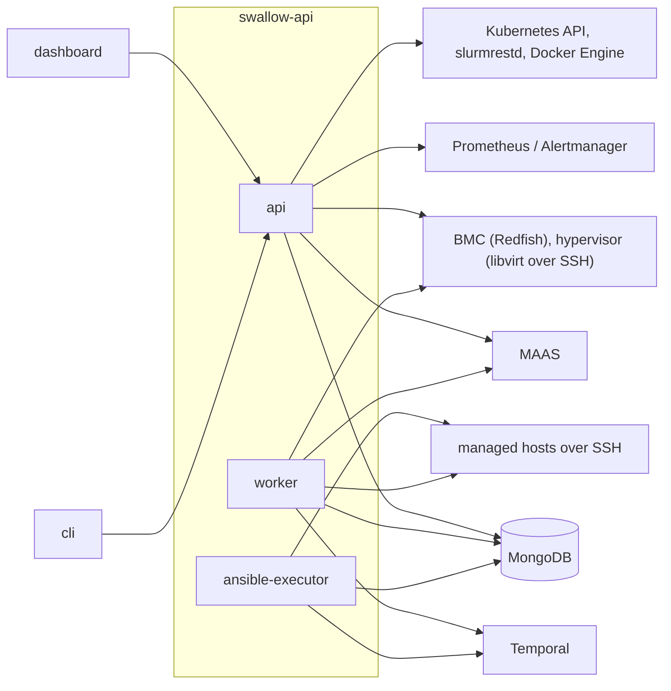
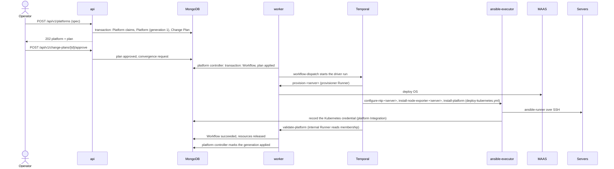

# 系統總覽

本文件是第一次接觸 swallow 時的地圖：swallow 有哪些功能、執行時有哪些 process 與背景工作、一次 Platform 部署怎麼
走完、資料存在哪裡由誰寫入，以及程式在哪裡。它只描述現況、不定義規則；規則在各規格，本文件在每一節指向它們。

- **讀者**：剛加入的 human developer，以及需要先看全貌的 AI agent。
- **讀完之後**：依任務找規格，見 root `AGENTS.md` 的 Reading by Task 與 Domain Specs。

---

## 1. 功能地圖

swallow 管理資料中心的實體與虛擬 Server：把它們納入 provisioner、部署 OS、在上面建立 Platform（Kubernetes、Slurm）
與安裝軟體，並以 Workflow 執行、追蹤每一個改變外部世界的動作。下表的契約在
[api-server 的契約目錄](../../api-server/docs/development/api-contracts/README.md)；dashboard 一欄標「實驗」的功能在
release build 中隱藏。

| 功能 | dashboard | CLI（`cli/internal/command/`） | API 契約 | 規格 |
| --- | --- | --- | --- | --- |
| Site 與 Integration | 有 | `sites.go`、`integrations.go` | `sites-integrations.md` | — |
| Site automation 設定 | 無 | `sites.go` | `site-automation.md` | [access-and-credentials.md](access-and-credentials.md) |
| Server 清單、詳情、即時更新 | 有 | `servers.go` | `servers-list.md`、`servers-stream.md`、`server-detail-actions.md` | 沒有領域規格，以 `servers-list.md` 為準；provisioning 軸見 [os-provisioning.md](os-provisioning.md) |
| Server Enrollment 與硬體檢視 | 有 | `servers.go`、`integrations.go` | `server-enrollment.md` | [server-enrollment-and-boot-media.md](server-enrollment-and-boot-media.md) |
| Boot ISO、Boot Media、Power Configuration | 有 | `bootisos.go`、`bootmedia.go`、`powerconfig.go` | `boot-isos.md`、`server-detail-actions.md` | 同上 |
| 虛擬機器的 enrollment | 實驗 | `virtualmachines.go` | `server-enrollment.md` | 同上 |
| OS 部署、Release、Recover、Rescue、Lock | 有 | `provisioning.go`、`servers.go` | `provisioning.md`、`server-detail-actions.md` | [os-provisioning.md](os-provisioning.md) |
| OS Image 與驗證 | 有（上傳為實驗） | `provisioning.go` | `provisioning.md` | 同上 |
| Deployment Template | 實驗 | `provisioning.go` | `provisioning.md` | 同上 |
| Zone、Pool、tag | 有 | `infrastructure.go`、`provisioning.go` | `infrastructure.md`、`server-tags.md` | 同上 |
| Provisioner HTTP Proxy、Subnet DNS | 有 | 無 | `provisioner-http-proxy.md`、`provisioner-subnet-dns.md` | 同上 |
| SSH Key、Server Default User | 有 | `sshkeys.go`（Default User 無） | `ssh-keys.md`、`server-detail-actions.md` | [access-and-credentials.md](access-and-credentials.md) |
| Platform（Kubernetes、Slurm）與 Change Plan | 有 | `platforms.go`、`plans.go` | `platforms.md`、`change-plans.md` | [platform-deployment.md](platform-deployment.md) |
| GPU Operator、Omnistat、Device Metrics Exporter | 有 | `platforms.go`（GPU Operator） | `platforms.md` | 同上 |
| Kubernetes explorer | 有 | `kubernetes.go` | `platforms-kubernetes.md` | 同上 |
| Managed Software 與 registry credential | 有 | 無 | `software.md`、`registry-credentials.md` | [software-deployment.md](software-deployment.md) |
| Docker explorer | 有 | 無 | `servers-docker.md` | 同上 |
| Workflow | 有 | `workflows.go` | `workflows.md` | [workflow-execution.md](workflow-execution.md) |
| 監控與告警 | 實驗 | `monitoring.go` | `monitoring-alerts.md`、`server-metrics.md` | — |
| Prometheus 的 service discovery | 無 | `discovery.go` | `discovery-prometheus.md` | — |
| Overview | 有 | `overview.go` | `overview.md` | — |
| 登入、API Key | 有 | `auth.go`、`apikeys.go` | `auth-*.md`、`api-keys.md` | [access-and-credentials.md](access-and-credentials.md) |

Teams、使用者管理、機房拓樸與 GPU observability 只有 Planned 的契約（`planned-surface.md`），沒有實作。

## 2. Runtime 拓樸

一個 binary `swallow-api` 提供四個 process role；dashboard 與 CLI 只經由 HTTP API 使用 swallow。

- **api**：HTTP API；Workflow 只寫入 intent 與命令，不連 Temporal。下列迴圈啟動時跑一次、之後依間隔執行，都不取得
  lease（程式在 `internal/app/reconciler.go`，啟動於 `internal/app/api.go`）：

  | 迴圈 | 做什麼 | 間隔 |
  | --- | --- | --- |
  | reconciler | 從每個 provisioner 投影 Server，記錄 Integration 的同步狀態 | 30 秒 |
  | inventory sweep | 更新 GPU 與附屬硬體的 inventory | 15 分鐘 |
  | membership sync | 讀 Platform 的 runtime API（Kubernetes、slurmrestd），寫入 membership | 30 秒 |
  | Redfish capability sweep | 探測 Redfish capability 未知或超過 24 小時的 BMC | 10 分鐘 |
  | artifact retention | 刪除超過 30 天的 Ansible 事件與 job artifact | 24 小時 |

  Server 的 SSE 由 process 內的 event broker 發送；Prometheus 與 discovery 只在查詢時讀取，沒有迴圈。這些迴圈
  不需要 lease，因為安裝只執行一個 api process（不支援多節點，見 api-server architecture spec 的部署假設）。
- **worker**：Temporal worker（task queue `swallow-operations`，driver workflow 與 provisioner、internal Runner 的
  activity），以及 desired-state controller（`internal/app/controllers.go`）。每個 controller 以 `controller_leases`
  的 lease 保證同時只有一個 instance 執行，由 change feed 與定期 resync 觸發：`workflow-dispatch`（派發與取消 Workflow，
  [workflow-execution.md](workflow-execution.md) §10）、`server`（tag 與 Zone／Pool placement）、`zone-pool-catalog`、
  `http-proxy`、`subnet-dns`、`ssh-keys`、`auto-inspect`（為新 enroll 的 Server 建立 `inspect-hardware` Workflow）、
  `platform`（Platform spec 與 Change Plan 的 apply）、`change-plan-expiry`。
  定期 resync 的間隔：`workflow-dispatch` 30 秒、`change-plan-expiry` 5 分鐘，其他 10 分鐘
  （`controllerResyncInterval`）。規則見 [desired-state-model.md](desired-state-model.md) §7。
- **ansible-executor**：task queue `swallow-ansible` 的 activity worker，以 ansible-runner 執行 playbook，把即時事件寫進
  `ansible_task_events`；結果類完成行為（例如記錄 Kubernetes credential）只在這個 process 執行。
- **migrate**：一次性的 schema migration，在服務啟動前執行。

安裝拓樸（容器、volume、MAAS 與 Temporal 共用的 PostgreSQL）見 [installation.md](installation.md)；開發環境見
[development-and-testing.md](development-and-testing.md) §1。

## 3. 從裸機到 Platform

在三台裸機上建立一個 Kubernetes Platform，依序經過：

1. **安裝**：production 安裝會一起裝好 MAAS、Site `default` 與它的 provisioner Integration
   （[installation.md](installation.md)）。開發環境要自己註冊 MAAS，並設定 Server 的 NTP 位址
   （[development-and-testing.md](development-and-testing.md) §1）。
2. **納管**：機器從 PXE（或在 DHCP 不由 MAAS 提供的網路上，從 Boot ISO）開機，MAAS enlist 後，reconcile 讓它以
   `new` 的 Server 出現；swallow 自動執行 `inspect-hardware`，完成後 Server 為 `ready`
   （[server-enrollment-and-boot-media.md](server-enrollment-and-boot-media.md)）。
3. **建立 Platform**：選 Kubernetes、成員與角色（control-plane 為 1 台或 3 台以上的奇數，HA 需要 `apiVip`）、
   `provision_os`；`ready` 的 Server 會先部署 OS（[platform-deployment.md](platform-deployment.md) §2）。
4. **核准 Change Plan**，Workflow 依序部署 OS、設定時間同步、等 SSH、安裝與驗證 k0s；成功後 Platform 可用。

下面的循序圖是第 3、4 步在系統內部的樣子。

## 4. 一次 Platform 部署

以 Kubernetes、`provision_os`（先部署 OS）為例。建立 Platform 是一次 spec 寫入：API 不直接開始部署，而是產生 Change
Plan，核准後由 worker 的 platform controller 建立 Workflow。

- Job 與 Task 的組成、每個 Task 的 Runner 與依賴見 [platform-deployment.md](platform-deployment.md) §2.1。
- Task 的排程、資源所有權、重試與取消見 [workflow-execution.md](workflow-execution.md)。
- 哪些 spec 變更需要 Change Plan 見 [desired-state-model.md](desired-state-model.md) §5.2。

## 5. 資料：collection 與寫入者

資料庫的狀態都在 MongoDB（single-node replica set；規則見 [desired-state-model.md](desired-state-model.md) §10）。另有
兩類檔案在 volume 上：Ansible run 的 job artifacts（`job-artifacts`，ansible-executor 寫入，api 讀取並依 retention
刪除）與 Boot ISO 檔案（`boot-media`，api 建置）。backup 涵蓋 MongoDB 與 job artifacts
（[installation.md](installation.md) §3.6）。同一個
collection 可能由多個 process 寫入，但每個欄位只有一個寫入者（desired-state-model §7.4）。repository 在
`api-server/internal/adapters/store/mongodb/<context>/`。

| context | collection | 內容 | 寫入者 |
| --- | --- | --- | --- |
| auth、apikey | `users`、`auth_sessions`、`api_keys` | 使用者、session、API Key | api |
| site | `sites`、`integrations` | Site；provider 的 Integration 與封存的 credential | api；ansible-executor 在部署完成時建立 Platform 的 Integration |
| server | `servers` | Server 的投影、spec 與 conditions、Platform Claim、deployment 結果、membership | api（reconcile、inventory、membership、spec 寫入）；worker（Server controller、deployment 投影）；ansible-executor（membership） |
| provisioning | `deployment_templates`、`os_image_metadata`、`boot_isos` | Deployment Template、OS Image metadata、Boot ISO | api |
| provisioning | `os_image_verifications`、`provisioning_tasks` | OS Image 的驗證證據、release 後的網路清理 | worker；api（刪除、重試） |
| provisioning | `provisioner_http_proxies`、`provisioner_subnet_dns` | HTTP Proxy 與 Subnet DNS 的 spec 與 status | api（spec）；worker（controller） |
| infrastructure | `zones`、`pools` | Zone、Pool 的 spec 與 status | api（spec）；worker（catalog controller） |
| platform | `platforms`、`platform_deployment_requirements` | Platform 的 spec、status 與功能狀態；Slurm 部署需求 | api（spec、同步狀態）；worker（controller、投影）；ansible-executor（credential 與功能結果） |
| software | `software_assignments`、`software_registry_credentials` | 哪台 Server 裝了什麼；registry 的封存密碼 | api（含 reconcile 觀察到機器沒有 OS 時標 `absent`）；worker 與 ansible-executor（Task 的記錄與失敗標記、拿走 OS 的 Task 標 `absent`） |
| sshkey | `ssh_keys`、`ssh_key_provider_syncs` | Deployment Key 與 Access Key；各 provisioner 的同步紀錄 | api（金鑰）；worker（同步） |
| workflow | `workflows`、`workflow_events`、`workflow_secrets` | Workflow 的計畫與執行狀態、timeline、封存的 secret | api（受理、命令）；worker 與 ansible-executor（經 Workflow service 的狀態轉換） |
| workflow | `resource_leases` | Workflow 擁有的資源（沒有 TTL） | worker |
| workflow | `ansible_task_events`、`automation_configurations` | Ansible 的即時事件；Site automation 設定 | ansible-executor（事件）；api（設定、事件的 retention） |
| convergence | `change_plans`、`convergence_requests`、`convergence_events` | Change Plan；要求 controller 立即收斂；controller 的 timeline | api（提出、核准、要求）；worker（apply、過期、事件） |
| convergence | `controller_leases`、`change_feed_checkpoints` | controller 的單一 instance lease；change stream 的 resume token | worker |
| migration | `schema_metadata` | schema 版本 | migrate |

## 6. 入門名詞

先認識這些詞，其他的在 [glossary 索引](glossaries/outline.md)查：

- [Site](glossaries/terms/site.md)、[Integration](glossaries/terms/integration.md)：一個資料中心範圍，以及 swallow 連到
  外部系統（provisioner、metrics、Platform）的設定。
- [Server](glossaries/terms/server.md)：swallow 管理的一台機器；[OS Provisioning Provider](glossaries/terms/os-provisioning-provider.md)
  （目前是 MAAS）擁有它的 machine 與 OS 部署。
- [OS Image](glossaries/terms/os-image.md)、[Deploy Target](glossaries/terms/deploy-target.md)：部署的 image，部署到
  磁碟或 RAM。
- [Platform](glossaries/terms/platform.md)、[Node Role](glossaries/terms/node-role.md)、[Platform Claim](glossaries/terms/platform-claim.md)：
  swallow 部署的 Kubernetes 或 Slurm、Server 在其中的角色、Platform 對 Server 的佔用。
- [Managed Software](glossaries/terms/managed-software.md)、[Software Assignment](glossaries/terms/software-assignment.md)：
  安裝在 Server 上的單一軟體，以及「哪台裝了什麼」。
- [Workflow](glossaries/terms/workflow.md)、[Job](glossaries/terms/job.md)、[Task](glossaries/terms/task.md)、
  [Runner](glossaries/terms/runner.md)：每個改變外部世界的動作的執行單位。
- [Desired State](glossaries/terms/desired-state.md)、[Observed State](glossaries/terms/observed-state.md)、
  [Condition](glossaries/terms/condition.md)、[Drift](glossaries/terms/drift.md)、[Change Plan](glossaries/terms/change-plan.md)：
  swallow 擁有的意圖、provider 回報的事實，以及兩者不同時怎麼辦。
- [Provider Interface](glossaries/terms/provider-interface.md)、[Platform Module](glossaries/terms/platform-module.md)、
  [Accelerator Module](glossaries/terms/accelerator-module.md)、[Software Module](glossaries/terms/software-module.md)：
  core 怎麼接上外部系統與擴充功能。
- [Deployment Key](glossaries/terms/deployment-key.md)、[Server Default User](glossaries/terms/server-default-user.md)：
  automation 以哪把金鑰、哪個帳號登入 Server。

## 7. 程式地圖

目錄與 component 的對應見 [codebase-structure.md](codebase-structure.md)；api-server 內部的分層見 api-server 的
architecture spec。找東西時：

| 要找 | 位置 |
| --- | --- |
| 三個 process 如何組裝、HTTP 路由在哪裡註冊 | `api-server/internal/app/api.go`、`worker.go`、`ansible_executor.go` |
| controller 清單 | `api-server/internal/app/worker.go`、`api-server/internal/app/controllers.go` |
| 編入的模組、provider kind、core 自己規劃的 Workflow kind | `api-server/internal/app/modules.go` |
| Workflow 的組成（launcher） | `api-server/internal/app/*_adapter.go`（platform deployment、software、GPU Operator、Slurm composition） |
| 每個 context 的 domain、use case、HTTP handler | `api-server/internal/core/<context>/` |
| 外部系統的 adapter | `api-server/internal/adapters/<port>/<adapter>/` |
| MongoDB 的 repository（列表的篩選與搜尋在這裡） | `api-server/internal/adapters/store/mongodb/<context>/` |
| 模組（module.json、hook、playbook、role） | `api-server/modules/<種類>/<id>/` |
| dashboard 的頁面、模組畫面、API adapter | `dashboard/src/presentation/pages/`、`dashboard/src/modules/`、`dashboard/src/infrastructure/api/` |
| CLI 的指令 | `cli/internal/command/` |
| 開發環境 | `deploy/dev/` |
