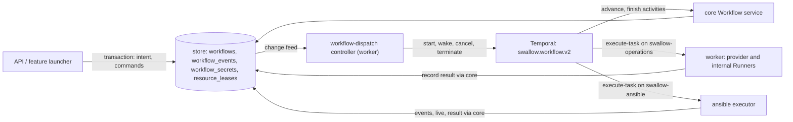

# Workflow Execution 設計與規範

本文件是 swallow **durable Workflow 執行**的權威設計文件與規範：一個 Workflow 從受理到結束的通用語意——
受理與派發、資源所有權與派發世代 fencing、Task 排程、attempt 與重試、`requires_attention` 停等、rerun、取消、
取代佔用中的工作、派發與接續，以及 Ansible Task 的執行與即時進度。這些語意與 Workflow 的 `kind` 無關；
platform deployment、OS provisioning、software deployment 都建立在它之上。

> **本文件不重述決策**：store 擁有執行狀態、Temporal 只執行見
> [decision 072](../decisions/072-store-driven-workflow-execution.md)（建立在
> [decision 069](../decisions/069-swallow-owns-desired-state.md) 之上），Workflow / Job / Task / Runner 與收斂式
> （ensure）執行見 [decision 017](../decisions/017-workflow-job-task-runner-model.md)，swallow 自己擁有 Ansible
> 執行見 [decision 006](../decisions/006-embedded-ansible-execution.md)。本文件描述這些決策之下**目前實作的行為**；
> 各節的「設計理由」只連到對應 ADR。

> **範圍分界**：各功能自己的 Task 組成與 Runner 行為不在本文件——platform 見
> [platform-deployment.md](platform-deployment.md)，OS 佈署、Release／Recover 與 Provider Recovery 見
> [os-provisioning.md](os-provisioning.md)，Managed Software 見 [software-deployment.md](software-deployment.md)。
> HTTP 路由、欄位、狀態碼與錯誤格式以 `api-server` 擁有的
> [workflows 契約](../../api-server/docs/development/api-contracts/api-server/workflows.md)為準。

---

## 1. 目的與範圍

- **讀者**：修改或除錯 orchestration（`internal/core/workflow`）、新增 Workflow kind 或 Task kind、或需要判斷
  「這個 Workflow 卡住時該 retry、rerun 還是 cancel」的開發者與 AI agent。
- **範圍內**：所有 schema-v3 Workflow 共用的執行語意（§3–§12）。
- **範圍外**：個別 kind 的 Task 組成、Runner 內部的 provider／playbook 行為、schema-v2 歷史紀錄的相容讀取
  （見 workflows 契約的 Schema-v2 Compatibility）。

語言以 glossary 為準：[Workflow](glossaries/terms/workflow.md)、[Job](glossaries/terms/job.md)、
[Task](glossaries/terms/task.md)、[Runner](glossaries/terms/runner.md)。程式與 wire 仍有舊名（`Operation`、
`Step`、`executor`、`steps[]`、`retryOfOperationId`、`RunnerKindProvisioner` 的值 `maas`），對照見
[platform-deployment.md](platform-deployment.md) §3 的「命名現況」。

---

## 2. 心智模型：store 擁有狀態，Temporal 只執行

- **store 是執行狀態的唯一紀錄**。`workflows` collection 保存受理時凍結的計畫（kind、targets、Job、Task 與其
  宣告、intent snapshot），以及執行狀態：Workflow 與 Task 的 status、attempt、normalized error、
  `externalExecution`、`live`、operator 送出的命令與派發世代。timeline 在 `workflow_events`，封存的 secret 在
  `workflow_secrets`，資源所有權在 `resource_leases`。API 一律讀 store。
- **只有一個寫入者**：core 的 Workflow service。每次狀態轉換（開始 Task、記錄結果、略過、停等、結束、取消）是一個
  store transaction，同時寫入 Task、timeline 與該 Task 宣告的投影（§12）。防止倒退的檢查是 domain 規則：已有結果
  的 Task 不被改寫，舊世代或舊 attempt 的寫入被拒絕。
- **Temporal 只執行**。driver workflow `swallow.workflow.v2` 不保存 Task 狀態：每一輪呼叫 core 決定下一步，把要
  執行的 Task 交給 Runner 的 activity，再等待結果。Temporal 的 history 遺失不會遺失任何狀態（§10）。
- **API 只寫入 intent 與命令**。受理、取消、Task 重試與 rerun 都只寫 store；API process 不連 Temporal。
- **兩個識別子**：Workflow id（UUID）與 Temporal Workflow ID `swallow-operation/<id>`。後者終身不變；每次派發
  是同一個 ID 下的新 run，store 記錄目前的 run ID 與派發世代。
- **Secret 不進 workflow history**：activity 的輸入只有 Workflow id、Task id、attempt 與世代；Task 的
  `Parameters`、`SecretRefs` 由 Runner 執行時從 store 讀取，值在執行時才 resolve。Task `Parameters`、`SecretRefs`
  與 intent snapshot 中的敏感 key 都不經 API 回傳（流程見 [platform-deployment.md](platform-deployment.md) §4.3）。

執行分散在三種 process：

- **API process**：受理與命令，不執行任何背景的 Workflow 工作。
- **worker process**：`workflow-dispatch` controller（§10）、driver workflow，以及 provider 與 internal Runner 的
  activity（task queue `swallow-operations`）。
- **ansible executor process**：唯一擁有 `ansible-runner` subprocess 的 process，在 task queue `swallow-ansible`
  執行 Ansible Runner 的 activity（§11）。

狀態值集（Workflow 的 `pending | running | waiting_external | waiting_dependency | canceling | succeeded |
failed | partially_succeeded | canceled | requires_attention`，以及 Task 的值集）定義在 workflows 契約與
glossary [Task](glossaries/terms/task.md)。終態是 `succeeded`、`failed`、`partially_succeeded`、`canceled`；
本文件說「未結束」或「active」即指其他所有狀態，`requires_attention` 與 `canceling` 也算未結束。

**規則：replay 相容**。driver 不保存狀態，可以隨時 ContinueAsNew，所以改變 driver 的決策路徑時，以新的 workflow
名稱註冊新版本，並讓 dispatcher 終止舊版本的 run 後以新版本接續（§10），不保留以 `workflow.GetVersion` 分支的舊
路徑。

---

## 3. 受理、持久化與派發

### 現行行為

1. **受理**。功能的 launcher（platform deploy／uninstall、OS 佈署、Release、Recover、software、inspection…）
   或通用的 `POST /workflows/` 先完成自己的檢查（Site、provisioning 狀態、Platform policy、Server Lock 等），
   再把凍結的計畫交給 `WorkflowService.Create`。
2. **驗證整份計畫**（Create）：kind 有效；有 definition 與 definition version；有 `siteId`；至少一個 Task；每個
   Task 有 id、kind、name 且 id 不重複；`DependsOn` 只指向同一 Workflow 的其他 Task，且沒有環；Task kind 已登錄、
   Runner 與該 kind 相符；宣告的完成行為與取消補償都已登錄；每個具名的 Job 都宣告了重試粒度（§12）。launcher 可
   預先指定 Workflow id，但必須是 UUID。任何一項不符都以 `validation_error` 拒絕，不會到執行時才發現。
3. **Busy check**：對每台 `targetServerIds`，若已有未結束的 Workflow 以它為 target，受理以
   `ErrTargetsBusy`（`409 conflict`）拒絕，訊息點名佔用者（Workflow id、intent、status）。
   `SupersededOperationIDs` 中的 Workflow 不計入（§9）。
4. **封存 secret**：launcher 提供的 secret 值加密存入 sealed store，Task 只拿到 reference。
5. **Target resources**：宣告的 resources 加上每台 target Server，去重並排序；它們就是執行時要取得的資源
   （`server:<id>`、`platform:<id>`，§4）。
6. **持久化**：`status=pending`、`startState=pending`、`temporal.workflowId=swallow-operation/<id>`，並寫入
   timeline 事件 `operation_requested`。API 此時回 `202 Accepted`。第 3～6 步在同一個 store transaction 內
   （decision 069）：任何一步失敗，secret、Workflow 紀錄與事件都不會留下。launcher 自己的紀錄（Platform 與其
   claim、Software Assignment、初始的 deployment 投影）由 launcher 在同一個 transaction 中寫入：launcher 先在
   transaction 外完成所有 provider 讀取與 Task 規劃（prepare），再在 transaction 內寫入（persist），Create 加入
   那個 transaction。
7. **派發**：worker 的 `workflow-dispatch` controller 從 change feed 看到新的 Workflow，就派發它的第一個 run：
   在一個 transaction 中把派發世代設為 1、`startState=started`，再以固定的 Temporal Workflow ID 啟動 driver，最後
   記錄 run ID。啟動失敗時 controller 以退避重試；細節見 §10。

### 規則與不變式

- **先持久化，再派發**：受理不依賴 Temporal 當下可用。
- **受理是原子的**：一個被拒絕的受理不留下任何紀錄，所以不需要事後的補償或刪除。Rerun 也一樣：對原 Workflow 寫入
  取消命令、複製 secret 與受理新 Workflow 是同一個 transaction（§7）。
- **一個 Workflow ↔ 一個 Temporal Workflow ID，終身不變**；同一時間最多一個 run（reuse policy
  `ALLOW_DUPLICATE`、conflict policy `FAIL`，派發前先終止仍在執行的舊 run）。

### 設計理由

[decision 072](../decisions/072-store-driven-workflow-execution.md)；受理原子性見
[decision 069](../decisions/069-swallow-owns-desired-state.md)。

---

## 4. 資源所有權與派發世代 fencing

### 現行行為

- **名稱**：wire 與 store 仍稱為 lease（`leases`、`resource_leases`），但它是所有權，不是有期限的租約。
- **取得**：driver 的第一輪在一個 transaction 中，以 Workflow id 為 owner 取得全部資源；任何一個被其他 Workflow
  持有，就一個都不取得，Workflow 投影為 `waiting_dependency`（reason `Waiting for resource leases.`），driver 每
  5 秒再試，直到全部取得或 Workflow 被取消。取得後才開始任何 Task。
- **期限**：所有權沒有 TTL，也不續租。Workflow 執行中、停等中都持有它，直到 Workflow 進入終態：釋放與終態轉換在
  同一個 transaction 中。
- **派發世代**：每次派發（第一次派發與每次接續，§10），Workflow 的派發世代加一。driver 的每個 activity 都帶著
  啟動它的世代；core 拒絕舊世代的寫入（`dispatch_fenced`），舊 run 的 driver 因此停止。
- **Runner 的 fencing**：執行 Task 的 activity 在呼叫 Runner 之前，以及執行中每 15 秒，確認自己的世代仍是目前的
  世代；不是就停止 Runner 並結束，不產生新的副作用。Ansible executor 在啟動 `ansible-runner` 之前與執行中做同樣的
  確認（§11）。
- **診斷**：`GET /workflows/{id}` 的 `leases` 列出該 Workflow 擁有的資源：`owner` 是 Workflow id，
  `fencingToken` 是目前的派發世代，沒有 `expiresAt`。
- **Server controller 的 hold**：Server 被某個 Workflow 擁有時，desired-state 的 Server controller 不收斂它
  （`held`，reason `workflow_lease`）；所有權釋放後立即收斂（見
  [desired-state-model.md](desired-state-model.md) §6.4）。

### 規則與不變式

- 對 Server 或 Platform 的所有 mutation 都在擁有該資源的 Workflow 內執行；其他 Workflow 只能等。
- 舊世代不得產生副作用：被取代的 run 一律停止。
- **所有權不會自動過期**：卡住或被放棄的 Workflow 由 operator 取消；取消一定生效，因為 execution 已不存在時
  dispatcher 會重新派發它來執行取消路徑（§8）。
- **Busy check 與所有權是兩道不同的防線**：busy check 在受理時拒絕 target Server 重疊；所有權在執行時序列化。
  `cancelActiveWorkflows` 只略過前者，從不略過後者（§9）。

### 設計理由

[decision 072](../decisions/072-store-driven-workflow-execution.md)；per-resource 序列化取代單站 site lease 見
[decision 016](../decisions/016-temporal-operation-orchestration.md)。

---

## 5. Task 排程、attempt 與重試

### 5.1 排程與 Workflow 結果

- **只有一條路徑**：每個 Task 屬於一個 Job；沒有 `job` 的 Task 屬於隱含的 Job。
- **依賴**：Task 依 `DependsOn` 執行。Job 之間的順序由 cross-Job `DependsOn` 推導：一個 Task 所在的 Job 依賴另一個
  Job 時，它也等那個 Job 的**每個** Task 定案。
- **決定一個 Task**：依賴都**定案**後才決定。預設只有 `succeeded` 或 `skipped` 的依賴允許它執行，否則它被
  `skipped`；Task 可用 `ContinueOn` 列出額外允許的依賴結果（例如補償 Task 允許 `skipped`），在 Job 內也一樣有效。
  `canceled` 與不可重試的 `failed` 算定案；**可重試的失敗不算**，依賴它的 Task 會等 operator 重試，而不是被略過。
- **並行**：sliding window，同時最多 `OperationMaxParallelism`（預設 4，`SWALLOW_API_OPERATION_MAX_PARALLELISM`）
  個 Task 執行；一個 Task 結束就補上下一個可執行的 Task，不等整批結束。
- **執行中的投影**：開始的 Task 為 `running`；有 Task 在執行時 Workflow 為 `waiting_external`
  （reason `Waiting for an external executor or provider.`）。
- **結果**：全部 Task `succeeded`／`skipped` → `succeeded`；有可重試的失敗而沒有其他可執行的 Task →
  `requires_attention`（§6）；否則 → `failed`，若有任一 Task 成功則為 `partially_succeeded`。

### 5.2 Task attempt 與 idempotency

- 每個 Task 有 operator 看得到的 `attempt`（從 1 起）。Runner 的 idempotency identity 包含 Workflow、Task、target
  與 attempt（例如 Ansible run ID 由 `<workflowId>/<taskId>/<attempt>` 決定）：同一 attempt 只會接續觀察同一個
  外部工作，換了 attempt 才真正重做。
- Runner 在較後的 attempt、activity 重試與接續（§10）時**先觀察再動作**，這是 ensure 語意的落實。只有 operator 的
  明確重試（attempt 大於 1）可以做破壞性的回復（例如 release 後重新部署）；activity 重試與接續只觀察。各 Runner
  觀察到什麼、如何收斂，由該功能的規格描述（例如 `provision-os` 見 [os-provisioning.md](os-provisioning.md)）。

### 5.3 Infrastructure retry（不建立新的 attempt）

- provider 與 internal Runner 的 activity：heartbeat timeout 30 秒，單次最長 7 天；worker 遺失時，Temporal 在 7 天
  的 schedule-to-close 內無上限重試（間隔 1 秒起、最長 30 秒）。這是 infrastructure retry，Task 的 attempt 不變。
- **worker graceful stop** 只中止本地等待（`worker_shutdown`），不 abort MAAS、不 cancel Ansible；下一次 activity
  attempt 以同一 idempotency key 接續觀察同一個外部工作。只有真正的 Workflow cancel 才取消外部工作。
- **ansible executor 遺失**：Ansible activity 只執行一次（MaximumAttempts 1），heartbeat timeout 30 秒。executor
  停止時 activity 逾時，Task 記為 `requires_attention`（`executor_outcome_unknown`），不自動重跑；由 operator
  明確重試。結果無法證明時不報成功、也不自動重跑。
- 狀態轉換的 activity 無上限重試；轉換是 idempotent 的，timeline 事件以 deterministic ID upsert（例如 Task 狀態
  事件以 `(task, status, attempt)` 為 ID），重試不會產生重複事件。

### 5.4 Operator 觸發的 Task／Job 重試

- `POST /workflows/{id}/tasks/{taskId}/retry` 只接受 `failed` 或 `requires_attention`、且 normalized error 為
  `retryable=true` 的 Task。API 把重試命令寫進 store，dispatcher 喚醒 driver（execution 已不存在時重新派發，§10），
  driver 的下一輪套用它。
- **重試粒度由 Job 宣告**（§12）：
  - `task`（隱含的 Job 一律如此）：該 Task 的 attempt 加一、回到 `pending`、清除 error；已成功的依賴不重跑。
  - `job`：該 Task 所在 Job 的**每個** Task attempt 加一、回到 `pending`，Runner 因此以新的 idempotency key 真正
    重做；已收斂的 ensure Task 很快就成功。
- **沒有自動重試**：任何 Task 都只在 operator 要求時重試。
- 不可重試的失敗（例如 `dispatch_fenced`、`executor_unavailable`）直接是 `failed`，不提供 retry。

### 設計理由

不自動重試、operator 重試遞增 attempt 見 [decision 016](../decisions/016-temporal-operation-orchestration.md)；
Job 與 ensure Task 見 [decision 017](../decisions/017-workflow-job-task-runner-model.md)；重試粒度與單一路徑見
[decision 072](../decisions/072-store-driven-workflow-execution.md)；「結果無法證明就交給 operator」源自
[decision 006](../decisions/006-embedded-ansible-execution.md) 的 `indeterminate` 原則。

---

## 6. `requires_attention` 停等

### 現行行為

- **進入**：有可重試的失敗而沒有其他可執行的 Task 時，Workflow 投影為 `requires_attention`（reason
  `A failed Step requires operator attention.`），driver 等待 wake signal。
- **持有所有權、不做 mutation**：停等期間 Workflow 仍擁有全部資源，但不執行任何 Task。所有權沒有 TTL，所以停等
  不需要續租，也不累積 history。
- **離開**：operator 的 Task 重試或取消；兩者都是 store 中的命令，由 dispatcher 送達（§10）。
- 停等中的 execution 若被 Temporal 終止（例如 history 超過上限、主機遷移後 Temporal 遺失資料），dispatcher 的
  resync 重新派發它，新的 run 依 store 回到停等，operator 看到的狀態不變。

### 規則與不變式

- 暫時性中斷（主機重開機、資料庫短暫中斷）不得結束停等中的 Workflow：停等不依賴任何計時器或續租。

### 設計理由

[decision 072](../decisions/072-store-driven-workflow-execution.md)（取代
[decision 020](../decisions/020-durable-operation-recovery.md) 的停等續租）。

---

## 7. Rerun：以新 Workflow 收斂

Rerun 建立一個新的 Workflow，依現況收斂同一個 intent。execution 遺失時 Task 重試與取消仍可用（§10），所以 rerun
用於已結束的 Workflow，以及 operator 想從頭收斂、而不是重試單一 Task 的情況。rerun 的 Task 複製規則已凍結，日後由
AR-15 的 reapply（依 spec 重新收斂）取代，不再新增例外。

### 現行行為

- **API**：`POST /workflows/{id}/rerun`，回 `202` 與新 Workflow 的投影。
- **可 rerun 的狀態**：`failed`、`partially_succeeded`、`canceled`、`requires_attention`。`succeeded`（沒有東西可
  回復）與仍在前進的 `pending`／`running`／`waiting_external`／`waiting_dependency`／`canceling`（應改用 Task retry
  或 cancel）回 `409 conflict`。
- **原 Workflow 為 `requires_attention` 時**：在同一個 transaction 中寫入它的取消命令（reason
  `Superseded by a rerun.`），並以 `SupersededOperationIDs` 受理新 Workflow，讓它通過 busy check。原 Workflow 依
  §8 走完取消路徑並釋放所有權後，新 Workflow 才離開 `waiting_dependency`（§4）。
- **新 Workflow**：新的 UUID（因此是新的 Temporal Workflow ID），沿用原本的 kind、definition、Job 宣告、intent
  snapshot、intent summary、Site、Platform 與 targets；`retryOfOperationId` 指回原 Workflow；`requestedBy` 是發起
  rerun 的 operator。
- **Secret**：以 `CloneForOperation` 把原 Workflow 的全部 sealed secret 複製成新 Workflow 自己的副本，並重新對應
  每個 Task 的 `SecretRefs`；應用層不解密，刪除原 Workflow 也不影響 rerun。沒有 secret storage 時 rerun 不可用。
- **Task 複製規則（收斂）**，依 Task kind 宣告的性質（§12）：
  - **收斂類 Task 一律重跑**，不論先前結果：目前是 `provision-os`、`ensure-boot-media`、`wait-for-ssh`、
    `ansible-playbook`、`validate-platform-health`、`release-os`、`recover-server`。attempt 設為
    `max(上次 attempt, 1) + 1`，Runner 因此走「先觀察再動作」（§5.2）。
  - **例外**：同一 Workflow 已有釋放主機的 Task（`release-os`）成功時，已成功的 `ansible-playbook` 沿用——被 release
    的主機已不再有 playbook 需要的 OS。
  - **其他 kind**（一次性動作，例如 image verification 紀錄、platform uninstall 收尾、inspection）：`succeeded`／
    `skipped` 保留，新的 execution 把它們當成已滿足的依賴；其餘回到 `pending`、attempt 1。
  - 重跑的 Task 清除 error、時間、progress、waiting reason、`externalExecution` 與 `live`。
- **觀察的結果**：例如 `provision-os` 對已以凍結 image 部署且 SSH 可連的 Server 幾秒內成功，並以新 Workflow 寫回
  該 Server 的 deployment 結果；`release-os` 與 `recover-server` 對已 Ready 的 Server 直接成功。各 Runner 的收斂
  細節（包括 [Server Default User](glossaries/terms/server-default-user.md) 只在真正送出部署時才清除）見
  [os-provisioning.md](os-provisioning.md)。
- **Platform lifecycle 跟隨新 Workflow**：[Platform Lifecycle State](glossaries/terms/platform-lifecycle-state.md)
  由 `requestedAt` 最新的 deploy 或 uninstall Workflow 推導，所以 rerun 自然接管 Platform 狀態；原 Workflow 留作
  診斷。全程不需刪除 Platform。
- Rerun 與 kind 無關：platform deploy、OS 佈署、release 等都用同一個原語。
- **相關但不同的 lineage**：失敗的 uninstall 重新送出時，新的 uninstall Workflow 同樣以 `retryOfOperationId`
  指向最近一次 uninstall，但那是新的 uninstall 請求，不是 rerun（見
  [platforms 契約](../../api-server/docs/development/api-contracts/api-server/platforms.md)）。
- **Consumer**：dashboard 的 Platform Repair 先對可重試的 Task 送 Task retry；沒有可重試的 Task 時改呼叫 rerun。

### 規則與不變式

- Rerun 依**現況**收斂，而非信任歷史：已成功的 ensure Task 也會重新驗證。
- 收斂類 Task kind 必須在較後的 attempt 先觀察再動作；做不到的 kind（一次性動作）不得宣告為收斂類。

### 設計理由

新 Workflow 加 lineage 見 [decision 020](../decisions/020-durable-operation-recovery.md)；依現況收斂、不信任
歷史，見 [decision 060](../decisions/060-cancel-and-rerun-converge.md)；ensure 語意見
[decision 017](../decisions/017-workflow-job-task-runner-model.md)。

---

## 8. 取消

### 8.1 取消流程

- `POST /workflows/{id}/cancel`：已結束的 Workflow 回 `409 conflict`；否則把取消命令寫進 store 並回 `202`。
  dispatcher 把它送到目前的 run（Temporal cancel）；execution 已不存在或 Workflow 還沒派發時，重新派發，新的 run
  第一輪就走取消路徑。
- **執行中的 Runner** 收到取消時 best-effort 停止外部工作（MAAS abort、對 `ansible-runner` 送出中斷）；worker
  drain 造成的 context 結束不算取消（§5.3）。driver 等這些 activity 結束。
- **取消路徑**（driver 在 disconnected context 上執行，因為已取消的 workflow context 不會再送出 activity）：
  1. Workflow 投影為 `canceling`（reason `Canceling active work.`）。
  2. 依 Task 宣告的取消補償執行（§12），期間仍擁有資源：
     - 取消抵達時正在執行、且宣告 `return-canceled-deployment` 的 `provision-os`：回收被中斷的部署（§8.3）。
     - 宣告「取消時執行」的 Task（`verify-os-image` 的 `recover-server`），除非已成功：以它自己的 Runner 執行一次，
       歸還借用的 Server（見 [os-provisioning.md](os-provisioning.md)）；結果不寫回 Task。
  3. 一個 transaction：所有未結束的 Task（含 `running` 與 `requires_attention`）寫成 `canceled` 並觸發它們宣告的
     投影，Workflow 寫成 `canceled`（reason 為命令的原因，預設 `Canceled by operator.`），釋放所有權。
- **已有結果的 Task 保留結果**；取消不回退已完成的成果（§8.2）。

### 8.2 已完成的結果不被改寫（投影單調性）

**不變式**：取消不把已 `succeeded`、`failed` 或 `skipped` 的 Task 改成 `canceled`，也不把 Server 已完成的 OS
deployment 結果改成 `canceled`。Server 的 deployment 結果是它**自己的** OS 佈署結果（見 glossary
[Server](glossaries/terms/server.md)），與 Platform 分開；Workflow 被取消由 Workflow status 與 Platform
lifecycle 表達。

這由單一寫入者保證：取消的 transaction 只改寫未結束的 Task，而 Task 的投影只在它真正轉換時執行，所以已完成的
Task 不會產生 `canceled` 投影。舊世代、舊 attempt 對已定案 Task 的寫入一律被 core 拒絕。

### 8.3 回收被中斷的部署

- 對每個在取消抵達時正在執行、且宣告 `return-canceled-deployment` 的 `provision-os`（一般部署都宣告；
  `verify-os-image` 不宣告，由它的 `recover-server` 歸還 Server），取消路徑在**仍擁有資源**時執行回收。回收不是
  Workflow 的 Task（因此不會改寫 `provision-os` 的投影），由該 Task 的 Runner（`provisioner`）執行。
- 每台 Server 並行執行、只執行一次、各自上限 30 分鐘，best-effort。
- 依 provider 觀察到的狀態：
  - Deploying：abort，並等它離開 Deploying（最多 10 分鐘，逾時為 `canceled_deployment_still_in_progress`）；
    Releasing 時繼續觀察。
  - Allocated（MAAS 中止部署後停留的狀態）：以 Recover 計畫回到 Ready——一般 Release，保留 static IP binding、
    不清磁碟。
  - Ready、deployed、failed、broken、rescue：不動。Ready 已是目標；其他狀態是這次部署的結果，可能需要 operator
    檢查。
- 結果記在被中斷 Task 的 timeline：`canceled_deployment_returned_to_ready`、`canceled_deployment_left_as_is`、
  `canceled_deployment_return_failed`（無法回收時 Server 留在 Recover 可接受的狀態）。
- execution 遺失後才取消時，store 中仍為 `running` 的 Task 同樣算被中斷，依同樣規則回收。
- Recover 計畫與 provider 狀態的對應見 [Provider Recovery](glossaries/terms/provider-recovery.md) 與
  [os-provisioning.md](os-provisioning.md)。

### 規則與不變式

- 取消只停止尚未完成的工作，並把它打斷的部署帶回 Ready；它不清除已完成的成果，也不 release 整個 Workflow 的
  Server。
- 補償在釋放所有權之前完成，所以別的 Workflow 不會在回收途中動到這些 Server。
- 取消一定能完成：不依賴原本的 execution 仍存在。

### 設計理由

[decision 060](../decisions/060-cancel-and-rerun-converge.md)；單一寫入者與宣告式補償見
[decision 072](../decisions/072-store-driven-workflow-execution.md)。

---

## 9. 取代佔用中的工作（`cancelActiveWorkflows`）

### 現行行為

- **適用的請求**：`POST /provisioning/release-operations`、`POST /provisioning/recover-operations`（契約見
  [provisioning](../../api-server/docs/development/api-contracts/api-server/provisioning.md)）與
  `POST /platforms/{id}/uninstall`（[platforms](../../api-server/docs/development/api-contracts/api-server/platforms.md)），
  欄位 `cancelActiveWorkflows`（預設 `false`）。三者共用同一個後端實作。
- **時機**：其他所有檢查（存在、Site、狀態、Platform Claim、Server Lock…）都通過後、建立 Workflow 之前，才對每台
  target Server 上所有未結束的 Workflow 寫入取消命令，因為取消送出後無法撤回。這段時間內已結束的 Workflow 略過。
- **受理**：被取代的 Workflow id 以 `SupersededOperationIDs` 傳給 Create，busy check 不把它們算進去；新 Workflow
  立即受理，請求在回應內完成。
- **等待**：新 Workflow 需要相同的資源，所以停在 `waiting_dependency`（`Waiting for resource leases.`），直到被
  取消的 Workflow 跑完取消路徑——包括 §8.3 的回收，最長約 30 分鐘——並釋放所有權後才開始。
- **第一個 attempt 就先觀察**：取代者開始時，Server 可能已被取消路徑帶回 Ready，所以 `release-os` **每個** attempt
  （不只重試）都先讀 Server：已 Ready 直接成功、Releasing 則跟到 Ready，不再送出另一個 Release。要求清除 static IP、
  但這個 Step 沒有送出 Release 時，沒有任何東西記下要移除的 binding，Step 以 `release_cleanup_not_applied`（stage
  `network_cleanup`，不可重試）失敗並說明 binding 仍在，而不是宣稱做了沒做的清理。`recover-server` 對已 Ready 的
  Server 同樣直接成功。
- **不帶旗標**：busy check 照常，`409` 訊息點名佔用的 Workflow（id、intent、status）。
- **繞不過的檢查**：[Platform Claim](glossaries/terms/platform-claim.md) 在取代之前檢查，旗標無法繞過（被 Platform
  佔用的 Server 不能直接 Release，`deployed` 的也不能 Recover）；所有權也從不被略過。
- **Platform uninstall**：帶旗標時 lifecycle 為 `deploying` 的 Platform 也可以 uninstall，且需要 durable
  orchestration。platform 專屬規則見 [platform-deployment.md](platform-deployment.md) §4.8。
- **Consumer**：dashboard 的 Release／Recover 對話框只送旗標、在請求內關閉，並提示工作會在被取消的 Workflow 結束後
  自動開始；uninstall 的單筆與批次對話框列出佔用的 Workflow，要求 operator 確認後才送旗標。CLI 的
  `platforms uninstall`、`provisioning release`、`provisioning recover` 提供 `--cancel-active-workflows`，未帶旗標
  遇到這類 `409` 時提示該旗標。

### 規則與不變式

- 「先取消、再動作」只在後端一個地方實作；client 不自行先取消再輪詢等待。
- 取代只略過受理時的 busy check，不略過所有權：新工作永遠在被取代的工作結束之後才動到 Server。

### 設計理由

[decision 061](../decisions/061-recovery-supersedes-blocking-work.md)。

---

## 10. 派發與接續（`workflow-dispatch` controller）

### 現行行為

- **執行位置**：worker process 中的 convergence controller `workflow-dispatch`，以 AR-15 的 controller runtime 執行
  （[desired-state-model.md](desired-state-model.md) §7.6）：store 中的 singleton lease 保證同時只有一個 active
  instance，API process 不執行它。
- **觸發**：`workflows` 的 change feed（key 是 Workflow id），以及每 `workflowResyncInterval`（預設 30 秒，
  `SWALLOW_API_WORKFLOW_RESYNC_INTERVAL`）一次的 resync。resync 列出所有未結束的 Workflow，另加一個孤兒 key。
- **Reconcile 一個 Workflow**（level-triggered，依 store 的現況決定，不依事件內容）：
  - 已結束：不動。
  - 還沒以目前的 driver 派發（新的 Workflow，或升級前的舊 driver 留下的）：**派發**。
  - 有尚未送達的命令：取消命令以 Temporal cancel 送到目前的 run，其他命令以 wake signal 喚醒 driver；run 已不存在
    時改為派發。送達後記下已送達的命令序號。
  - resync 時：確認目前的 run 仍在執行；不在就**派發**（接續）。
  - change feed 觸發時只比對 store 的欄位（派發世代、run ID、命令序號）；`Task.Live` 的頻繁更新因此不會造成對
    Temporal 的呼叫。
- **派發**：在一個 transaction 中派發世代加一、`startState=started`；終止仍在執行的 run（包括舊 driver 的
  execution），以 `ALLOW_DUPLICATE` 與 conflict policy `FAIL` 啟動新的 run，記錄 run ID。driver 的 ContinueAsNew
  不改變世代。
- **接續進行中的 Task**：新世代的第一輪處理 store 中仍為 `running` 的 Task（由前一個世代開始），依 Task kind 宣告
  的接續方式（§12）：
  - 可以重新觀察的 Runner（provider、internal）：以同一個 attempt 重新執行並標記為接續，Runner 先觀察再接續同一個
    外部工作。
  - Ansible：結果無法證明，Task 記為 `requires_attention`（`executor_outcome_unknown`），等 operator 重試。
- **孤兒**：resync 時列出 Temporal 中仍在執行的 driver run；store 不認得的、已結束的、或不是 store 記錄的目前 run，
  一律終止。
- **升級**：升級後 dispatcher 終止每個舊 driver 的 execution，以新的 driver 接續它的 Workflow。

### 規則與不變式

- execution 遺失時由 store 的狀態重新派發，不只是標記；Task 重試與取消因此在 execution 遺失後仍可用。
- 同一時間只有一個世代能產生副作用（§4）。
- 派發不改變 Task 的 attempt：只有 operator 的重試會。

### 設計理由

[decision 072](../decisions/072-store-driven-workflow-execution.md)（取代
[decision 020](../decisions/020-durable-operation-recovery.md) 只標記的 reconciler）。

---

## 11. Ansible Task 的執行、即時事件串流與進度投影（`Task.Live`）

### 現行行為

- **分工**：ansible executor process 是唯一擁有 `ansible-runner` subprocess 的 process。它是 Temporal worker，只在
  task queue `swallow-ansible` 註冊 Ansible Runner 的 activity。driver 依 Task 的 Runner 把 activity 送到這個
  queue；輸入只有 Workflow id、Task id、attempt 與世代。
- **執行前**：executor 從 store 讀取 Task、目標與 Site 的 Automation Configuration，確認世代與 Server Lock，建立
  inventory、學習目標主機的 SSH host key（與 Site 設定的 known_hosts 合併），並 resolve secret。run ID 由
  `<workflowId>/<taskId>/<attempt>` 決定。
- **發佈 reference**：開始執行就經由 core 寫入 Task 的 `externalExecution` 與 `startedAt`（targeted update，不覆寫
  Task 的其他欄位），讓 events、logs、stderr 端點在執行中就有內容。
- **串流**：每 2 秒讀取該 run artifact 目錄中新增的 job events（以檔名序號為 cursor），把每台 host 的 task 結果——
  play、task、host（serverId）、status（`ok`／`failed`／`skipped`／`unreachable`）、`changed`、起訖時間，**不含 task
  output**——以 `(runId, seq)` idempotent upsert 進 `ansible_task_events`，並經由 core 更新 `Task.Live`（current
  play／task 與累計 total、ok、changed、failed、unreachable、skipped；`changed` 是 `ok` 的子集）。append 成功後才推進
  cursor，所以寫入失敗會在下一輪重讀同一段，不遺漏也不重複計數；run 結束時再 flush 一次。
- **取消與 fencing**：activity 以 heartbeat 回報進度；Workflow 被取消時 heartbeat 收到取消，executor 中斷
  `ansible-runner`。執行中每 15 秒確認世代，不是目前的世代就中斷並結束。
- **結果**：成功時先執行 Task 宣告的結果類完成行為（例如記錄 Kubernetes 或 slurmrestd credential、Omnistat 與
  DME 的 Grafana URL、uninstall 收尾），playbook 回傳的資料不離開 executor；完成行為失敗時 Task 為 `failed`
  （`completion_failed`，可重試）。之後經由 core 記錄結果與 artifact metadata。
- **API 讀取**：Task 的 events、logs、stderr 端點只對有 `externalExecution` 的 Ansible Task 有內容。events 讀
  `ansible_task_events`（未設定該 store 時退回 on-disk events），計數由 events 推導，摘要與清單不會不一致。logs 與
  stderr 讀 on-disk artifact。欄位定義見 workflows 契約。
- **Retention**：artifact 依 `JobArtifactRetention`（預設 30 天）清除，該 run 的 `ansible_task_events` 一併刪除。
- **Delivery**：client 輪詢；目前沒有 push（SSE）。

### 規則與不變式

- Raw stdout 永不進 MongoDB 或 Temporal history（它沒有上限且可能含 secret）；只存有界、不含 output 的 task 結果。
  stdout 留在 executor 的磁碟，由 logs 端點提供。
- 進度以計數與 current play／task 表示，**不提供百分比**：Ansible 事先不知道總 task 數。
- `Task.Live` 是 advisory：權威結果是 Task 的 status 與 error。串流是 best-effort，失敗只記 log，不影響 run 的結果。
- 一支 playbook 內的 Ansible task 不是 Workflow Task（[decision 017](../decisions/017-workflow-job-task-runner-model.md)）；
  串流只讓單一 Task 的內部進度可觀察，不改變執行模型或 Runner 邊界。

### 已知限制

- push（SSE）delivery 尚未實作。

### 設計理由

[decision 030](../decisions/030-live-ansible-task-streaming.md)；executor 成為 Temporal worker 見
[decision 072](../decisions/072-store-driven-workflow-execution.md)。

---

## 12. 宣告式的執行計畫

### 現行行為

一個 Workflow 就是一份完整的計畫：Job、Task、依賴、`ContinueOn`、重試粒度、完成行為、取消補償、目標與資源。
engine（排程、driver、dispatcher）只依宣告執行，不出現任何 Workflow kind 或 Task kind 的判斷；新增一種
deployment 只需要產生這份計畫。

- **Job 宣告**：每個具名的 Job 宣告重試粒度 `task` 或 `job`（§5.4）。隱含的 Job 是 `task`。
- **Task kind 的性質**：集中在一處登錄，engine 讀取：
  - 由哪個 Runner 執行（Runner 決定 task queue：Ansible 在 `swallow-ansible`，其他在 `swallow-operations`）。
  - rerun 時是否重跑：一律、除非已有釋放主機的 Task 成功、或沿用（§7）；以及這個 kind 是否釋放主機。
  - 接續時的處理：先觀察再接續，或轉為 `requires_attention`（§10）。
- **完成行為**：Task 宣告零到多個，每個由型別與參數組成，core 依型別呼叫已登錄的 handler：
  - **投影類**：只寫 store，在 Task 每次轉換的 transaction 內執行（開始、結果、略過、重試、取消）。目前有
    Server deployment 結果、Software Assignment 失敗標記、GPU Operator、Omnistat 與 DME 的狀態。
  - **結果類**：需要 Runner 回傳的資料，在執行該 Task 的 activity 內、記錄結果之前執行。目前有 Kubernetes 與
    slurmrestd credential、Omnistat 與 DME 的結果、platform uninstall 收尾。
- **取消補償**：Task 宣告 `return-canceled-deployment`（被中斷時回收部署），或「取消時執行」（§8.1）。
- **檢查**：受理時驗證整份計畫（§3）；宣告了卻沒有 handler 的型別讓 process 啟動失敗，不會靜默略過；engine 的
  package 不得引用任何 kind 常數（以測試保證）。

### 規則與不變式

- 行為只依宣告決定；Task ID 只是識別子，不用來決定行為。
- 新的完成行為或補償是一個新的型別與 handler，不是 engine 裡的新分支。

### 設計理由

[decision 072](../decisions/072-store-driven-workflow-execution.md)；deployment 以宣告式定義開發的方向見
[core-and-extensions.md](core-and-extensions.md)。

---

## 13. 程式位置對照（導航用）

路徑相對於 `api-server/`。

| 職責 | 路徑 |
| --- | --- |
| Workflow／Task／所有權 domain、狀態值、計畫宣告與 Task kind 性質 | `internal/core/workflow/domain/` |
| 排程（pure function） | `internal/core/workflow/domain/schedule.go` |
| `WorkflowService`：Create（驗證整份計畫、busy check、secret 封存）、命令、Rerun 與 Task 複製規則 | `internal/core/workflow/application/orchestration.go` |
| 狀態轉換（單一寫入者）、完成行為的呼叫 | `internal/core/workflow/application/engine.go` |
| 完成行為的 handler（投影類與結果類） | `internal/app/workflow_completions.go` |
| `workflow-dispatch` controller 與 executor port | `internal/core/workflow/application/dispatcher.go` |
| driver workflow、activities、executor adapter | `internal/adapters/executor/temporalworkflow/` |
| Workflow repository 與資源所有權 | `internal/adapters/store/mongodb/workflow/` |
| Task kind 性質、完成行為與取消補償的登錄 | `internal/app/workflow_plan.go` |
| `cancelActiveWorkflows` 的後端實作 | `internal/app/workflow_supersede.go` |
| Release／Recover 的受理與取代 | `internal/app/provisioning_operation_adapter.go` |
| Platform uninstall 的受理與取代 | `internal/app/platform_deployment_adapter.go`、`internal/core/platform/application/uninstall_platform.go` |
| Server deployment 投影 | `internal/app/server_deployment_projection.go` |
| `return-canceled-deployment` 與 `release-os` 的先觀察；續跑的 attempt 只觀察（`resumedStep`） | `internal/app/provider_step_executor.go` |
| Platform lifecycle 推導 | `internal/app/platform_lifecycle_adapter.go` |
| worker 與 executor 的接線 | `internal/app/worker.go`、`internal/app/ansible_executor.go` |
| Ansible activity（串流、`Task.Live`、fencing、結果類完成行為） | `internal/core/workflow/application/ansible_task.go` |
| `ansible_task_events` store | `internal/adapters/store/mongodb/workflow/mongo_ansible_event_repo.go` |
| 讀取 run 的增量 events | `internal/adapters/hostautomation/ansible/local_runner.go` |
| Task events 的 API 讀取 | `internal/core/workflow/application/execution_service.go` |
| artifact 與 events retention | `internal/app/artifact_retention.go`、`internal/adapters/hostautomation/ansible/artifact_retention.go` |
| 設定預設值（parallelism、resync interval、Ansible task queue） | `config/defaults.go`、`config/env.go`、`config/validate.go` |
| 舊 Workflow 的計畫宣告與舊 lease 轉換（schema v9） | `internal/adapters/store/mongodb/migration/v9.go` |

---

## 14. 相關文件

- 決策（why）：[decision 006](../decisions/006-embedded-ansible-execution.md)、
  [decision 016](../decisions/016-temporal-operation-orchestration.md)、
  [decision 017](../decisions/017-workflow-job-task-runner-model.md)、
  [decision 020](../decisions/020-durable-operation-recovery.md)、
  [decision 030](../decisions/030-live-ansible-task-streaming.md)、
  [decision 060](../decisions/060-cancel-and-rerun-converge.md)、
  [decision 061](../decisions/061-recovery-supersedes-blocking-work.md)、
  [decision 072](../decisions/072-store-driven-workflow-execution.md)；相關的 OS 層回復：
  [decision 033](../decisions/033-provider-recovery-policy.md)、
  [decision 059](../decisions/059-retry-recovers-failed-deployment.md)、
  [decision 067](../decisions/067-platform-claim-on-server.md)。
- 語言：glossary [Workflow](glossaries/terms/workflow.md)、[Job](glossaries/terms/job.md)、
  [Task](glossaries/terms/task.md)、[Runner](glossaries/terms/runner.md)、[Server](glossaries/terms/server.md)、
  [Platform Lifecycle State](glossaries/terms/platform-lifecycle-state.md)、
  [Platform Claim](glossaries/terms/platform-claim.md)、
  [Provider Recovery](glossaries/terms/provider-recovery.md)。
- Context map：[automation-execution](context-maps/automation-execution.md)。
- 其他規格：[desired-state-model.md](desired-state-model.md)、[platform-deployment.md](platform-deployment.md)、
  [os-provisioning.md](os-provisioning.md)、[software-deployment.md](software-deployment.md)。
- API 契約（`api-server` 擁有）：
  [workflows](../../api-server/docs/development/api-contracts/api-server/workflows.md)、
  [provisioning](../../api-server/docs/development/api-contracts/api-server/provisioning.md)、
  [platforms](../../api-server/docs/development/api-contracts/api-server/platforms.md)。
