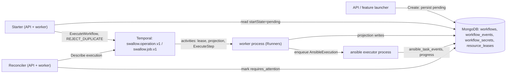

# Workflow Execution 設計與規範

本文件是 swallow **durable Workflow 執行**的權威設計文件與規範：一個 Workflow 從受理到結束的通用語意——
受理與啟動、resource lease 與 fencing、Task attempt 與重試、`requires_attention` 停等、rerun、取消、
取代佔用中的工作、lost-execution 回復，以及 Ansible Task 的即時進度。這些語意與 Workflow 的 `kind`
無關；platform deployment、OS provisioning、software deployment 都建立在它之上。

> **本文件不重述決策**：為什麼以 Temporal 編排見
> [decision 016](../decisions/016-temporal-operation-orchestration.md)，Workflow / Job / Task / Runner
> 與收斂式（ensure）執行見 [decision 017](../decisions/017-workflow-job-task-runner-model.md)，swallow
> 自己擁有 Ansible 執行見 [decision 006](../decisions/006-embedded-ansible-execution.md)。本文件描述這些
> 決策之下**目前實作的行為**；各節的「設計理由」只連到對應 ADR。

> **範圍分界**：各功能自己的 Task 組成與 executor 行為不在本文件——platform 見
> [platform-deployment.md](platform-deployment.md)，OS 佈署、Release／Recover 與 Provider Recovery 見
> [os-provisioning.md](os-provisioning.md)，Managed Software 見 [software-deployment.md](software-deployment.md)。
> HTTP 路由、欄位、狀態碼與錯誤格式以 `api-server` 擁有的
> [workflows 契約](../../api-server/docs/development/api-contracts/api-server/workflows.md)為準。

---

## 1. 目的與範圍

- **讀者**：修改或除錯 orchestration（`internal/operation`）、新增 Workflow kind 或 Task kind、或需要判斷
  「這個 Workflow 卡住時該 retry、rerun 還是 cancel」的開發者與 AI agent。
- **範圍內**：所有 schema-v3 Workflow 共用的執行語意（§3–§11）。
- **範圍外**：個別 kind 的 Task 組成、Runner 內部的 provider／playbook 行為、schema-v2 歷史紀錄的相容讀取
  （見 workflows 契約的 Schema-v2 Compatibility）。

語言以 glossary 為準：[Workflow](glossaries/terms/workflow.md)、[Job](glossaries/terms/job.md)、
[Task](glossaries/terms/task.md)、[Runner](glossaries/terms/runner.md)。程式與 wire 仍有舊名（`Operation`、
`Step`、`executor`、`steps[]`、`retryOfOperationId`、`RunnerKindProvisioner` 的值 `maas`），對照見
[platform-deployment.md](platform-deployment.md) §3 的「命名現況」。

---

## 2. 心智模型：Mongo 投影與 Temporal 執行的分工

一個 Workflow 同時存在於兩個地方，各自負責不同的事：

- **MongoDB 存 intent 與投影**。`workflows` collection 保存受理時凍結的 intent（kind、targets、Tasks、
  intent snapshot）以及 operator 讀取的投影（Workflow／Task 狀態、attempt、normalized error、
  `externalExecution`、`live`）；timeline 在 `workflow_events`，封存的 secret 在 `workflow_secrets`，
  resource lease 在 `resource_leases`。API 一律讀投影。
- **Temporal 擁有執行**。`swallow.operation.v1`（`OperationWorkflowV1`）只決定順序、等待與重試；Job 以
  child workflow `swallow.job.v1`（`JobWorkflowV1`）執行。所有 I/O——取得／續租／釋放 lease、寫投影、
  執行 Task——都是 activity；workflow 程式本身不碰 Mongo。
- **投影只由 workflow 的 activity 寫入**。API handler 送出 cancel／retry signal，但不寫 status。例外只有三個，
  都是 workflow 程式不會（或來不及）寫結果的情況：Cancel 遇到已消失的 execution（§8.4）、Rerun 把被取代的原
  Workflow 直接寫成終態（§7），以及 lost-execution reconciler（§10）。
- **兩個識別子**：Workflow id（UUID）與 Temporal Workflow ID `swallow-operation/<id>`。後者終身不變，
  Temporal 以 reject-duplicate 拒絕重複啟動。
- **Secret 不進 workflow history**：Task 只帶不透明的 `SecretRefs`，值在執行時才 resolve；Task
  `Parameters`、`SecretRefs` 與 intent snapshot 中的敏感 key 都不經 API 回傳（流程見
  [platform-deployment.md](platform-deployment.md) §4.3）。

執行分散在三種 process：API process、worker process（Temporal worker，承載所有 Runner 與 activity），以及
ansible executor process（唯一擁有 `ansible-runner` subprocess 的 process，§11）。Starter 與 lost-execution
reconciler 在 API 與 worker 兩個 process 都執行。

狀態值集（Workflow 的 `pending | running | waiting_external | waiting_dependency | canceling | succeeded |
failed | partially_succeeded | canceled | requires_attention`，以及 Task 的值集）定義在 workflows 契約與
glossary [Task](glossaries/terms/task.md)。終態是 `succeeded`、`failed`、`partially_succeeded`、`canceled`；
本文件說「未結束」或「active」即指其他所有狀態，`requires_attention` 與 `canceling` 也算未結束。

**規則：replay 相容**。改變 workflow 決策路徑的修改必須以 `workflow.GetVersion` 分支，讓已記錄的 history 以
原本的命令 replay。因此本文件描述的某些行為（例如 §6 的停等續租節奏、§8.3 的回收）只適用於該修改之後記錄的
history；更早的 history 依舊走舊路徑。

---

## 3. 受理、持久化與啟動

### 現行行為

1. **受理**。功能的 launcher（platform deploy／uninstall、OS 佈署、Release、Recover、software、inspection…）
   或通用的 `POST /workflows/` 先完成自己的檢查（Site、provisioning 狀態、Platform policy、Server Lock 等），
   再把凍結的 Tasks 交給 `WorkflowService.Create`。
2. **結構驗證**（Create）：kind 有效；有 definition 與 definition version；有 `siteId`；至少一個 Task；每個
   Task 有 id、kind、name 且 id 不重複；`DependsOn` 只指向同一 Workflow 的其他 Task，且沒有環。launcher 可
   預先指定 Workflow id，但必須是 UUID。
3. **Busy check**：對每台 `targetServerIds`，若已有未結束的 Workflow 以它為 target，受理以
   `ErrTargetsBusy`（`409 conflict`）拒絕，訊息點名佔用者（Workflow id、intent、status）。
   `SupersededOperationIDs` 中的 Workflow 不計入（§9）。
4. **封存 secret**：launcher 提供的 secret 值加密存入 sealed store，Task 只拿到 reference。
5. **Target resources**：宣告的 resources 加上每台 target Server，去重並排序；它們就是執行時的 lease key
   （`server:<id>`、`platform:<id>`）。
6. **持久化**：`status=pending`、`startState=pending`、`temporal.workflowId=swallow-operation/<id>`，並寫入
   timeline 事件 `operation_requested`。API 此時回 `202 Accepted`；Temporal 可能在回應之後才啟動。
   第 3～6 步在同一個 store transaction 內（decision 069）：任何一步失敗，secret、Workflow 紀錄與事件都不會留下。
   launcher 自己的紀錄（Platform 與其 claim、Software Assignment、初始的 deployment 投影）由 launcher 在同一個
   transaction 中寫入：launcher 先在 transaction 外完成所有 provider 讀取與 Task 規劃（prepare），再在 transaction
   內寫入（persist），Create 加入那個 transaction。
7. **啟動**（Starter）：每 `TemporalStartInterval`（預設 1 秒，`SWALLOW_API_TEMPORAL_START_INTERVAL`）依
   `requestedAt` 由舊到新讀取最多 100 筆 `startState=pending`，以固定的 Temporal Workflow ID 與
   `WORKFLOW_ID_REUSE_POLICY_REJECT_DUPLICATE` 啟動；已啟動（AlreadyStarted）視同成功。之後寫入
   `startState=started` 與 run ID。啟動失敗的紀錄維持 `pending`，下一輪再試。

### 規則與不變式

- **先持久化，再啟動**：受理不依賴 Temporal 當下可用。
- **受理是原子的**：一個被拒絕的受理不留下任何紀錄，所以不需要事後的補償或刪除。Rerun 也一樣：取消原 Workflow 的
  Temporal 請求在 transaction 之外先送出，之後的釋放 lease、收尾原投影、複製 secret 與受理新 Workflow 是同一個
  transaction（§7）。
- **一個 Workflow ↔ 一個 Temporal Workflow ID，終身不變**。Starter 只啟動 `startState=pending`，從不重新啟動
  `started` 的紀錄；回復已不能前進的 Workflow 一律建立新 Workflow（§7），不重設 `startState`、不換 ID。
- Starter 在多個 process 同時執行是安全的：重複啟動被 Temporal 拒絕，紀錄照樣標為 started。

### 設計理由

idempotent start 見 [decision 016](../decisions/016-temporal-operation-orchestration.md)；為何不以「換 ID 或
重設 `startState`」回復見 [decision 020](../decisions/020-durable-operation-recovery.md)。

---

## 4. Resource lease 與 fencing

### 現行行為

- **取得**：Workflow 一開始投影為 `waiting_dependency`（reason `Waiting for resource leases.`），以自己的
  Temporal Workflow ID 為 owner，依排序一次取得全部 lease key；任何一個被他人持有，就放回已取得的部分並在
  5 秒後重試，直到全部取得或 Workflow 被取消。取得後轉為 `running`。
- **條件與 token**：lease 未被持有、已過期，或 owner 相同時才能取得；每次取得都把該 resource 的 fencing token
  加一。
- **有效期**：`OperationLeaseDuration`（預設 90 秒，`SWALLOW_API_OPERATION_LEASE_DURATION`；設定驗證要求至少為
  dispatch interval 的 3 倍）。
- **執行前驗證**：ExecuteStep activity 在呼叫 Runner 之前驗證每個 lease（owner、token、未過期）；不符就以
  non-retryable 的 `lease_fenced` 結束，Task 為 `failed` 且不可重試。
- **執行中續租**：Task 執行期間每 `min(leaseDuration/4, 15 秒)` 續租一次；續租失敗即中止 Runner，同樣以
  `lease_fenced` 結束。
- **Ansible executor 的 fencing**：AnsibleExecution 在排入時凍結 Workflow 的 lease；ansible executor process
  每次續租自己的 execution lease（`leaseDuration/3`）時也驗證這些 Workflow lease，不符就停止
  `ansible-runner`，結果為 `requires_attention`（`executor_outcome_unknown`）。
- **Job**：Job child 不另取 lease；parent 取得的 lease 傳給 child，child 執行每個 Task 時以同一組 lease 驗證與
  續租，所以同一時間只有一棵 Workflow tree 能改動某個 Server 或 Platform。
- **釋放**：Workflow 以任何結果結束時，在 disconnected context 上釋放 lease。
- **診斷**：`GET /workflows/{id}` 回傳該 Workflow 目前持有的 `leases`。
- 停等期間的續租見 §6。

### 規則與不變式

- 對 Server 或 Platform 的所有 mutation 都在持有該 resource lease 的 Workflow 內執行；其他 Workflow 只能等。
- 持有過期或被取代的 token 時不得產生副作用：fenced 一律是終態失敗，不提供 retry，避免 operator 重試進必然
  失敗的狀態。
- **Busy check 與 lease 是兩道不同的防線**：busy check 在受理時拒絕 target Server 重疊；lease 在執行時序列化。
  `cancelActiveWorkflows` 只略過前者，從不略過後者（§9）。

### 設計理由

per-resource lease 與 fencing 取代單站 site lease，見
[decision 016](../decisions/016-temporal-operation-orchestration.md)。

---

## 5. Task 排程、attempt 與重試

### 5.1 排程與 Workflow 結果

- **沒有 Job 的 Workflow（flat path）**：每一輪找出可執行的 Task，依 `OperationMaxParallelism`（預設 4，
  `SWALLOW_API_OPERATION_MAX_PARALLELISM`）分批並行。依賴都**定案**後才決定一個 Task：預設只有 `succeeded`
  或 `skipped` 的依賴允許它執行，否則它被 `skipped`；Task 可用 `ContinueOn` 列出額外允許的依賴結果（例如補償
  Task 允許 `skipped`）。`canceled` 與不可重試的 `failed` 算定案；**可重試的失敗不算**，依賴它的 Task 會等
  operator 重試，而不是被略過。
- **有 Job 的 Workflow**：只要任一 Task 帶 `Job`，就走 child-workflow 路徑，所以所有 Task 都必須帶 Job。Job 的
  順序由 cross-Job `DependsOn` 推導，一次執行一個 Job child（ID `<temporalWorkflowId>/job/<job>/<n>`）；Job 內的
  Task 在同 Job 的依賴 `succeeded`／`skipped` 後執行，跨 Job 的依賴由 Job 順序保證。
- **執行中的投影**：Task 依序為 `running` → `waiting_external`（等待 Runner），Workflow 為 `waiting_external`。
- **結果**：全部 Task `succeeded`／`skipped` → `succeeded`；有可重試的失敗 → `requires_attention`（§6）；
  否則 → `failed`，若有任一 Task 成功則為 `partially_succeeded`。

### 5.2 Task attempt 與 idempotency

- 每個 Task 有 operator 看得到的 `attempt`（從 1 起）。Runner 的 idempotency identity 包含 Workflow、Task、target
  與 attempt（例如 AnsibleExecution 的 key 為 `<workflowId>/<taskId>/<attempt>`）：同一 attempt 只會接續觀察同一個
  外部工作，換了 attempt 才真正重做。
- Executor 在較後的 attempt（以及 activity 重試）時**先觀察再動作**，這是 ensure 語意的落實。各 executor 觀察到
  什麼、如何收斂，由該功能的規格描述（例如 `provision-os` 見 [os-provisioning.md](os-provisioning.md)）。

### 5.3 Infrastructure retry（不建立新的 attempt）

- ExecuteStep activity 的 heartbeat timeout 為 30 秒，單次最長 7 天。worker 遺失時，Temporal 在 7 天的
  schedule-to-close 內無上限重試（間隔 1 秒起、最長 30 秒）。這是 infrastructure retry，Task 的 attempt 不變。
- **worker graceful stop** 只中止本地等待（`worker_shutdown`），不 abort MAAS、不 cancel Ansible；下一次 activity
  attempt 以同一 idempotency key 接續觀察同一個外部工作。只有真正的 Workflow cancel 才取消外部工作。
- **ansible executor process 遺失**：execution lease 過期而沒有結果的 AnsibleExecution 標為 `requires_attention`
  （「executor 在記錄結果前停止」），不自動重新排入；由 operator 明確重試。結果無法證明時不報成功、也不自動
  重跑。
- 投影 activity（state、Task、timeline 寫入）無上限重試；timeline 事件以 deterministic ID upsert（例如
  Task 狀態事件以 `(task, status, attempt)` 為 ID），重試不會產生重複事件。

### 5.4 Operator 觸發的 Task／Job 重試

- `POST /workflows/{id}/tasks/{taskId}/retry` 只接受 `failed` 或 `requires_attention`、且 normalized error 為
  `retryable=true` 的 Task，以 Temporal signal `retry-operation-step` 送到同一個 execution。
- **flat path**：該 Task 的 attempt 加一、回到 `pending`、清除 error；已成功的依賴不重跑。
- **有 Job**：retry 讓 parent 以新的 child 重跑**整個 Job**（Job run 編號加一），Job 內每個 Task 的 attempt 都加上
  「Job run 編號 − 1」，所以 executor 以新的 idempotency key 真正重做；已收斂的 ensure Task 很快就成功。
- **沒有自動重試**：任何 Task 都只在 operator 要求時重試。
- activity 層的不可重試失敗（例如 `lease_fenced`、`executor_unavailable`）直接是 `failed`，不提供 retry。
- execution 已不存在時 signal 送不到，retry 回 `409 conflict` 並提示 operator 先取消；回復路徑是 cancel 或
  rerun（§7）。

### 設計理由

不自動重試、operator 重試遞增 attempt 見 [decision 016](../decisions/016-temporal-operation-orchestration.md)；
Job 與 ensure Task 見 [decision 017](../decisions/017-workflow-job-task-runner-model.md)；「結果無法證明就交給
operator」源自 [decision 006](../decisions/006-embedded-ansible-execution.md) 的 `indeterminate` 原則。

---

## 6. `requires_attention` 停等與 lease 續租

### 現行行為

- **進入**：有可重試的失敗而沒有其他可執行的 Task 時，Workflow 投影為 `requires_attention`（flat path reason
  `A failed Step requires operator attention.`；有 Job 時為 `Job <job> requires operator attention.`），在
  execution 內等待 operator。
- **持有 lease、不做 mutation**：停等期間 Workflow 仍持有全部 lease，但不執行任何 Task。
- **續租節奏**：進入停等時把 lease 延長到 24 小時，之後每 8 小時續租一次。下一次 Task 執行的續租把 lease 改回
  一般的 `leaseDuration` 節奏。（`parked-lease-renewal` version 之前記錄的 history 仍以 `leaseDuration/3` 續租。）
  每次續租約產生 11 個 history event，這個節奏約一天 33 個，讓停等數年都遠低於 Temporal 每個 execution 51,200
  event 的上限；舊節奏約 39 小時就會撞到上限而被 Temporal 終止。
- **續租失敗不結束 Workflow**：停等中的續租失敗（每次續租 activity 最多試 3 次）只記 log，繼續等待。離開停等的
  條件只有兩個：收到 retry signal，或 operator 取消。
- **安全性**：停等時沒有 host mutation；任何 Task 在產生副作用前都重新驗證 lease（§4）。若 lease 在停等期間被
  別的 owner 取得，重試該 Task 會以 `lease_fenced` 失敗，之後仍可用 rerun 以新的 lease 回復（§7）。
- 停等中的 execution 若被 Temporal 終止（例如 history 超過上限），由 reconciler 更新 statusReason（§10）。

### 規則與不變式

- 暫時性中斷（主機重開機、資料庫短暫中斷）不得結束停等中的 Workflow；任何有上限的重試都撐不過多分鐘的重開機。
- 長 TTL 只會延後「已消失的 execution 所持有的 lease」被別人取得；Cancel 與 Rerun 遇到已消失的 execution 時依
  owner 立即釋放它的 lease（§7、§8.4）。

### 設計理由

[decision 020](../decisions/020-durable-operation-recovery.md)（含續租失敗後繼續等待的租約取捨與 replay 安全）。

---

## 7. Rerun：以新 Workflow 收斂

Rerun 是 Workflow 已無法就地前進時的回復原語：Temporal Workflow ID 固定且拒絕重複啟動、Starter 不重啟
`started` 的紀錄（§3），execution 消失後也收不到 retry signal，所以回復一律是**新的 Workflow**。

### 現行行為

- **API**：`POST /workflows/{id}/rerun`，回 `202` 與新 Workflow 的投影。
- **可 rerun 的狀態**：`failed`、`partially_succeeded`、`canceled`、`requires_attention`（包括 reconciler 標記的
  lost execution，§10）。`succeeded`（沒有東西可回復）與仍在前進的 `pending`／`running`／`waiting_external`／
  `waiting_dependency`／`canceling`（應改用 Task retry 或 cancel）回 `409 conflict`。
- **先讓原 Workflow 結束**：原 Workflow 為 `requires_attention` 時，先 best-effort cancel 它的 execution
  （execution 已不存在時依 owner 釋放其 lease），再把投影直接寫成 `canceled`（reason `Superseded by a rerun.`，
  未結束的 Task 一併寫成 `canceled`），讓同一批 target 通過 busy check。execution 若仍存活，它的 lease 在自己的
  取消路徑結束後才釋放，新 Workflow 在那之前停在 `waiting_dependency`（§4）。
- **新 Workflow**：新的 UUID（因此是新的 Temporal Workflow ID），沿用原本的 kind、definition、intent snapshot、
  intent summary、Site、Platform 與 targets；`retryOfOperationId` 指回原 Workflow；`requestedBy` 是發起 rerun 的
  operator。由 Starter 啟動。
- **Secret**：以 `CloneForOperation` 把原 Workflow 的全部 sealed secret 複製成新 Workflow 自己的副本，並重新對應
  每個 Task 的 `SecretRefs`；應用層不解密，刪除原 Workflow 也不影響 rerun。建立新 Workflow 失敗時刪除這些副本。
  沒有 secret storage 時 rerun 不可用。
- **Task 複製規則（收斂）**：
  - **收斂類 Task 一律重跑**，不論先前結果：`provision-os`、`ensure-boot-media`、`wait-for-ssh`、
    `ansible-playbook`、`validate-platform-health`、`release-os`、`recover-server`。attempt 設為
    `max(上次 attempt, 1) + 1`，executor 因此走「先觀察再動作」（§5.2）。
  - **例外**：同一 Workflow 已有 `release-os` 成功時，已成功的 `ansible-playbook` 沿用——被 release 的主機已不再有
    playbook 需要的 OS。
  - **其他 kind**（一次性動作，例如 image verification 紀錄、platform uninstall 收尾、inspection）沿用舊規則：
    `succeeded`／`skipped` 保留，新的 execution 把它們當成已滿足的依賴；其餘回到 `pending`、attempt 1。
  - 重跑的 Task 清除 error、時間、progress、waiting reason、`externalExecution` 與 `live`。
- **觀察的結果**：例如 `provision-os` 對已以凍結 image 部署且 SSH 可連的 Server 幾秒內成功，並以新 Workflow 寫回
  該 Server 的 deployment 結果；`release-os` 與 `recover-server` 對已 Ready 的 Server 直接成功。各 executor 的收斂
  細節（包括 [Server Default User](glossaries/terms/server-default-user.md) 只在真正送出部署時才清除）見
  [os-provisioning.md](os-provisioning.md)。
- **Platform lifecycle 跟隨新 Workflow**：[Platform Lifecycle State](glossaries/terms/platform-lifecycle-state.md)
  由 `requestedAt` 最新的 deploy 或 uninstall Workflow 推導，所以 rerun 自然接管 Platform 狀態；原 Workflow 留作
  診斷。全程不需刪除 Platform。
- Rerun 與 kind 無關：platform deploy、OS 佈署、release 等都用同一個原語。
- **相關但不同的 lineage**：失敗的 uninstall 重新送出時，新的 uninstall Workflow 同樣以 `retryOfOperationId`
  指向最近一次 uninstall，但那是新的 uninstall 請求，不是 rerun（見
  [platforms 契約](../../api-server/docs/development/api-contracts/api-server/platforms.md)）。
- **Consumer**：dashboard 的 Platform Repair 先對可重試的 Task 送 Task retry；遇到 `409`（execution 已不存在）或沒有
  可重試的 Task 時改呼叫 rerun。

### 規則與不變式

- 回復永遠建立新 Workflow；不重用 Temporal Workflow ID，不重設 `startState`。
- Rerun 依**現況**收斂，而非信任歷史：已成功的 ensure Task 也會重新驗證。
- 加入收斂集合的 Task kind 必須在較後的 attempt 先觀察再動作；做不到的 kind（一次性動作）不得加入。

### 設計理由

新 Workflow 加 lineage 而非對抗固定 Workflow ID，見
[decision 020](../decisions/020-durable-operation-recovery.md)；依現況收斂、不信任歷史，見
[decision 060](../decisions/060-cancel-and-rerun-converge.md)；ensure 語意見
[decision 017](../decisions/017-workflow-job-task-runner-model.md)。

---

## 8. 取消

### 8.1 取消流程

- `POST /workflows/{id}/cancel`：已結束的 Workflow 回 `409 conflict`；否則送出 Temporal cancel，Temporal 接受即
  回 `202`。handler 不寫 Mongo status。
- **執行中的 Runner** 收到取消時 best-effort 停止外部工作（MAAS abort、對 Ansible execution 送出 cancel
  request）；worker drain 造成的 context 結束不算取消（§5.3）。
- **Workflow 的取消路徑**（在 disconnected context 上執行，因為已取消的 workflow context 不會再送出 activity）：
  1. kind 專屬的補償：`verify-os-image` 以它自己的 `recover-server` 歸還借用的 Server（見
     [os-provisioning.md](os-provisioning.md)）。
  2. 回收被中斷的部署（§8.3）。
  3. 投影 `canceling`，把仍為 `pending`、`waiting_dependency`、`waiting_external`、`running` 的 Task 寫成
     `canceled`，最後 Workflow 寫成 `canceled`（reason `Canceled by operator.`）。
  4. 釋放 lease（§4）。
- **已有結果的 Task 保留結果**；取消不回退已完成的成果（§8.2）。
- **有 Job 的 Workflow**：parent 以 `WaitForCancellation` 等 Job child 跑完自己的取消路徑——只有 child 知道哪些
  Task 在取消時正在執行——然後才完成自己的取消並釋放 lease。parent 以**啟動時的 Task 快照**完成取消，快照中的
  Task 都是 pending、attempt 1，所以 parent 會對 child 已完成的 Task 送出 `canceled` 寫入；這些寫入由 §8.2 擋下。

### 8.2 已完成的結果不被改寫（投影單調性）

**不變式**：取消不把已 `succeeded`、`failed` 或 `skipped` 的 Task 改成 `canceled`，也不把 Server 已完成的 OS
deployment 結果改成 `canceled`。Server 的 deployment 結果是它**自己的** OS 佈署結果（見 glossary
[Server](glossaries/terms/server.md)），與 Platform 分開；Workflow 被取消由 Workflow status 與 Platform
lifecycle 表達。三道機制保證這件事：

1. **Repository guard**：`UpdateStep` 的 `canceled` 寫入遇到已 `succeeded`／`failed`／`skipped` 的 Task 時什麼都不改，
   回 `ErrStepTransitionIgnored`。activity 把它當成功，但**不通知任何 projection observer、也不寫 timeline 事件**，
   所以被拒的轉換不會流到 Server 或時間軸。
2. **Server deployment observer**：同一 Workflow、同一 Task 的 `canceled`／`skipped`，若 attempt 不比已記錄的
   `succeeded`／`failed` 新，就忽略。比較的是 attempt 先後而非相等，因為 parent 快照是 attempt 1，Job 重試後
   Task 可能已到更後面的 attempt。較新的 attempt 或不同的 Workflow 照常套用；進行中或 `requires_attention` 的部署
   仍可被取消。
3. **Repair sweep**：API process 每個 reconcile interval（預設 30 秒）檢查 Server 的 deployment 結果，只在它指名的
   Workflow **已結束**時動作：仍為 `deploying`／`verifying` 者依 Task 結果定案（Workflow 被取消而 Task 沒有結果時
   定為 `canceled`）；為 `canceled` 但 Task 在相同或更後的 attempt 記錄了 `succeeded`／`failed` 者，還原為該結果。
   寫入前重讀 Server，結果已換成新的部署就不動；它不碰 provider 擁有的 provisioning 軸，Workflow 仍在前進、
   `canceling` 或 `requires_attention` 時也不動。

### 8.3 回收被中斷的部署

- 對每個在 cancel 抵達時 activity 已送出的 `provision-os`，取消路徑在**仍持有 lease** 時執行
  `return-canceled-deployment`。這個 step 不在 Workflow 的 Task 清單中（因此不會改寫已 `canceled` 的
  `provision-os` 投影），由該 Task 的 Runner（`provisioner`）執行。
- 每台 Server 並行執行、只執行一次、各自上限 30 分鐘，best-effort。
- 依 provider 觀察到的狀態：
  - Deploying：abort，並等它離開 Deploying（最多 10 分鐘，逾時為 `canceled_deployment_still_in_progress`）；
    Releasing 時繼續觀察。
  - Allocated（MAAS 中止部署後停留的狀態）：以 Recover 計畫回到 Ready——一般 Release，保留 static IP binding、
    不清磁碟。
  - Ready、deployed、failed、broken、rescue：不動。Ready 已是目標；其他狀態是這次部署的結果，可能需要 operator
    檢查。
- 結果記在被中斷 Task 的 timeline：`canceled_deployment_returned_to_ready`、`canceled_deployment_left_as_is`、
  `canceled_deployment_return_failed`（無法回收時 Server 留在 Recover 可接受的狀態）。
- `verify-os-image` 不走這條路，由它自己的 `recover-server` 歸還 Server（§8.1）。
- Recover 計畫與 provider 狀態的對應見 [Provider Recovery](glossaries/terms/provider-recovery.md) 與
  [os-provisioning.md](os-provisioning.md)。

### 8.4 Execution 已不存在時的取消

- Temporal 回報 execution 不存在（terminated、timed out、超過 retention 或 NotFound）時，Cancel 由 swallow 自己
  記錄結果：先依 owner 釋放該 execution 仍持有的 lease（釋放失敗時 Workflow 維持可再取消，不會變成「已取消但
  Server 仍被佔用」），再把投影寫成 `canceled`（reason `Canceled by operator; its workflow execution had already
  ended.`），所有未結束的 Task（含 `requires_attention`）寫成 `canceled`，已有結果的 Task 保留。仍回 `202`。
- 這條路徑直接寫 repository、不經 observer；Server 的 deployment 結果由 §8.2 的 repair sweep 定案。

### 規則與不變式

- 取消只停止尚未完成的工作，並把它打斷的部署帶回 Ready；它不清除已完成的成果，也不 release 整個 Workflow 的
  Server。
- 回收在釋放 lease 之前完成，所以別的 Workflow 不會在回收途中動到這些 Server。

### 設計理由

[decision 060](../decisions/060-cancel-and-rerun-converge.md)。

---

## 9. 取代佔用中的工作（`cancelActiveWorkflows`）

### 現行行為

- **適用的請求**：`POST /provisioning/release-operations`、`POST /provisioning/recover-operations`（契約見
  [provisioning](../../api-server/docs/development/api-contracts/api-server/provisioning.md)）與
  `POST /platforms/{id}/uninstall`（[platforms](../../api-server/docs/development/api-contracts/api-server/platforms.md)），
  欄位 `cancelActiveWorkflows`（預設 `false`）。三者共用同一個後端實作。
- **時機**：其他所有檢查（存在、Site、狀態、Platform Claim、Server Lock…）都通過後、建立 Workflow 之前，才對每台
  target Server 上所有未結束的 Workflow 送出 Cancel，因為取消送出後無法撤回。
- **取消被拒**：若該 Workflow 在這段時間內已結束就略過；仍在執行則整個請求以 `409 conflict` 失敗並指出它，不建立
  新 Workflow。execution 已不存在的 Workflow 由 §8.4 直接關閉，照常列入取代清單。
- **受理**：被取代的 Workflow id 以 `SupersededOperationIDs` 傳給 Create，busy check 不把它們算進去；新 Workflow
  立即受理，請求在回應內完成。
- **等待**：新 Workflow 需要相同的 resource lease，所以停在 `waiting_dependency`（`Waiting for resource leases.`），
  直到被取消的 Workflow 跑完取消路徑——包括 §8.3 的回收，最長約 30 分鐘——並釋放 lease 後才開始。
- **第一個 attempt 就先觀察**：取代者開始時，Server 可能已被取消路徑帶回 Ready，所以 `release-os` **每個** attempt
  （不只重試）都先讀 Server：已 Ready 直接成功、Releasing 則跟到 Ready，不再送出另一個 Release。要求清除 static IP、
  但這個 Step 沒有送出 Release 時，沒有任何東西記下要移除的 binding，Step 以 `release_cleanup_not_applied`（stage
  `network_cleanup`，不可重試）失敗並說明 binding 仍在，而不是宣稱做了沒做的清理。`recover-server` 對已 Ready 的
  Server 同樣直接成功。
- **不帶旗標**：busy check 照常，`409` 訊息點名佔用的 Workflow（id、intent、status）。
- **繞不過的檢查**：[Platform Claim](glossaries/terms/platform-claim.md) 在取代之前檢查，旗標無法繞過（被 Platform
  佔用的 Server 不能直接 Release，`deployed` 的也不能 Recover）；lease 也從不被略過。
- **Platform uninstall**：帶旗標時 lifecycle 為 `deploying` 的 Platform 也可以 uninstall，且需要 durable
  orchestration。platform 專屬規則見 [platform-deployment.md](platform-deployment.md) §4.8。
- **Consumer**：dashboard 的 Release／Recover 對話框只送旗標、在請求內關閉，並提示工作會在被取消的 Workflow 結束後
  自動開始；uninstall 的單筆與批次對話框列出佔用的 Workflow，要求 operator 確認後才送旗標。CLI 的
  `platforms uninstall`、`provisioning release`、`provisioning recover` 提供 `--cancel-active-workflows`，未帶旗標
  遇到這類 `409` 時提示該旗標。

### 規則與不變式

- 「先取消、再動作」只在後端一個地方實作；client 不自行先取消再輪詢等待。
- 取代只略過受理時的 busy check，不略過 lease：新工作永遠在被取代的工作結束之後才動到 Server。

### 設計理由

[decision 061](../decisions/061-recovery-supersedes-blocking-work.md)。

---

## 10. Lost-execution reconciliation

### 現行行為

- **執行位置與頻率**：reconciler 在 API 與 worker process 都執行，間隔為 reconcile interval（預設 30 秒，
  `SWALLOW_API_RECONCILE_INTERVAL`）；每次寫入都是 idempotent 的狀態更新，重複 sweep 安全。sweep 失敗就跳過，下一輪
  再試。
- **候選**：`startState=started` 的未結束 Workflow，分兩組讀取（前進中；`requires_attention` 與 `canceling`），各組
  依 `requestedAt` 由舊到新最多 100 筆。Mongo index `operation_v3_recovery (schemaVersion, startState, status)` 讓
  sweep 跳過大量已結束的紀錄。尚未啟動的 `pending` 紀錄不是候選。
- **判斷**：以 `DescribeWorkflowExecution` 查 Temporal：NotFound 或已關閉即 lost；仍在執行就不動（停等中的
  Workflow 不受影響）；describe 暫時失敗則本輪略過該筆。
- **處理**：
  - 前進中（`pending`、`waiting_dependency`、`running`、`waiting_external`）→ `requires_attention`，statusReason
    說明 execution 遺失（主機重開機、execution timeout 或 history 上限），並建議 cancel 以釋放 Server 或 repair。
  - 已是 `requires_attention` → 狀態不變，只把 statusReason 換成上述 lost-execution 原因，讓 operator 分辨「仍可
    Task retry」與「已被 Temporal 終止」。
  - `canceling` → 取消早已被要求，所以依 owner 釋放 lease 後記為 `canceled`；釋放失敗就維持 `canceling`，下一輪再試。
- **只標記，不自動回復**：reconciler 不 rerun、不重試；回復一律是 operator 的明確動作（cancel 或 rerun，§7）。
- deploy Workflow 為 `requires_attention` 時，Platform lifecycle 呈現為 `deploy_failed`，因此遺失 execution 的部署
  顯示為可 repair。

### 規則與不變式

- 遺失的前進中 Workflow 不直接標為終態：終態會失去「待處理、可回復」的語意；rerun 在需要時才把原 Workflow 轉為
  終態（§7）。

### 設計理由

[decision 020](../decisions/020-durable-operation-recovery.md)。

---

## 11. Ansible Task 即時事件串流與進度投影（`Task.Live`）

### 現行行為

- **分工**：ansible executor process 是唯一擁有 `ansible-runner` subprocess 的 process。Temporal 的 ansible activity
  只排入一筆 AnsibleExecution（idempotency key `<workflowId>/<taskId>/<attempt>`，§5.2）並觀察它。
- **Executor 串流**：每 2 秒讀取該 run artifact 目錄中新增的 job events（以檔名序號為 cursor），把每台 host 的 task
  結果——play、task、host（serverId）、status（`ok`／`failed`／`skipped`／`unreachable`）、`changed`、起訖時間，
  **不含 task output**——以 `(runId, seq)` idempotent upsert 進 `ansible_task_events`，並更新
  `AnsibleExecution.Progress`（current play／task 與累計 total、ok、changed、failed、unreachable、skipped；
  `changed` 是 `ok` 的子集）。append 成功後才推進 cursor，所以寫入失敗會在下一輪重讀同一段，不遺漏也不重複計數；
  run 結束時再 flush 一次，讓最後的結果在終態寫入前落地。
- **Activity 投影**：建立 execution 後立刻以 targeted update（`UpdateStepLive`，只寫 `externalExecution`、
  `startedAt`、`live`，不覆寫 Task 的 targets、parameters 與 dependencies）發佈 Task 的 `externalExecution` 與
  `startedAt`；之後每 2 秒輪詢 execution，把 Progress 鏡射成 `Task.Live`。Task 到終態時，最終投影會清除 `live`。
- **API 讀取**：Task 的 events、logs、stderr 端點只對有 `externalExecution` 的 Ansible Task 有內容，所以提早發佈
  reference 是即時可見的前提。events 讀 `ansible_task_events`（未設定該 store 時退回 on-disk events），計數由 events
  推導，摘要與清單不會不一致。logs 與 stderr 仍讀 on-disk artifact。欄位定義見 workflows 契約。
- **Delivery**：client 輪詢；目前沒有 push（SSE）。

### 規則與不變式

- Raw stdout 永不進 MongoDB（它沒有上限且可能含 secret）；只存有界、不含 output 的 task 結果。stdout 留在磁碟，由
  logs 端點提供。
- 進度以計數與 current play／task 表示，**不提供百分比**：Ansible 事先不知道總 task 數。
- `Task.Live` 與 `AnsibleExecution.Progress` 是 advisory：權威結果是 Task 的 status 與 error。串流是 best-effort，
  失敗只記 log，不影響 run 的結果。
- 一支 playbook 內的 Ansible task 不是 Workflow Task（[decision 017](../decisions/017-workflow-job-task-runner-model.md)）；
  串流只讓單一 Task 的內部進度可觀察，不改變執行模型或 Runner 邊界。

### 已知限制

- `ansible_task_events` 沒有 retention：on-disk artifact 依 `JobArtifactRetention`（預設 30 天）清除，events 不會。
  兩者的對齊仍是後續工作。
- push（SSE）delivery 尚未實作。

### 設計理由

[decision 030](../decisions/030-live-ansible-task-streaming.md)。

---

## 12. 程式位置對照（導航用）

路徑相對於 `api-server/`。

| 職責 | 路徑 |
| --- | --- |
| Workflow／Task／lease domain、狀態值、`ErrStepTransitionIgnored` | `internal/operation/domain/orchestration.go` |
| `WorkflowService`：Create（驗證、busy check、secret 封存）、Cancel、RetryStep、Rerun 與 Task 複製規則 | `internal/operation/application/orchestration.go` |
| execution 已不存在時的取消投影與 lease 釋放 | `internal/operation/application/lost_execution.go` |
| `OperationWorkflowV1`、`JobWorkflowV1`、停等續租、取消路徑、回收被中斷的部署、Controller、Starter、Reconciler | `internal/operation/infra/temporalworkflow/workflow.go` |
| ExecuteStep activity 的 timeout 與重試設定、worker drain 的判斷 | `internal/operation/infra/temporalworkflow/activity_options.go`、`activity_shutdown.go` |
| Workflow repository（monotonic guard、`UpdateStepLive`、索引）與 resource lease repository | `internal/adapters/store/mongodb/workflow/mongo_orchestration_repo.go` |
| `cancelActiveWorkflows` 的後端實作 | `internal/app/workflow_supersede.go` |
| Release／Recover 的受理與取代 | `internal/app/provisioning_operation_adapter.go` |
| Platform uninstall 的受理與取代 | `internal/app/platform_deployment_adapter.go`、`internal/platform/application/uninstall_platform.go` |
| Server deployment observer 與 repair sweep | `internal/app/server_deployment_projection.go` |
| `return-canceled-deployment` 與 `release-os` 的先觀察 | `internal/app/provider_step_executor.go` |
| Platform lifecycle 推導 | `internal/app/platform_lifecycle_adapter.go` |
| Starter、Reconciler、repair sweep 的接線 | `internal/app/api.go`、`internal/app/worker.go` |
| ansible activity（提早發佈 reference、鏡射 `Task.Live`） | `internal/operation/infra/temporalworkflow/ansible_executor.go` |
| ansible executor process（串流、Progress、executor lease 與 fencing） | `internal/operation/application/ansible_executor.go` |
| `ansible_task_events` store | `internal/adapters/store/mongodb/workflow/mongo_ansible_event_repo.go` |
| 讀取 run 的增量 events | `internal/operation/infra/local_runner.go` |
| Task events 的 API 讀取 | `internal/operation/application/execution_service.go` |
| artifact retention | `internal/app/artifact_retention.go`、`internal/operation/infra/artifact_retention.go` |
| 設定預設值（lease、parallelism、各 interval） | `config/defaults.go`、`config/env.go`、`config/validate.go` |

---

## 13. 相關文件

- 決策（why）：[decision 006](../decisions/006-embedded-ansible-execution.md)、
  [decision 016](../decisions/016-temporal-operation-orchestration.md)、
  [decision 017](../decisions/017-workflow-job-task-runner-model.md)、
  [decision 020](../decisions/020-durable-operation-recovery.md)、
  [decision 030](../decisions/030-live-ansible-task-streaming.md)、
  [decision 060](../decisions/060-cancel-and-rerun-converge.md)、
  [decision 061](../decisions/061-recovery-supersedes-blocking-work.md)；相關的 OS 層回復：
  [decision 033](../decisions/033-provider-recovery-policy.md)、
  [decision 059](../decisions/059-retry-recovers-failed-deployment.md)、
  [decision 067](../decisions/067-platform-claim-on-server.md)。
- 語言：glossary [Workflow](glossaries/terms/workflow.md)、[Job](glossaries/terms/job.md)、
  [Task](glossaries/terms/task.md)、[Runner](glossaries/terms/runner.md)、[Server](glossaries/terms/server.md)、
  [Platform Lifecycle State](glossaries/terms/platform-lifecycle-state.md)、
  [Platform Claim](glossaries/terms/platform-claim.md)、
  [Provider Recovery](glossaries/terms/provider-recovery.md)。
- Context map：[automation-execution](context-maps/automation-execution.md)。
- 其他規格：[platform-deployment.md](platform-deployment.md)、[os-provisioning.md](os-provisioning.md)、
  [software-deployment.md](software-deployment.md)。
- API 契約（`api-server` 擁有）：
  [workflows](../../api-server/docs/development/api-contracts/api-server/workflows.md)、
  [provisioning](../../api-server/docs/development/api-contracts/api-server/provisioning.md)、
  [platforms](../../api-server/docs/development/api-contracts/api-server/platforms.md)。
