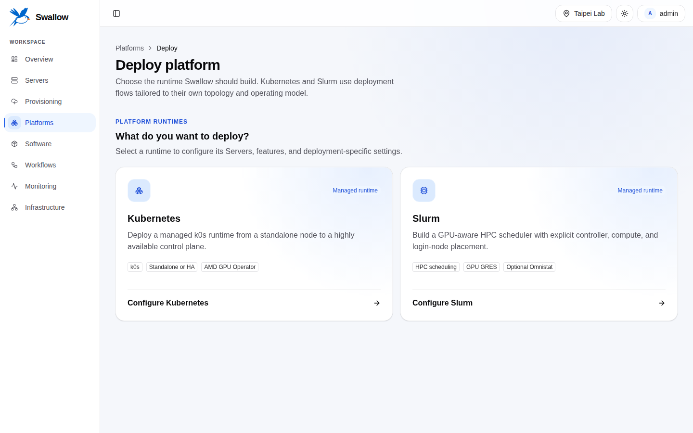

# Platforms

[繁體中文](../../zh-TW/guides/platforms.md) · [Documentation home](../README.md)

A Platform is a Kubernetes or Slurm runtime deployed by swallow. swallow does
not register arbitrary existing runtimes, and it never treats itself as a
Platform.

## Before deployment

- Target Servers belong to one Site and are `ready` or `deployed`; a `ready`
  Server gets its operating system deployed first (the OS preparation step).
- Server locks and active conflicting Workflows are cleared.
- Site automation, SSH known hosts, credentials, worker, and Ansible executor
  are ready.
- The selected topology meets its minimum resource requirements.
- Required shared state or workload storage is available for the chosen Slurm
  topology.

The wizard revalidates current eligibility when the request is submitted.

Open **Deploy platform** to choose Kubernetes or Slurm from the runtime catalog. The
selection opens a dedicated workspace: Kubernetes and Slurm share Server discovery
and OS-provisioning controls, but keep their own steps, validation, features, and
review. Optional capabilities use Switches; topology and implementation modes remain
explicit radio choices, and Slurm node roles remain independently selectable.

Submitting the wizard creates the Platform and proposes its install as a
[Change Plan](workflows.md#change-plans): nothing is installed until you approve it on
**Change Plans**, and until then the Platform reads **Awaiting approval**. Deleting a
Platform in that state withdraws the plan; no host was changed.

## Clock check

The platform's install step (**Install k0s Platform** or **Install Slurm Platform**)
first examines every node's clock, before it installs anything. It changes nothing;
time is set when an OS is deployed (see
[Time synchronization](os-provisioning.md#time-synchronization)). A node fails the
check when its clock is not synchronized, when the swallow host's NTP service does
not answer it, or when it is more than a second away from that service.

The **Require synchronized clocks** Switch in the Features step is on by default. A
node that fails the check then stops the install step on every node, and the step's
output names it.
Slurm needs this: MUNGE rejects credentials between nodes whose clocks disagree. Turn
the Switch off to report such nodes and continue anyway.

## Kubernetes

Choose a supported topology and assign control-plane and worker roles. The
workspace starts with **Multi-node (non-HA)**; **High availability** needs an odd
number of at least three control planes and an unused API virtual IP. A
standalone deployment is still one Kubernetes Platform. Deployment can also
request ephemeral OS targets when the selected image/provider combination
supports them.

After deployment, the Platform detail provides a live Kubernetes explorer for:

- namespaces and applications;
- pods, logs, and related resources;
- YAML apply;
- node cordon state.

Open the Kubernetes Platform, then use its **Applications**, **Namespaces**, and
**Cluster** tabs:

- **Applications** lists Deployments, DaemonSets, StatefulSets, and bare Pods.
  Filter by namespace; scale Deployments and StatefulSets, restart Deployments,
  DaemonSets, and StatefulSets, read a bounded snapshot of the first Pod's
  logs, or delete a workload. **Apply YAML** supports a server-side dry run
  before applying one or more objects.
- **Namespaces** creates and deletes namespaces. System namespaces are
  identified and cannot be deleted.
- **Cluster** shows version, readiness, schedulable GPU resources, and the
  Server matched to each node. **Cordon** stops new scheduling on a node;
  **Uncordon** makes it schedulable again. Neither action drains existing Pods.

These views query the Kubernetes API live and do not create a durable copy of
in-cluster state in swallow. The Cluster tab also shows the AMD GPUs each node
exposes.

### AMD GPU Operator

The Kubernetes workspace's **Features** step can install the AMD GPU Operator with the
Platform. When a selected workload node has an AMD GPU, **AMD GPU Operator** starts on,
with its **Device Metrics Exporter** on as the Platform's GPU monitoring. Turn it off to
deploy without it. Once you change the switch or any option, your choice stays when you
change the selected Servers later; until then it follows them, and turns off when no workload
node has an AMD GPU. While it is on, it shows its options:

- **Allocation mode**: **Device Plugin** (Pods request `amd.com/gpu`) or **DRA**
  (Pods claim GPUs through a ResourceClaim; Kubernetes 1.34 or later).
- **GPU Operator version** and, for DRA, the **DRA driver version**, from the
  releases swallow has verified.
- **Resource naming** for the Device Plugin, **Node Labeller** (on), and
  **Device Metrics Exporter** (on).

The **Review** step lists the operator's version and allocation mode, its resource naming
(or DRA driver), whether the Node Labeller is on, and its **GPU monitoring**.

You do not pick nodes. The operator's Node Feature Discovery finds every node
with a supported AMD GPU, physical or SR-IOV virtual function, and the operator
manages all of them; a node added to the cluster later is included the next
time you change the operator.

The operator uses the GPU driver that the OS image provides, so choose an image
with the `amdgpu` driver. If the image does not load `amdgpu` at boot (some
Instinct and SR-IOV images blacklist it on purpose), swallow loads it on each
managed node and keeps loading it after every reboot, once SSH is up; Kubernetes
starts after it. The deployment succeeds only when every
managed node exposes its GPUs. The Switch is unavailable, with a textual reason,
when no selected workload node has an AMD GPU.

After deployment, the **AMD GPU Operator** section of the Platform Overview shows
its state and settings and offers **Install**, **Configure**, and **Uninstall**.
**Install** starts from the same options as the workspace, Device Metrics Exporter on;
**Configure** starts from the operator's current settings. Installing starts at once. Configuring or uninstalling a running operator restarts GPU
workloads, so it is proposed as a Change Plan to approve first. Switching between Device
Plugin and DRA, or uninstalling, is refused while a Pod still uses an AMD GPU; stop that
work first. Uninstalling the operator keeps the Platform running. swallow does not take over an operator
that was installed by hand.

With **Device Metrics Exporter** on, the operator runs AMD's exporter on each GPU
node's host network at port 5001, the same port and metric names as every other
Device Metrics Exporter swallow manages. The Site Prometheus collects it, and the
Platform Grafana adds its GPU dashboards. A GPU node that already runs AMD's
standalone exporter package is refused, since both need that port.

### Platform Grafana

The Kubernetes workspace's **Features** step also has the **Platform Grafana**
switch, on by default, CPU-only Platforms included: a read-only Grafana in the
cluster, reached at port 30300 of every workload node (see
[Monitoring](monitoring.md#a-platforms-own-grafana)).

## Slurm

The Slurm workspace assigns controller, compute, and login roles independently,
then derives state-server and workload-storage responsibilities from the selected
topology and features. Its Features step uses separate Switches for shared workload
storage, a container runtime, job monitoring (Omnistat by default, the AMD Device Metrics
Exporter, or none), and the Platform Grafana (on by default; see
[Monitoring](monitoring.md#a-platforms-own-grafana)); AMD GPU GRES is included automatically
on eligible compute nodes.

Before a GPU node joins, swallow proves every GPU works by allocating and freeing
memory on it through the HIP runtime, on the node and again through Slurm; a node
that fails is drained and the deployment fails with the reason. The GRES type
defaults to the GPU architecture (for example `gfx942`). Under **Advanced
settings** you can name a different GRES type that existing job scripts expect
(for example `mi308x_vf`) and set amdgpu driver module options. swallow already
applies the options a node's GPU topology needs (for example `pcie_p2p=0` where
ROCm would otherwise crash at exit), so most deployments leave them empty. It
learns them once the driver has loaded and then loads the driver again in place,
without a reboot, so RAM (ephemeral) deployments work too; options you set are
there from the first load. A misspelled option name fails the deployment at once
with the closest real name.

Open **Platforms → Settings** to configure the system-wide Slurm deployment
requirement. Enable the policy and set the minimum **CPU cores**, **Memory GiB**,
and **Storage GB** that every selected Slurm node must report. All three values
are required while it is enabled; disabling it removes the floor. The deploy
wizard shows why an ineligible Server cannot be selected and rechecks the
policy on submission.

The requirement is a hardware eligibility floor. It does not reserve resources,
express Slurm scheduler capacity, or prove that an OS image fits an ephemeral
root filesystem.

Platform detail reads live Slurm state through the Platform API and correlates
nodes back to Server IDs.

## Platform details

A Platform's **Overview** opens, below any lifecycle notice, with **Platform details**:

- **General**: type, lifecycle, Site, when the Platform was created, and when its last
  successful deployment finished, with **View deployment workflow** to open that Workflow
  (**Not deployed yet** before the first one). **Spec state** says whether the current spec
  generation is applied, converging, waiting for its Change Plan's approval, or failed, and
  names any drift.
- **Deployment**: topology, the number of member Servers, and how their OS was prepared:
  **Provision OS** with its image and deploy mode, or **Existing OS**.
- **Kubernetes**: the k0s version, the Pod and Service CIDRs, and the API endpoint (the
  virtual IP of a high-availability Platform, otherwise the direct control-plane endpoint).
- **Slurm**: the cluster name, the slurmrestd API version, the container runtime, and MPI. The
  container runtime includes the engine a containerized Platform Grafana put on the primary
  controller (Docker CE when no engine was chosen for the compute nodes).
- **Integration and GPU**: the Platform's Integration, the GPU stack owner, and the GRES type
  and GPU driver options when you set them.

The facts describe the applied spec; a newer spec that is not applied yet shows in
**Spec state**.

## Lifecycle

- **Sync** refreshes observed Platform membership/state.
- **Uninstall** proposes removing the swallow-deployed runtime from its original
  targets as a Change Plan. Once you approve it, swallow runs the uninstall and then
  deletes the Platform record; a failed uninstall keeps the record for diagnosis.
  When a workflow still holds the Platform's servers (a failed deployment waiting
  for attention, or one still running), the dialog lists it and asks you to confirm
  that swallow cancels it before the uninstall starts.
- **Delete only** removes only the swallow record/projections and must not be
  confused with host-side uninstall.
- Bulk actions remain subject to each Platform's lifecycle gate.

Every approved install or uninstall creates a Workflow. Inspect failed Tasks and
retry at the narrowest supported level rather than recreating the Platform.

Exact payloads and lifecycle states are in the active
[Platforms contract](../../../api-server/docs/development/api-contracts/api-server/platforms.md)
and
[Kubernetes explorer contract](../../../api-server/docs/development/api-contracts/api-server/platforms-kubernetes.md).
