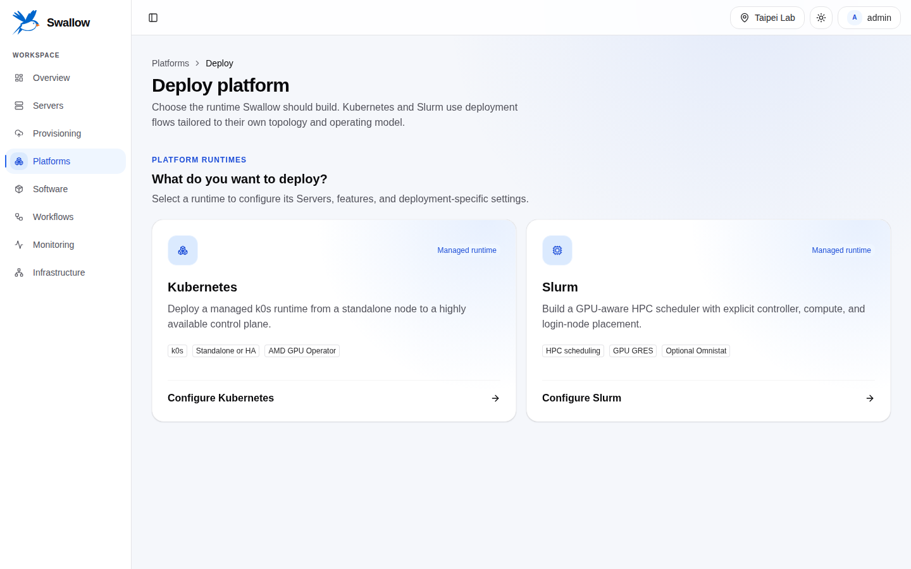

# Introduction

[繁體中文](../zh-TW/introduction.md) · [Documentation home](README.md)

swallow gives datacenter users one identity and automation layer across
provisioning, runtime Platforms, host software, and observability. It is useful
when the same physical Server appears under different names and identifiers in
MAAS, Kubernetes or Slurm, Prometheus, and automation logs.

## The problem

A GPU datacenter usually already has specialized systems:

- MAAS discovers machines and controls power and operating-system provisioning.
- Kubernetes or Slurm owns live runtime membership and workload state.
- Prometheus and Alertmanager own metrics and alerts.
- Ansible performs repeatable changes on hosts.

Replacing those systems would lose mature capabilities. Leaving them unrelated
makes users manually answer questions such as: which MAAS machine is this
Kubernetes node, which alerts belong to it, and which automation last changed
it? swallow solves the correlation and intent problem.

## How swallow is built

swallow's core is generic: it manages intent, identity, and convergence, and it
carries no knowledge of any vendor, product, Platform, or GPU vendor. Two kinds
of parts compose it into out-of-the-box datacenter management:

- **Providers** connect the core to external systems: MAAS for OS
  provisioning, Temporal for durable Workflow execution, Ansible for host
  automation, MongoDB for swallow's own state, Prometheus and Alertmanager for
  metrics and alerts, and Redfish and libvirt for BMCs and hypervisors.
- **Plugins** add what swallow manages: Kubernetes and Slurm Platforms, AMD
  GPUs, and the Managed Software catalog.

What this repository ships is one combination of the core, providers, and
plugins, built for GPU datacenters. Supporting another Platform or GPU vendor
means adding a plugin, not redesigning the core. Contributors find the full
statement in the
[design principles](../development/architecture-spec.md#swallow-的設計主張).

## Ownership model

swallow records what you want, and the systems that own the facts report what
is:

- **Desired state** is what a user asks for, such as a Server's tags and
  Zone and Pool placement, the Zones, Pools, and SSH keys swallow registers
  with the provisioner, a Platform, or the software assigned to a Server.
  swallow owns it and is its only source of truth.
- **Observed state** is what a provider reports: machine and hardware facts from
  MAAS, membership and live state from Kubernetes or Slurm, health from
  Prometheus. Each observation carries its source and time, and swallow never
  treats it as intent.
- When observed state departs from what you set without swallow asking, for
  example a tag removed in the MAAS UI, swallow reports the difference instead
  of silently accepting it. Settings that swallow realizes through the
  provisioner, such as tags and placement, are put back at its next periodic
  check.

swallow owns:

- Sites and the Integrations registered for each Site.
- Stable Server identities and the mapping to provider machines.
- Desired state, policy, and durable automation intent.
- Self-deployed Platform records, credentials, and lifecycle intent.
- Software Assignments and the relationship between resources and Workflows.

swallow deliberately does not own:

- Hardware, power, and provisioning facts that MAAS observes; swallow keeps
  them only as observed state.
- Kubernetes or Slurm live state, including workloads and their scheduling.
- Time-series metrics or Alertmanager alert state.
- A second copy of credentials that an API is allowed to return; stored
  integration and automation credentials are write-only.

See the [desired-state model](../development/desired-state-model.md) and the
binding [system ownership decision](../decisions/069-swallow-owns-desired-state.md)
for the detailed boundary.

## Interfaces

- **Dashboard:** guided user workflows, fleet status, diagnostics, and
  resource management.
- **CLI:** broad user coverage with table, JSON, YAML, and streaming
  output. Managed Software currently uses the Dashboard or HTTP API.
- **HTTP API:** provider-owned contracts for external integrations and custom
  automation.

All three use opaque IDs as resource identity. Hostnames and IP addresses are
observed, mutable attributes and must not be used as keys.

## Main user journeys

1. Create a Site and register its MAAS and monitoring Integrations.
2. Configure Site automation and reconcile MAAS machines into Servers.
3. Inspect inventory, organize Servers with Zones, Pools, and tags, and deploy
   an operating system.
4. Deploy a Kubernetes or Slurm Platform, or install host-level Managed
   Software.
5. Follow the durable Workflow through Jobs, Tasks, events, and logs.
6. Correlate live metrics and alerts back to stable Server and Platform IDs.

## Non-goals and current status

swallow manages only Platforms it deploys itself. It does not register arbitrary
existing Kubernetes or Slurm environments. Teams, user administration, and physical
rack topology are planned design areas and are not active features. GPU monitoring
charts AMD GPU Servers that already run an RDC exporter (swallow does not install the
RDC exporter on hosts) and, on a Slurm Platform, covers the optional Omnistat
([Monitoring](guides/monitoring.md)).

The project is in active development and has no stable SemVer release. The
Compose topology is the complete runnable topology. Native packaging is a
preview until Temporal and PostgreSQL native service packaging is complete.
