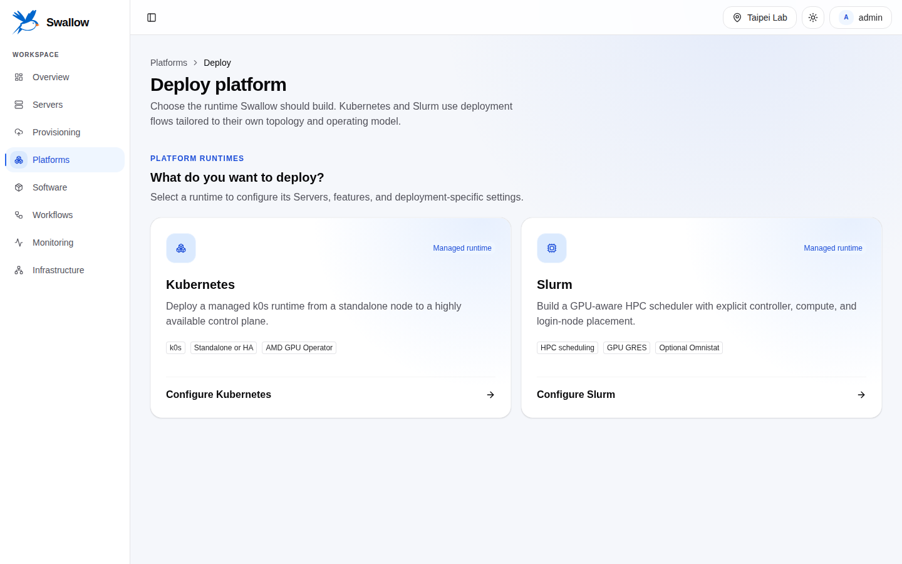

# Platform

[English](../../../docs/en/guides/platforms.md) · [文件首頁](../README.md)

Platform 是由 swallow 佈署的 Kubernetes 或 Slurm runtime。swallow 不會註冊任意
既有 runtime，也不會把自己稱為 Platform。

## 佈署前

- Target Servers 屬於同一個 Site，且為 `ready` 或 `deployed`；`ready` 的 Server 會先佈署 OS（OS 準備步驟）。
- Server lock 與 active conflicting Workflow 已清除。
- Site automation、SSH known hosts、credentials、worker 與 Ansible executor ready。
- 選擇的 topology 符合 minimum resource requirement。
- 選擇的 Slurm topology 所需 shared state／workload storage 已可用。

送出 request 時 wizard 會重新驗證 current eligibility。

開啟 **Deploy platform** 後，先從 runtime catalog 選擇 Kubernetes 或 Slurm，再進入各自的
deployment workspace。兩者只共用 Server discovery 與 OS provisioning controls；steps、
validation、features 與 review 仍依 Platform 類型設計。Optional capability 使用 Switch，
topology 與 implementation mode 使用明確的 radio choice，Slurm node roles 則可各自複選。

送出 wizard 會建立 Platform，並把安裝記成由你核准的 [Change Plan](workflows.md#change-plans)，
所以安裝會立即開始，wizard 會開啟新的 Platform。[安全開關](workflows.md#change-plans)打開時，安裝改在
**Change Plans** 等待，wizard 會開啟該頁並說明原因。安裝開始前 Platform 顯示 **Planned**；刪除這個狀態的
Platform 會撤回 plan，不會動到任何主機。

## 時鐘檢查

platform 的安裝 step（**Install k0s Platform** 或 **Install Slurm Platform**）在安裝任何東西前，會先
檢查每個節點的時鐘。它不更改任何設定；
時間在 OS 佈署時就設定好了（見[時間同步](os-provisioning.md#時間同步)）。節點的時鐘未同步、
swallow 主機的 NTP 服務沒有回應它，或與該服務相差超過一秒時，就不通過檢查。

Features 步驟的 **Require synchronized clocks** Switch 預設開啟。此時只要有節點未通過檢查，所有節點的
安裝 step 都會停止，step 的輸出會列出這些節點。Slurm 需要這個檢查：時鐘不一致的節點之間，MUNGE 會拒絕 credential。
關閉 Switch 則只回報這些節點，佈署繼續進行。

## Kubernetes

選擇 supported topology，指派 control-plane 與 worker role。Workspace 預設為
**Multi-node (non-HA)**；**High availability** 需要至少三個且為奇數的 control plane，以及一個未使用的
API virtual IP。Standalone deployment 仍是一個 Kubernetes Platform。Provider／image combination 支援時，deployment
也可要求 ephemeral OS target。

佈署完成後，Platform detail 會提供 live Kubernetes explorer：

- Namespace 與 application。
- Pod、log 與 related resource。
- YAML apply。
- Node cordon state。

開啟 Kubernetes Platform 後，使用 **Applications**、**Namespaces** 與
**Cluster** 分頁：

- **Applications** 會列出 Deployment、DaemonSet、StatefulSet 與 bare Pod。可依
  namespace 篩選；Deployment 與 StatefulSet 可 scale；Deployment、DaemonSet 與
  StatefulSet 可 restart；也可讀取第一個 Pod 的 bounded log snapshot，或刪除
  workload。**Apply YAML** 可先執行 server-side dry run，再套用一個或多個 object。
- **Namespaces** 可建立與刪除 namespace；system namespace 會標示出來且不能刪除。
- **Cluster** 顯示 version、readiness、schedulable GPU resource，以及每個 node
  對應的 Server。**Cordon** 會阻止新工作排入 node；**Uncordon** 讓它恢復可排程。
  兩者都不會 drain 既有 Pod。

這些 view 會 live query Kubernetes API，不會在 swallow 建立 in-cluster state
的 durable copy。Cluster 頁籤也會顯示每個節點提供的 AMD GPU。

### 叢集 credential

Kubernetes Platform 的部署會為叢集記下兩個 credential，swallow 都不會顯示。Membership sync
與這些 view 的所有讀取都使用唯讀 token，它無法讀取 Secret。你在這裡做的變更（cordon、namespace
與 workload 的變更、刪除 Pod，以及 **Apply YAML**，含 dry run）與 Secret 清單，則使用另一個
cluster-admin token，而且只在 admin 要求時使用。

在 swallow 分開這兩者之前最後一次部署的 Platform，讀寫仍共用一個 cluster-admin token；它的
Overview 會在 **Cluster access** 說明：*Cluster credentials are not separated yet*。Explorer 照常運作。
該 Platform 下一次成功的部署 Workflow 會把那個 token 收窄為唯讀，並記下另一個 cluster-admin token。
若部署在收窄 token 之後失敗，變更會被拒絕，直到部署成功；讀取不受影響。

### AMD GPU Operator

Kubernetes workspace 的 **Features** 步驟可以在佈署 Platform 時一併安裝 AMD GPU Operator。
選取的 workload 節點有 AMD GPU 時，**AMD GPU Operator** 預設開啟，並開啟 **Device Metrics Exporter**
作為 Platform 的 GPU 監控；關掉它就不安裝。一旦調整過這個 Switch 或任何選項，之後再更換選取的 Server
也會保留你的選擇；在那之前它跟著選取的 Server 走，沒有 workload 節點有 AMD GPU 時就關閉。開啟時會展開選項：

- **Allocation mode**：**Device Plugin**（Pod 以 `amd.com/gpu` 請求 GPU）或 **DRA**
  （Pod 透過 ResourceClaim 取得 GPU，需要 Kubernetes 1.34 以上）。
- **GPU Operator version**，選 DRA 時另有 **DRA driver version**，都來自 swallow 驗證過的版本。
- Device Plugin 的 **Resource naming**、**Node Labeller**（開啟）與 **Device Metrics Exporter**（開啟）。

**Review** 步驟會列出 operator 的版本與 allocation mode、resource naming（或 DRA driver）、Node Labeller
是否開啟，以及它的 **GPU monitoring**。

不需要挑選節點。operator 附帶的 Node Feature Discovery 會找出所有有支援 AMD GPU 的節點（實體 GPU 或
SR-IOV VF），operator 全部納管；之後加入叢集的節點，會在下一次調整 operator 時納入。

operator 使用 OS image 內建的 GPU driver，請選擇含 `amdgpu` driver 的 image。若 image 開機時不載入
`amdgpu`（部分 Instinct 與 SR-IOV image 會刻意 blacklist），swallow 會在每個納管節點載入它，並在每次重開機、
SSH 起來之後再載入一次，Kubernetes 會等它載入後才啟動。所有納管節點都提供
GPU 之後，佈署才算成功。選取的 workload 節點都沒有 AMD GPU 時，Switch 會停用並顯示
文字原因。

佈署完成後，Platform Overview 的 **AMD GPU Operator** 區塊會顯示狀態與設定，並提供
**Install**、**Configure** 與 **Uninstall**。**Install** 從與 workspace 相同的選項開始，Device Metrics Exporter
開啟；**Configure** 從 operator 目前的設定開始。安裝會直接開始；調整或卸載運作中的 operator 會讓
GPU workload 重啟，所以是一份 Change Plan：確認對話框就核准它、變更立即開始，除非安全開關讓它在
**Change Plans** 等待。仍有 Pod 使用 AMD GPU 時，切換 Device Plugin
與 DRA 或卸載都會被拒絕，請先停止那些工作。卸載 operator 不會影響 Platform 本身。swallow 不會
接管手動安裝的 operator。

開啟 **Device Metrics Exporter** 時，operator 在每個 GPU 節點的 host network 上以 port 5001 執行 AMD 的 exporter，
port 與指標名稱都和 swallow 管理的其他 Device Metrics Exporter 相同。Site 的 Prometheus 收集它，Platform Grafana 也會
加上它的 GPU dashboards。已經裝了 AMD standalone exporter 套件的 GPU 節點會被拒絕，因為兩者都需要這個 port。

### Platform Grafana

Kubernetes workspace 的 **Features** step 也有 **Platform Grafana** 開關，預設開啟，CPU-only 的 Platform 也一樣：
叢集內的唯讀 Grafana，以每個 workload 節點的 port 30300 開放（見[監控](monitoring.md#platform-自己的-grafana)）。

## Slurm

Slurm workspace 可獨立指派 controller、compute 與 login roles，並依 topology 與 feature
決定 state-server 與 workload storage responsibility。Features step 分別以 Switch 啟用
shared workload storage、container runtime、作業監控（預設 Omnistat，也可選 AMD Device Metrics Exporter 或不安裝）
與 Platform Grafana（預設開啟，見[監控](monitoring.md#platform-自己的-grafana)）；符合條件的 compute node 會自動
包含 AMD GPU GRES，不提供沒有實際語意的開關。

GPU node 加入前，swallow 會在節點上透過 HIP runtime 在每張 GPU 上配置並釋放記憶體來證明 GPU 可用。安裝 Slurm
之後，部署會執行 `slurm-acceptance` [Validation Suite](validation.md) 作為閘門（**Validate Slurm** Job）：每台節點
都能執行 step、job 能共用節點、開啟時的 container 與 MPI，以及每台 GPU node 透過 Slurm 執行 HIP probe。失敗的 GPU
node 會被 drain，沒有通過的 check 會讓部署帶著原因停下；修正後重試這個 Job。GRES type 預設是 GPU 架構（例如
`gfx942`）。在 **Advanced settings** 可以指定既有 job script 使用的 GRES type（例如 `mi308x_vf`），以及
amdgpu driver module option。swallow 已會套用節點 GPU topology 需要的選項（例如在 ROCm 結束時會 crash 的
情況下加上 `pcie_p2p=0`），所以大多數部署可以留空。這些選項要等 driver 載入後才看得出來，swallow 會原地重新載入
driver、不重開機，所以 RAM（ephemeral）部署也適用；自己指定的選項在第一次載入就生效。option 名稱打錯時，部署會
立刻失敗並提示最接近的正確名稱。

從 **Platforms → Settings** 設定 system-wide Slurm deployment requirement。
啟用 policy 後，設定每個選取的 Slurm node 必須提供的最低 **CPU cores**、
**Memory GiB** 與 **Storage GB**。啟用時三個值都必填；停用則移除這個 floor。
Deploy wizard 會說明無法選擇某個 Server 的原因，並在送出時重新檢查 policy。

Requirement 是 hardware eligibility floor，不會保留 resource、不表示 Slurm
scheduler capacity，也不保證 OS image 能放進 ephemeral root filesystem。

Platform detail 透過 Platform API 讀取 live Slurm state，並把 node 關聯回 Server ID。

已部署且有 Omnistat 的 Slurm Platform，**Monitoring** 分頁在 **Omnistat** 底下列出 Omnistat 的 GPU hardware counters，
旁邊的開關不經 Change Plan 開啟或關閉它們；swallow 在每台 compute node 重新設定 Omnistat，Platform 維持 active（見
[Slurm 的 GPU 與作業監控](monitoring.md#slurm-的-gpu-與作業監控)）。

## Platform runtime workspace

開啟 `/platforms/<id>` 會保留目前 Site，並重新導向 Platform 的 **Overview**。header 下方的每個分頁
（名稱旁附圖示，與 Server 詳細頁相同）都有自己的 URL，因此 refresh、瀏覽器歷史與分享 URL 都會保留
目前分頁；方向鍵可在分頁之間移動。

- **Overview** 採 summary-first：顯示 lifecycle、topology、member matching、已套用 generation、
  sync freshness、runtime access，以及 Platform module 提供的 capabilities；不再重複完整的 OS、
  network、driver 或 node 設定。
- **Configuration** 顯示已套用的 specification、desired generation 與 drift、Conditions、member
  roles、OS preparation、Integration、module settings 與 accelerator contributions。除了已有支援
  Workflow 的 module action（例如 AMD GPU Operator 管理）之外，這一頁是唯讀的。
- **Monitoring** 連到 Swallow usage charts、Platform Grafana、其他 Monitoring Links，以及 Omnistat
  或 GPU 監控元件記錄的狀態與 Workflow；不在頁面內嵌 dashboard。
- **Activity** 依新到舊列出此 Platform 的 Workflows。頁碼屬於 URL；每頁可選 5、10、15 或 20 筆。
- Kubernetes 增加 **Applications**、**Namespaces** 與 **Cluster**；Slurm 增加 **Nodes**
  （login access、controllers 與 compute nodes）及 **Partitions**。

lifecycle 正在變更或失敗時，主要入口是 **View workflow** 或 **Review workflow**；等待核准的
Change Plan 連到 **Change Plans**。Active 且有自己 Grafana 的 Platform 提供
**Grafana**；**Sync**、**Uninstall** 與 record deletion 仍保留，但不把 Overview
做成 action wall。
## Lifecycle

- **Sync** refresh observed Platform membership／state。

- **Uninstall** 透過 Change Plan 從原始 target 移除 swallow-deployed runtime，確認對話框就核准它：
  uninstall 立即開始，Platform 頁面顯示它正在執行（安全開關打開時改在 **Change Plans** 等待，Platform
  頁面也會說明並附上連結）。uninstall 成功後 swallow 刪除 Platform record；uninstall 失敗時保留 record
  供診斷。若仍有 workflow 佔著 Platform 的 Server（停在等待處理的失敗部署，或仍在進行的部署），對話框會
  列出它，並請你確認在 uninstall 開始前由 swallow 取消它。部署進行中或失敗的 Platform 也會 uninstall，
  因為部署可能已經改過它的 Server；只有安裝從未開始的 Platform 會直接刪除。
- uninstall 的 Change Plan 被拒絕或過期，或 uninstall 失敗時，再按一次 **Uninstall**：會以這次選擇的選項
  重新提出 uninstall。uninstall 還在等核准時改選其他選項，會取代等待中的 plan。
- **Delete only** 只移除 swallow record／projection，不等於 host-side uninstall。
- Bulk action 仍受每個 Platform 的 lifecycle gate 限制。

每次核准的安裝或 uninstall 都會建立 Workflow。失敗時請檢視 Task，在支援的最小
層級 retry，不要直接重建 Platform。

精確 payload 與 lifecycle state 請見 active
[Platforms contract](../../../api-server/docs/development/api-contracts/api-server/platforms.md)
與
[Kubernetes explorer contract](../../../api-server/docs/development/api-contracts/api-server/platforms-kubernetes.md)。
