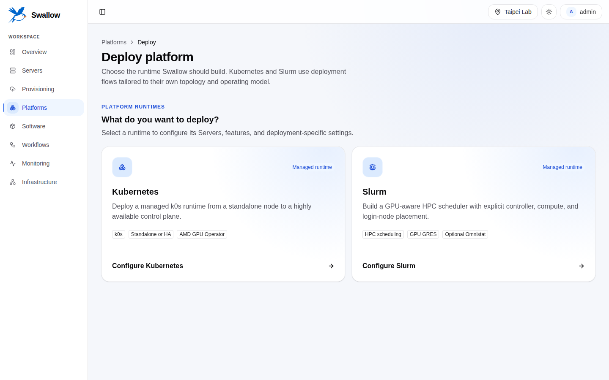

# 專案介紹

[English](../en/introduction.md) · [文件首頁](README.md)

swallow 在 provisioning、runtime Platform、host software 與 observability
之間提供統一的 identity 與 automation layer。當同一台實體 Server 在 MAAS、
Kubernetes／Slurm、Prometheus 與 automation logs 中有不同名稱或識別碼時，
swallow 可以把它們穩定地關聯起來。

## 要解決的問題

GPU 資料中心通常已經有專門系統：

- MAAS 探索 machine，並控制 power 與 OS provisioning。
- Kubernetes 或 Slurm 擁有即時 runtime membership 與 workload state。
- Prometheus 與 Alertmanager 擁有 metrics 與 alerts。
- Ansible 對 host 執行可重複的變更。

取代這些系統會失去成熟能力；完全分離則會迫使 user 手動回答「這個
Kubernetes node 是哪台 MAAS machine、哪些 alerts 屬於它、最近是哪個 automation
改動它」。swallow 解決的是 correlation 與 intent 問題。

## swallow 的組成

swallow 的 core 是通用的：它管理 intent、identity 與收斂，不含任何廠商、產品、
Platform 或 GPU 廠商的知識。兩種組件把它組合成開箱即用的 datacenter 管理：

- **Provider** 把 core 連到外部系統：MAAS 負責 OS provisioning、Temporal 負責
  durable Workflow 執行、Ansible 負責 host automation、MongoDB 保存 swallow
  自己的 state、Prometheus 與 Alertmanager 負責 metrics 與 alerts、Redfish 與
  libvirt 負責 BMC 與 hypervisor。
- **Plugin** 加入 swallow 能管理的東西：Kubernetes 與 Slurm Platform、AMD GPU，
  以及 Managed Software catalog。

本 repository 交付的是 core、provider 與 plugin 的一種組合，為 GPU 資料中心而建。
要支援其他 Platform 或 GPU 廠商，是新增一個 plugin，而不是重新設計 core。
給貢獻者的完整陳述見
[設計主張](../development/architecture-spec.md#swallow-的設計主張)。

## Ownership model

swallow 記錄你要的狀態，由擁有事實的系統回報實際狀態：

- **Desired state** 是 user 要求的樣子，例如 Server 的 tag 與 Zone／Pool
  placement、swallow 登錄到 provisioner 的 Zone 與 SSH key、決定誰使用哪些 Server 的 Pool、一個
  Platform，或指派到 Server 的 software。swallow 擁有它，是它唯一的真相來源。
- **Observed state** 是 provider 回報的樣子：MAAS 的 machine 與 hardware facts、
  Kubernetes／Slurm 的 membership 與 live state、Prometheus 的 health。每筆
  observation 都帶來源與時間，swallow 不會把它當成 intent。
- Observed state 在 swallow 沒有要求的情況下偏離你的設定時（例如有人在 MAAS UI
  移除 tag），swallow 會回報差異，而不是默默接受。由 swallow 經 provisioner
  實現的設定（例如 tag 與 placement）會在下一次定期檢查時改回。

swallow 擁有：

- Site，以及每個 Site 註冊的 Integration。
- 穩定的 Server identity 與 provider machine mapping。
- Desired state、policy 與 durable automation intent。
- 自行佈署的 Platform record、credential 與 lifecycle intent。
- Software Assignment，以及 resource 和 Workflow 間的關聯。

swallow 刻意不擁有：

- MAAS 觀察到的 hardware、power 與 provisioning facts；swallow 只把它們保存為
  observed state。
- Kubernetes／Slurm live state，包含 workload 與其排程。
- Time-series metrics 或 Alertmanager alert state。
- API 可讀回的第二份 credential；integration 與 automation credentials 都是 write-only。

完整邊界請見 [desired-state model](../development/desired-state-model.md) 與具約束力的
[system ownership decision](../decisions/069-swallow-owns-desired-state.md)。

## 操作介面

- **Dashboard：** 引導式操作流程、fleet status、診斷與 resource management。
- **CLI：** 以 table、JSON、YAML 與 streaming output 提供廣泛的 user
  能力；Managed Software 目前使用 Dashboard 或 HTTP API。
- **HTTP API：** 給 external integration 與自訂 automation 使用的 provider-owned contracts。

三種介面都以 opaque ID 作為 resource identity。Hostname 與 IP address 是可變的
observed attributes，不能當作 key。

## 主要 user journeys

1. 建立 Site，註冊 MAAS 與 monitoring Integration。
2. 設定 Site automation，將 MAAS machines reconcile 成 Servers。
3. 檢視 inventory，以 Zone、Pool、tag 組織 Server，並佈署 OS。
4. 佈署 Kubernetes／Slurm Platform，或安裝 host-level Managed Software。
5. 從 Job、Task、event 與 log 追蹤 durable Workflow。
6. 將 live metrics 與 alerts 關聯回穩定的 Server／Platform ID。

## 非目標與目前狀態

swallow 只管理自己佈署的 Platform，不註冊任意既有 Kubernetes／Slurm 環境。
Teams、user administration 與實體 rack topology 仍是 planned design area，不是 active
feature。GPU 監控會為已經執行 RDC exporter 的 AMD GPU Server 繪製圖表（swallow 不在主機上
安裝 RDC exporter），並涵蓋 Slurm Platform 上選用的 Omnistat（[Monitoring](guides/monitoring.md)）。

專案正在積極開發，尚無穩定 SemVer release。Compose topology 是功能完整的執行
topology；在 Temporal 與 PostgreSQL native service packaging 完成前，native
packaging 仍是 preview。
